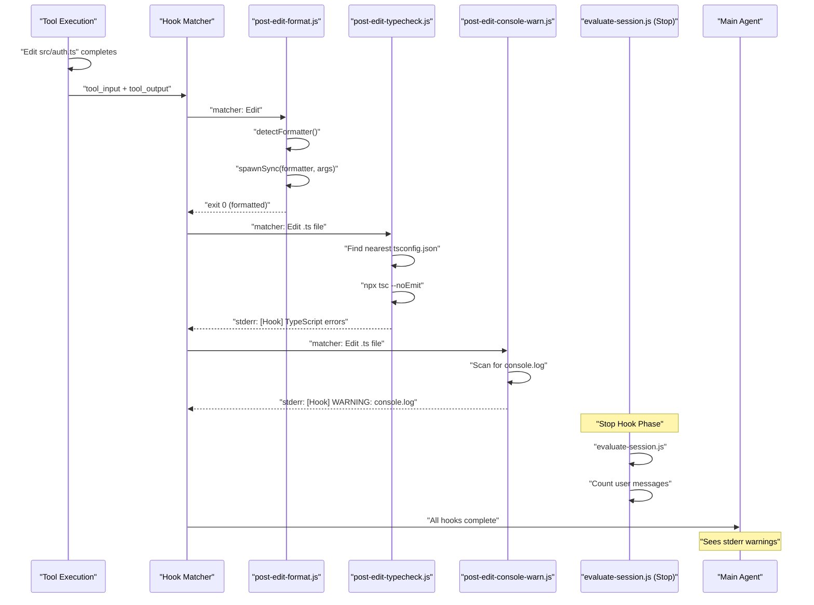
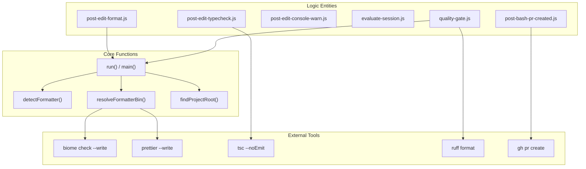

<!-- source: DeepWiki mcp.deepwiki.com · repo affaan-m/everything-claude-code · page 6.3 PostToolUse Hooks · fetched 2026-10-26 -->

# PostToolUse Hooks

<details>
<summary>Relevant source files</summary>

The following files were used as context for generating this wiki page:

- [.claude/package-manager.json](.claude/package-manager.json)
- [.opencode/commands/harness-audit.md](.opencode/commands/harness-audit.md)
- [agents/performance-optimizer.md](agents/performance-optimizer.md)
- [commands/harness-audit.md](commands/harness-audit.md)
- [commands/loop-start.md](commands/loop-start.md)
- [commands/model-route.md](commands/model-route.md)
- [commands/quality-gate.md](commands/quality-gate.md)
- [commands/setup-pm.md](commands/setup-pm.md)
- [hooks/README.md](hooks/README.md)
- [hooks/hooks.json](hooks/hooks.json)
- [scripts/harness-audit.js](scripts/harness-audit.js)
- [scripts/hooks/auto-tmux-dev.js](scripts/hooks/auto-tmux-dev.js)
- [scripts/hooks/bash-hook-dispatcher.js](scripts/hooks/bash-hook-dispatcher.js)
- [scripts/hooks/check-console-log.js](scripts/hooks/check-console-log.js)
- [scripts/hooks/desktop-notify.js](scripts/hooks/desktop-notify.js)
- [scripts/hooks/evaluate-session.js](scripts/hooks/evaluate-session.js)
- [scripts/hooks/gateguard-fact-force.js](scripts/hooks/gateguard-fact-force.js)
- [scripts/hooks/post-bash-build-complete.js](scripts/hooks/post-bash-build-complete.js)
- [scripts/hooks/post-bash-command-log.js](scripts/hooks/post-bash-command-log.js)
- [scripts/hooks/post-bash-dispatcher.js](scripts/hooks/post-bash-dispatcher.js)
- [scripts/hooks/post-bash-pr-created.js](scripts/hooks/post-bash-pr-created.js)
- [scripts/hooks/post-edit-console-warn.js](scripts/hooks/post-edit-console-warn.js)
- [scripts/hooks/post-edit-format.js](scripts/hooks/post-edit-format.js)
- [scripts/hooks/post-edit-typecheck.js](scripts/hooks/post-edit-typecheck.js)
- [scripts/hooks/pre-bash-commit-quality.js](scripts/hooks/pre-bash-commit-quality.js)
- [scripts/hooks/pre-bash-dispatcher.js](scripts/hooks/pre-bash-dispatcher.js)
- [scripts/hooks/pre-bash-git-push-reminder.js](scripts/hooks/pre-bash-git-push-reminder.js)
- [scripts/hooks/pre-bash-tmux-reminder.js](scripts/hooks/pre-bash-tmux-reminder.js)
- [scripts/hooks/pre-compact.js](scripts/hooks/pre-compact.js)
- [skills/gateguard/SKILL.md](skills/gateguard/SKILL.md)
- [skills/git-workflow/SKILL.md](skills/git-workflow/SKILL.md)
- [tests/hooks/gateguard-fact-force.test.js](tests/hooks/gateguard-fact-force.test.js)
- [tests/hooks/pre-bash-commit-quality.test.js](tests/hooks/pre-bash-commit-quality.test.js)
- [tests/scripts/harness-audit.test.js](tests/scripts/harness-audit.test.js)

</details>


This page documents all PostToolUse hooks in the ECC system, which run **after** tool execution completes to enforce code quality, capture observations, and provide informational feedback. PostToolUse hooks are advisory only and cannot block operations.

For hooks that run **before** tools execute, see [PreToolUse Hooks](). For session lifecycle hooks, see [Session & Context Hooks](). For the complete hook execution model, see [Hook Lifecycle & Event Flow]().

---

## Purpose and Characteristics

PostToolUse hooks fire immediately after a tool (Edit, Write, Read, Bash) completes execution. They receive both the tool's input parameters and output results, enabling:

- **Quality enforcement**: Auto-formatting, type checking, linting.
- **Warning generation**: Console.log detection, style violations.
- **Observation capture**: Continuous learning data collection.
- **Informational logging**: PR URLs, build status, command suggestions.

**Key Properties:**

| Property | Value | Rationale |
|----------|-------|-----------|
| **Exit code** | Always 0 | Cannot block completed operations. [scripts/hooks/post-edit-format.js:105-105]() |
| **Execution order** | Sequential by matcher priority | Predictable warning/fix order. |
| **Async support** | Yes | Long-running analysis without blocking. [hooks/hooks.json:44-44]() |
| **Stdin format** | JSON with `tool_input` + `tool_output` | Complete context for analysis. [scripts/hooks/post-edit-format.js:39-40]() |
| **Stderr output** | Warnings/info for user | Main agent can see but doesn't halt. [scripts/hooks/post-edit-typecheck.js:82-86]() |

Sources: [scripts/hooks/post-edit-format.js:104-106](), [scripts/hooks/post-edit-typecheck.js:94-96](), [scripts/hooks/post-edit-console-warn.js:52-54](), [hooks/hooks.json:44-45]()

---

## Hook Execution Flow



**Flow Characteristics:**

1. **Sequential execution**: Hooks run in order for matching matcher.
2. **Accumulated stderr**: All warnings collected and shown to agent. [scripts/hooks/post-edit-typecheck.js:82-86]()
3. **Auto-fix then warn**: Format hook fixes issues, typecheck warns about remaining issues. [scripts/hooks/post-edit-format.js:52-54]()
4. **Non-blocking**: Agent receives response immediately after sync hooks complete. [scripts/hooks/post-edit-format.js:79-81]()

Sources: [scripts/hooks/post-edit-format.js:37-88](), [scripts/hooks/post-edit-typecheck.js:27-96](), [scripts/hooks/post-edit-console-warn.js:25-54]()

---

## Stdin JSON Protocol

PostToolUse hooks receive JSON on stdin with both input and output. 

```json
{
  "tool_name": "Edit",
  "tool_input": {
    "file_path": "src/auth.ts",
    "instructions": "Add validation"
  },
  "tool_output": {
    "output": "Successfully edited src/auth.ts",
    "status": "success"
  }
}
```

**Input parsing pattern** (all hooks follow this):

```javascript
let data = '';
process.stdin.on('data', chunk => {
  if (data.length < MAX_STDIN) {
    data += chunk.substring(0, MAX_STDIN - data.length);
  }
});

process.stdin.on('end', () => {
  try {
    const input = JSON.parse(data);
    // ... logic ...
  } catch { /* pass through */ }
  process.stdout.write(data);
  process.exit(0);
});
```

Sources: [scripts/hooks/post-edit-format.js:91-107](), [scripts/hooks/post-edit-typecheck.js:16-27](), [scripts/hooks/post-edit-console-warn.js:14-25]()

---

## PostToolUse Hook Registry

### Code Entity Mapping



Sources: [scripts/hooks/post-edit-format.js:37-55](), [scripts/hooks/post-edit-typecheck.js:54-55](), [scripts/hooks/quality-gate.js:135-149](), [scripts/lib/resolve-formatter.js:58-116](), [hooks/README.md:50-50]()

---

## Hook 1: post-edit-format.js

**Purpose:** Auto-format JavaScript/TypeScript files after Edit tool use using project's configured formatter (Biome or Prettier). [scripts/hooks/post-edit-format.js:3-9]()

### Detection Logic

The hook uses `detectFormatter` to check for `biome.json` or Prettier configs. Biome takes priority. It then resolves the binary via `resolveFormatterBin`, preferring local `node_modules/.bin` to avoid `npx` overhead. [scripts/hooks/post-edit-format.js:46-54]()

| Formatter | Primary Command | Target Extensions |
|-----------|-----------------|-------------------|
| **Biome** | `check --write` | `.ts`, `.tsx`, `.js`, `.jsx` [scripts/hooks/post-edit-format.js:52-54]() |
| **Prettier**| `--write`      | `.ts`, `.tsx`, `.js`, `.jsx` [scripts/hooks/post-edit-format.js:54-54]() |

Sources: [scripts/hooks/post-edit-format.js:52-54](), [scripts/hooks/post-edit-format.js:56-67](), [scripts/lib/resolve-formatter.js:77-116]()

---

## Hook 2: post-edit-typecheck.js

**Purpose:** Run TypeScript type checking after editing `.ts`/`.tsx` files, reporting only errors in the edited file. [scripts/hooks/post-edit-typecheck.js:3-9]()

### Type Checking Flow

1. **Resolve Path**: Converts relative `file_path` to absolute. [scripts/hooks/post-edit-typecheck.js:33-33]()
2. **Find Config**: Walks up directories to find `tsconfig.json` (max 20 levels). [scripts/hooks/post-edit-typecheck.js:39-49]()
3. **Execute**: Runs `tsc --noEmit --pretty false` using `npx.cmd` on Windows or `npx` on Unix. [scripts/hooks/post-edit-typecheck.js:54-55]()
4. **Filter**: Captures output and filters lines containing the `filePath`, `resolvedPath`, or `relPath`. [scripts/hooks/post-edit-typecheck.js:63-79]()

Sources: [scripts/hooks/post-edit-typecheck.js:33-49](), [scripts/hooks/post-edit-typecheck.js:54-79]()

---

## Hook 3: post-edit-console-warn.js

**Purpose:** Warn about `console.log` statements in edited files to help remove debug statements before committing. [scripts/hooks/post-edit-console-warn.js:3-9]()

### Implementation

It reads the file content after the tool edit and scans for the `console.log` regex. If found, it prints the first 5 matches to `stderr`. [scripts/hooks/post-edit-console-warn.js:31-46]()

```javascript
lines.forEach((line, idx) => {
  if (/console\.log/.test(line)) {
    matches.push((idx + 1) + ': ' + line.trim());
  }
});
```

Sources: [scripts/hooks/post-edit-console-warn.js:31-40]()

---

## Hook 4: evaluate-session.js (Stop Hook)

**Purpose:** Evaluates Claude Code sessions for extractable patterns and reusable skills at the end of a session. [scripts/hooks/evaluate-session.js:3-7]()

### Logic and Thresholds

- **Trigger**: Runs on the `Stop` hook event. [scripts/hooks/evaluate-session.js:11-11]()
- **Threshold**: Only evaluates sessions with a minimum number of user messages (default 10, configurable in `config.json`). [scripts/hooks/evaluate-session.js:60-68]()
- **Data Source**: Reads the `transcript_path` provided via stdin JSON. [scripts/hooks/evaluate-session.js:48-49]()

Sources: [scripts/hooks/evaluate-session.js:44-93]()

---

## Hook 5: quality-gate.js

**Purpose:** Runs lightweight quality checks after file edits, supporting Biome, Prettier, Go, and Python. [scripts/hooks/quality-gate.js:3-13]()

### Language Support

- **JS/TS**: Skipped if Biome is used (handled by `post-edit-format.js`), otherwise runs Prettier. [scripts/hooks/quality-gate.js:73-100]()
- **JSON/MD**: Runs Biome or Prettier. [scripts/hooks/quality-gate.js:79-100]()
- **Go**: Runs `gofmt -w` (if `ECC_QUALITY_GATE_FIX=true`) or `gofmt -l`. [scripts/hooks/quality-gate.js:106-121]()
- **Python**: Runs `ruff format` or `ruff format --check`. [scripts/hooks/quality-gate.js:123-131]()

Sources: [scripts/hooks/quality-gate.js:69-132]()

---

## Hook 6: post-bash-pr-created.js

**Purpose:** Logs PR URL and review command after a successful `gh pr create` execution. [hooks/README.md:50-50]()

### Implementation Pattern

This hook matches the `Bash` tool and triggers when the command matches the GitHub CLI PR creation pattern. It extracts the PR URL from the `tool_output` and provides a convenient review command for the developer.

Sources: [hooks/README.md:50-50](), [hooks/hooks.json:422-430]()

---

## Common Implementation Patterns

### Cross-Platform Command Execution

Hooks use `spawnSync` or `execFileSync` with platform-specific binary shims (e.g., `npx.cmd` on Windows) and safe environment handling. [scripts/hooks/post-edit-typecheck.js:54-54]()

```javascript
const npxBin = process.platform === "win32" ? "npx.cmd" : "npx";
execFileSync(npxBin, ["tsc", "--noEmit", "--pretty", "false"], {
  cwd: dir,
  timeout: 30000,
});
```

Sources: [scripts/hooks/post-edit-typecheck.js:54-60](), [scripts/hooks/post-edit-format.js:56-67]()

### Error Handling Guidelines

All PostToolUse hooks follow the "Fail Silently" principle to ensure the main agent's workflow is never blocked by a hook failure. [scripts/hooks/post-edit-format.js:17-17]()

1. **Try-Catch Blocks**: Wrap logic to prevent crashes on malformed JSON or missing files. [scripts/hooks/post-edit-format.js:38-38]()
2. **Exit Code 0**: Always exit with 0, even if errors occur, to avoid blocking Claude Code. [scripts/hooks/post-edit-format.js:105-105]()
3. **Stdout Passthrough**: Always write the original stdin data back to stdout to maintain the tool result chain. [scripts/hooks/post-edit-format.js:104-104]()

Sources: [scripts/hooks/post-edit-format.js:83-87](), [scripts/hooks/post-edit-typecheck.js:90-96](), [scripts/hooks/post-edit-console-warn.js:48-54]()

---

