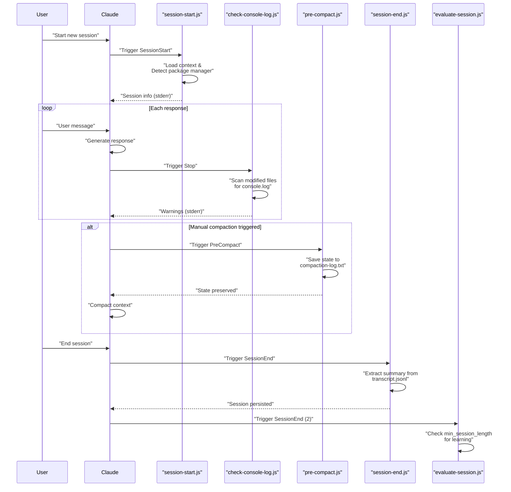
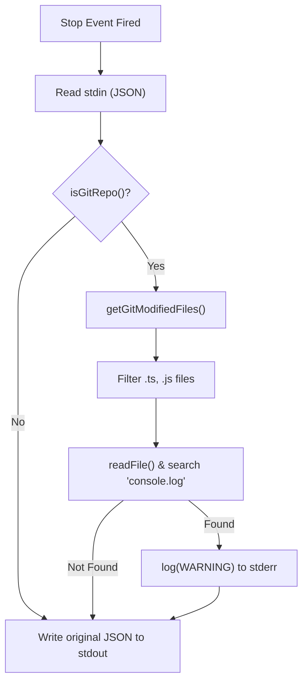
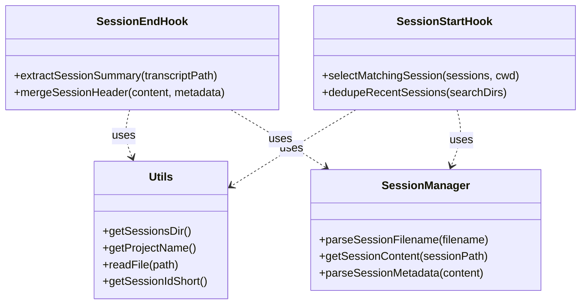

<!-- source: DeepWiki mcp.deepwiki.com · repo affaan-m/everything-claude-code · page 6.4 Session & Context Hooks · fetched 2026-10-26 -->

# Session & Context Hooks

Relevant source files

The following files were used as context for generating this wiki page:

- [.claude/package-manager.json](.claude/package-manager.json)
- [commands/setup-pm.md](commands/setup-pm.md)
- [scripts/hooks/check-console-log.js](scripts/hooks/check-console-log.js)
- [scripts/hooks/evaluate-session.js](scripts/hooks/evaluate-session.js)
- [scripts/hooks/post-edit-console-warn.js](scripts/hooks/post-edit-console-warn.js)
- [scripts/hooks/post-edit-format.js](scripts/hooks/post-edit-format.js)
- [scripts/hooks/post-edit-typecheck.js](scripts/hooks/post-edit-typecheck.js)
- [scripts/hooks/pre-compact.js](scripts/hooks/pre-compact.js)
- [scripts/hooks/session-end.js](scripts/hooks/session-end.js)
- [scripts/hooks/session-start.js](scripts/hooks/session-start.js)
- [scripts/hooks/suggest-compact.js](scripts/hooks/suggest-compact.js)
- [scripts/lib/package-manager.js](scripts/lib/package-manager.js)
- [scripts/lib/session-aliases.js](scripts/lib/session-aliases.js)
- [scripts/lib/session-manager.js](scripts/lib/session-manager.js)
- [scripts/lib/utils.js](scripts/lib/utils.js)
- [tests/ci/validators.test.js](tests/ci/validators.test.js)
- [tests/hooks/hooks.test.js](tests/hooks/hooks.test.js)
- [tests/integration/hooks.test.js](tests/integration/hooks.test.js)
- [tests/lib/package-manager.test.js](tests/lib/package-manager.test.js)
- [tests/lib/session-aliases.test.js](tests/lib/session-aliases.test.js)
- [tests/lib/session-manager.test.js](tests/lib/session-manager.test.js)
- [tests/lib/utils.test.js](tests/lib/utils.test.js)

This page documents Session & Context Hooks, which manage the lifecycle of Claude Code sessions and preserve context during compaction. These hooks handle session initialization, cleanup, state persistence, and context window management. Session & Context Hooks fire at distinct lifecycle events: `SessionStart` (at session beginning), `Stop` (after each response), `SessionEnd` (at session termination), and `PreCompact` (before context compaction).

For hooks that fire during tool execution, see [6.2 PreToolUse Hooks]() and [6.3 PostToolUse Hooks](). For the complete hook lifecycle, see [6.1 Hook Lifecycle & Event Flow]().

## Overview

Session & Context Hooks enable four critical capabilities:

| Hook Type | Trigger Point | Primary Purpose | Blocking Behavior |
|-----------|--------------|-----------------|-------------------|
| `SessionStart` | Session initialization | Load context, detect environment | Non-blocking |
| `Stop` | After each assistant response | Post-response validation | Non-blocking |
| `SessionEnd` | Session termination | Persist state, evaluate patterns | Non-blocking |
| `PreCompact` | Before context compaction | Save critical state | Non-blocking |

Sources: [scripts/hooks/session-end.js:1-10](), [scripts/hooks/session-start.js:1-10](), [scripts/hooks/evaluate-session.js:1-13]()

## Session Hook Lifecycle

The complete lifecycle showing when each session and context hook executes:

Title: Session and Context Hook Lifecycle

Sources: [scripts/hooks/session-end.js:7-10](), [scripts/hooks/session-start.js:7-10](), [scripts/hooks/evaluate-session.js:1-13](), [scripts/hooks/check-console-log.js:4-14]()

## SessionStart Hook

The `SessionStart` hook executes when a new Claude Code session initializes. It loads persisted context from previous sessions and detects the project's package manager configuration.

### Implementation Details

The `SessionStart` phase triggers `session-start.js`. This script performs the following:

1.  **Environment Detection**: Uses `getPackageManager()` to identify if the project uses `npm`, `pnpm`, `yarn`, or `bun` [scripts/hooks/session-start.js:25](). It prioritizes lock files (`package-lock.json`, `pnpm-lock.yaml`, etc.) [scripts/lib/package-manager.js:98-145]().
2.  **Session Selection**: Uses `selectMatchingSession()` to find the best previous session based on `Worktree` (exact path match) or `Project` name [scripts/hooks/session-start.js:155-208](). It normalizes paths to handle symlinks and case-sensitivity [scripts/hooks/session-start.js:48-54]().
3.  **Context Loading**: Reads the selected `*-session.tmp` file from `~/.claude/session-data/` and emits it via `stdout` to Claude's context [scripts/hooks/session-start.js:7-10](). Context size is capped by `ECC_SESSION_START_MAX_CHARS` (default 8000) [scripts/hooks/session-start.js:97-103]().
4.  **Alias Discovery**: Lists available session aliases via `listAliases()` to inform the user of saved context points [scripts/hooks/session-start.js:26]().
5.  **Retention Management**: Prunes expired sessions older than `ECC_SESSION_RETENTION_DAYS` (default 30) using `pruneExpiredSessions()` [scripts/hooks/session-start.js:119-157]().

Sources: [scripts/hooks/session-start.js:25-208](), [scripts/lib/package-manager.js:98-145](), [scripts/lib/utils.js:45-47]()

## Stop Hook

The `Stop` hook executes after each assistant response completes. It performs lightweight validation checks on modified files.

### check-console-log.js Implementation

This hook scans files modified during the current turn to ensure debug statements aren't accidentally committed.

Title: Stop Hook File Validation Flow

Sources: [scripts/hooks/check-console-log.js:40-71](), [scripts/lib/utils.js:121-125]()

| Code Entity | File Path | Role |
| :--- | :--- | :--- |
| `getGitRepoName` | [scripts/lib/utils.js:121-125]() | Retrieves the name of the current git repository |
| `EXCLUDED_PATTERNS` | [scripts/hooks/check-console-log.js:20-27]() | RegEx list to skip tests and config files |
| `readFile` | [scripts/lib/utils.js:250]() | Utility to read file content for string matching |

## SessionEnd Hooks

The `SessionEnd` hooks execute when a session terminates. These are critical for the **Continuous Learning System**.

### Hook 1: session-end.js (Persistence)

This hook extracts a meaningful summary from the session transcript (`transcript.jsonl`) and updates a session file for cross-session continuity.

*   **Summary Extraction**: Parses JSONL lines to collect `userMessages`, `toolsUsed`, and `filesModified` [scripts/hooks/session-end.js:40-111](). It handles both direct content and nested `message.content` blocks found in Claude Code JSONL formats [scripts/hooks/session-end.js:56-66]().
*   **Metadata Management**: Captures current git branch and worktree path via `getSessionMetadata()` [scripts/hooks/session-end.js:136-144]().
*   **Header Merging**: Updates the session file header with `Last Updated` timestamps and project metadata using `mergeSessionHeader()` [scripts/hooks/session-end.js:169-179]().

Sources: [scripts/hooks/session-end.js:7-10, 40-111, 136-144, 169-179]()

### Hook 2: evaluate-session.js (Continuous Learning)

Analyzes the session to determine if it contains reusable patterns worth promoting to "learned skills".

*   **Threshold Check**: Only evaluates sessions longer than `min_session_length` (default: 10 user messages) [scripts/hooks/evaluate-session.js:60-93]().
*   **Transcript Parsing**: Calculates session depth by counting occurrences of `"type": "user"` in the transcript [scripts/hooks/evaluate-session.js:87-93]().
*   **Signaling**: Logs to stderr to inform the user that the session is being evaluated for extractable patterns [scripts/hooks/evaluate-session.js:96-98]().

Sources: [scripts/hooks/evaluate-session.js:44-100]()

## PreCompact Hook

The `PreCompact` hook executes immediately before Claude Code performs context window compaction.

### pre-compact.js Implementation

When the context window is full, Claude summarizes previous turns. `pre-compact.js` ensures a permanent record of the state exists before this lossy summarization.

1.  **Logging**: Appends a timestamped entry to `~/.claude/session-data/compaction-log.txt` [scripts/hooks/pre-compact.js:23-31]().
2.  **Session Annotation**: Finds the active `*-session.tmp` file and inserts a marker: `**[Compaction occurred at HH:MM:SS]**` [scripts/hooks/pre-compact.js:33-39]().

Sources: [scripts/hooks/pre-compact.js:11-48]()

## Summary of Context Management Entities

Title: Context Management Code Map

Sources: [scripts/lib/utils.js:45-47, 130-134, 175-182](), [scripts/lib/session-manager.js:34-61, 216-218, 225-235](), [scripts/hooks/session-end.js:40-111](), [scripts/hooks/session-start.js:155-208]()

---

