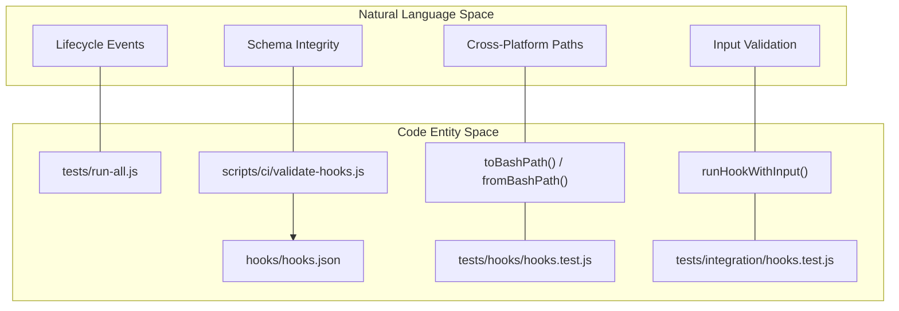
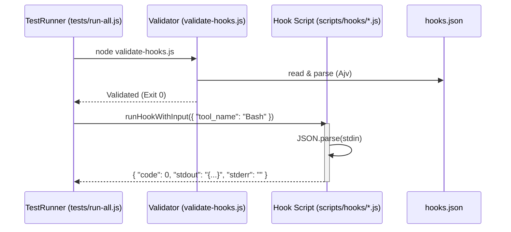

<!-- source: DeepWiki mcp.deepwiki.com · repo affaan-m/everything-claude-code · page 6.5 Hook Testing Infrastructure · fetched 2026-10-26 -->

# Hook Testing Infrastructure

<details>
<summary>Relevant source files</summary>

The following files were used as context for generating this wiki page:

- [schemas/hooks.schema.json](schemas/hooks.schema.json)
- [scripts/ci/catalog.js](scripts/ci/catalog.js)
- [scripts/ci/validate-hooks.js](scripts/ci/validate-hooks.js)
- [scripts/hooks/session-end.js](scripts/hooks/session-end.js)
- [scripts/hooks/session-start.js](scripts/hooks/session-start.js)
- [scripts/hooks/suggest-compact.js](scripts/hooks/suggest-compact.js)
- [scripts/lib/package-manager.js](scripts/lib/package-manager.js)
- [scripts/lib/session-aliases.js](scripts/lib/session-aliases.js)
- [scripts/lib/session-manager.js](scripts/lib/session-manager.js)
- [scripts/lib/utils.js](scripts/lib/utils.js)
- [tests/ci/catalog.test.js](tests/ci/catalog.test.js)
- [tests/ci/validators.test.js](tests/ci/validators.test.js)
- [tests/hooks/hooks.test.js](tests/hooks/hooks.test.js)
- [tests/integration/hooks.test.js](tests/integration/hooks.test.js)
- [tests/lib/package-manager.test.js](tests/lib/package-manager.test.js)
- [tests/lib/session-aliases.test.js](tests/lib/session-aliases.test.js)
- [tests/lib/session-manager.test.js](tests/lib/session-manager.test.js)
- [tests/lib/utils.test.js](tests/lib/utils.test.js)
- [tests/run-all.js](tests/run-all.js)

</details>


This document covers the test suite for hook scripts, including test helpers, test categories, and the validation infrastructure used to ensure hook reliability across platforms. For information about the hook lifecycle and event flow, see [Hook Lifecycle & Event Flow](). For guidance on creating custom hooks, see [Creating Custom Hooks]().

## Overview

The hook testing infrastructure provides a comprehensive framework for validating hook behavior in realistic scenarios. It tests input/output handling, exit codes, error recovery, timeout enforcement, and `hooks.json` schema validation. The suite functions as a standalone integration test that simulates Claude Code's hook invocation protocol by feeding JSON payloads into `stdin` and capturing `stdout`/`stderr`.

**Sources:** [tests/hooks/hooks.test.js:1-11](), [tests/integration/hooks.test.js:1-7](), [scripts/ci/validate-hooks.js:1-10]()

---

## Test Infrastructure Components

### Test Orchestration

The project uses a centralized test runner, `tests/run-all.js`, which discovers and executes all test files matching the `tests/**/*.test.js` glob [tests/run-all.js:14-15](). It captures output and aggregates results into a unified report.

| Component | Role |
|-----------|------|
| `tests/run-all.js` | Main orchestrator; spawns node processes for each test file [tests/run-all.js:76-79](). |
| `scripts/ci/validate-hooks.js` | Validates `hooks.json` against schema and rules [scripts/ci/validate-hooks.js:141-153](). |
| `tests/hooks/hooks.test.js` | Provides low-level utility tests for path normalization and shell script execution [tests/hooks/hooks.test.js:15-79](). |

**Sources:** [tests/run-all.js:14-44](), [tests/hooks/hooks.test.js:102-152]()

### Hook Simulation Helpers

#### runHookWithInput

The primary hook simulation function in `tests/integration/hooks.test.js` mimics the host's hook invocation:

```javascript
function runHookWithInput(scriptPath, input = {}, env = {}, timeoutMs = 10000)
```

**Key behaviors:**
- Spawns a node process for the hook script [tests/integration/hooks.test.js:52-55]().
- Writes JSON input to `stdin` and closes the stream [tests/integration/hooks.test.js:72-75]().
- Handles `EPIPE` or `EOF` (on Windows) errors gracefully if the hook exits before reading all input [tests/integration/hooks.test.js:65-69]().
- Enforces timeouts using `SIGKILL` to prevent hanging tests [tests/integration/hooks.test.js:77-80]().

**Sources:** [tests/integration/hooks.test.js:49-91]()

#### runHookCommand

Specialized helper for testing hook commands exactly as they are declared in `hooks.json`, supporting environment variable interpolation and shell wrappers:

```javascript
function runHookCommand(command, input = {}, env = {}, timeoutMs = 10000)
```

**Behavior:**
- Resolves environment variables like `${CLAUDE_PLUGIN_ROOT}` using regex [tests/integration/hooks.test.js:153-156]().
- Detects if the command requires a shell wrapper (`bash` on Unix, `cmd` on Windows) [tests/integration/hooks.test.js:161-162]().
- Manages platform-specific shell arguments (`/d /s /c` for Windows vs `-lc` for Linux) [tests/integration/hooks.test.js:162]().
- Supports direct node spawning for `node -e` inline scripts [tests/integration/hooks.test.js:178-180]().

**Sources:** [tests/integration/hooks.test.js:109-217]()

---

## Validation Infrastructure

The `scripts/ci/validate-hooks.js` script ensures that all hook registrations are syntactically and structurally sound before they are deployed.

### hooks.json Schema Validation
The validator uses `Ajv` to compile and check `hooks/hooks.json` against the formal schema [scripts/ci/validate-hooks.js:142-146]().

**Schema Requirements:**
- **Event Types**: Must be one of the supported events (e.g., `PreToolUse`, `PostToolUse`, `SessionStart`, `SessionEnd`, `Stop`, `PreCompact`) [scripts/ci/validate-hooks.js:13-32]().
- **Hook Types**: Supports `command`, `http`, `prompt`, or `agent` [scripts/ci/validate-hooks.js:33]().
- **Matchers**: Required for events like `PreToolUse` but excluded for global events like `Stop` [scripts/ci/validate-hooks.js:34]().

### Inline JavaScript Validation
For hooks using the `command` type with `node -e`, the validator extracts the script and uses the `vm` module to check for syntax errors [scripts/ci/validate-hooks.js:75-84]().

**Sources:** [scripts/ci/validate-hooks.js:50-125](), [schemas/hooks.schema.json:1-10]()

---

## Test Architecture

The following diagram bridges the Natural Language test concepts to the Code Entities responsible for them.



**Sources:** [tests/run-all.js:1-10](), [scripts/ci/validate-hooks.js:9-12](), [tests/hooks/hooks.test.js:15-58](), [tests/integration/hooks.test.js:49-50]()

---

## Test Categories

### Hook Input Format Handling
Tests hook resilience to various `stdin` inputs:
- **Empty stdin**: Hooks should handle empty input gracefully [tests/integration/hooks.test.js:72-74]().
- **Valid tool_input**: Integration tests verify hooks correctly extract properties like `tool_name` and `tool_input` from the JSON payload [tests/integration/hooks.test.js:43-50]().

### Session Persistence Tests
Specific tests for `SessionStart` and `SessionEnd` hooks verify context preservation:
- **Context Injection**: Verifies `SessionStart` emits the correct `additionalContext` payload to `stdout` [tests/hooks/hooks.test.js:93-99]().
- **Payload Structure**: Ensures the `hookSpecificOutput` contains the correct `hookEventName` [tests/integration/hooks.test.js:94-100]().
- **Transcript Parsing**: `SessionEnd` tests verify that `extractSessionSummary` correctly parses JSONL transcript files [scripts/hooks/session-end.js:40-111]().

**Sources:** [tests/hooks/hooks.test.js:93-99](), [tests/integration/hooks.test.js:94-100](), [scripts/hooks/session-end.js:40-111]()

---

## Data Flow: Hook Testing

This diagram illustrates how data flows from the test runner into a hook and how side effects are captured.



**Sources:** [tests/run-all.js:76-86](), [scripts/ci/validate-hooks.js:156-202](), [tests/integration/hooks.test.js:49-91]()

---

## Running Tests

Tests are run using standard Node.js to minimize dependencies.

```bash
# Run all tests (Logic + Integration)
node tests/run-all.js

# Run component validation only
node scripts/ci/validate-hooks.js

# Run specific hook logic tests
node tests/hooks/hooks.test.js

# Run integration tests
node tests/integration/hooks.test.js
```

**Sources:** [tests/run-all.js:1-6](), [tests/hooks/hooks.test.js:1-5](), [tests/integration/hooks.test.js:1-7]()

---

