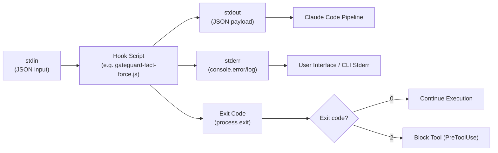
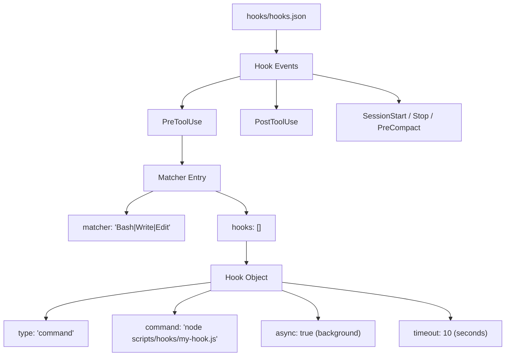

<!-- source: DeepWiki mcp.deepwiki.com · repo affaan-m/everything-claude-code · page 6.6 Creating Custom Hooks · fetched 2026-10-26 -->

# Creating Custom Hooks

<details>
<summary>Relevant source files</summary>

The following files were used as context for generating this wiki page:

- [.opencode/commands/harness-audit.md](.opencode/commands/harness-audit.md)
- [CONTRIBUTING.md](CONTRIBUTING.md)
- [agents/docs-lookup.md](agents/docs-lookup.md)
- [commands/harness-audit.md](commands/harness-audit.md)
- [commands/loop-start.md](commands/loop-start.md)
- [commands/model-route.md](commands/model-route.md)
- [commands/quality-gate.md](commands/quality-gate.md)
- [docs/SKILL-DEVELOPMENT-GUIDE.md](docs/SKILL-DEVELOPMENT-GUIDE.md)
- [docs/examples/project-guidelines-template.md](docs/examples/project-guidelines-template.md)
- [docs/skill-adaptation-policy.md](docs/skill-adaptation-policy.md)
- [hooks/README.md](hooks/README.md)
- [hooks/hooks.json](hooks/hooks.json)
- [rules/common/code-review.md](rules/common/code-review.md)
- [rules/common/development-workflow.md](rules/common/development-workflow.md)
- [scripts/harness-audit.js](scripts/harness-audit.js)
- [scripts/hooks/desktop-notify.js](scripts/hooks/desktop-notify.js)
- [scripts/hooks/gateguard-fact-force.js](scripts/hooks/gateguard-fact-force.js)
- [skills/gateguard/SKILL.md](skills/gateguard/SKILL.md)
- [skills/search-first/SKILL.md](skills/search-first/SKILL.md)
- [tests/hooks/gateguard-fact-force.test.js](tests/hooks/gateguard-fact-force.test.js)
- [tests/scripts/harness-audit.test.js](tests/scripts/harness-audit.test.js)

</details>


This document provides a technical guide for implementing custom hooks in the Everything Claude Code (ECC) system. Hooks are event-driven automations that intercept tool execution events to enforce code quality, catch mistakes early, and automate repetitive checks.

---

## Hook Input/Output Protocol

### Stdin JSON Format

Hooks receive JSON input via `stdin` containing the tool invocation details. The structure varies depending on the hook lifecycle phase.

```typescript
interface HookInput {
  tool_name?: string;         // "Bash", "Edit", "Write", "Read", etc.
  tool_input?: {
    command?: string;         // Bash: the command being run
    file_path?: string;       // Edit/Write/Read: target file
    old_string?: string;      // Edit: text being replaced
    new_string?: string;      // Edit: replacement text
    content?: string;         // Write: file content
  };
  tool_output?: {             // PostToolUse only
    output?: string;          // Command/tool output
  };
  transcript_path?: string;   // SessionEnd/Stop hooks: path to JSONL transcript
  last_assistant_message?: string; // Stop hooks: text content of response
}
```

*   **PreToolUse hooks**: Receive `tool_name` and `tool_input` before the tool has executed [hooks/README.md:11-11](), [hooks/hooks.json:4-130]().
*   **PostToolUse hooks**: Receive all fields including `tool_output` to analyze results [hooks/README.md:12-12](), [hooks/hooks.json:157-234]().
*   **SessionEnd / Stop hooks**: Often receive `transcript_path` or `last_assistant_message` for analysis [hooks/README.md:65-66](), [scripts/hooks/desktop-notify.js:121-122]().

**Sources:** [hooks/README.md:7-15](), [hooks/hooks.json:1-234](), [scripts/hooks/desktop-notify.js:119-123](), [hooks/README.md:153-167]()

### Output Protocol

Custom hooks must follow a strict I/O protocol to remain compatible with the Claude Code harness.

Title: "Hook Execution Data Flow (Natural Language to Code Entity Space)"


**Rules:**
1.  **stdout**: Hooks must output valid JSON to `stdout`. Typically, they echo the original `stdin` data (JSON passthrough) [hooks/README.md:141-143]().
2.  **stderr**: Write human-readable messages or warnings here. These are displayed to the user and Claude [hooks/README.md:135-136]().
3.  **Exit code 0**: Success. Execution proceeds.
4.  **Exit code 2**: Block tool execution (Valid for `PreToolUse` only) [hooks/README.md:148-148]().
5.  **Other non-zero**: Logged as an error but does not block execution [hooks/README.md:149-149]().

**Sources:** [hooks/README.md:119-150](), [scripts/hooks/desktop-notify.js:153-168](), [scripts/hooks/gateguard-fact-force.js:237-240]()

---

## Creating a Hook Script

### Example: Node.js Hook Template

Hooks are typically implemented in Node.js. The following template demonstrates the standard "Read-Process-Write" loop used in ECC scripts like `desktop-notify.js`.

```javascript
// my-hook.js
const MAX_STDIN = 1024 * 1024;
let stdinData = '';
process.stdin.setEncoding('utf8');

process.stdin.on('data', chunk => {
  if (stdinData.length < MAX_STDIN) {
    stdinData += chunk;
  }
});

process.stdin.on('end', () => {
  try {
    const input = JSON.parse(stdinData);
    const toolName = input.tool_name;
    const toolInput = input.tool_input;

    // Logic: Warn if using 'rm' in Bash
    if (toolName === 'Bash' && toolInput.command?.includes('rm ')) {
      process.stderr.write('[Hook] Warning: Destructive command detected\n');
    }

    // Logic: Block execution (PreToolUse only)
    // if (isForbidden) process.exit(2);

  } catch (e) {
    // Fail-open on parse errors
  }

  // Pass-through original data to stdout
  process.stdout.write(stdinData);
});
```

**Sources:** [hooks/README.md:123-144](), [scripts/hooks/desktop-notify.js:153-168](), [scripts/hooks/gateguard-fact-force.js:237-240]()

---

## Hook Registration in `hooks.json`

Custom hooks must be registered in the `hooks/hooks.json` file.

### Registration Schema

Title: "hooks.json Configuration Architecture"


**Sources:** [hooks/hooks.json:1-70](), [hooks/README.md:173-183]()

### Registration Example

```json
{
  "hooks": {
    "PreToolUse": [
      {
        "matcher": "Bash",
        "hooks": [
          {
            "type": "command",
            "command": "node \"${CLAUDE_PLUGIN_ROOT}/scripts/hooks/my-custom-hook.js\"",
            "timeout": 10
          }
        ],
        "description": "Custom check for bash commands",
        "id": "pre:bash:custom-check"
      }
    ]
  }
}
```

**Matcher patterns:**
*   `"Bash"`, `"Write"`, `"Edit"`, `"MultiEdit"`: Match specific tools [hooks/hooks.json:6, 17, 28, 52]().
*   `"Edit|Write"`: Pipe-separated matching for multiple tools [hooks/hooks.json:32]().
*   `"*"`: Matches all tools/events for that lifecycle phase [hooks/hooks.json:39]().

**Sources:** [hooks/hooks.json:4-158]()

---

## Async Hooks and Timeouts

Hooks that perform heavy analysis or background tasks should be configured as `async` to avoid blocking the main interaction loop.

```json
{
  "type": "command",
  "command": "node my-slow-hook.js",
  "async": true,
  "timeout": 30
}
```

*   **`async: true`**: Runs the hook in the background. Background hooks cannot block tool execution [hooks/README.md:175-182](), [hooks/hooks.json:44]().
*   **`timeout`**: Maximum duration in seconds before the hook process is killed [hooks/hooks.json:45, 57]().

**Sources:** [hooks/README.md:169-183](), [hooks/hooks.json:43-50]()

---

## Error Handling and Validation

### Fail-Open Pattern
Most ECC hooks use a "fail-open" strategy: if the hook script encounters an internal error or fails to parse input, it logs the error to `stderr` and continues to avoid breaking the user's session [scripts/hooks/desktop-notify.js:144-146]().

### State Persistence
Advanced hooks like `gateguard-fact-force.js` maintain per-session state to avoid redundant prompts. They use a state directory (often `~/.gateguard`) and atomic writes via temporary files to ensure data integrity [scripts/hooks/gateguard-fact-force.js:30-31, 171-187]().

### Testing Infrastructure
ECC provides testing infrastructure for hooks, typically using `spawnSync` to execute the hook with mock JSON input and verifying the exit code and output [tests/hooks/gateguard-fact-force.test.js:60-86]().

```javascript
// Example test case for a custom hook
const result = spawnSync('node', ['scripts/hooks/my-hook.js'], {
    input: JSON.stringify({ tool_name: 'Bash', tool_input: { command: 'ls' } }),
    encoding: 'utf8'
});
assert.strictEqual(result.status, 0);
```

**Sources:** [scripts/hooks/gateguard-fact-force.js:106-200](), [tests/hooks/gateguard-fact-force.test.js:1-86]()

---

## Summary of Hook Exit Codes

| Exit Code | Meaning | Context |
| :--- | :--- | :--- |
| `0` | Success / Allow | Tool execution proceeds normally. |
| `2` | Block Tool | **PreToolUse only**. Prevents the tool from running. |
| `Non-zero` | Error | Logged to stderr; tool proceeds unless it was code 2 in PreToolUse. |

**Sources:** [hooks/README.md:146-150](), [tests/hooks/gateguard-fact-force.test.js:148-148]()

---

