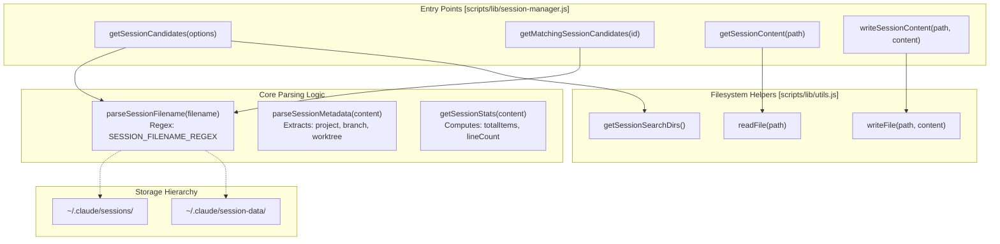
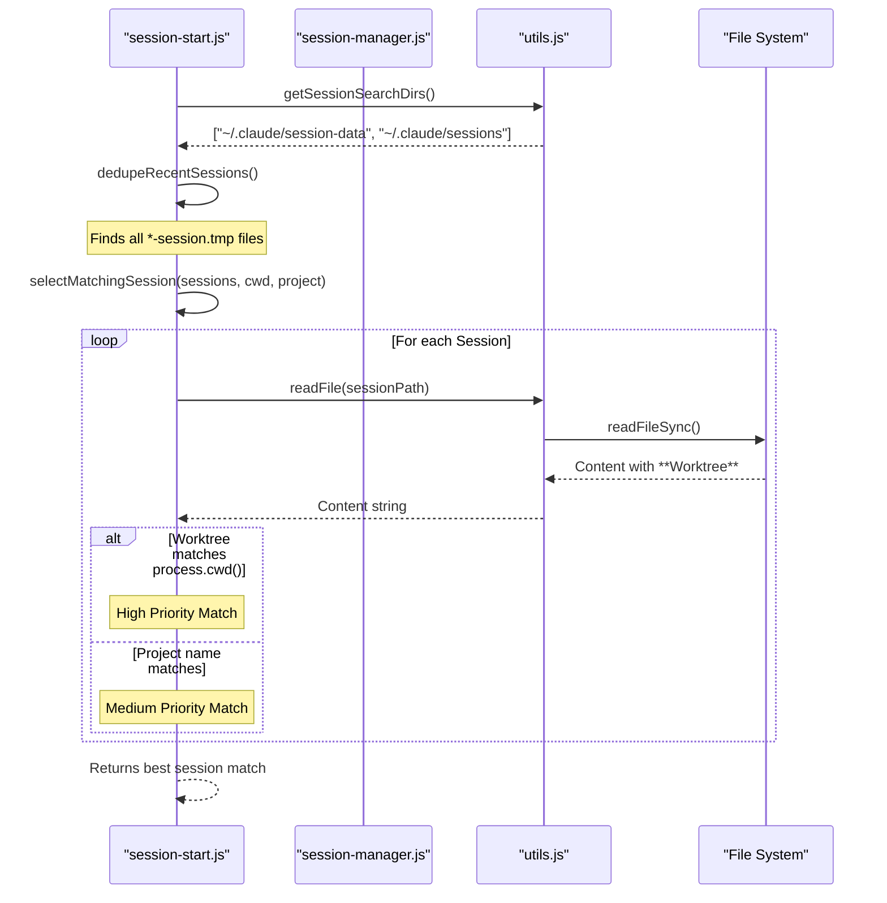

<!-- source: DeepWiki mcp.deepwiki.com · repo affaan-m/everything-claude-code · page 7.2 Session Manager API · fetched 2026-10-26 -->

# Session Manager API

<details>
<summary>Relevant source files</summary>

The following files were used as context for generating this wiki page:

- [scripts/hooks/session-end.js](scripts/hooks/session-end.js)
- [scripts/hooks/session-start.js](scripts/hooks/session-start.js)
- [scripts/hooks/suggest-compact.js](scripts/hooks/suggest-compact.js)
- [scripts/lib/package-manager.js](scripts/lib/package-manager.js)
- [scripts/lib/session-aliases.js](scripts/lib/session-aliases.js)
- [scripts/lib/session-manager.js](scripts/lib/session-manager.js)
- [scripts/lib/utils.js](scripts/lib/utils.js)
- [tests/ci/validators.test.js](tests/ci/validators.test.js)
- [tests/hooks/hooks.test.js](tests/hooks/hooks.test.js)
- [tests/integration/hooks.test.js](tests/integration/hooks.test.js)
- [tests/lib/package-manager.test.js](tests/lib/package-manager.test.js)
- [tests/lib/session-aliases.test.js](tests/lib/session-aliases.test.js)
- [tests/lib/session-manager.test.js](tests/lib/session-manager.test.js)
- [tests/lib/utils.test.js](tests/lib/utils.test.js)

</details>


## Purpose and Scope

The Session Manager API provides core CRUD operations for Claude Code sessions stored in `~/.claude/session-data/` (canonical) and `~/.claude/sessions/` (legacy). This library handles session file parsing, metadata extraction, content reading/writing, and session listing with pagination and filtering. It serves as the data access layer for session lifecycle hooks like `session-start.js` and `session-end.js`.

**Sources:** [scripts/lib/session-manager.js:1-10](), [scripts/lib/session-manager.js:14-19]()

---

## Session Manager Architecture

The following diagram illustrates the relationship between the high-level API functions and the underlying file system storage, including the multi-directory search strategy.

Title: Session Management Architecture


**Sources:** [scripts/lib/session-manager.js:1-240](), [scripts/lib/utils.js:41-57]()

---

## Filename Parsing

### `parseSessionFilename(filename)`

Parses session filenames to extract metadata. It uses `SESSION_FILENAME_REGEX` to identify the date and optional short ID.

**Supported formats:**
- **Old format:** `2026-01-17-session.tmp` (returns `shortId: 'no-id'`) [scripts/lib/session-manager.js:50-50]()
- **New format:** `2026-02-01-a1b2c3d4-session.tmp` [scripts/lib/session-manager.js:24-27]()
- **Worktree format:** `2026-02-01-frontend-worktree-1-session.tmp` [scripts/lib/session-manager.js:25-26]()

**Validation rules:**
- Date must be `YYYY-MM-DD` format. [scripts/lib/session-manager.js:36-39]()
- Month must be 01-12 and Day 01-31. [scripts/lib/session-manager.js:43-43]()
- Validates calendar accuracy (e.g., rejects Feb 31) by checking if the `Date` object month roundtrips correctly. [scripts/lib/session-manager.js:46-47]()

**Returns:** `{ filename, shortId, date, datetime }` or `null` if invalid. [scripts/lib/session-manager.js:52-60]()

**Sources:** [scripts/lib/session-manager.js:27-61](), [tests/lib/session-manager.test.js:51-88]()

---

## Content Operations

### `getSessionContent(sessionPath)`
Reads session markdown content from disk using the `readFile` utility. [scripts/lib/session-manager.js:216-218]()

### `writeSessionContent(sessionPath, content)`
Writes content to a session file. It utilizes `fs.writeFileSync` to persist data. [scripts/lib/session-manager.js:371-379]()

### `appendSessionContent(sessionPath, content)`
Appends content to an existing session file, used for incremental updates during session execution. [scripts/lib/session-manager.js:387-395]()

**Sources:** [scripts/lib/session-manager.js:212-218](), [scripts/lib/session-manager.js:371-395]()

---

## Metadata Extraction

### `parseSessionMetadata(content)`

Extracts structured metadata from session markdown content using regex patterns. It initializes a metadata object with default null/empty values. [scripts/lib/session-manager.js:225-236]()

| Metadata Field | Extraction Source | Regex Pattern / Logic |
| :--- | :--- | :--- |
| `title` | First `#` heading | `/^#\s+(.+)$/m` [scripts/lib/session-manager.js:241-244]() |
| `project` | `**Project:**` field | `/\*\*Project:\*\*\s*(.+)$/m` [scripts/lib/session-manager.js:256-259]() |
| `branch` | `**Branch:**` field | `/\*\*Branch:\*\*\s*(.+)$/m` [scripts/lib/session-manager.js:262-265]() |
| `worktree` | `**Worktree:**` field | `/\*\*Worktree:\*\*\s*(.+)$/m` [scripts/lib/session-manager.js:268-271]() |
| `completed` | `### Completed` section | Matches `- [x]` items [scripts/lib/session-manager.js:281-287]() |
| `inProgress` | `### In Progress` section | Matches `- [ ]` items [scripts/lib/session-manager.js:290-296]() |

**Sources:** [scripts/lib/session-manager.js:221-311](), [tests/lib/session-manager.test.js:92-130]()

---

### `getSessionStats(sessionPathOrContent)`

Calculates session statistics. It includes a heuristic to determine if the input is a file path or raw content to avoid redundant disk reads. [scripts/lib/session-manager.js:325-331]()

**Heuristic for Path Detection:**
- Input ends with `.tmp`.
- Input contains no newlines.
- Input starts with `/` or a Windows drive letter. [scripts/lib/session-manager.js:325-328]()

**Returns:**
```javascript
{
  totalItems: 3,       // Sum of completed and in-progress
  completedItems: 2,   // Count of checked tasks
  inProgressItems: 1,  // Count of unchecked tasks
  lineCount: 15        // Total lines in content
}
```
**Sources:** [scripts/lib/session-manager.js:320-343](), [tests/lib/session-manager.test.js:154-183]()

---

## Session Retrieval and Search

### `getSessionCandidates(options)`

Lists all sessions across canonical and legacy directories with filtering.

**Options:**
- `date`: Filter by specific date (YYYY-MM-DD). [scripts/lib/session-manager.js:74-74]()
- `search`: Substring search within the short ID. [scripts/lib/session-manager.js:75-75]()

**Implementation Detail:**
1. Iterates through directories provided by `getSessionSearchDirs()`. [scripts/lib/session-manager.js:80-80]()
2. Filters files by extension (`.tmp`) and matching criteria. [scripts/lib/session-manager.js:94-101]()
3. Deduplicates sessions by filename (preferring canonical over legacy). [scripts/lib/session-manager.js:124-133]()
4. Sorts by modification time (newest first). [scripts/lib/session-manager.js:135-135]()

**Sources:** [scripts/lib/session-manager.js:72-137](), [scripts/lib/utils.js:55-57]()

---

### `getMatchingSessionCandidates(normalizedSessionId)`

Retrieves sessions matching a specific identifier. It supports matching by short ID prefix, full filename, or filename without extension. [scripts/lib/session-manager.js:158-165]()

**Search Logic:**
1. Scans all session search directories. [scripts/lib/session-manager.js:171-171]()
2. Uses `sessionMatchesId` helper to validate candidates. [scripts/lib/session-manager.js:188-188]()
3. Builds session records including filesystem stats (size, mtime). [scripts/lib/session-manager.js:197-197]()

**Sources:** [scripts/lib/session-manager.js:158-209](), [tests/lib/session-manager.test.js:428-480]()

---

## Data Flow: Session Selection

The following diagram maps the natural language "resume last session" request to the code entities that resolve the best match based on the current project and worktree.

Title: Session Selection Data Flow


**Sources:** [scripts/hooks/session-start.js:155-208](), [scripts/lib/utils.js:55-57](), [scripts/lib/session-manager.js:158-165]()

---

## Session Utilities

| Function | Purpose | Implementation Detail |
| :--- | :--- | :--- |
| `getSessionTitle(path)` | Returns session title | Extracts `#` heading or returns "Untitled Session". [scripts/lib/session-manager.js:349-354]() |
| `getSessionSize(path)` | Human-readable size | Formats bytes into KB/MB using `Math.log`. [scripts/lib/session-manager.js:360-373]() |
| `sessionExists(path)` | Existence check | Uses `fs.existsSync` and `fs.statSync`. [scripts/lib/session-manager.js:420-423]() |
| `deleteSession(path)` | File removal | Uses `fs.unlinkSync` with error logging. [scripts/lib/session-manager.js:402-413]() |

**Sources:** [scripts/lib/session-manager.js:349-423](), [tests/lib/session-manager.test.js:222-329]()

---

