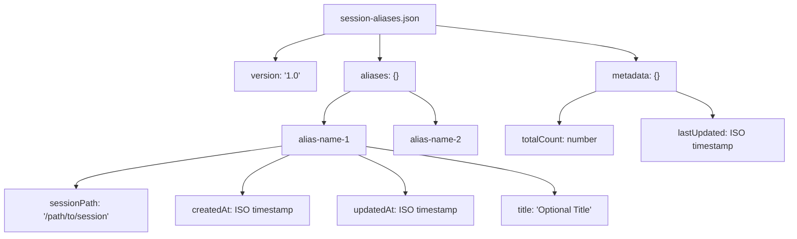
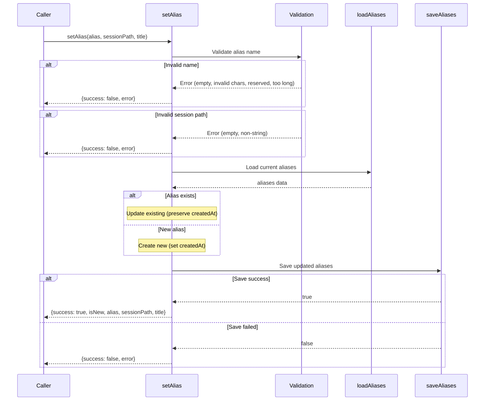
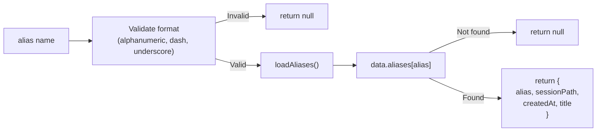
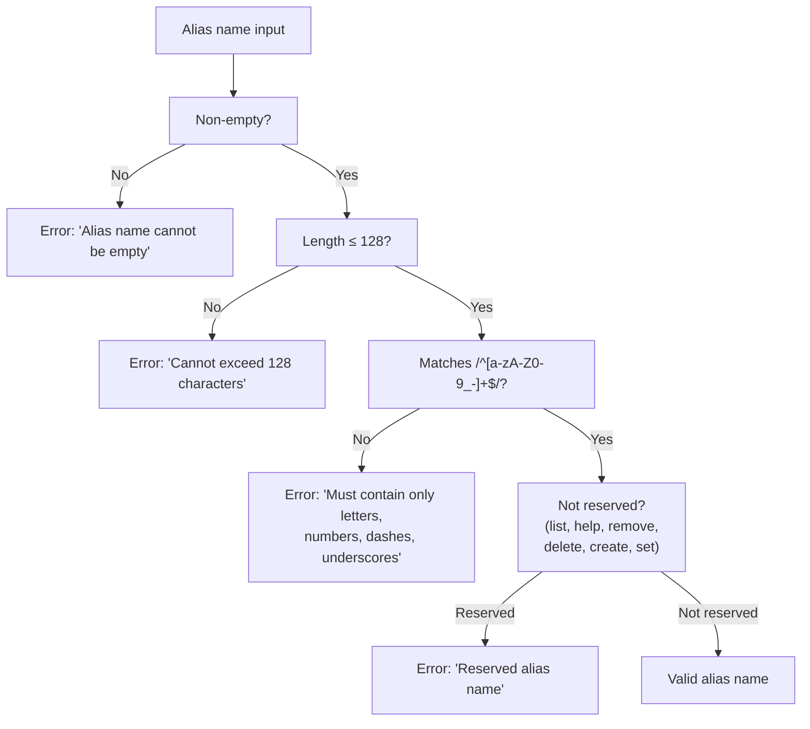
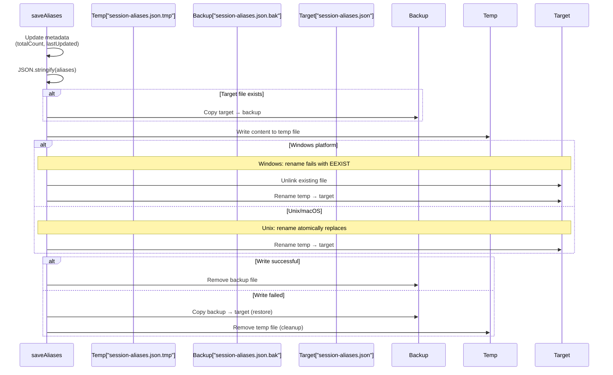
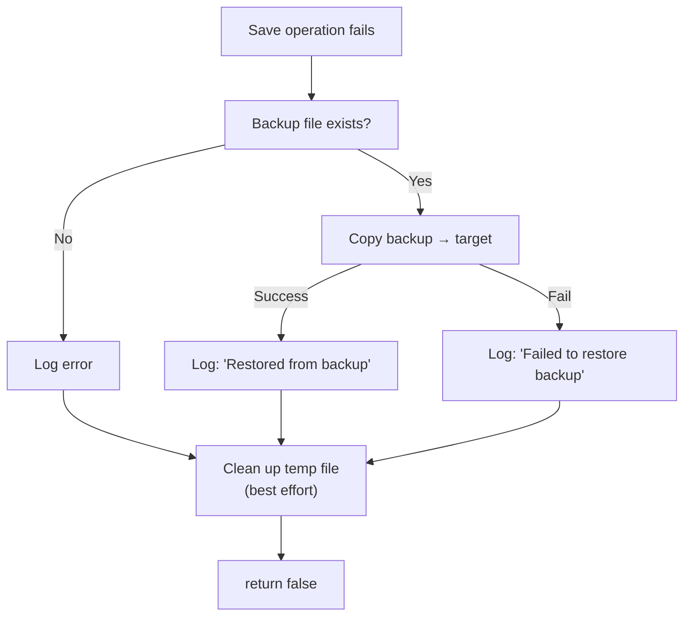
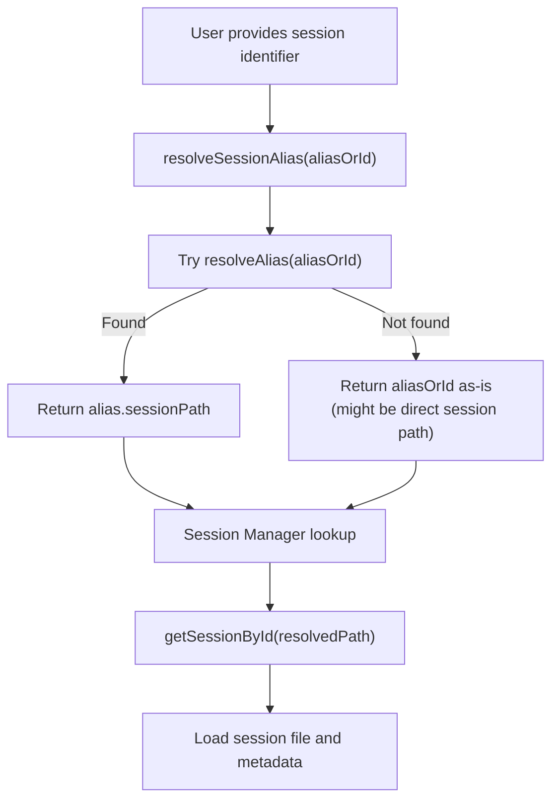
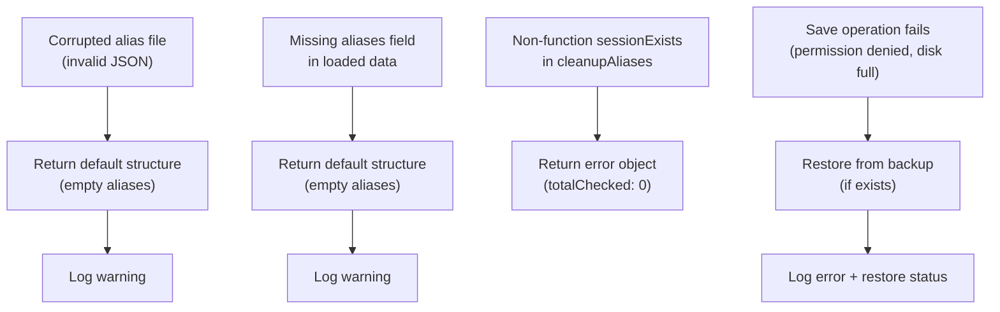

<!-- source: DeepWiki mcp.deepwiki.com · repo affaan-m/everything-claude-code · page 7.3 Session Aliases System · fetched 2026-10-26 -->

# Session Aliases System

<details>
<summary>Relevant source files</summary>

The following files were used as context for generating this wiki page:

- [scripts/hooks/session-end.js](scripts/hooks/session-end.js)
- [scripts/hooks/session-start.js](scripts/hooks/session-start.js)
- [scripts/hooks/suggest-compact.js](scripts/hooks/suggest-compact.js)
- [scripts/lib/package-manager.js](scripts/lib/package-manager.js)
- [scripts/lib/session-aliases.js](scripts/lib/session-aliases.js)
- [scripts/lib/session-manager.js](scripts/lib/session-manager.js)
- [scripts/lib/utils.js](scripts/lib/utils.js)
- [tests/ci/validators.test.js](tests/ci/validators.test.js)
- [tests/hooks/hooks.test.js](tests/hooks/hooks.test.js)
- [tests/integration/hooks.test.js](tests/integration/hooks.test.js)
- [tests/lib/package-manager.test.js](tests/lib/package-manager.test.js)
- [tests/lib/session-aliases.test.js](tests/lib/session-aliases.test.js)
- [tests/lib/session-manager.test.js](tests/lib/session-manager.test.js)
- [tests/lib/utils.test.js](tests/lib/utils.test.js)

</details>


**Purpose:** The Session Aliases System provides human-readable names for session files in Claude Code. Instead of referencing sessions by long IDs like `2026-02-01-a1b2c3d4-session.tmp`, users can create memorable aliases like `auth-refactor` or `api-migration`. This system manages the alias storage file (`~/.claude/session-aliases.json`), validates alias names, ensures atomic writes with backup/restore, and integrates with the Session Manager for session lookups. [scripts/lib/session-aliases.js:1-4]()

For session file management operations (CRUD, pagination, metadata extraction), see [Session Manager API (7.2)](). For session persistence and cross-session continuity, see [Session Lifecycle & Persistence (7.4)]().

---

## Storage Architecture

The alias system stores all aliases in a single JSON file at `~/.claude/session-aliases.json` with a versioned schema. [scripts/lib/session-aliases.js:17-22]()

### Alias File Structure

Title: Session Alias Data Model


**Sources:** [scripts/lib/session-aliases.js:27-36](), [scripts/lib/session-aliases.js:69-74](), [scripts/lib/session-aliases.js:95-98]()

### File Location

| Path | Description |
|------|-------------|
| `~/.claude/session-aliases.json` | Main alias storage file |
| `~/.claude/session-aliases.json.tmp` | Temporary file for atomic writes |
| `~/.claude/session-aliases.json.bak` | Backup created during save operations |

**Sources:** [scripts/lib/session-aliases.js:17-19](), [scripts/lib/session-aliases.js:90-91]()

---

## Alias Structure

Each alias entry contains the following fields:

| Field | Type | Description |
|-------|------|-------------|
| `sessionPath` | `string` | Full path to the session file |
| `createdAt` | `string` | ISO 8601 timestamp when alias was created |
| `updatedAt` | `string` | ISO 8601 timestamp of last update |
| `title` | `string \| null` | Optional human-readable title |

**Sources:** [scripts/lib/session-aliases.js:173-178](), [scripts/lib/session-aliases.js:217-222]()

---

## CRUD Operations

### Create/Update Alias: `setAlias()`

Title: setAlias Function Flow


**Sources:** [scripts/lib/session-aliases.js:188-235]()

### Read Alias: `resolveAlias()`

Title: resolveAlias Logic


**Sources:** [scripts/lib/session-aliases.js:158-179]()

### List Aliases: `listAliases()`

The `listAliases()` function supports filtering and pagination: [scripts/lib/session-aliases.js:244-245]()

| Option | Type | Description |
|--------|------|-------------|
| `search` | `string` | Filter by partial name or title match (case-insensitive) |
| `limit` | `number` | Maximum number of results to return |

**Sort Order:** Aliases are sorted by `updatedAt` (most recent first), falling back to `createdAt` if `updatedAt` is missing. [scripts/lib/session-aliases.js:257-257]()

**Sources:** [scripts/lib/session-aliases.js:244-274]()

---

## Validation Rules

### Alias Name Constraints

Title: Alias Name Validation


**Reserved Names:** `list`, `help`, `remove`, `delete`, `create`, `set`. [scripts/lib/session-aliases.js:208-211]()

**Sources:** [scripts/lib/session-aliases.js:189-211](), [scripts/lib/session-aliases.js:162-164]()

### Session Path Validation

| Rule | Error Message |
|------|---------------|
| Non-empty string | "Session path cannot be empty" |
| Type is `string` | "Session path cannot be empty" |
| Not whitespace-only | "Session path cannot be empty" |

**Sources:** [scripts/lib/session-aliases.js:195-197](), [tests/lib/session-aliases.test.js:136-140]()

---

## Atomic Write Strategy

The alias system uses atomic writes with backup/restore to prevent data corruption. [scripts/lib/session-aliases.js:88-151]()

### Write Process

Title: saveAliases Atomic Write Sequence


**Platform Differences:**
- **Windows:** `fs.renameSync()` fails with `EEXIST` if destination exists. Target file must be deleted before rename. [scripts/lib/session-aliases.js:116-118]()
- **Unix/macOS:** `rename(2)` atomically replaces the destination file. No pre-delete needed. [scripts/lib/session-aliases.js:114-115]()

**Sources:** [scripts/lib/session-aliases.js:88-151]()

### Error Recovery

Title: saveAliases Recovery Logic


**Sources:** [scripts/lib/session-aliases.js:127-149]()

---

## Integration with Session Manager

The alias system integrates with the Session Manager to enable alias-based session lookups.

### Session Resolution Flow

Title: Mapping Aliases to Session Entities


**Sources:** [scripts/lib/session-aliases.js:365-374](), [scripts/lib/session-manager.js:279-332]()

---

## Cleanup Operations

### Stale Alias Detection

The `cleanupAliases()` function removes aliases pointing to non-existent sessions. [scripts/lib/session-aliases.js:434-460]()

Title: cleanupAliases Process
```mermaid
sequenceDiagram
    participant Caller
    participant cleanupAliases
    participant sessionExists["sessionExists(path)<br/>(callback)"]
    participant saveAliases
    
    Caller->>cleanupAliases: cleanupAliases(sessionExists)
    
    alt sessionExists not a function
        cleanupAliases-->>Caller: {totalChecked: 0, removed: 0, error}
    end
    
    cleanupAliases->>cleanupAliases: loadAliases()
    
    loop For each alias entry
        cleanupAliases->>sessionExists: Check if session exists
        
        alt Session does not exist
            Note over cleanupAliases: Mark for removal
        else Session exists
            Note over cleanupAliases: Keep alias
        end
    end
    
    cleanupAliases->>cleanupAliases: Delete marked aliases
    cleanupAliases->>saveAliases: Save updated aliases
    cleanupAliases-->>Caller: {success, totalChecked,<br/>removed, removedAliases}
```

**Callback Function:** The `sessionExists` callback receives a session path and returns `true` if the session exists, `false` otherwise. This allows the caller to define custom existence checks. [scripts/lib/session-aliases.js:434-440]()

**Sources:** [scripts/lib/session-aliases.js:434-460]()

---

## API Reference

### Core Functions

| Function | Parameters | Returns | Description |
|----------|-----------|---------|-------------|
| `getAliasesPath()` | - | `string` | Path to alias storage file [scripts/lib/session-aliases.js:17-19]() |
| `loadAliases()` | - | `object` | Load aliases from file with validation [scripts/lib/session-aliases.js:42-81]() |
| `saveAliases(aliases)` | `object` | `boolean` | Atomic save with backup [scripts/lib/session-aliases.js:88-151]() |
| `setAlias(alias, sessionPath, title)` | `string, string, string?` | `{success, isNew, alias, sessionPath, title}` | Create or update alias [scripts/lib/session-aliases.js:188-235]() |
| `resolveAlias(alias)` | `string` | `object \| null` | Get alias data or null [scripts/lib/session-aliases.js:158-179]() |
| `listAliases(options)` | `{search?, limit?}` | `Array<object>` | List aliases with filtering [scripts/lib/session-aliases.js:244-274]() |
| `deleteAlias(alias)` | `string` | `{success, alias, deletedSessionPath}` | Delete alias [scripts/lib/session-aliases.js:382-405]() |
| `renameAlias(oldAlias, newAlias)` | `string, string` | `{success, oldAlias, newAlias, sessionPath}` | Rename alias [scripts/lib/session-aliases.js:308-358]() |
| `updateAliasTitle(alias, title)` | `string, string \| null` | `{success, alias, title}` | Update alias title [scripts/lib/session-aliases.js:281-300]() |
| `resolveSessionAlias(aliasOrId)` | `string` | `string \| null` | Resolve alias to session path [scripts/lib/session-aliases.js:365-374]() |
| `getAliasesForSession(sessionPath)` | `string` | `Array<object>` | Get all aliases for session [scripts/lib/session-aliases.js:412-427]() |
| `cleanupAliases(sessionExists)` | `Function` | `object` | Remove stale aliases [scripts/lib/session-aliases.js:434-460]() |

---

## Error Handling

### Common Error Scenarios

Title: Session Alias Error Handling


**Defensive Behaviors:**
- **File corruption:** Returns default structure instead of throwing. [scripts/lib/session-aliases.js:77-80]()
- **Missing fields:** Adds missing fields on load. [scripts/lib/session-aliases.js:63-74]()
- **Save failures:** Attempts backup restoration. [scripts/lib/session-aliases.js:127-148]()
- **Invalid input:** Returns error objects with descriptive messages. [scripts/lib/session-aliases.js:190-211]()

**Sources:** [scripts/lib/session-aliases.js:54-80](), [scripts/lib/session-aliases.js:127-148](), [scripts/lib/session-aliases.js:435-437]()

---

## Testing Coverage

The test suite in `tests/lib/session-aliases.test.js` covers the following scenarios:

| Test Category | Coverage |
|---------------|----------|
| **loadAliases** | Empty file, corrupted JSON, invalid structure [tests/lib/session-aliases.test.js:60-85]() |
| **setAlias** | Create new, update existing, validation rules [tests/lib/session-aliases.test.js:90-146]() |
| **resolveAlias** | Existing alias, non-existent, invalid input [tests/lib/session-aliases.test.js:151-175]() |
| **listAliases** | Sort by recency, search filtering [tests/lib/session-aliases.test.js:180-202]() |
| **deleteAlias** | Existing alias, non-existent [tests/lib/session-aliases.test.js:207-220]() |
| **renameAlias** | Valid rename, existing target, non-existent source [tests/lib/session-aliases.test.js:225-243]() |

**Sources:** [tests/lib/session-aliases.test.js:1-243]()

---

