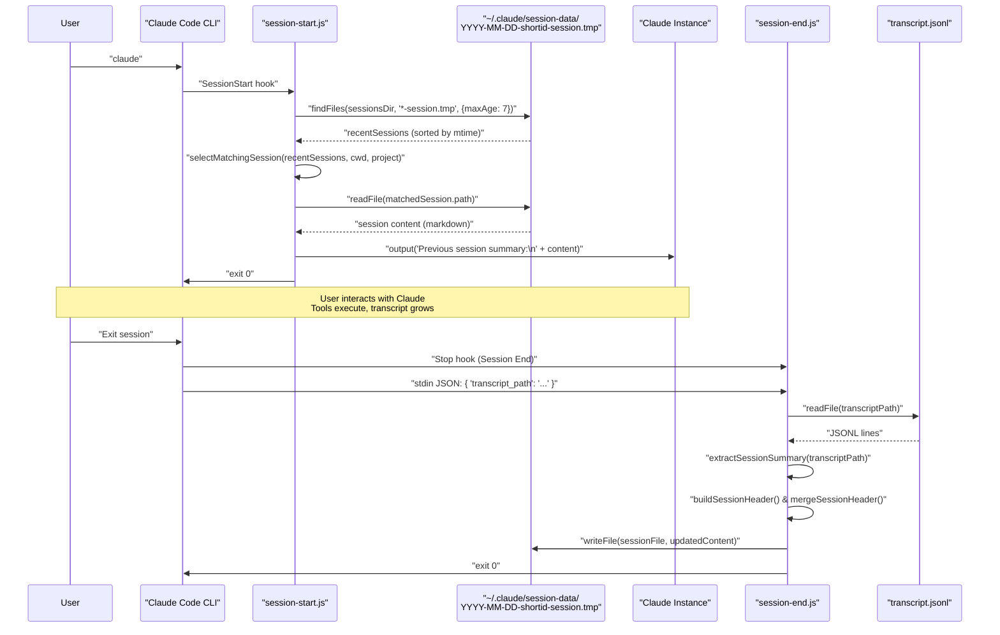
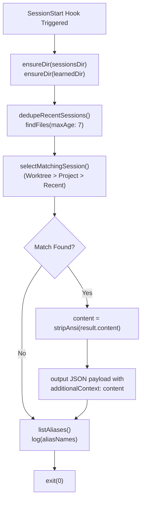
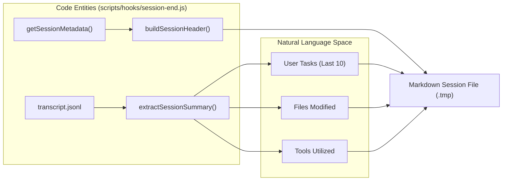
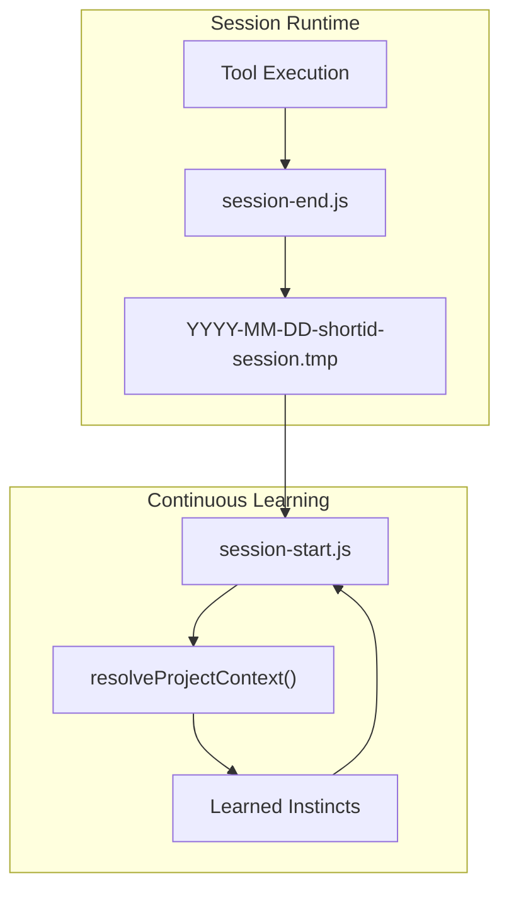

<!-- source: DeepWiki mcp.deepwiki.com · repo affaan-m/everything-claude-code · page 7.4 Session Lifecycle & Persistence · fetched 2026-10-26 -->

# Session Lifecycle & Persistence

Relevant source files

The following files were used as context for generating this wiki page:

- [scripts/hooks/session-end.js](scripts/hooks/session-end.js)
- [scripts/hooks/session-start.js](scripts/hooks/session-start.js)
- [scripts/hooks/suggest-compact.js](scripts/hooks/suggest-compact.js)
- [scripts/lib/package-manager.js](scripts/lib/package-manager.js)
- [scripts/lib/session-aliases.js](scripts/lib/session-aliases.js)
- [scripts/lib/session-manager.js](scripts/lib/session-manager.js)
- [scripts/lib/utils.js](scripts/lib/utils.js)
- [tests/ci/validators.test.js](tests/ci/validators.test.js)
- [tests/hooks/hooks.test.js](tests/hooks/hooks.test.js)
- [tests/integration/hooks.test.js](tests/integration/hooks.test.js)
- [tests/lib/package-manager.test.js](tests/lib/package-manager.test.js)
- [tests/lib/session-aliases.test.js](tests/lib/session-aliases.test.js)
- [tests/lib/session-manager.test.js](tests/lib/session-manager.test.js)
- [tests/lib/utils.test.js](tests/lib/utils.test.js)

This page documents how session state is persisted across independent Claude Code invocations through the `session-start.js` and `session-end.js` hooks. These hooks create a "memory bridge" that allows Claude to maintain context even though each `claude` invocation has no inherent memory of prior sessions.

---

## Session Lifecycle Overview

The session lifecycle consists of three phases: initialization (`SessionStart` hook), active work, and persistence (`Stop` hook). Each phase runs at specific Claude Code hook points and performs distinct responsibilities.

### Lifecycle Sequence

Sources: [scripts/hooks/session-start.js:1-155](), [scripts/hooks/session-end.js:1-225]()

---

## SessionStart Hook: Context Injection

The `session-start.js` hook fires when a new Claude session initializes. Its primary responsibility is to inject the most recent relevant session's summary into Claude's context via a JSON payload on `stdout` [scripts/hooks/session-start.js:7-10]().

### Session Selection Logic
Unlike simple recency-based selection, `session-start.js` uses a prioritized matching strategy in `selectMatchingSession()` to find the most relevant context for the current directory [scripts/hooks/session-start.js:185-240]().

1.  **Exact Worktree Match**: Highest priority. Matches the `**Worktree:**` header in the session file to `normalizePath(cwd)` [scripts/hooks/session-start.js:207-210]().
2.  **Project Name Match**: Matches the `**Project:**` header to the current project name from `getProjectName()` [scripts/hooks/session-start.js:213-222]().
3.  **Recency Fallback**: Selects the most recently modified readable session file from the last 7 days [scripts/hooks/session-start.js:225-228]().

### Execution Flow

Sources: [scripts/hooks/session-start.js:185-240](), [scripts/lib/utils.js:175-182]()

---

## SessionEnd Hook: Summary Extraction

The `session-end.js` hook (mapped to the `Stop` event) extracts a summary from the `transcript.jsonl` file provided by Claude Code via `stdin` JSON [scripts/hooks/session-end.js:113-127]().

### Transcript Parsing Logic
The `extractSessionSummary(transcriptPath)` function performs a linear scan of the JSONL transcript to extract:
1.  **User Messages**: Captures the last 10 user messages, truncated to 200 characters each. It supports both standard `content` and nested `message.content` formats [scripts/hooks/session-end.js:55-67]().
2.  **Tools Used**: A unique `Set` of all tool names invoked, limited to the first 20 [scripts/hooks/session-end.js:70-72]().
3.  **Files Modified**: Specifically tracks files passed to `Edit` or `Write` tools, limited to the first 30 [scripts/hooks/session-end.js:73-77]().

### Summary Extraction Data Flow

Sources: [scripts/hooks/session-end.js:40-111](), [scripts/hooks/session-end.js:136-167]()

---

## Session Persistence Logic

The persistence mechanism ensures that headers (Date, Started, Project, Branch, Worktree) are maintained or updated correctly during a session.

### Filename Structure
Sessions are stored in `~/.claude/session-data/` using the format: `YYYY-MM-DD-<short-id>-session.tmp` [scripts/lib/session-manager.js:5-9]().
- The `short-id` is derived from the `CLAUDE_SESSION_ID` environment variable (last 8 characters) or a sanitized project name [scripts/lib/utils.js:175-182]().
- `session-end.js` derives the `shortId` from the transcript UUID to prevent subprocesses from overwriting parent session files [scripts/hooks/session-end.js:202-209]().

### Header Merging
The `mergeSessionHeader()` function is used when updating an existing session file. It splits the content at the `---` separator, rebuilds the header with the current `Last Updated` time and Git branch via `buildSessionHeader()`, and re-attaches the body [scripts/hooks/session-end.js:151-179]().

### Session Cleanup
`session-start.js` includes a pruning mechanism `pruneExpiredSessions()` that removes session files older than a configurable retention period, controlled by `ECC_SESSION_RETENTION_DAYS` (default 30 days) [scripts/hooks/session-start.js:119-157]().

Sources: [scripts/hooks/session-end.js:151-179](), [scripts/lib/session-manager.js:21-61](), [scripts/lib/utils.js:175-182](), [scripts/hooks/session-start.js:85-90]()

---

## Continuous Learning Integration

Session persistence also bridges the Continuous Learning System by providing context and tracking progress.

### Project Context Resolution
`session-start.js` calls `resolveProjectContext()` from `observer-sessions.js` to link the current session to existing project-scoped learning data [scripts/hooks/session-start.js:24]().

### Instinct Injection
The hook injects learned "instincts" into the session start context if they meet the `INSTINCT_CONFIDENCE_THRESHOLD` (0.7), allowing Claude to immediately apply project-specific patterns [scripts/hooks/session-start.js:31-33]().

Sources: [scripts/hooks/session-start.js:24-34](), [scripts/hooks/session-end.js:202-215]()

---

## Summary of Session Metadata Fields

| Field | Source | Purpose |
| :--- | :--- | :--- |
| **Date** | `getDateString()` | Primary sorting key for session discovery [scripts/lib/utils.js:100-106](). |
| **Started** | `getTimeString()` | Initial timestamp of the session creation [scripts/lib/utils.js:109-116](). |
| **Last Updated** | `getTimeString()` | Updated on every `Stop` hook execution [scripts/hooks/session-end.js:161](). |
| **Project** | `getProjectName()` | Scopes the session to a specific codebase for matching [scripts/lib/utils.js:130-134](). |
| **Branch** | `git rev-parse` | Provides context on the specific feature/fix branch [scripts/hooks/session-end.js:137](). |
| **Worktree** | `process.cwd()` | Absolute path to the local repository for exact matching [scripts/hooks/session-end.js:142](). |

Sources: [scripts/hooks/session-end.js:136-167](), [scripts/lib/utils.js:100-134]()

---

