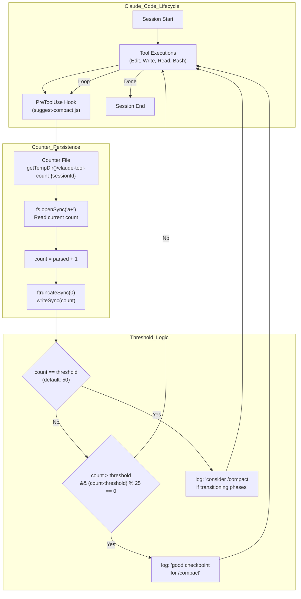
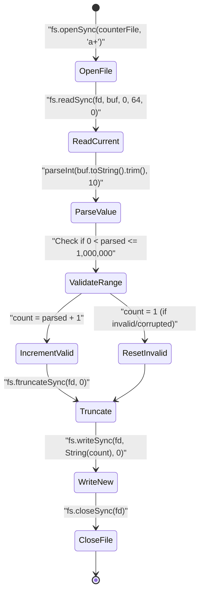
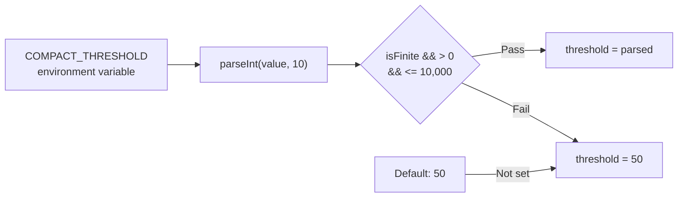
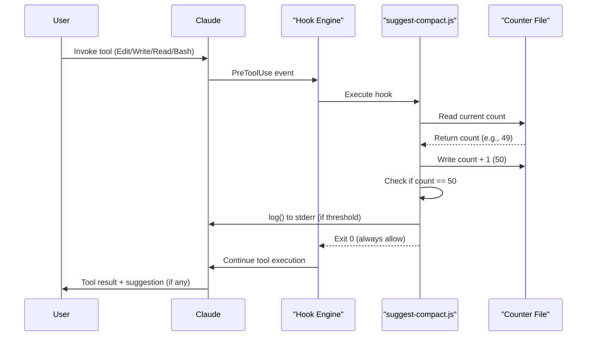

<!-- source: DeepWiki mcp.deepwiki.com · repo affaan-m/everything-claude-code · page 7.5 Strategic Compaction · fetched 2026-10-26 -->

# Strategic Compaction

<details>
<summary>Relevant source files</summary>

The following files were used as context for generating this wiki page:

- [scripts/hooks/session-end.js](scripts/hooks/session-end.js)
- [scripts/hooks/session-start.js](scripts/hooks/session-start.js)
- [scripts/hooks/suggest-compact.js](scripts/hooks/suggest-compact.js)
- [scripts/lib/package-manager.js](scripts/lib/package-manager.js)
- [scripts/lib/session-aliases.js](scripts/lib/session-aliases.js)
- [scripts/lib/session-manager.js](scripts/lib/session-manager.js)
- [scripts/lib/utils.js](scripts/lib/utils.js)
- [scripts/skill-create-output.js](scripts/skill-create-output.js)
- [tests/ci/validators.test.js](tests/ci/validators.test.js)
- [tests/hooks/evaluate-session.test.js](tests/hooks/evaluate-session.test.js)
- [tests/hooks/hooks.test.js](tests/hooks/hooks.test.js)
- [tests/hooks/suggest-compact.test.js](tests/hooks/suggest-compact.test.js)
- [tests/integration/hooks.test.js](tests/integration/hooks.test.js)
- [tests/lib/package-manager.test.js](tests/lib/package-manager.test.js)
- [tests/lib/session-aliases.test.js](tests/lib/session-aliases.test.js)
- [tests/lib/session-manager.test.js](tests/lib/session-manager.test.js)
- [tests/lib/utils.test.js](tests/lib/utils.test.js)
- [tests/scripts/setup-package-manager.test.js](tests/scripts/setup-package-manager.test.js)
- [tests/scripts/skill-create-output.test.js](tests/scripts/skill-create-output.test.js)

</details>


This document describes the strategic compaction system implemented in `suggest-compact.js`, which tracks tool call counts and recommends manual compaction at logical intervals. This is part of the session management system's optimization layer, designed to maintain context quality without arbitrary interruptions.

For information about the PreCompact hook that runs when compaction occurs, see [6.4 Session & Context Hooks](). For general session persistence mechanisms, see [7.4 Session Lifecycle & Persistence]().

---

## Purpose & Philosophy

The strategic compaction system advocates **manual compaction at logical checkpoints** rather than automatic compaction at arbitrary points. The core philosophy:

- **Auto-compact happens mid-task**: Automatic compaction triggers at fixed message counts, often disrupting active work.
- **Context preservation**: Manual compaction allows you to compact after exploration phases, before execution phases.
- **Milestone-based**: Compact after completing a feature, before starting the next one.
- **Strategic timing**: Preserve the most relevant context by choosing when to reset.

The system **suggests** compaction opportunities but never forces them, leaving the decision to the user.

**Sources:** [scripts/hooks/suggest-compact.js:1-14]()

---

## Architecture Overview

Strategic compaction operates as a `PreToolUse` hook that maintains a persistent counter in the system's temporary directory.

**Strategic Compaction Data Flow**


**Counter File Path Resolution:**
- Session ID: `process.env.CLAUDE_SESSION_ID || 'default'` [scripts/hooks/suggest-compact.js:28]()
- File path: `path.join(getTempDir(), \`claude-tool-count-\${sessionId}\`)` [scripts/hooks/suggest-compact.js:23-26]()
- Temp directory varies by platform (from `os.tmpdir()`) [scripts/lib/utils.js:73-75]()

**Sources:** [scripts/hooks/suggest-compact.js:17-75](), [scripts/lib/utils.js:73-75]()

---

## Counter File Mechanics

### File Location & Naming

| Component | Implementation | Example |
|-----------|---------------|---------|
| Base directory | `getTempDir()` (from `os.tmpdir()`) | `/tmp` (Linux/macOS) [scripts/lib/utils.js:75]() |
| Session ID source | `process.env.CLAUDE_SESSION_ID` | `test-session-abc12345` [scripts/hooks/suggest-compact.js:28]() |
| Fallback ID | `'default'` | When `CLAUDE_SESSION_ID` is unset [scripts/hooks/suggest-compact.js:28]() |
| Filename pattern | `claude-tool-count-${sessionId}` | `claude-tool-count-abc12345` [scripts/hooks/suggest-compact.js:23]() |

**Sources:** [scripts/hooks/suggest-compact.js:23-33](), [scripts/lib/utils.js:73-75]()

### Read-Increment-Write Cycle

The counter follows an atomic file descriptor pattern to reduce race conditions during high-frequency tool calls.

**Counter Atomic Update Sequence**


**Race Condition Mitigation:**
- Uses `fs.openSync()` with `'a+'` mode (open for appending, create if not exists) [scripts/hooks/suggest-compact.js:40]().
- Single file descriptor for read → truncate → write sequence [scripts/hooks/suggest-compact.js:41-62]().
- Fallback to `writeFile()` if file descriptor operations fail [scripts/hooks/suggest-compact.js:62]().

**Value Validation:**
- Valid range: `0 < count <= 1,000,000` [scripts/hooks/suggest-compact.js:44-51]().
- Protects against corrupted files with extremely large integers.
- Resets to `1` if parsed value is `NaN`, non-finite, or out of range.

**Sources:** [scripts/hooks/suggest-compact.js:35-62]()

---

## Threshold & Interval System

### Initial Threshold

The system allows users to define a custom threshold via environment variables, defaulting to 50 calls.

**Threshold Resolution Logic**


**Threshold Configuration:**

| Configuration | Value Range | Default | Validation |
|---------------|-------------|---------|------------|
| `COMPACT_THRESHOLD` | 1 - 10,000 | 50 | Must be finite, positive, <= 10,000 [scripts/hooks/suggest-compact.js:30-33]() |
| Invalid values | Any other | Falls back to 50 | Includes `NaN`, negative, zero, > 10,000 |

**First Suggestion:**
- Triggers when `count === threshold` (exact match) [scripts/hooks/suggest-compact.js:64]().
- Message: `"${threshold} tool calls reached - consider /compact if transitioning phases"` [scripts/hooks/suggest-compact.js:66]().

**Sources:** [scripts/hooks/suggest-compact.js:30-33](), [scripts/hooks/suggest-compact.js:64-67]()

### Interval Suggestions

After the initial threshold, the system suggests compaction at **regular 25-call intervals**.

**Calculation:**
`if (count > threshold && (count - threshold) % 25 === 0)` [scripts/hooks/suggest-compact.js:69]()

**Example Progression (threshold = 50):**

| Tool Calls | Suggestion? | Message |
|------------|-------------|---------|
| 50 | ✅ Yes | "50 tool calls reached - consider /compact if transitioning phases" |
| 75 | ✅ Yes | "75 tool calls - good checkpoint for /compact if context is stale" |
| 100 | ✅ Yes | "100 tool calls - good checkpoint for /compact if context is stale" |

**Sources:** [scripts/hooks/suggest-compact.js:69-72]()

---

## Hook Integration

The `suggest-compact.js` script is registered as a **PreToolUse hook** in the plugin configuration.

**Hook Execution Sequence**


**Exit Code Behavior:**
- Always exits with `0` (never blocks tool execution) [scripts/hooks/suggest-compact.js:75]().
- Unlike validation hooks (e.g., `doc-file-warning.js`), this is purely advisory.
- Logs to `stderr` for user visibility but doesn't modify stdin/stdout data flow.

**Sources:** [scripts/hooks/suggest-compact.js:75](), [scripts/hooks/suggest-compact.js:14-15]()

---

## Edge Cases & Error Handling

### Corrupted Counter Files

If the counter file contains non-numeric or invalid data, the system attempts to recover gracefully.

**Validation Logic:**
1. Must be finite number (rejects `NaN`, `Infinity`) [scripts/hooks/suggest-compact.js:44]().
2. Must be positive (rejects `<= 0`) [scripts/hooks/suggest-compact.js:44]().
3. Must be reasonable (rejects `> 1,000,000`) [scripts/hooks/suggest-compact.js:44]().
4. Resets to `1` if any rule fails [scripts/hooks/suggest-compact.js:49]().

**Sources:** [scripts/hooks/suggest-compact.js:43-51]()

### File Descriptor Failures

The system wraps file operations in a try-catch block to prevent hook crashes from affecting the main agent workflow.

```javascript
try {
  const fd = fs.openSync(counterFile, 'a+');
  // ... operations ...
} catch {
  // Fallback: use simple writeFile if fd operations fail
  writeFile(counterFile, String(count));
}
```

**Sources:** [scripts/hooks/suggest-compact.js:40-62]()

---

## Testing Infrastructure

The strategic compaction system has comprehensive test coverage in `tests/hooks/suggest-compact.test.js`, ensuring threshold logic and interval calculations are accurate across platforms.

**Test Coverage Summary:**
- **Basic execution**: Ensures the hook exits 0 and allows tools [tests/hooks/suggest-compact.test.js:146-148]().
- **Atomic updates**: Validates tracking across multiple calls using the `runScript` helper [tests/hooks/suggest-compact.test.js:128-152]().
- **Environment isolation**: Tests use `createTestDir` to ensure side-effect free execution [tests/hooks/suggest-compact.test.js:178-180]().

**Sources:** [tests/hooks/suggest-compact.test.js:128-180]()

---

