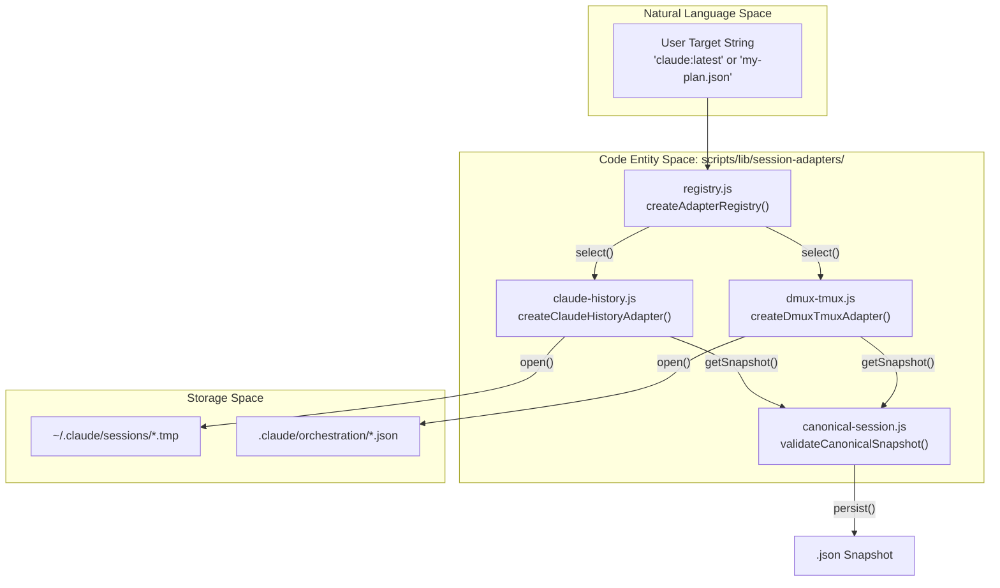
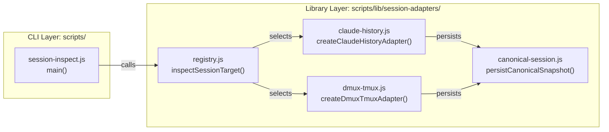

<!-- source: DeepWiki mcp.deepwiki.com · repo affaan-m/everything-claude-code · page 7.6 Session Adapters · fetched 2026-10-26 -->

# Session Adapters

<details>
<summary>Relevant source files</summary>

The following files were used as context for generating this wiki page:

- [commands/sessions.md](commands/sessions.md)
- [commands/skill-health.md](commands/skill-health.md)
- [docs/SESSION-ADAPTER-CONTRACT.md](docs/SESSION-ADAPTER-CONTRACT.md)
- [scripts/lib/resolve-ecc-root.js](scripts/lib/resolve-ecc-root.js)
- [scripts/lib/session-adapters/canonical-session.js](scripts/lib/session-adapters/canonical-session.js)
- [scripts/lib/session-adapters/claude-history.js](scripts/lib/session-adapters/claude-history.js)
- [scripts/lib/session-adapters/dmux-tmux.js](scripts/lib/session-adapters/dmux-tmux.js)
- [scripts/lib/session-adapters/registry.js](scripts/lib/session-adapters/registry.js)
- [scripts/session-inspect.js](scripts/session-inspect.js)
- [tests/hooks/detect-project-worktree.test.js](tests/hooks/detect-project-worktree.test.js)
- [tests/lib/command-plugin-root.test.js](tests/lib/command-plugin-root.test.js)
- [tests/lib/resolve-ecc-root.test.js](tests/lib/resolve-ecc-root.test.js)
- [tests/lib/session-adapters.test.js](tests/lib/session-adapters.test.js)
- [tests/scripts/session-inspect.test.js](tests/scripts/session-inspect.test.js)

</details>


The Session Adapter system provides a unified interface for inspecting and snapshotting AI agent sessions across different execution environments. Whether a session is a standard local Claude Code history file or a complex, multi-worker `dmux` orchestration running in `tmux` with multiple git worktrees, the adapter layer normalizes this data into a **Canonical Session Snapshot**.

## Overview

ECC supports diverse "harnesses" for running Claude. The Session Adapter registry allows tools like the `session-inspect` CLI to treat these disparate data sources as a single unified entity.

Key components include:
*   **Adapter Registry**: Routes a target string (e.g., `claude:latest` or a path to a `plan.json`) to the correct handler [scripts/lib/session-adapters/registry.js:6-12]().
*   **Canonical Format**: A strict JSON schema (`ecc.session.v1`) that represents workers, their intent, runtime state, and outputs [scripts/lib/session-adapters/canonical-session.js:7-8]().
*   **Persistence Layer**: Automatically records snapshots to a temporary recording directory for historical analysis and state tracking [scripts/lib/session-adapters/canonical-session.js:142-147]().

### System Architecture

The following diagram illustrates how the `AdapterRegistry` bridges the gap between the physical storage of sessions and the unified API used by the CLI and other ECC components.

**Session Resolution and Normalization Flow**

Sources: [scripts/lib/session-adapters/registry.js:78-115](), [scripts/lib/session-adapters/claude-history.js:114-154](), [scripts/lib/session-adapters/dmux-tmux.js:43-84]()

---

## The Adapter Registry

The `AdapterRegistry` is the central entry point for session inspection. It manages a list of registered adapters and provides methods to resolve targets to specific adapter instances.

### Target Resolution
The registry uses `normalizeStructuredTarget` to handle both raw strings and structured objects. It supports explicit type-hinting via the `adapterId` or `type` fields to bypass auto-detection [scripts/lib/session-adapters/registry.js:45-76]().

| Target Type | Example Value | Resolved Adapter |
| :--- | :--- | :--- |
| `claude-history` | `latest` or `short-id` | `claude-history` |
| `claude-alias` | `my-feature-session` | `claude-history` |
| `session-file` | `./2026-01-01-abc.tmp` | `claude-history` |
| `plan` | `./my-plan.json` | `dmux-tmux` |
| `session` | `orchestration-session-name` | `dmux-tmux` |

Sources: [scripts/lib/session-adapters/registry.js:6-12](), [scripts/lib/session-adapters/claude-history.js:10-22](), [scripts/lib/session-adapters/dmux-tmux.js:29-41]()

---

## Supported Adapters

### Claude History Adapter (`claude-history`)
This adapter interfaces with the standard Claude Code session management system. It leverages `session-manager.js` and `session-aliases.js` to locate and parse `.tmp` session files [scripts/lib/session-adapters/claude-history.js:6-8]().

*   **Logic**: It detects targets prefixed with `claude:`, `history:`, or raw `.tmp` file paths [scripts/lib/session-adapters/claude-history.js:15-20]().
*   **Resolution**: Uses `resolveSessionRecord` to handle aliases and the `latest` keyword [scripts/lib/session-adapters/claude-history.js:57-112]().
*   **Normalization**: It maps markdown-based session metadata (Branch, Worktree, etc.) into the canonical worker format using `normalizeClaudeHistorySession` [scripts/lib/session-adapters/claude-history.js:139-140]().

### Dmux Tmux Adapter (`dmux-tmux`)
This adapter handles "orchestrated" sessions created via `scripts/orchestrate-worktrees.js`. These sessions involve multiple agents running in parallel across different tmux panes [scripts/lib/session-adapters/dmux-tmux.js:6-7]().

*   **Logic**: It detects `.json` plan files via `isPlanFileTarget` or directories within `.claude/orchestration/` via `isSessionNameTarget` [scripts/lib/session-adapters/dmux-tmux.js:9-27]().
*   **Worker Aggregation**: It collects real-time status from tmux panes, including active PIDs, current commands, and handoff files (`task.md`, `status.md`, `handoff.md`) [tests/lib/session-adapters.test.js:63-113]().

---

## Canonical Session Format

All adapters must emit a snapshot adhering to the `ecc.session.v1` schema. This ensures that downstream consumers can process data without knowing the source harness [scripts/lib/session-adapters/canonical-session.js:7]().

### Snapshot Structure

| Field | Type | Description |
| :--- | :--- | :--- |
| `schemaVersion` | `string` | Always `ecc.session.v1` [scripts/lib/session-adapters/canonical-session.js:7]() |
| `adapterId` | `string` | The ID of the adapter that generated the snapshot (e.g., `dmux-tmux`) [docs/SESSION-ADAPTER-CONTRACT.md:90]() |
| `session.id` | `string` | Unique identifier (e.g., short ID or orchestration name) [docs/SESSION-ADAPTER-CONTRACT.md:99]() |
| `session.kind` | `string` | `history` (Claude) or `orchestrated` (Dmux) [docs/SESSION-ADAPTER-CONTRACT.md:100]() |
| `session.state` | `string` | `active`, `completed`, `failed`, `idle`, or `missing` [docs/SESSION-ADAPTER-CONTRACT.md:179-183]() |
| `workers` | `Array` | List of worker objects containing `intent`, `runtime`, and `outputs` [docs/SESSION-ADAPTER-CONTRACT.md:111-122]() |
| `aggregates` | `Object` | Summary counts of worker states and health [docs/SESSION-ADAPTER-CONTRACT.md:147-154]() |

Sources: [scripts/lib/session-adapters/canonical-session.js:156-214](), [docs/SESSION-ADAPTER-CONTRACT.md:22-81]()

### Worker Health and State
The system includes logic to derive worker health based on process status and file updates:
*   **Health Derivation**: `deriveWorkerHealth` marks workers as `healthy`, `degraded`, `stale`, or `unknown` based on state and the `STALE_THRESHOLD_MS` (5 minutes) [scripts/lib/session-adapters/canonical-session.js:63-90]().
*   **Session State**: `deriveDmuxSessionState` aggregates worker states to determine if the overall session is `completed`, `failed`, or `active` [scripts/lib/session-adapters/canonical-session.js:126-154]().

---

## Session Inspection CLI

The `session-inspect.js` script is the primary tool for emitting unified session views. It supports inspecting both active sessions and skill health patterns [scripts/session-inspect.js:13-37]().

### Command Usage
```bash
# Inspect the most recent Claude session
node scripts/session-inspect.js claude:latest

# Inspect a specific orchestration plan
node scripts/session-inspect.js .claude/plan/workflow.json

# Use an explicit target type for routing
node scripts/session-inspect.js latest --target-type claude-history

# Write the snapshot to a JSON file
node scripts/session-inspect.js claude:a1b2c3d4 --write /tmp/session.json
```
Sources: [scripts/session-inspect.js:13-37](), [tests/scripts/session-inspect.test.js:82-114](), [tests/scripts/session-inspect.test.js:141-167]()

### Implementation Detail
The CLI initializes the `AdapterRegistry`, resolves the target, and calls `getSnapshot()`. If the `--write` flag is provided, it serializes the result to disk; otherwise, it emits the JSON to `stdout` [scripts/session-inspect.js:100-136]().

**CLI to Adapter Mapping**

Sources: [scripts/session-inspect.js:120-127](), [scripts/lib/session-adapters/registry.js:117-120](), [scripts/lib/session-adapters/claude-history.js:142-147](), [scripts/lib/session-adapters/dmux-tmux.js:72-77]()

---

## Skill Loop Integration

The `session-inspect` tool also serves as the interface for the ECC Continuous Learning system's skill improvement loop [scripts/session-inspect.js:66-98]().

*   **`skills:health`**: Aggregates skill failure/success patterns from `observations.jsonl` using `buildSkillHealthReport` [scripts/session-inspect.js:73-77]().
*   **`skills:amendify`**: Proposes a `SKILL.md` patch from failure evidence using `proposeSkillAmendment` [scripts/session-inspect.js:79-85]().
*   **`skills:evaluate`**: Compares baseline vs amended skill outcomes using `buildSkillEvaluationScaffold` [scripts/session-inspect.js:87-95]().

Sources: [scripts/session-inspect.js:13-37](), [tests/scripts/session-inspect.test.js:169-210]()

---

