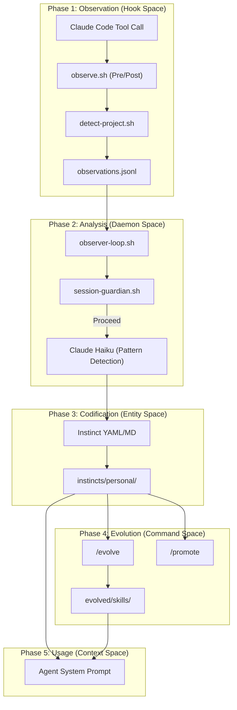

<!-- source: DeepWiki mcp.deepwiki.com · repo affaan-m/everything-claude-code · page 8.1 Continuous Learning v2 Architecture · fetched 2026-10-26 -->

# Continuous Learning v2 Architecture

<details>
<summary>Relevant source files</summary>

The following files were used as context for generating this wiki page:

- [.gitignore](.gitignore)
- [docs/ja-JP/skills/continuous-learning-v2/SKILL.md](docs/ja-JP/skills/continuous-learning-v2/SKILL.md)
- [docs/ko-KR/skills/continuous-learning-v2/SKILL.md](docs/ko-KR/skills/continuous-learning-v2/SKILL.md)
- [docs/tr/skills/continuous-learning-v2/SKILL.md](docs/tr/skills/continuous-learning-v2/SKILL.md)
- [docs/zh-CN/skills/continuous-learning-v2/SKILL.md](docs/zh-CN/skills/continuous-learning-v2/SKILL.md)
- [docs/zh-TW/skills/continuous-learning-v2/SKILL.md](docs/zh-TW/skills/continuous-learning-v2/SKILL.md)
- [scripts/hooks/session-end-marker.js](scripts/hooks/session-end-marker.js)
- [scripts/lib/observer-sessions.js](scripts/lib/observer-sessions.js)
- [skills/continuous-learning-v2/SKILL.md](skills/continuous-learning-v2/SKILL.md)
- [skills/continuous-learning-v2/agents/observer-loop.sh](skills/continuous-learning-v2/agents/observer-loop.sh)
- [skills/continuous-learning-v2/agents/session-guardian.sh](skills/continuous-learning-v2/agents/session-guardian.sh)
- [skills/continuous-learning-v2/agents/start-observer.sh](skills/continuous-learning-v2/agents/start-observer.sh)
- [skills/continuous-learning-v2/hooks/observe.sh](skills/continuous-learning-v2/hooks/observe.sh)
- [skills/continuous-learning-v2/scripts/detect-project.sh](skills/continuous-learning-v2/scripts/detect-project.sh)
- [skills/strategic-compact/SKILL.md](skills/strategic-compact/SKILL.md)
- [tests/docs/continuous-learning-v2-docs.test.js](tests/docs/continuous-learning-v2-docs.test.js)
- [tests/hooks/observe-subdirectory-detection.test.js](tests/hooks/observe-subdirectory-detection.test.js)
- [tests/hooks/observer-memory.test.js](tests/hooks/observer-memory.test.js)

</details>


## Purpose and Scope

This page documents the architecture of the Continuous Learning v2 system, an instinct-based learning framework that observes Claude Code sessions via hooks, detects patterns through background analysis, and codifies learned behaviors as atomic "instincts" with confidence scoring. Version 2.1 introduces project-scoped learning to prevent cross-project contamination by isolating observations and instincts based on project identity. [skills/continuous-learning-v2/SKILL.md:1-14]()

The system bridges the "Natural Language Space" (user intent and model reasoning) with the "Code Entity Space" (tool calls, file edits, and project structures) by capturing the relationship between prompts and their resulting code changes. [skills/continuous-learning-v2/hooks/observe.sh:2-9]()

---

## System Overview

The architecture transitions from unreliable session-end summaries to deterministic, hook-based observation. Every tool execution is captured, analyzed by a background daemon, and converted into structured YAML/Markdown "instincts." [skills/continuous-learning-v2/SKILL.md:36-46]()

| Component | Role | Implementation Entity |
|-----------|------|-----------------------|
| **Observer Hook** | Event Capture | `observe.sh` |
| **Project Detector** | Context Isolation | `detect-project.sh` |
| **Observer Daemon** | Pattern Analysis | `observer-loop.sh` |
| **Session Guardian** | Resource Management | `session-guardian.sh` |
| **Instinct Store** | Knowledge Persistence | `~/.claude/homunculus/projects/` |

**Sources:** [skills/continuous-learning-v2/SKILL.md:36-46](), [skills/continuous-learning-v2/agents/start-observer.sh:25-45]()

---

## Five-Phase Pipeline Architecture

### System Data Flow: From Tool Use to Instinct

This diagram maps the flow from the Claude Code execution environment to the persisted instinct files.



**Sources:** [skills/continuous-learning-v2/SKILL.md:82-124](), [skills/continuous-learning-v2/agents/observer-loop.sh:108-192]()

---

## Phase 1: Observation

### Hook Execution and Project Detection
The `observe.sh` hook is triggered by Claude Code's `PreToolUse` and `PostToolUse` events [skills/continuous-learning-v2/hooks/observe.sh:15-16](). It performs lightweight project detection to ensure observations are stored in the correct project directory. It includes multi-layer guards (Layers 1-5) to prevent "self-observation" (where the observer observes its own analysis sessions) or capturing automated tool sessions [skills/continuous-learning-v2/hooks/observe.sh:133-162]().

```mermaid
sequenceDiagram
    participant CC as "Claude Code"
    participant Hook as "observe.sh"
    participant DP as "detect-project.sh"
    participant Obs as "observations.jsonl"
    participant Loop as "observer-loop.sh"
    
    CC->>Hook: stdin (JSON payload)
    Hook->>Hook: resolve_python_cmd()
    Hook->>Hook: Layer 1-5 Guards (Skip automated sessions)
    Hook->>DP: source detect-project.sh
    DP->>DP: _clv2_detect_project()
    Note over DP: Hashing Git Remote/Path
    DP-->>Hook: Export PROJECT_ID, PROJECT_DIR
    Hook->>Obs: Append JSONL record
    Hook->>Loop: kill -USR1 (Signal Data)
```

**Key Implementation Details:**
- **Throttling:** To prevent signaling storms, `observe.sh` uses a signal counter file (`.observer-signal-counter`) and only signals the daemon every `ECC_OBSERVER_SIGNAL_EVERY_N` (default 20) observations [tests/hooks/observer-memory.test.js:62-77]().
- **Project Hashing:** `detect-project.sh` generates a 12-character SHA256 hash of the git remote URL (or local path) to uniquely identify the project [skills/continuous-learning-v2/scripts/detect-project.sh:111-115]().
- **Subdirectory Resolution:** If `cwd` is provided in stdin, `observe.sh` resolves it to the repo root so observations attach to the project instead of a nested path [skills/continuous-learning-v2/hooks/observe.sh:94-108]().

**Sources:** [skills/continuous-learning-v2/hooks/observe.sh:15-163](), [skills/continuous-learning-v2/scripts/detect-project.sh:52-115](), [tests/hooks/observer-memory.test.js:55-84]()

---

## Phase 2: Analysis

### The Observer Loop and Session Guardian
The `observer-loop.sh` is a background process that analyzes the `observations.jsonl` file. It incorporates a "Session Guardian" and sampling techniques to prevent resource contention [skills/continuous-learning-v2/agents/observer-loop.sh:131-134]().

| Guard Type | Implementation | Purpose |
|------------|----------------|---------|
| **Re-entrancy** | `ANALYZING` flag | Prevents multiple Claude processes from overlapping [skills/continuous-learning-v2/agents/observer-loop.sh:93-111](). |
| **Cooldown** | `ANALYSIS_COOLDOWN` | Minimum seconds between analyses (default 60s) [skills/continuous-learning-v2/agents/observer-loop.sh:14-16](). |
| **Sampling** | `tail -n 500` | Only analyzes the most recent 500 lines to prevent context bloat [skills/continuous-learning-v2/agents/observer-loop.sh:138-142](). |
| **Guardian** | `session-guardian.sh` | Gates cycles based on active hours and idle detection [skills/continuous-learning-v2/agents/observer-loop.sh:131-134](). |

**Sources:** [skills/continuous-learning-v2/agents/observer-loop.sh:11-150](), [tests/hooks/observer-memory.test.js:91-161]()

---

## Phase 3: Codification

### Instinct Structure
Pattern detection results in "Instincts"—atomic units of learned behavior. These are stored in `~/.claude/homunculus/projects/<project_id>/instincts/personal/` [skills/continuous-learning-v2/agents/start-observer.sh:48]().

**Instinct Schema:** [skills/continuous-learning-v2/SKILL.md:51-61]()
- **id**: Kebab-case identifier.
- **trigger**: Natural language condition (e.g., "when writing React components").
- **confidence**: Score from 0.3 to 0.85 based on frequency.
- **domain**: One of `code-style`, `testing`, `git`, `debugging`, `workflow`, `file-patterns`.
- **scope**: `project` (default) or `global`.
- **Evidence**: Tracks observations, patterns, and dates [skills/continuous-learning-v2/agents/observer-loop.sh:177-180]().

**Sources:** [skills/continuous-learning-v2/SKILL.md:48-79](), [skills/continuous-learning-v2/agents/observer-loop.sh:152-192]()

---

## Phase 4: Evolution and Usage

### Knowledge Lifecycle
Instincts move from project-specific observations to global skills through two primary mechanisms:

1.  **Promotion (`/promote`)**: Project-scoped instincts are moved to global scope when the pattern is verified as universal [skills/continuous-learning-v2/SKILL.md:201]().
2.  **Evolution (`/evolve`)**: Related instincts are clustered by domain and similarity to generate full `SKILL.md` files or specialized agents [skills/continuous-learning-v2/SKILL.md:115-122]().

### Agent Context Integration
When an ECC agent starts, the system injects relevant instincts into the prompt based on the current project ID. Project detection uses a registry file at `~/.claude/homunculus/projects.json` to map IDs to human-readable names [skills/continuous-learning-v2/scripts/detect-project.sh:24-25]().

**Sources:** [skills/continuous-learning-v2/SKILL.md:105-124](), [skills/continuous-learning-v2/scripts/detect-project.sh:158-185]()

---

