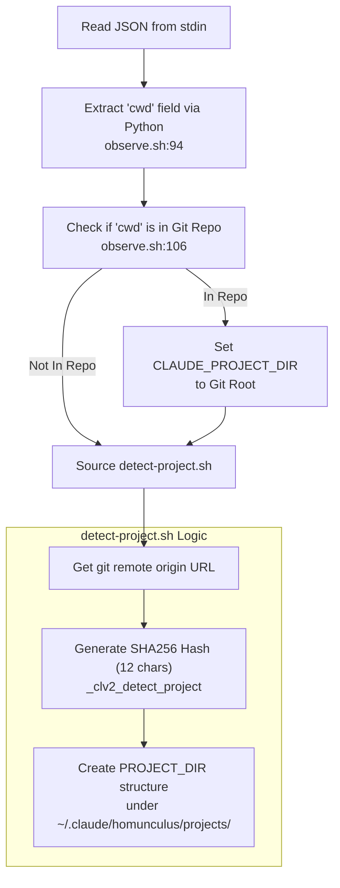
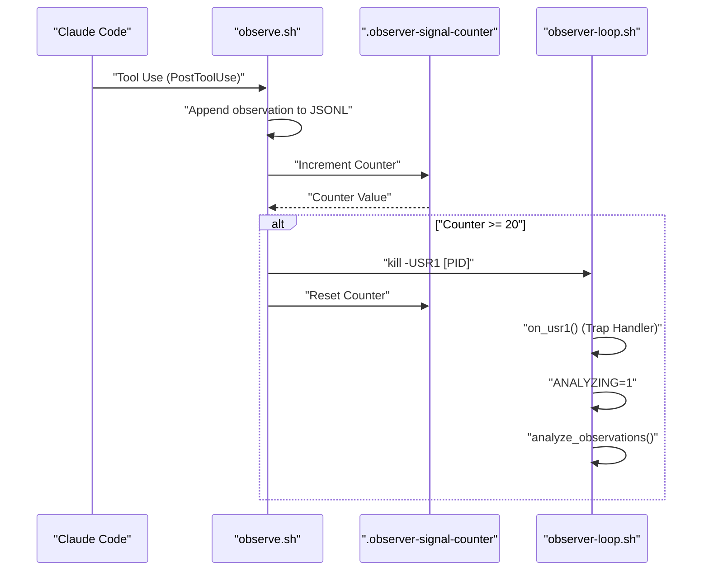
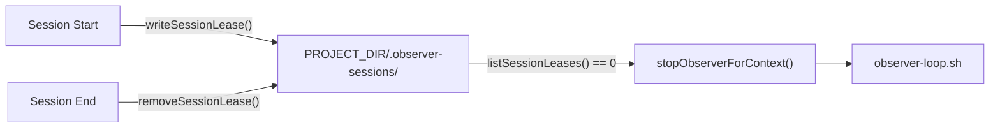

<!-- source: DeepWiki mcp.deepwiki.com · repo affaan-m/everything-claude-code · page 8.2 Observation System · fetched 2026-10-26 -->

# Observation System

<details>
<summary>Relevant source files</summary>

The following files were used as context for generating this wiki page:

- [.gitignore](.gitignore)
- [scripts/hooks/session-end-marker.js](scripts/hooks/session-end-marker.js)
- [scripts/lib/observer-sessions.js](scripts/lib/observer-sessions.js)
- [skills/continuous-learning-v2/agents/observer-loop.sh](skills/continuous-learning-v2/agents/observer-loop.sh)
- [skills/continuous-learning-v2/agents/session-guardian.sh](skills/continuous-learning-v2/agents/session-guardian.sh)
- [skills/continuous-learning-v2/agents/start-observer.sh](skills/continuous-learning-v2/agents/start-observer.sh)
- [skills/continuous-learning-v2/hooks/observe.sh](skills/continuous-learning-v2/hooks/observe.sh)
- [skills/continuous-learning-v2/scripts/detect-project.sh](skills/continuous-learning-v2/scripts/detect-project.sh)
- [skills/strategic-compact/SKILL.md](skills/strategic-compact/SKILL.md)
- [tests/hooks/observe-subdirectory-detection.test.js](tests/hooks/observe-subdirectory-detection.test.js)
- [tests/hooks/observer-memory.test.js](tests/hooks/observer-memory.test.js)

</details>


The Observation System is the data capture layer of the Continuous Learning v2 architecture. It captures tool use events (`Edit`, `Write`, `Read`, `Bash`) as they occur during Claude Code sessions and writes them to project-scoped JSONL files for subsequent analysis by the Observer Agent.

This document covers the `observe.sh` hook implementation, project detection integration, `observations.jsonl` format, archival strategy, and USR1 signaling.

---

## Hook Registration and Execution

The observation hook is implemented as a shell script that integrates with the Claude Code lifecycle. It executes on both `PreToolUse` and `PostToolUse` events to capture the full context of tool invocations.

### Hook Configuration Structure

The hook is typically registered via the plugin's `hooks.json` or manually in `~/.claude/settings.json`:

```json
{
  "PreToolUse": [{
    "matcher": "*",
    "hooks": [{
      "type": "command",
      "command": "~/.claude/skills/continuous-learning-v2/hooks/observe.sh pre"
    }]
  }],
  "PostToolUse": [{
    "matcher": "*",
    "hooks": [{
      "type": "command",
      "command": "~/.claude/skills/continuous-learning-v2/hooks/observe.sh post"
    }]
  }]
}
```

The script receives the hook phase (`pre` or `post`) as the first command-line argument [skills/continuous-learning-v2/hooks/observe.sh:15-16]().

**Execution Model:**
- **PreToolUse**: Captures `tool_start` events, recording the intended tool and its input parameters [skills/continuous-learning-v2/hooks/observe.sh:172-205]().
- **PostToolUse**: Captures `tool_complete` events, including the tool's output or response [skills/continuous-learning-v2/hooks/observe.sh:172-205]().
- **Stdin Protocol**: Claude Code passes hook data as JSON via stdin, which is captured into `INPUT_JSON` [skills/continuous-learning-v2/hooks/observe.sh:22-23]().
- **Non-Blocking**: The script is designed to fail closed or exit early (e.g., if no Python is found) to ensure the main Claude session is never blocked [skills/continuous-learning-v2/hooks/observe.sh:76-80]().

**Sources:** [skills/continuous-learning-v2/hooks/observe.sh:1-80]()

---

## Project Detection Integration

The system utilizes project-scoped storage to enable per-project learning. Observations are written to directories specific to the project's identity, preventing cross-contamination of "instincts" between unrelated codebases.

### Project Detection Flow



**Detection Priority:**
1. **Stdin CWD**: The script extracts the `cwd` from the tool invocation JSON [skills/continuous-learning-v2/hooks/observe.sh:91-102]().
2. **Git Root Resolution**: If the `cwd` is a subdirectory, it resolves to the repository root using `git rev-parse --show-toplevel` [skills/continuous-learning-v2/hooks/observe.sh:105-108]().
3. **Portable Identity**: `detect-project.sh` prefers hashing the git remote URL (stripped of credentials) over the local path to ensure project identity persists across different machines [skills/continuous-learning-v2/scripts/detect-project.sh:88-115]().

**Sources:** [skills/continuous-learning-v2/hooks/observe.sh:87-108](), [skills/continuous-learning-v2/scripts/detect-project.sh:52-156](), [tests/hooks/observe-subdirectory-detection.test.js:130-140]()

---

## Observation Capture Process

The capture process transforms the raw Claude Code hook payload into a normalized format suitable for the `observer-loop.sh` analysis.

### Normalized Observation Record
The Python parser within `observe.sh` extracts and truncates data to prevent memory explosion. Records are stored in `observations.jsonl` within the `PROJECT_DIR` [skills/continuous-learning-v2/hooks/observe.sh:180]().

| Field | Description | Source / Logic |
|-------|-------------|----------------|
| `timestamp` | ISO 8601 UTC | Generated at capture time |
| `event` | `tool_start` / `tool_complete` | Derived from `HOOK_PHASE` [skills/continuous-learning-v2/hooks/observe.sh:172]() |
| `tool` | Tool name | Extracted from JSON payload |
| `input` | Truncated input | Max 5000 chars [skills/continuous-learning-v2/hooks/observe.sh:188]() |
| `output` | Truncated output | Max 5000 chars [skills/continuous-learning-v2/hooks/observe.sh:193]() |
| `session` | Claude Session ID | Extracted from JSON payload |

### Archival and Purge Strategy
To manage disk usage:
- **Size Limit**: If `observations.jsonl` exceeds 10MB, it is archived [skills/continuous-learning-v2/hooks/observe.sh:181]().
- **Time-based Purge**: Files in `observations.archive/` older than 30 days are automatically deleted [skills/continuous-learning-v2/hooks/observe.sh:185-188]().
- **Activity Tracking**: The system touches `.observer-last-activity` on every observation to prevent premature idle shutdown [skills/continuous-learning-v2/hooks/observe.sh:220]().

**Sources:** [skills/continuous-learning-v2/hooks/observe.sh:180-220]()

---

## Observer Signaling via USR1

`observe.sh` acts as the trigger for the background `observer-loop.sh`. It uses Unix signals to wake the observer for immediate processing.

### Throttled Signaling
To avoid overwhelming the system with signals during rapid tool use, `observe.sh` implements a counter-based throttle. It only sends `SIGUSR1` every 20 observations (configurable via `ECC_OBSERVER_SIGNAL_EVERY_N`) [tests/hooks/observer-memory.test.js:76]().



### Re-entrancy and Cooldown
The `observer-loop.sh` daemon protects itself using:
- **ANALYZING Guard**: Skips signals if an analysis is already in progress [skills/continuous-learning-v2/agents/observer-loop.sh:13]().
- **Cooldown**: Enforces a minimum of 60 seconds (default) between analysis runs [skills/continuous-learning-v2/agents/observer-loop.sh:16]().
- **Tail-based Sampling**: When analysis is triggered, the observer only reads the last 500 lines (default) of `observations.jsonl` to prevent context window overflow [skills/continuous-learning-v2/agents/observer-loop.sh:138-142]().

**Sources:** [skills/continuous-learning-v2/agents/observer-loop.sh:11-142](), [tests/hooks/observer-memory.test.js:55-125]()

---

## Automated Session Guards

The system must avoid "observing itself" or other automated processes, which could lead to infinite loops or low-quality data.

- **Entrypoint Filtering**: Only sessions originating from `cli`, `sdk-ts`, or `claude-desktop` are observed [skills/continuous-learning-v2/hooks/observe.sh:137-140]().
- **Agent ID Guard**: If the payload contains an `agent_id`, it is identified as a subagent (automated) and skipped [skills/continuous-learning-v2/hooks/observe.sh:149-150]().
- **Path Exclusion**: Directories like `observer-sessions` or `.claude-mem` are ignored [skills/continuous-learning-v2/hooks/observe.sh:153-162]().
- **Hook Profile**: If `ECC_HOOK_PROFILE` is set to `minimal`, observations are suppressed [skills/continuous-learning-v2/hooks/observe.sh:143]().
- **Idle Timeout**: The observer loop will self-terminate if idle for 30 minutes without active session leases [skills/continuous-learning-v2/agents/observer-loop.sh:70-84]().

**Sources:** [skills/continuous-learning-v2/hooks/observe.sh:128-162](), [skills/continuous-learning-v2/agents/observer-loop.sh:70-84]()

---

## Session Lifecycle and Cleanup

The system tracks active sessions using a lease mechanism to manage the background observer's lifecycle.



- **Lease Creation**: When a session starts, a JSON file is created in `.observer-sessions/` containing the session ID and PID [scripts/lib/observer-sessions.js:102-116]().
- **Lease Removal**: The `session-end-marker.js` hook removes the lease file upon session termination [scripts/hooks/session-end-marker.js:32]().
- **Automatic Shutdown**: If no lease files remain, `session-end-marker.js` sends a `SIGTERM` to the project's observer process [scripts/hooks/session-end-marker.js:35-43]().

**Sources:** [scripts/lib/observer-sessions.js:88-163](), [scripts/hooks/session-end-marker.js:21-49]()

---

