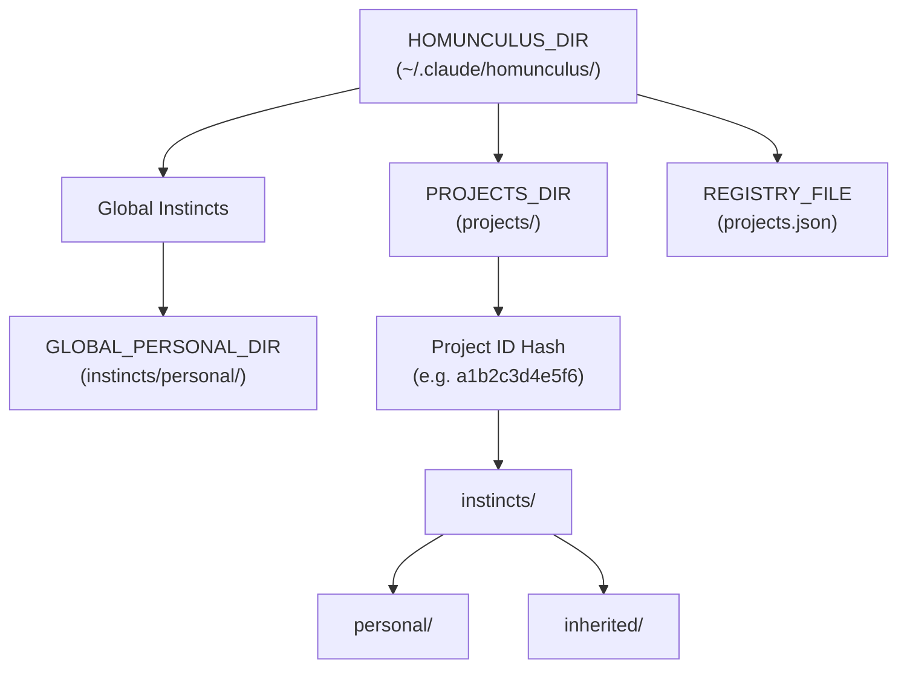
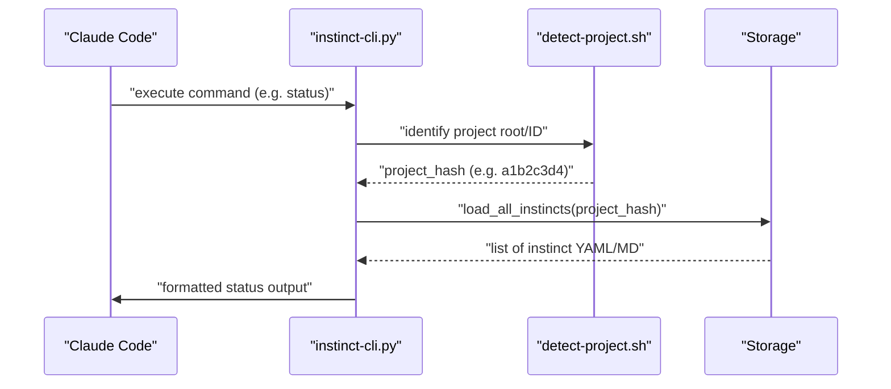

<!-- source: DeepWiki mcp.deepwiki.com · repo affaan-m/everything-claude-code · page 8.4 Instinct Structure & Management · fetched 2026-10-26 -->

# Instinct Structure & Management

<details>
<summary>Relevant source files</summary>

The following files were used as context for generating this wiki page:

- [.gitignore](.gitignore)
- [commands/evolve.md](commands/evolve.md)
- [commands/instinct-export.md](commands/instinct-export.md)
- [commands/instinct-import.md](commands/instinct-import.md)
- [commands/instinct-status.md](commands/instinct-status.md)
- [commands/skill-create.md](commands/skill-create.md)
- [scripts/hooks/session-end-marker.js](scripts/hooks/session-end-marker.js)
- [scripts/lib/observer-sessions.js](scripts/lib/observer-sessions.js)
- [skills/continuous-learning-v2/agents/observer-loop.sh](skills/continuous-learning-v2/agents/observer-loop.sh)
- [skills/continuous-learning-v2/agents/session-guardian.sh](skills/continuous-learning-v2/agents/session-guardian.sh)
- [skills/continuous-learning-v2/agents/start-observer.sh](skills/continuous-learning-v2/agents/start-observer.sh)
- [skills/continuous-learning-v2/hooks/observe.sh](skills/continuous-learning-v2/hooks/observe.sh)
- [skills/continuous-learning-v2/scripts/detect-project.sh](skills/continuous-learning-v2/scripts/detect-project.sh)
- [skills/strategic-compact/SKILL.md](skills/strategic-compact/SKILL.md)
- [tests/hooks/observe-subdirectory-detection.test.js](tests/hooks/observe-subdirectory-detection.test.js)
- [tests/hooks/observer-memory.test.js](tests/hooks/observer-memory.test.js)

</details>


This page documents the structure of instinct files in the continuous learning v2.1 system, their metadata format, confidence scoring mechanism, project scoping rules, storage architecture, and the commands used to manage instincts throughout their lifecycle.

For the overall continuous learning architecture, see [8.1 Continuous Learning v2 Architecture](). For how instincts are created from observations, see [8.3 Observer Agent & Pattern Detection](). For how instincts evolve into skills/commands, see [8.5 Evolution Pipeline]().

---

## Instinct File Format

Instincts are stored as markdown files with YAML frontmatter or standalone YAML files. Each instinct is an atomic learned behavior with a single trigger and action [skills/continuous-learning-v2/SKILL.md:73-74]().

### YAML Frontmatter Structure

The frontmatter defines the metadata used by the `instinct-cli.py` for filtering and clustering [skills/continuous-learning-v2/scripts/instinct-cli.py:101-112]().

```yaml
---
id: prefer-functional-style
trigger: "when writing new functions"
confidence: 0.7
domain: "code-style"
source: "session-observation"
scope: project
project_id: "a1b2c3d4e5f6"
project_name: "my-react-app"
---
```

| Field | Type | Required | Description |
|-------|------|----------|-------------|
| `id` | string | Yes | Kebab-case unique identifier [skills/continuous-learning-v2/scripts/instinct-cli.py:101-112]() |
| `trigger` | string | Yes | Condition that activates the instinct [skills/continuous-learning-v2/SKILL.md:54-54]() |
| `confidence` | float | Yes | 0.3-0.85 weighted score [skills/continuous-learning-v2/agents/observer-loop.sh:164-164]() |
| `domain` | string | Yes | Category (e.g., `code-style`, `testing`, `git`) [skills/continuous-learning-v2/SKILL.md:56-56]() |
| `source` | string | Yes | Origin (usually `session-observation`) [skills/continuous-learning-v2/SKILL.md:57-57]() |
| `scope` | string | Yes | `project` or `global` [skills/continuous-learning-v2/SKILL.md:58-58]() |
| `project_id` | string | Conditional | 12-char hash for project-scoped instincts [skills/continuous-learning-v2/SKILL.md:59-59]() |

**Sources:** [skills/continuous-learning-v2/SKILL.md:51-61](), [skills/continuous-learning-v2/agents/observer-loop.sh:159-170](), [skills/continuous-learning-v2/scripts/instinct-cli.py:101-181]()

---

### Markdown Content Structure

The markdown body contains two required sections that define the instinct's behavior and justification [skills/continuous-learning-v2/SKILL.md:63-71]().

```markdown
# Title

## Action
<what to do, one clear sentence>

## Evidence
- Observed N times in session <id>
- Pattern: <description>
- Last observed: <date>
```

- **Action**: A single-sentence directive describing the behavior [skills/continuous-learning-v2/SKILL.md:65-66]().
- **Evidence**: Bulleted logs provided by the `observer-loop.sh` during generation [skills/continuous-learning-v2/agents/observer-loop.sh:177-180]().

**Sources:** [skills/continuous-learning-v2/SKILL.md:63-71](), [skills/continuous-learning-v2/agents/observer-loop.sh:172-181]()

---

## Instinct Metadata Model

**Diagram: Instinct Metadata Structure**

```mermaid
graph TB
    subgraph "InstinctFile[.yaml or .md]"
        FM["YAML Frontmatter"]
        Body["Markdown Body"]
    end
    
    subgraph "FrontmatterFields"
        ID["id: kebab-case-name"]
        Trigger["trigger: when condition"]
        Conf["confidence: 0.3-0.85"]
        Domain["domain: category"]
        Source["source: origin"]
        Scope["scope: project|global"]
        ProjID["project_id: hash (if project)"]
        ProjName["project_name: name (if project)"]
    end
    
    subgraph "BodySections"
        Title["# Title"]
        Action["## Action<br/>(single directive)"]
        Evidence["## Evidence<br/>(observations)"]
    end
    
    FM --> ID
    FM --> Trigger
    FM --> Conf
    FM --> Domain
    FM --> Source
    FM --> Scope
    FM --> ProjID
    FM --> ProjName
    
    Body --> Title
    Body --> Action
    Body --> Evidence
    
    Scope -.->|if project| ProjID
    Scope -.->|if project| ProjName
```



**Sources:** [skills/continuous-learning-v2/scripts/instinct-cli.py:101-112](), [skills/continuous-learning-v2/SKILL.md:51-71](), [skills/continuous-learning-v2/agents/observer-loop.sh:159-181]()

---

## Storage Architecture

### Directory Structure

The system manages instincts across global and project-specific directories under `~/.claude/homunculus/` [skills/continuous-learning-v2/SKILL.md:105-113](). Project-scoped directories are initialized by `detect-project.sh` [skills/continuous-learning-v2/scripts/detect-project.sh:146-152]().

**Diagram: Instinct Storage Hierarchy**



### Storage Paths

| Scope | Source | Path |
|-------|--------|------|
| Global | Auto-learned | `~/.claude/homunculus/instincts/personal/` [skills/continuous-learning-v2/SKILL.md:110-110]() |
| Project | Auto-learned | `~/.claude/homunculus/projects/<hash>/instincts/personal/` [skills/continuous-learning-v2/scripts/detect-project.sh:147-147]() |
| Project | Inherited | `~/.claude/homunculus/projects/<hash>/instincts/inherited/` [skills/continuous-learning-v2/scripts/detect-project.sh:148-148]() |

**Sources:** [skills/continuous-learning-v2/SKILL.md:105-113](), [skills/continuous-learning-v2/scripts/detect-project.sh:141-152]()

---

## Confidence Scoring System

Confidence in an instinct is weighted based on frequency of observation [skills/continuous-learning-v2/agents/observer-loop.sh:164-164]().

| Confidence | Threshold | Frequency |
|------------|-----------|-----------|
| 0.5 | Tentative | 3-5 times observed [skills/continuous-learning-v2/agents/observer-loop.sh:164-164]() |
| 0.7 | Strong | 6-10 times observed [skills/continuous-learning-v2/agents/observer-loop.sh:164-164]() |
| 0.85 | Near Certain | 11+ times observed [skills/continuous-learning-v2/agents/observer-loop.sh:164-164]() |

The `/evolve` command filters for high-confidence instincts (typically >= 80%) when suggesting new skills or agents [commands/evolve.md:100-100]().

**Sources:** [skills/continuous-learning-v2/agents/observer-loop.sh:164-164](), [commands/evolve.md:100-100]()

---

## Scope Decision System

### Scope Types

1. **Project scope** (`scope: project`): Default for new instincts. Isolated to specific repositories via the `PROJECT_ID` hash [skills/continuous-learning-v2/scripts/detect-project.sh:141-144]().
2. **Global scope** (`scope: global`): Universal patterns shared across all projects, such as input validation or error handling [skills/continuous-learning-v2/agents/observer-loop.sh:189-191]().

### Scope Precedence
When clustering instincts for evolution, the system reads both project and global instincts. Project-scoped instincts take precedence if ID conflicts occur [commands/evolve.md:80-80]().

**Sources:** [skills/continuous-learning-v2/scripts/detect-project.sh:141-144](), [skills/continuous-learning-v2/agents/observer-loop.sh:189-192](), [commands/evolve.md:79-81]()

---

## Instinct Management Commands

Instinct management is performed via slash commands that interface with the `instinct-cli.py` utility [commands/instinct-status.md:13-17]().

| Command | Implementation Path | Purpose |
|---------|---------------------|---------|
| `/instinct-status` | `scripts/instinct-cli.py status` | Show learned instincts for current project + global [commands/instinct-status.md:1-4](). |
| `/instinct-import` | `scripts/instinct-cli.py import` | Import instinct libraries [skills/continuous-learning-v2/SKILL.md:206-206](). |
| `/instinct-export` | `scripts/instinct-cli.py export` | Export current instinct library [skills/continuous-learning-v2/SKILL.md:205-205](). |
| `/evolve` | `scripts/instinct-cli.py evolve` | Cluster related instincts into Skills/Commands/Agents [commands/evolve.md:23-26](). |

**Diagram: instinct-cli.py Internal Flow**



**Sources:** [commands/instinct-status.md:13-17](), [commands/evolve.md:11-21](), [skills/continuous-learning-v2/scripts/detect-project.sh:141-144]()

---

## Evolution Pipeline

The evolution process transforms atomic instincts into complex components [commands/evolve.md:23-26]().

### Evolution Targets

| Target | Criteria | Example |
|--------|----------|---------|
| **Command** | User-invoked repeatable sequences [commands/evolve.md:37-41](). | `/new-table` cluster [commands/evolve.md:43-48](). |
| **Skill** | Auto-triggered behaviors or code style enforcement [commands/evolve.md:50-53](). | `functional-patterns` skill [commands/evolve.md:56-61](). |
| **Agent** | Complex processes requiring isolation and multi-step depth [commands/evolve.md:63-67](). | `debugger` agent [commands/evolve.md:69-75](). |

If the `--generate` flag is used, the system writes the evolved markdown files to the project's `evolved/` directory [commands/evolve.md:87-89]().

**Sources:** [commands/evolve.md:35-90](), [commands/evolve.md:120-123]()

---

## Project Registry

The system maintains a mapping of project IDs to human-readable names and paths in `~/.claude/homunculus/projects.json` [skills/continuous-learning-v2/scripts/detect-project.sh:24-24](). This is updated atomically via Python to prevent corruption [skills/continuous-learning-v2/scripts/detect-project.sh:189-199]().

**Project Detection Logic**:
1. **`CLAUDE_PROJECT_DIR`**: Manual override [skills/continuous-learning-v2/scripts/detect-project.sh:58-62]().
2. **Git Remote URL**: Hashed (SHA256, first 12 chars) to create a portable project ID [skills/continuous-learning-v2/scripts/detect-project.sh:111-115]().
3. **Git Toplevel**: Machine-specific fallback [skills/continuous-learning-v2/scripts/detect-project.sh:65-70]().
4. **Global Fallback**: Used if no project context is detected [skills/continuous-learning-v2/scripts/detect-project.sh:73-78]().

**Sources:** [skills/continuous-learning-v2/scripts/detect-project.sh:52-156](), [skills/continuous-learning-v2/scripts/detect-project.sh:189-199]()

---

