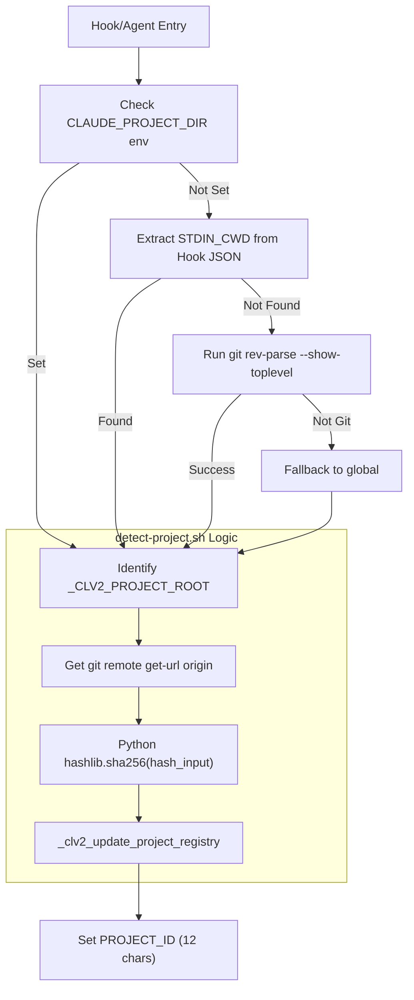
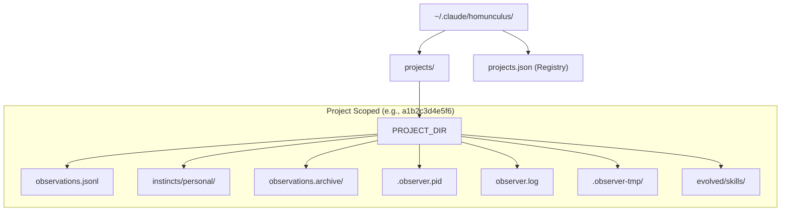

<!-- source: DeepWiki mcp.deepwiki.com · repo affaan-m/everything-claude-code · page 8.6 Project-Scoped Learning · fetched 2026-10-26 -->

# Project-Scoped Learning

<details>
<summary>Relevant source files</summary>

The following files were used as context for generating this wiki page:

- [.gitignore](.gitignore)
- [commands/projects.md](commands/projects.md)
- [commands/promote.md](commands/promote.md)
- [scripts/hooks/doc-file-warning.js](scripts/hooks/doc-file-warning.js)
- [scripts/hooks/session-end-marker.js](scripts/hooks/session-end-marker.js)
- [scripts/lib/observer-sessions.js](scripts/lib/observer-sessions.js)
- [scripts/lib/project-detect.js](scripts/lib/project-detect.js)
- [skills/continuous-learning-v2/agents/observer-loop.sh](skills/continuous-learning-v2/agents/observer-loop.sh)
- [skills/continuous-learning-v2/agents/observer.md](skills/continuous-learning-v2/agents/observer.md)
- [skills/continuous-learning-v2/agents/session-guardian.sh](skills/continuous-learning-v2/agents/session-guardian.sh)
- [skills/continuous-learning-v2/agents/start-observer.sh](skills/continuous-learning-v2/agents/start-observer.sh)
- [skills/continuous-learning-v2/config.json](skills/continuous-learning-v2/config.json)
- [skills/continuous-learning-v2/hooks/observe.sh](skills/continuous-learning-v2/hooks/observe.sh)
- [skills/continuous-learning-v2/scripts/detect-project.sh](skills/continuous-learning-v2/scripts/detect-project.sh)
- [skills/continuous-learning-v2/scripts/instinct-cli.py](skills/continuous-learning-v2/scripts/instinct-cli.py)
- [skills/continuous-learning-v2/scripts/test_parse_instinct.py](skills/continuous-learning-v2/scripts/test_parse_instinct.py)
- [skills/strategic-compact/SKILL.md](skills/strategic-compact/SKILL.md)
- [tests/hooks/doc-file-warning.test.js](tests/hooks/doc-file-warning.test.js)
- [tests/hooks/observe-subdirectory-detection.test.js](tests/hooks/observe-subdirectory-detection.test.js)
- [tests/hooks/observer-memory.test.js](tests/hooks/observer-memory.test.js)
- [tests/lib/project-detect.test.js](tests/lib/project-detect.test.js)

</details>


This document explains how the continuous learning system isolates observations, instincts, and analysis by project context. Project scoping enables per-project learning patterns while maintaining a global knowledge base for universal patterns.

For the overall continuous learning architecture, see [8.1 Continuous Learning v2 Architecture](). For instinct structure and management, see [8.4 Instinct Structure & Management](). For the evolution pipeline that promotes project instincts to global scope, see [8.5 Evolution Pipeline]().

---

## Purpose and Benefits

Project-scoped learning solves the problem of conflicting conventions across codebases. A pattern learned in a Django REST framework project (e.g., "use ViewSets with routers") should not apply to an Express.js project. Project scoping provides:

- **Isolation**: Observations from different projects are stored separately in project-specific directories [skills/continuous-learning-v2/hooks/observe.sh:7-8]().
- **Context**: Instincts include project metadata (`project_id`, `project_name`) to anchor them to their origin [skills/continuous-learning-v2/agents/observer-loop.sh:168-169]().
- **Precision**: Pattern detection analyzes project-specific behavior logs rather than a mixed global stream [skills/continuous-learning-v2/agents/observer-loop.sh:118-119]().
- **Promotion**: Universal patterns can be promoted to global scope via the `/promote` command [skills/continuous-learning-v2/scripts/instinct-cli.py:13]().

The system maintains both project-scoped storage under `~/.claude/homunculus/projects/` and global fallback storage under `~/.claude/homunculus/` [skills/continuous-learning-v2/scripts/detect-project.sh:22-23]().

**Sources:** [skills/continuous-learning-v2/hooks/observe.sh:7-8](), [skills/continuous-learning-v2/agents/observer-loop.sh:118-169](), [skills/continuous-learning-v2/scripts/instinct-cli.py:13](), [skills/continuous-learning-v2/scripts/detect-project.sh:22-23]()

---

## Project Detection System

### Detection Flow

The `detect-project.sh` script (and its Python equivalent in `instinct-cli.py`) runs at the start of observation hooks and observer agents to establish project identity. It sets environment variables that subsequent scripts use to locate storage.

**Project Identity Mapping (Code to System)**

**Sources:** [skills/continuous-learning-v2/scripts/detect-project.sh:52-156](), [skills/continuous-learning-v2/hooks/observe.sh:94-108](), [skills/continuous-learning-v2/scripts/instinct-cli.py:128-181]()

### Environment Variables Set

The following variables are exported by `detect-project.sh` for use in the learning pipeline:

| Variable | Description | Source Logic |
|----------|-------------|--------------|
| `PROJECT_ROOT` | Absolute path to the detected project base (e.g., git repo root). | [skills/continuous-learning-v2/scripts/detect-project.sh:143]() |
| `PROJECT_ID` | 12-character SHA256 hash of the git remote URL or path. | [skills/continuous-learning-v2/scripts/detect-project.sh:141]() |
| `PROJECT_NAME` | Basename of the `PROJECT_ROOT` directory. | [skills/continuous-learning-v2/scripts/detect-project.sh:142]() |
| `PROJECT_DIR` | Absolute path to the scoped storage directory under `~/.claude/homunculus/projects/`. | [skills/continuous-learning-v2/scripts/detect-project.sh:144]() |

**Sources:** [skills/continuous-learning-v2/scripts/detect-project.sh:141-144]()

### Priority Cascade

Project detection follows this priority order:

1. **`CLAUDE_PROJECT_DIR` environment variable**: Explicit override [skills/continuous-learning-v2/scripts/detect-project.sh:59]().
2. **`cwd` field from hook stdin JSON**: Extracted from the `INPUT_JSON` passed by Claude Code to hooks, resolved to git root if applicable [skills/continuous-learning-v2/hooks/observe.sh:94-108]().
3. **Git repository root**: Primary detection method using `git rev-parse --show-toplevel` [skills/continuous-learning-v2/scripts/detect-project.sh:66]().
4. **"global" fallback**: Used if no project context is detected, pointing to the base homunculus directory [skills/continuous-learning-v2/scripts/detect-project.sh:73-77]().

**Sources:** [skills/continuous-learning-v2/scripts/detect-project.sh:59-77](), [skills/continuous-learning-v2/hooks/observe.sh:94-108]()

---

## Storage Architecture

### Directory Structure

Project-specific data is stored in a hashed subdirectory to ensure isolation. The `_clv2_detect_project` function ensures this structure exists upon detection, including directories for personal instincts, inherited instincts, and evolved components [skills/continuous-learning-v2/scripts/detect-project.sh:147-152]().

**Homunculus Storage Layout**

**Sources:** [skills/continuous-learning-v2/scripts/detect-project.sh:144-152](), [skills/continuous-learning-v2/agents/start-observer.sh:45-48](), [skills/continuous-learning-v2/agents/observer-loop.sh:139-141]()

### Key Data Entities

| Entity | Path (relative to `PROJECT_DIR`) | Purpose |
|--------|----------------------------------|---------|
| **Observations** | `observations.jsonl` | Append-only log of tool use events for the specific project [skills/continuous-learning-v2/hooks/observe.sh:180](). |
| **Instincts** | `instincts/personal/` | Markdown files containing learned patterns generated by the observer [skills/continuous-learning-v2/agents/start-observer.sh:48](). |
| **Project Registry** | `~/.claude/homunculus/projects.json` | JSON mapping of `PROJECT_ID` to metadata (root, name, remote) [skills/continuous-learning-v2/scripts/detect-project.sh:24](). |
| **State Guard** | `.observer.pid` | Lock file containing the PID of the project's background observer [skills/continuous-learning-v2/agents/start-observer.sh:45](). |

**Sources:** [skills/continuous-learning-v2/scripts/detect-project.sh:24](), [skills/continuous-learning-v2/hooks/observe.sh:180](), [skills/continuous-learning-v2/agents/start-observer.sh:45-48]()

---

## Project Context in Observations

### Observation Format

Every observation written by `observe.sh` captures the project context. The script parses the incoming hook JSON using a Python subprocess to map fields like `tool_name`, `tool_input`, and `session_id` [skills/continuous-learning-v2/hooks/observe.sh:190-202]().

The `observe.sh` script attaches the `PROJECT_ID` and `PROJECT_NAME` derived from `detect-project.sh` to every entry to ensure downstream analysis remains scoped [skills/continuous-learning-v2/hooks/observe.sh:173-175]().

**Sources:** [skills/continuous-learning-v2/hooks/observe.sh:173-202]()

---

## Project Context in Instincts

### YAML Frontmatter

The `observer-loop.sh` uses a prompt that mandates specific YAML frontmatter for every generated instinct. This metadata includes the `project_id` and `scope` to prevent cross-contamination [skills/continuous-learning-v2/agents/observer-loop.sh:161-170]().

```yaml
---
id: kebab-case-name
trigger: when <specific condition>
confidence: <0.3-0.85 based on frequency>
domain: <domain-type>
source: session-observation
scope: project
project_id: ${PROJECT_ID}
project_name: ${PROJECT_NAME}
---
```

### Scope Decision Logic

The system distinguishes between project-specific conventions and universal best practices. The observer is instructed to set `scope: global` if a pattern is universally applicable [skills/continuous-learning-v2/agents/observer-loop.sh:189-191]().

| Pattern Type | Scope | Storage Location |
|--------------|-------|------------------|
| **Framework Style** | `project` | `PROJECT_DIR/instincts/personal/` |
| **Local File Patterns** | `project` | `PROJECT_DIR/instincts/personal/` |
| **Security Best Practices** | `global` | `~/.claude/homunculus/instincts/personal/` |
| **General Workflow** | `global` | `~/.claude/homunculus/instincts/personal/` |

**Sources:** [skills/continuous-learning-v2/agents/observer-loop.sh:189-191](), [skills/continuous-learning-v2/scripts/instinct-cli.py:46-48]()

---

## Multi-Project Observer Management

### Independent Daemons

Each project has its own background observer loop. This is managed by `start-observer.sh`, which uses project-scoped PID files to track status [skills/continuous-learning-v2/agents/start-observer.sh:45]().

- **Start**: `start-observer.sh start` launches `observer-loop.sh` using `nohup` with project-specific environment variables [skills/continuous-learning-v2/agents/start-observer.sh:199-212]().
- **Status**: `start-observer.sh status` checks if the PID in `PROJECT_DIR/.observer.pid` is active and reports project-specific stats [skills/continuous-learning-v2/agents/start-observer.sh:148-168]().
- **Stop**: `start-observer.sh stop` kills the process identified in the PID file [skills/continuous-learning-v2/agents/start-observer.sh:55-73]().

**Sources:** [skills/continuous-learning-v2/agents/start-observer.sh:45-212]()

### Signal Routing and Throttling

To prevent high CPU usage and memory explosion when multiple projects are active, the system implements several guards:

1. **Re-entrancy Guard**: The `ANALYZING` variable in `observer-loop.sh` prevents multiple analyses from running concurrently for the same project [skills/continuous-learning-v2/agents/observer-loop.sh:13, 91-100]().
2. **Cooldown**: `ANALYSIS_COOLDOWN` (default 60s) prevents rapid re-triggering via `USR1` signals [skills/continuous-learning-v2/agents/observer-loop.sh:16, 119-128]().
3. **Tail-based Sampling**: Only the last `MAX_ANALYSIS_LINES` (default 500) are analyzed to keep payloads manageable [skills/continuous-learning-v2/agents/observer-loop.sh:138-142]().
4. **Signal Throttling**: `observe.sh` only signals the observer daemon every `SIGNAL_EVERY_N` observations (default 20) using a `.observer-signal-counter` file [tests/hooks/observer-memory.test.js:57-77]().

**Sources:** [skills/continuous-learning-v2/agents/observer-loop.sh:13-142](), [tests/hooks/observer-memory.test.js:57-160]()

---

## Global Fallback and Promotion

### Global Fallback

If `detect-project.sh` cannot identify a git repository or project root, it sets `PROJECT_ID` to `"global"` and `PROJECT_DIR` to the root `~/.claude/homunculus/` directory [skills/continuous-learning-v2/scripts/detect-project.sh:73-77](). This ensures learning still occurs even in ad-hoc environments.

### Promotion Pipeline

The `promote` command in `instinct-cli.py` facilitates moving instincts from project scope to global scope.

1. **Criteria**: It identifies patterns appearing in multiple projects (`PROMOTE_MIN_PROJECTS = 2`) with high confidence scores [skills/continuous-learning-v2/scripts/instinct-cli.py:53-54]().
2. **Registry**: Uses `projects.json` to scan all known projects for candidate instincts [skills/continuous-learning-v2/scripts/instinct-cli.py:43, 197]().
3. **Execution**: Updates the YAML frontmatter to `scope: global` and moves the file to the global personal directory [skills/continuous-learning-v2/scripts/instinct-cli.py:47, 13]().

**Sources:** [skills/continuous-learning-v2/scripts/detect-project.sh:73-77](), [skills/continuous-learning-v2/scripts/instinct-cli.py:13-197]()

---

