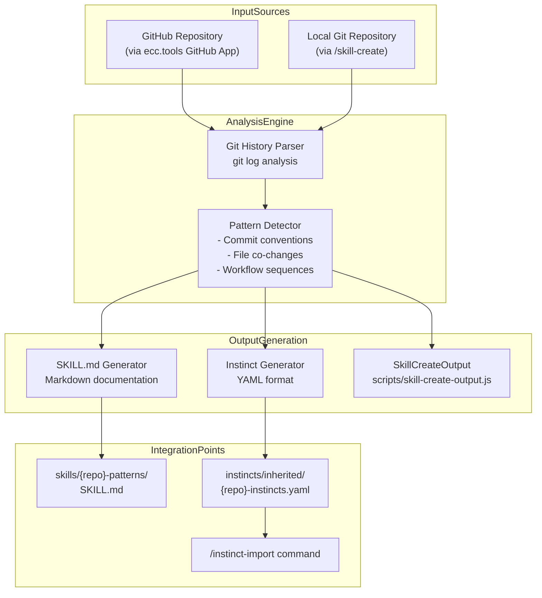
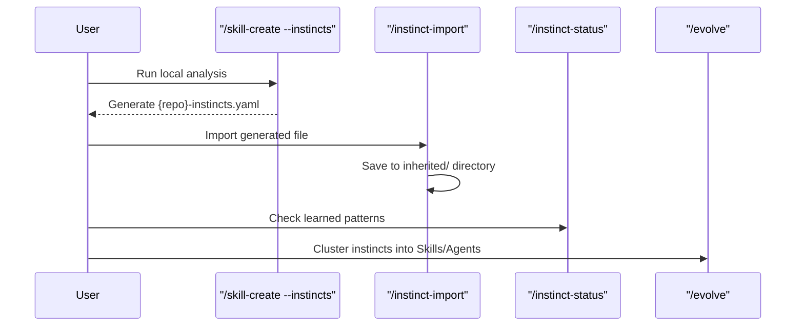

<!-- source: DeepWiki mcp.deepwiki.com · repo affaan-m/everything-claude-code · page 8.7 Skill Creator Integration · fetched 2026-10-26 -->

# Skill Creator Integration

<details>
<summary>Relevant source files</summary>

The following files were used as context for generating this wiki page:

- [commands/evolve.md](commands/evolve.md)
- [commands/instinct-export.md](commands/instinct-export.md)
- [commands/instinct-import.md](commands/instinct-import.md)
- [commands/instinct-status.md](commands/instinct-status.md)
- [commands/skill-create.md](commands/skill-create.md)
- [scripts/skill-create-output.js](scripts/skill-create-output.js)
- [tests/hooks/evaluate-session.test.js](tests/hooks/evaluate-session.test.js)
- [tests/hooks/suggest-compact.test.js](tests/hooks/suggest-compact.test.js)
- [tests/scripts/setup-package-manager.test.js](tests/scripts/setup-package-manager.test.js)
- [tests/scripts/skill-create-output.test.js](tests/scripts/skill-create-output.test.js)

</details>


The Skill Creator system analyzes git repository history to automatically extract coding patterns and generate Skills and Instincts. Skill Creator operates in two modes: a GitHub App for remote repositories and a local command (`/skill-create`) for analyzing local git history. Both modes integrate with the Continuous Learning System by generating instincts that can be imported via `/instinct-import` and later evolved into high-level constructs.

---

## System Architecture

The Skill Creator system utilizes a specialized output formatter and git analysis logic to bridge the gap between raw version control history and actionable AI instructions.

### Data Flow Overview

Title: Skill Creator Data Flow


**Sources:** [commands/skill-create.md:1-175](), [scripts/skill-create-output.js:81-86]()

---

## Local Command Mode

The `/skill-create` command provides local git analysis without external dependencies. It uses standard git tools to inspect the history of the current working directory.

### Command Interface

| Flag | Purpose | Default |
| :--- | :--- | :--- |
| `--commits N` | Analyze last N commits | 200 |
| `--output PATH` | Output directory for generated files | `./.claude/skills` |
| `--instincts` | Also generate instincts for the learning system | false |

**Sources:** [commands/skill-create.md:4-18]()

### Git Analysis Pipeline

The analyzer executes specific git commands to extract structural and behavioral data:

```bash
# 1. Extract recent commits with file changes for sequence analysis
git log --oneline -n 200 --name-only --pretty=format:"%H|%s|%ad" --date=short

# 2. Calculate file change frequency to identify core modules
git log --oneline -n 200 --name-only | grep -v "^$" | sort | uniq -c | sort -rn | head -20

# 3. Analyze commit message patterns for convention detection
git log --oneline -n 200 | cut -d' ' -f2- | head -50
```

**Sources:** [commands/skill-create.md:32-39]()

---

## Output Formatter (`SkillCreateOutput`)

The `SkillCreateOutput` class in `scripts/skill-create-output.js` provides a high-fidelity terminal UI for the analysis results. It is designed to be zero-dependency, implementing its own internal styling and box-drawing logic.

### UI Implementation Details

The class uses a `CHALK` object for ANSI styling and a `BOX` constant for consistent borders.

Title: SkillCreateOutput Class Structure
```mermaid
classDiagram
    class SkillCreateOutput {
        +string repoName
        +number width
        +header()
        +analysisResults(data)
        +patterns(patterns)
        +instincts(instincts)
        +output(skillPath, instinctPath)
        +nextSteps()
        -progressBar(confidence)
    }
    
    SkillCreateOutput ..> BOX : uses
    SkillCreateOutput ..> chalk : uses

    style SkillCreateOutput stroke-width:2px
```

**Sources:** [scripts/skill-create-output.js:1-174](), [tests/scripts/skill-create-output.test.js:59-68]()

### Key Methods

*   **`analysisResults(data)`**: Renders a summary box containing commit counts, time ranges, and contributor metrics. [scripts/skill-create-output.js:112-120]()
*   **`patterns(patterns)`**: Displays discovered patterns with a visual `progressBar` (using `█` and `░` characters) indicating detection confidence. [scripts/skill-create-output.js:122-136]()
*   **`instincts(instincts)`**: Renders a summary of generated instincts and their associated confidence scores. [scripts/skill-create-output.js:138-143]()
*   **`progressBar(percent, width)`**: Internal helper that clamps confidence values between 0 and 100 to prevent `RangeError` during string repetition. [scripts/skill-create-output.js:55-60](), [tests/scripts/skill-create-output.test.js:185-192]()

---

## Pattern Detection Methods

The analyzer identifies five primary pattern types by correlating git history with filesystem structure:

| Pattern Type | Detection Method | Example Output |
| :--- | :--- | :--- |
| **Commit conventions** | Regex on commit messages | `feat:`, `fix:`, `chore:` prefix usage |
| **File co-changes** | Statistical correlation | "Files X and Y always change together" |
| **Workflow sequences** | Temporal file change patterns | "Migration → Schema → Types" sequence |
| **Architecture** | Directory structure analysis | Service layer in `services/` vs `logic/` |
| **Testing patterns** | Test file location/naming | `__tests__/` vs `.test.ts` conventions |

**Sources:** [commands/skill-create.md:44-52]()

---

## Integration with Continuous Learning

The Skill Creator serves as a major ingestion point for the Continuous Learning v2 system.

### Instinct Generation

When the `--instincts` flag is used, the system generates YAML files compatible with the `instinct-import` command. These instincts include:
*   **Trigger**: The context in which the pattern applies (e.g., "when writing a commit message"). [commands/skill-create.md:89-89]()
*   **Confidence**: A score based on how consistently the pattern appeared in the analyzed commits. [commands/skill-create.md:90-90]()
*   **Evidence**: A summary of the git history that justifies the pattern. [commands/skill-create.md:100-103]()

### Import and Evolution

Title: Skill Creation to Evolution Lifecycle


1.  **Ingestion**: The user runs `/instinct-import` on the generated file. [commands/instinct-import.md:28-32]()
2.  **Tracking**: The system marks these as `source: inherited` to distinguish them from locally observed patterns. [commands/instinct-import.md:87-87]()
3.  **Evolution**: The `/evolve` command can then cluster these inherited instincts with local observations to create comprehensive global skills. [commands/evolve.md:1-33]()

**Sources:** [commands/skill-create.md:166-171](), [commands/evolve.md:1-5](), [commands/instinct-import.md:1-5]()

---

## GitHub App Mode (`ecc.tools`)

The `ecc.tools` GitHub App (formerly Skill Creator) provides cloud-based repository analysis for remote repositories.

### Usage Pattern
1.  Install the app on a GitHub repository. [commands/skill-create.md:162-162]()
2.  Trigger analysis via a comment (e.g., `/skill-creator analyze`). [commands/skill-create.md:164-164]()
3.  The app analyzes the full history (supporting 10,000+ commits). [commands/skill-create.md:160-160]()
4.  The app opens a Pull Request with generated `SKILL.md` and instinct files. [commands/skill-create.md:165-165]()

**Sources:** [commands/skill-create.md:158-165](), [scripts/skill-create-output.js:171-171]()

---

