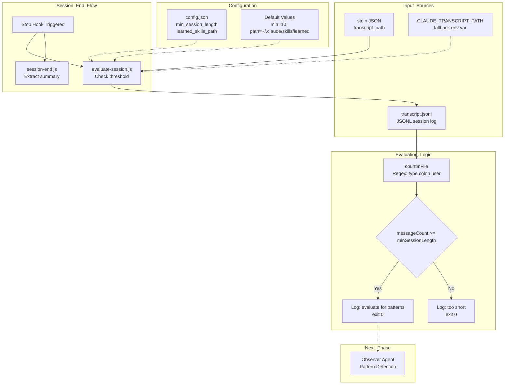
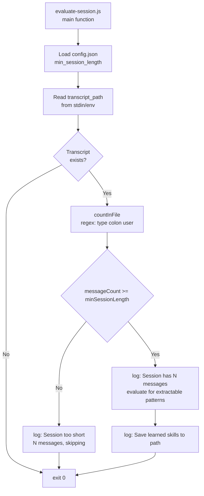
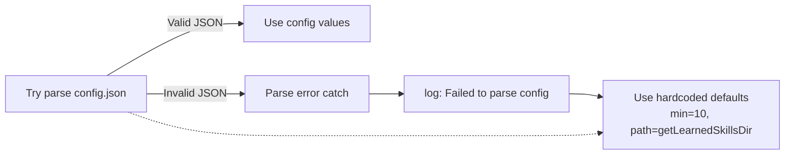
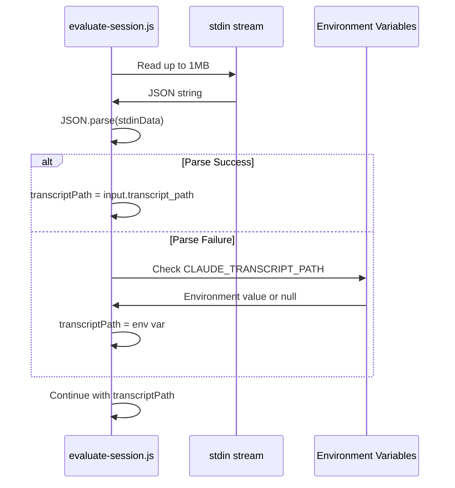

<!-- source: DeepWiki mcp.deepwiki.com · repo affaan-m/everything-claude-code · page 8.8 Evaluation System · fetched 2026-10-26 -->

# Evaluation System

<details>
<summary>Relevant source files</summary>

The following files were used as context for generating this wiki page:

- [.claude/package-manager.json](.claude/package-manager.json)
- [commands/setup-pm.md](commands/setup-pm.md)
- [scripts/hooks/check-console-log.js](scripts/hooks/check-console-log.js)
- [scripts/hooks/evaluate-session.js](scripts/hooks/evaluate-session.js)
- [scripts/hooks/post-edit-console-warn.js](scripts/hooks/post-edit-console-warn.js)
- [scripts/hooks/post-edit-format.js](scripts/hooks/post-edit-format.js)
- [scripts/hooks/post-edit-typecheck.js](scripts/hooks/post-edit-typecheck.js)
- [scripts/hooks/pre-compact.js](scripts/hooks/pre-compact.js)
- [scripts/skill-create-output.js](scripts/skill-create-output.js)
- [tests/hooks/evaluate-session.test.js](tests/hooks/evaluate-session.test.js)
- [tests/hooks/suggest-compact.test.js](tests/hooks/suggest-compact.test.js)
- [tests/scripts/setup-package-manager.test.js](tests/scripts/setup-package-manager.test.js)
- [tests/scripts/skill-create-output.test.js](tests/scripts/skill-create-output.test.js)

</details>


The Evaluation System determines whether a Claude Code session contains sufficient interaction to warrant pattern extraction and instinct generation. It runs on the `Stop` hook to analyze session transcripts and applies a configurable message count threshold to filter out trivial sessions. This system serves as the entry point for the continuous learning pipeline, preventing noise from short sessions while capturing meaningful interactions for analysis.

For information about the pattern detection and instinct generation that follows evaluation, see [8.3. Observer Agent & Pattern Detection](). For session persistence and summary extraction, see [7.4. Session Lifecycle & Persistence]().

---

## System Architecture

The Evaluation System operates as a lightweight gatekeeper between session completion and the continuous learning analysis pipeline. It reads session transcript metadata, applies threshold criteria, and signals whether deeper analysis should occur.

### Evaluation Data Flow



**Sources:** [scripts/hooks/evaluate-session.js:1-101]()

---

## Hook Execution Context

The Evaluation System runs on the **Stop hook**, which fires once per session after all responses complete. This design choice minimizes latency compared to per-message hooks like `UserPromptSubmit`.

### Stop Hook vs UserPromptSubmit

| Aspect | Stop Hook | UserPromptSubmit Hook |
|--------|-----------|----------------------|
| **Trigger frequency** | Once per session | Every user message |
| **Latency impact** | None (post-session) | Adds delay per message |
| **Use case** | Session-level analysis | Real-time validation |
| **Resource cost** | Low (single execution) | High (N executions) |

The Stop hook receives a JSON payload via stdin containing `transcript_path`, which points to the session's JSONL transcript file [scripts/hooks/evaluate-session.js:25-53](). If JSON parsing fails, the system falls back to the `CLAUDE_TRANSCRIPT_PATH` environment variable for backward compatibility [scripts/hooks/evaluate-session.js:51-53]().

**Sources:** [scripts/hooks/evaluate-session.js:10-13](), [scripts/hooks/evaluate-session.js:25-53]()

---

## Session Length Threshold

The core evaluation criterion is the **message count threshold**, which defaults to 10 user messages [scripts/hooks/evaluate-session.js:60-60](). Sessions below this threshold are considered too short for meaningful pattern extraction.

### Threshold Logic



The `countInFile` utility function uses a regex pattern `/"type"\s*:\s*"user"/g` to count user messages in the JSONL transcript [scripts/hooks/evaluate-session.js:87-87](). The regex includes optional whitespace (`\s*`) around the colon to handle both minified and pretty-printed JSON formats.

**Sources:** [scripts/hooks/evaluate-session.js:86-98]()

---

## Configuration System

The Evaluation System reads configuration from `skills/continuous-learning/config.json`, which defines threshold and output path parameters [scripts/hooks/evaluate-session.js:56-57]().

### Configuration Schema

| Parameter | Type | Default | Description |
|-----------|------|---------|-------------|
| `min_session_length` | `number` | `10` | Minimum user messages required for evaluation |
| `learned_skills_path` | `string` | `~/.claude/skills/learned` | Directory for generated skills (supports `~` expansion) |

### Configuration Loading Priority



The system falls back to defaults if the config file is missing or contains invalid JSON [scripts/hooks/evaluate-session.js:64-77](). The `learned_skills_path` supports tilde (`~`) expansion, which is replaced with `os.homedir()` at runtime [scripts/hooks/evaluate-session.js:70-73]().

**Sources:** [scripts/hooks/evaluate-session.js:56-77]()

---

## Transcript Analysis Implementation

The transcript counting logic bridges the evaluation system to the raw session data stored in JSONL format.

### JSONL Transcript Format

Each line in the transcript is a JSON object representing a message exchange. The `evaluate-session.js` hook specifically looks for entries where the `type` is `user`.

```json
{"type":"user","content":"Add authentication to the API"}
{"type":"assistant","content":"I'll help add authentication..."}
{"type":"user","content":"Use JWT tokens"}
```

The `countInFile` utility function performs a regex scan without full JSON parsing, making it efficient for large transcripts [scripts/hooks/evaluate-session.js:87-87](). Assistant messages (`"type":"assistant"`) are intentionally ignored, as the evaluation criterion measures user interaction depth, not total conversation length.

**Sources:** [scripts/hooks/evaluate-session.js:86-87]()

---

## Input Protocol

The Evaluation System implements the standard Claude Code hook stdin/stdout protocol with specific handling for the Stop hook payload.

### Stdin JSON Structure

```json
{
  "transcript_path": "/Users/user/.claude/sessions/transcript-abc123.jsonl"
}
```

### Input Parsing with Fallback



The system reads stdin in chunks up to a 1MB limit (`MAX_STDIN = 1024 * 1024`) to prevent memory exhaustion on malformed input [scripts/hooks/evaluate-session.js:26-35](). If stdin contains invalid JSON, the system falls back to the `CLAUDE_TRANSCRIPT_PATH` environment variable [scripts/hooks/evaluate-session.js:51-53]().

**Sources:** [scripts/hooks/evaluate-session.js:26-53]()

---

## Evaluation Outcomes

The Evaluation System has two possible outcomes, both of which exit with code 0 (non-blocking) [scripts/hooks/evaluate-session.js:99-99]():

### Outcome 1: Session Too Short

When `messageCount < minSessionLength`:
`[ContinuousLearning] Session too short (9 messages), skipping` [scripts/hooks/evaluate-session.js:91-91]().

The session is discarded without further processing. This prevents the Observer Agent from wasting resources on trivial interactions.

### Outcome 2: Session Eligible for Analysis

When `messageCount >= minSessionLength`:
`[ContinuousLearning] Session has 15 messages - evaluate for extractable patterns` [scripts/hooks/evaluate-session.js:96-96]().

This signals that the session contains sufficient interaction for pattern extraction. The logs include the target directory for generated skills [scripts/hooks/evaluate-session.js:97-97]().

### Exit Code Behavior

| Scenario | Exit Code | Stdout | Stderr |
|----------|-----------|--------|--------|
| Threshold not met | 0 | Empty | Log message |
| Threshold met | 0 | Empty | Log messages |
| Transcript missing | 0 | Empty | None |
| Config parse error | 0 | Empty | Log error |
| Invalid stdin | 0 | Empty | Error message |

All scenarios exit with code 0 to avoid blocking the Stop hook chain [scripts/hooks/evaluate-session.js:38-42]().

**Sources:** [scripts/hooks/evaluate-session.js:88-99]()

---

