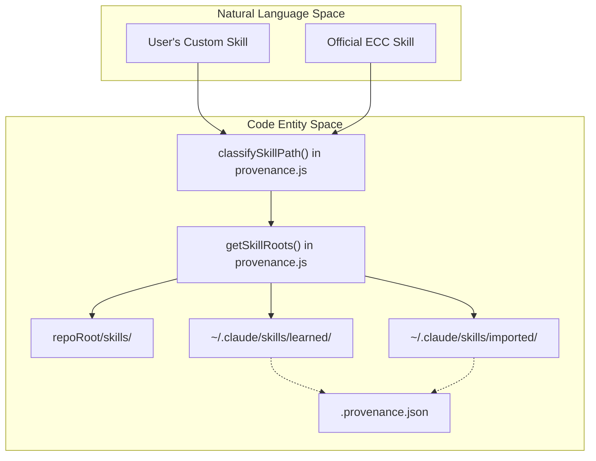
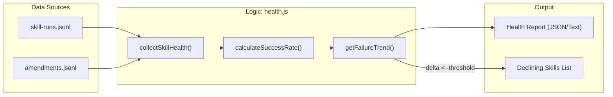
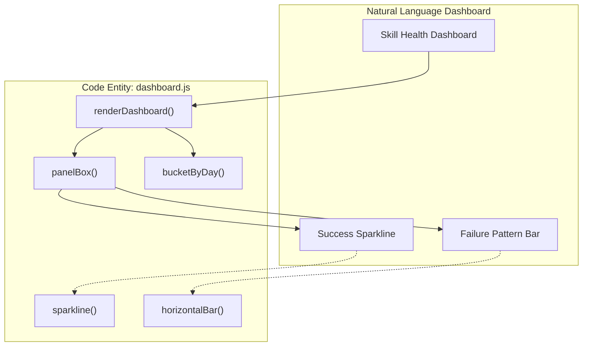

<!-- source: DeepWiki mcp.deepwiki.com · repo affaan-m/everything-claude-code · page 8.9 Skill Evolution & Health Tracking · fetched 2026-10-26 -->

# Skill Evolution & Health Tracking

Relevant source files

The following files were used as context for generating this wiki page:

- [scripts/lib/skill-evolution/dashboard.js](scripts/lib/skill-evolution/dashboard.js)
- [scripts/lib/skill-evolution/health.js](scripts/lib/skill-evolution/health.js)
- [scripts/lib/skill-evolution/index.js](scripts/lib/skill-evolution/index.js)
- [scripts/lib/skill-evolution/provenance.js](scripts/lib/skill-evolution/provenance.js)
- [scripts/lib/skill-evolution/tracker.js](scripts/lib/skill-evolution/tracker.js)
- [scripts/lib/skill-evolution/versioning.js](scripts/lib/skill-evolution/versioning.js)
- [scripts/skills-health.js](scripts/skills-health.js)
- [tests/lib/skill-dashboard.test.js](tests/lib/skill-dashboard.test.js)
- [tests/lib/skill-evolution.test.js](tests/lib/skill-evolution.test.js)

The Skill Evolution system provides the infrastructure for tracking the lifecycle, performance, and reliability of skills within Everything Claude Code (ECC). It transitions skills from static markdown files into versioned, measurable entities with tracked success rates and automated improvement pipelines.

## Overview & Provenance

Skills in ECC are categorized by their **provenance**, which determines how they are managed and whether they require metadata tracking. The system distinguishes between curated library skills and those learned or imported during active sessions.

### Skill Types
| Type | Identifier | Description | Location |
| :--- | :--- | :--- | :--- |
| **Curated** | `curated` | High-quality, battle-tested skills bundled with the ECC core. | `skills/` in repo root |
| **Learned** | `learned` | Skills generated by the Continuous Learning system from user patterns. | `~/.claude/skills/learned` |
| **Imported** | `imported` | Skills brought in from external sources or other projects. | `~/.claude/skills/imported` |

The `provenance.js` library handles the classification and metadata validation for these types [[scripts/lib/skill-evolution/provenance.js:10-15]](). Learned and imported skills require a `.provenance.json` file to track their origin, author, and confidence scores [[scripts/lib/skill-evolution/provenance.js:80-83]]().

### Provenance Data Flow
The following diagram illustrates how the `classifySkillPath` function determines skill types based on directory roots.

Title: Skill Provenance Resolution

Sources: [[scripts/lib/skill-evolution/provenance.js:50-78]](), [[scripts/lib/skill-evolution/provenance.js:85-87]]()

---

## Skill Run Tracking

Every time a skill is invoked, its execution is logged to a persistent store. This data forms the basis for health analytics and success rate calculations.

### Data Schema (`skill-runs.jsonl`)
Execution records are stored in a newline-delimited JSON format at `~/.claude/state/skill-runs.jsonl` [[scripts/lib/skill-evolution/tracker.js:21-22]](). Each record includes:
* **skill_id**: Unique identifier of the skill [[scripts/lib/skill-evolution/tracker.js:74]]().
* **skill_version**: The specific version (e.g., `v2`) active during the run [[scripts/lib/skill-evolution/tracker.js:75]]().
* **outcome**: One of `success`, `failure`, or `partial` [[scripts/lib/skill-evolution/tracker.js:9]]().
* **user_feedback**: Optional explicit feedback (`accepted`, `corrected`, `rejected`) [[scripts/lib/skill-evolution/tracker.js:10]]().
* **Metadata**: `tokens_used`, `duration_ms`, and `recorded_at` timestamp [[scripts/lib/skill-evolution/tracker.js:79-83]]().

### Implementation
The `tracker.js` library provides `recordSkillExecution()` to append new runs. It supports a fallback mechanism: it attempts to use the SQLite `stateStore` if available, otherwise it appends to the flat `.jsonl` file [[scripts/lib/skill-evolution/tracker.js:105-129]]().

Sources: [[scripts/lib/skill-evolution/tracker.js:37-84]](), [[scripts/lib/skill-evolution/tracker.js:105-129]]()

---

## Versioning & Evolution Logs

Skills support internal versioning and a "shadow" directory structure for tracking changes over time.

### Directory Structure
Each skill directory can contain two hidden subdirectories for lifecycle management [[scripts/lib/skill-evolution/versioning.js:8-14]]():
1.  `.versions/`: Stores snapshots of the `SKILL.md` file (e.g., `v1.md`, `v2.md`) [[scripts/lib/skill-evolution/versioning.js:164]]().
2.  `.evolution/`: Contains append-only logs for the skill's development [[scripts/lib/skill-evolution/versioning.js:46-49]]():
    *   `observations.jsonl`: Raw patterns detected during usage.
    *   `inspections.jsonl`: Results of automated skill reviews.
    *   `amendments.jsonl`: Proposed and applied changes to the skill text.

### Versioning Logic
The `versioning.js` library provides `createVersion()` to snapshot the current state and `rollbackTo()` to revert a skill to a previous version [[scripts/lib/skill-evolution/versioning.js:158-183]](), [[scripts/lib/skill-evolution/versioning.js:185-221]]().

Sources: [[scripts/lib/skill-evolution/versioning.js:8-14]](), [[scripts/lib/skill-evolution/versioning.js:58-78]](), [[scripts/lib/skill-evolution/versioning.js:129-133]]()

---

## Health Reports & Analytics

The health system analyzes the `skill-runs.jsonl` data to detect performance trends and "declining" skills.

### Health Metrics
The `collectSkillHealth()` function calculates several key indicators [[scripts/lib/skill-evolution/health.js:145-211]]():
*   **Success Rate (7d vs 30d)**: Compares recent performance against a long-term baseline [[scripts/lib/skill-evolution/health.js:184-187]]().
*   **Failure Trend**: Categorized as `stable`, `improving`, or `worsening`. A skill is marked as `declining` if its 7-day success rate drops below the 30-day rate by more than the `warn-threshold` (default 10%) [[scripts/lib/skill-evolution/health.js:97-112]]().
*   **Pending Amendments**: Counts open proposals in `.evolution/amendments.jsonl` [[scripts/lib/skill-evolution/health.js:114-128]]().

### Health Logic Diagram
Title: Health Analysis & Success Rate Calculation

Sources: [[scripts/lib/skill-evolution/health.js:80-87]](), [[scripts/lib/skill-evolution/health.js:97-112]](), [[scripts/lib/skill-evolution/health.js:145-168]]()

---

## Interfaces: CLI & Commands

Users interact with the health system via the `skills-health.js` CLI and the `/skill-health` slash command.

### `skills-health.js` CLI
This utility provides raw and visual health data [[scripts/skills-health.js:7-23]]().
*   `--json`: Emits machine-readable health data [[scripts/skills-health.js:12]]().
*   `--dashboard`: Renders a rich terminal UI with charts [[scripts/skills-health.js:19]]().
*   `--panel <name>`: Filters for a specific panel (success-rate, failures, amendments, versions) [[scripts/skills-health.js:20]]().
*   `--warn-threshold <n>`: Adjusts sensitivity for declining skill detection (default: 0.1) [[scripts/skills-health.js:21]]().

### `/skill-health` Dashboard
The command triggers a multi-panel view using `renderDashboard()` [[scripts/skills-health.js:120]](). The dashboard implementation in `dashboard.js` uses sophisticated Unicode-based visualization [[scripts/lib/skill-evolution/dashboard.js:8-10]]():
1.  **Success Rate (30d)**: Sparkline charts showing daily success percentages using Unicode block characters `\u2581` through `\u2588` [[scripts/lib/skill-evolution/dashboard.js:8]](), [[tests/lib/skill-dashboard.test.js:79-84]]().
2.  **Failure Patterns**: Clusters failure reasons into a horizontal bar chart using `horizontalBar()` to identify common friction points [[scripts/lib/skill-evolution/dashboard.js:30-38]](), [[scripts/lib/skill-evolution/dashboard.js:174-220]]().
3.  **Pending Amendments**: Lists skills awaiting evolution review by scanning the `amendments.jsonl` logs [[scripts/lib/skill-evolution/dashboard.js:222-250]]().
4.  **Version History**: Timeline of skill snapshots rendered via `renderVersionPanel()` [[scripts/lib/skill-evolution/dashboard.js:252-280]]().

### Dashboard Visualization Primitives
The system uses custom rendering primitives for the TUI dashboard:
*   `sparkline(values)`: Maps a sequence of floats (0.0 to 1.0) to Unicode blocks [[scripts/lib/skill-evolution/dashboard.js:14-28]]().
*   `horizontalBar(value, max, width)`: Renders a proportional bar using `\u2588` (fill) and `\u2591` (empty) [[scripts/lib/skill-evolution/dashboard.js:30-38]]().
*   `panelBox(title, lines, width)`: Draws a boxed container using box-drawing characters [[scripts/lib/skill-evolution/dashboard.js:40-54]]().

Title: Dashboard Component Mapping

Sources: [[scripts/lib/skill-evolution/dashboard.js:14-54]](), [[scripts/lib/skill-evolution/dashboard.js:56-86]](), [[scripts/lib/skill-evolution/dashboard.js:125-172]]()

Sources: [[scripts/skills-health.js:11-23]](), [[scripts/lib/skill-evolution/dashboard.js:8-54]](), [[tests/lib/skill-dashboard.test.js:79-104]]()

---

