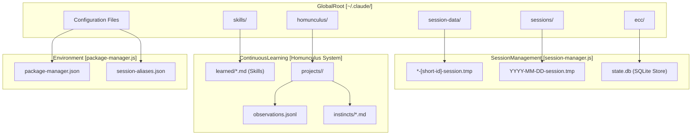
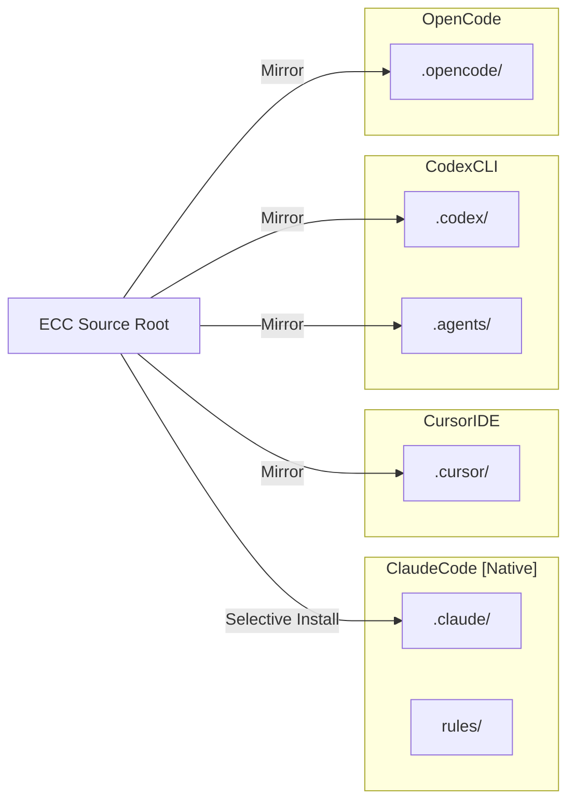

<!-- source: DeepWiki mcp.deepwiki.com · repo affaan-m/everything-claude-code · page 9.1 Directory Structure · fetched 2026-10-26 -->

# Directory Structure

Relevant source files

The following files were used as context for generating this wiki page:

- [.claude/commands/add-language-rules.md](.claude/commands/add-language-rules.md)
- [.claude/commands/database-migration.md](.claude/commands/database-migration.md)
- [.claude/commands/feature-development.md](.claude/commands/feature-development.md)
- [.claude/ecc-tools.json](.claude/ecc-tools.json)
- [.claude/enterprise/controls.md](.claude/enterprise/controls.md)
- [.claude/homunculus/instincts/inherited/everything-claude-code-instincts.yaml](.claude/homunculus/instincts/inherited/everything-claude-code-instincts.yaml)
- [.claude/identity.json](.claude/identity.json)
- [.claude/research/everything-claude-code-research-playbook.md](.claude/research/everything-claude-code-research-playbook.md)
- [.claude/rules/everything-claude-code-guardrails.md](.claude/rules/everything-claude-code-guardrails.md)
- [.claude/skills/everything-claude-code/SKILL.md](.claude/skills/everything-claude-code/SKILL.md)
- [AGENTS.md](AGENTS.md)
- [README.md](README.md)
- [README.zh-CN.md](README.zh-CN.md)
- [WORKING-CONTEXT.md](WORKING-CONTEXT.md)
- [agent.yaml](agent.yaml)
- [commands/auto-update.md](commands/auto-update.md)
- [commands/jira.md](commands/jira.md)
- [docs/zh-CN/AGENTS.md](docs/zh-CN/AGENTS.md)
- [docs/zh-CN/README.md](docs/zh-CN/README.md)
- [manifests/install-modules.json](manifests/install-modules.json)
- [scripts/auto-update.js](scripts/auto-update.js)
- [skills/jira-integration/SKILL.md](skills/jira-integration/SKILL.md)
- [tests/ci/agent-yaml-surface.test.js](tests/ci/agent-yaml-surface.test.js)
- [tests/scripts/auto-update.test.js](tests/scripts/auto-update.test.js)

## Purpose

This document describes the filesystem layout used by Everything Claude Code (ECC), including user-global directories (`~/.claude/`), project-specific directories (`.claude/`), and the core repository hierarchy. ECC uses a dual-directory model to separate global user preferences from project-specific configuration, ensuring persistent memory across projects while allowing for per-project overrides.

---

## Two-Tier Directory Architecture

ECC operates on a cascading configuration model where settings are resolved in a specific priority: environment variables > project-level config > global config.

| Scope | Location | Purpose | Management |
|-------|----------|---------|------------|
| **Global** | `~/.claude/` | User preferences, learned skills, and all session history. | Persistent across all projects; created via `ensureDir()` [scripts/lib/utils.js:83-95](). |
| **Project** | `.claude/` | Project-specific overrides (e.g., package manager, rules). | Located in the project root; version-controlled or ignored per-project. |
| **Plugin** | `.claude-plugin/` | Metadata for marketplace distribution and harness registration. | Located within the ECC repository or installed plugin cache. |

**Sources:** [scripts/lib/utils.js:25-42](), [scripts/lib/package-manager.js:149-236](), [WORKING-CONTEXT.md:13-14]()

---

## Global Directory Structure (`~/.claude/`)

The global directory is the primary state store for ECC. It houses session data, learned instincts, and user-level configuration.

### Visualizing Global Entity Space

The following diagram maps high-level system concepts to the specific directory and file entities used in the implementation.

Title: Global Entity Space Mapping

**Sources:** [scripts/lib/utils.js:12-68](), [scripts/lib/session-manager.js:1-9](), [scripts/lib/session-aliases.js:17-19](), [README.md:104-106]()

### Key Global Components

| Component | Path | Role |
|-----------|------|------|
| **Sessions** | `session-data/` | Stores active and archived session transcripts [scripts/lib/session-manager.js:72-137](). |
| **SQLite Store** | `ecc/state.db` | Persists installation state, skill runs, and governance events [README.md:104-106](). |
| **Homunculus** | `homunculus/` | The core of the continuous learning system, containing project-specific observations [README.md:80-82](). |
| **Learned Skills** | `skills/learned/` | Workflow patterns extracted from session analysis [scripts/lib/utils.js:64-68](). |

**Sources:** [scripts/lib/utils.js:12-68](), [scripts/lib/session-manager.js:21-61](), [README.md:104-106]()

---

## Project Directory Structure (`.claude/`)

Project-specific directories allow developers to tailor ECC behavior to a specific codebase without affecting global settings.

| File/Directory | Purpose |
|------|---------|
| `package-manager.json` | Overrides the detected package manager for the current project [scripts/lib/package-manager.js:177-192](). |
| `skills/` | Contains project-scoped skills, such as `everything-claude-code/SKILL.md` [.claude/skills/everything-claude-code/SKILL.md:1-4](). |
| `commands/` | Project-specific slash command scaffolds, e.g., `feature-development.md` [.claude/commands/feature-development.md:1-5](). |
| `rules/` | Guardrails and coding standards specific to the repository [.claude/rules/everything-claude-code-guardrails.md:1-3](). |
| `identity.json` | Metadata identifying the project for the Homunculus system [.claude/identity.json:1-5](). |

### Package Manager Priority Cascade
ECC determines which package manager to use (npm, pnpm, yarn, bun) via `getPackageManager()` [scripts/lib/package-manager.js:149-236]():
1. **Env Var**: `CLAUDE_PACKAGE_MANAGER`.
2. **Project Config**: `.claude/package-manager.json`.
3. **Manifest**: `package.json` `packageManager` field [scripts/lib/package-manager.js:107-126]().
4. **Lock Files**: Detection of `pnpm-lock.yaml`, `bun.lockb`, etc [scripts/lib/package-manager.js:57-58]().
5. **Global Config**: `~/.claude/package-manager.json`.

**Sources:** [scripts/lib/package-manager.js:92-126](), [scripts/lib/package-manager.js:163-236](), [README.zh-CN.md:185-195]()

---

## Repository & Plugin Structure

The ECC repository is organized to support multiple AI harnesses (Claude Code, Cursor, Codex, OpenCode).

### Cross-Harness Mapping

ECC uses a "root-first" strategy: changes are made in the repository root and mirrored to harness-specific directories via the selective install system.

Title: Cross-Harness Target Resolution

**Sources:** [manifests/install-modules.json:1-109](), [tests/ci/agent-yaml-surface.test.js:10-15](), [.claude/homunculus/instincts/inherited/everything-claude-code-instincts.yaml:113-118]()

### Core Repository Layout

| Directory | Content |
|-----------|---------|
| `agents/` | YAML definitions for 48+ specialized agents [AGENTS.md:15-45](). |
| `skills/` | Markdown-based workflow definitions (182+ skills) [AGENTS.md:3](). |
| `commands/` | Slash command shims and documentation [AGENTS.md:3](). |
| `hooks/` | Configuration for event-driven automation (`hooks.json`) [AGENTS.md:152](). |
| `rules/` | Hierarchical coding standards (Common + Language-specific) [README.zh-CN.md:140-143](). |
| `scripts/` | Node.js implementation of hooks, installers, and utilities [scripts/lib/utils.js:1-4](). |
| `manifests/` | JSON files defining install modules and profiles [manifests/install-modules.json:1-5](). |

**Sources:** [AGENTS.md:1-45](), [manifests/install-modules.json:1-109](), [README.zh-CN.md:140-157]()

---

## Path Resolution Utilities

The `utils.js` library provides a unified API for interacting with the ECC directory structure across platforms.

| Function | Returns | Implementation |
|----------|---------|----------------|
| `getHomeDir()` | User's home directory | Detects `HOME` or `USERPROFILE` [scripts/lib/utils.js:27-33](). |
| `getClaudeDir()` | `~/.claude/` | Joins home with `.claude` [scripts/lib/utils.js:38-40](). |
| `getSessionsDir()` | `~/.claude/session-data/` | Canonical session storage path [scripts/lib/utils.js:45-47](). |
| `getECCStatePath()`| `~/.claude/ecc/state.db` | Path to the SQLite persistence layer [scripts/lib/utils.js:52-54](). |

**Sources:** [scripts/lib/utils.js:25-75](), [scripts/lib/session-manager.js:1-225]()

---

