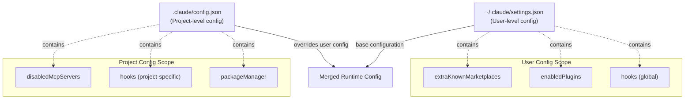
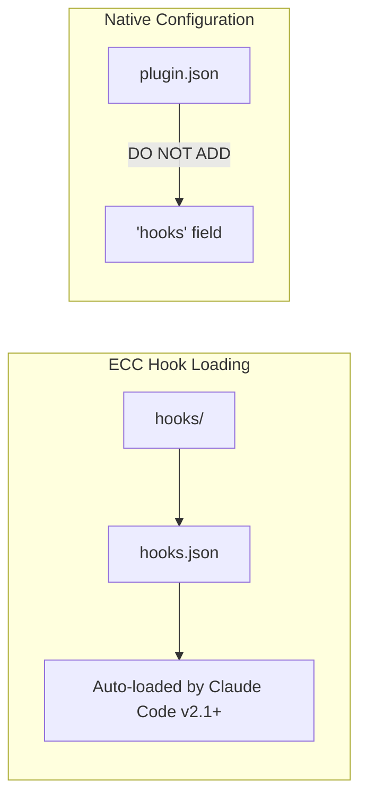

<!-- source: DeepWiki mcp.deepwiki.com · repo affaan-m/everything-claude-code · page 9.2 Settings Configuration · fetched 2026-10-26 -->

# Settings Configuration

<details>
<summary>Relevant source files</summary>

The following files were used as context for generating this wiki page:

- [.agents/plugins/marketplace.json](.agents/plugins/marketplace.json)
- [.claude-plugin/PLUGIN_SCHEMA_NOTES.md](.claude-plugin/PLUGIN_SCHEMA_NOTES.md)
- [.claude-plugin/README.md](.claude-plugin/README.md)
- [.claude-plugin/marketplace.json](.claude-plugin/marketplace.json)
- [.claude-plugin/plugin.json](.claude-plugin/plugin.json)
- [.codex-plugin/README.md](.codex-plugin/README.md)
- [.codex-plugin/plugin.json](.codex-plugin/plugin.json)
- [.mcp.json](.mcp.json)
- [AGENTS.md](AGENTS.md)
- [README.md](README.md)
- [README.zh-CN.md](README.zh-CN.md)
- [WORKING-CONTEXT.md](WORKING-CONTEXT.md)
- [agent.yaml](agent.yaml)
- [commands/auto-update.md](commands/auto-update.md)
- [commands/jira.md](commands/jira.md)
- [docs/zh-CN/AGENTS.md](docs/zh-CN/AGENTS.md)
- [docs/zh-CN/README.md](docs/zh-CN/README.md)
- [manifests/install-modules.json](manifests/install-modules.json)
- [schemas/package-manager.schema.json](schemas/package-manager.schema.json)
- [schemas/plugin.schema.json](schemas/plugin.schema.json)
- [scripts/auto-update.js](scripts/auto-update.js)
- [skills/jira-integration/SKILL.md](skills/jira-integration/SKILL.md)
- [tests/ci/agent-yaml-surface.test.js](tests/ci/agent-yaml-surface.test.js)
- [tests/plugin-manifest.test.js](tests/plugin-manifest.test.js)
- [tests/scripts/auto-update.test.js](tests/scripts/auto-update.test.js)

</details>


## Purpose and Scope

This page documents the structure and configuration options for `settings.json`, the primary user-level configuration file for Claude Code. This file controls plugin marketplaces, plugin enablement, and global hooks configuration. It also covers the interaction between user-level settings and project-specific overrides, including MCP server management and the continuous learning configuration.

ECC (Everything Claude Code) extends these native configuration patterns with its own manifest-driven installation and state management system.

---

## File Location and Structure

The `settings.json` file is located at `~/.claude/settings.json` and serves as the **user-level configuration** that applies to all Claude Code sessions unless overridden at the project level.

### Settings File Hierarchy



**Sources:** [README.md:185-195](), [.claude-plugin/plugin.json:1-28](), [manifests/install-modules.json:83-109]()

---

## Schema Validation

Claude Code validates `settings.json` against a JSON schema. ECC enforces version consistency across all its configuration files (including `plugin.json` and `agent.yaml`) to ensure compatibility with the current release.

| Config File | Schema/Reference | Validation Rule |
|-------------|------------------|-----------------|
| `settings.json` | `claude-code-settings.json` | Native Claude Code validation |
| `plugin.json` | `PLUGIN_SCHEMA_NOTES.md` | Array-only fields, no `agents` or `hooks` [PLUGIN_SCHEMA_NOTES.md:44-60]() |
| `agent.yaml` | `spec_version: "0.1.0"` | Semver pattern matching [tests/plugin-manifest.test.js:130-135]() |

**Sources:** [.claude-plugin/PLUGIN_SCHEMA_NOTES.md:1-40](), [tests/plugin-manifest.test.js:37-107]()

---

## Plugin Marketplace Configuration

### `extraKnownMarketplaces` Structure

The `extraKnownMarketplaces` field defines custom plugin marketplaces. ECC is distributed via a marketplace definition that points to the GitHub repository.

```json
{
  "extraKnownMarketplaces": {
    "everything-claude-code": {
      "source": {
        "source": "github",
        "repo": "affaan-m/everything-claude-code"
      }
    }
  }
}
```

**Sources:** [README.md:100-106](), [.claude-plugin/marketplace.json:1-10]()

---

## Plugin Enablement

### `enabledPlugins` Structure

The `enabledPlugins` field controls which installed plugins are active. The canonical name for the ECC plugin is `everything-claude-code@everything-claude-code`.

```json
{
  "enabledPlugins": {
    "everything-claude-code@everything-claude-code": true
  }
}
```

**Sources:** [README.md:108-114](), [.claude-plugin/plugin.json:1-4]()

---

## MCP Server Management

### `disabledMcpServers` Configuration

The `disabledMcpServers` field controls which MCP servers are disabled on a per-project basis. This is critical for preserving the context window, as each enabled MCP server adds its tool definitions to the prompt. ECC includes an explicit opt-out in its `plugin.json` to prevent auto-loading overlong tool names from the root `.mcp.json`.

```json
{
  "mcpServers": {}
}
```

### Context Window Preservation Strategy

The system warns against keeping more than 10 MCPs enabled simultaneously to avoid the "200k to 70k" context degradation problem.

| Strategy | Implementation |
|----------|----------------|
| **Global Config** | Defined in `~/.claude.json` |
| **Project Disable** | Use `disabledMcpServers` in project config |
| **Opt-out** | `mcpServers: {}` in `plugin.json` prevents auto-discovery [.claude-plugin/PLUGIN_SCHEMA_NOTES.md:140-152]() |

**Sources:** [.claude-plugin/PLUGIN_SCHEMA_NOTES.md:136-152](), [AGENTS.md:139-142]()

---

## Hooks Configuration

### Hook Execution Lifecycle

ECC hooks are event-driven automations. Unlike early versions of Claude Code, v2.1+ automatically loads `hooks/hooks.json` from installed plugins. Explicitly declaring this file in `plugin.json` is an anti-pattern that causes duplicate errors.



**Sources:** [.claude-plugin/PLUGIN_SCHEMA_NOTES.md:98-129]()

### Runtime Hook Controls

ECC provides environment variables to control hook behavior dynamically without requiring manual edits to `settings.json`.

| Variable | Values | Description |
|----------|--------|-------------|
| `ECC_HOOK_PROFILE` | `minimal`, `standard`, `strict` | Sets the enforcement level. |
| `ECC_DISABLED_HOOKS` | Comma-separated IDs | Disables specific hooks by their `id`. |

**Sources:** [docs/zh-CN/README.md:108-110]()

---

## Configuration Precedence

When multiple configuration sources exist, they are resolved in the following order (highest priority first):

1. **Environment Variables**: Overrides all file-based settings (e.g., `CLAUDE_PACKAGE_MANAGER`).
2. **Project-level settings**: `.claude/package-manager.json` or `.claude/config.json`.
3. **Package Manifests**: `package.json` fields (like `packageManager`).
4. **Lock Files**: Automatic detection from `package-lock.json`, `yarn.lock`, etc.
5. **User-level settings**: `~/.claude/settings.json` or `~/.claude/package-manager.json`.

**Sources:** [README.md:185-195](), [manifests/install-modules.json:83-109]()

---

