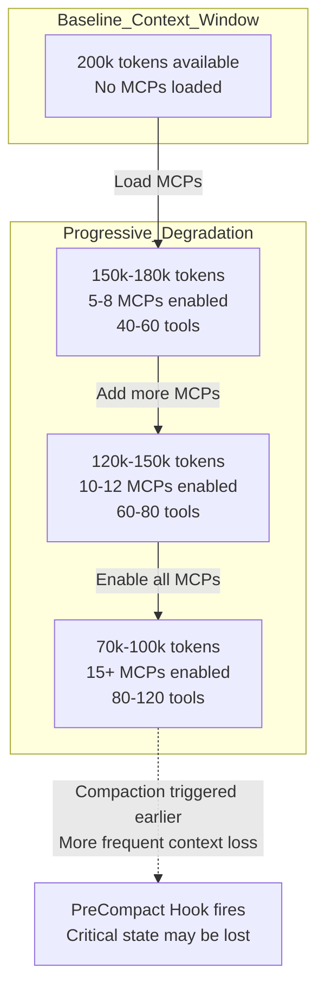
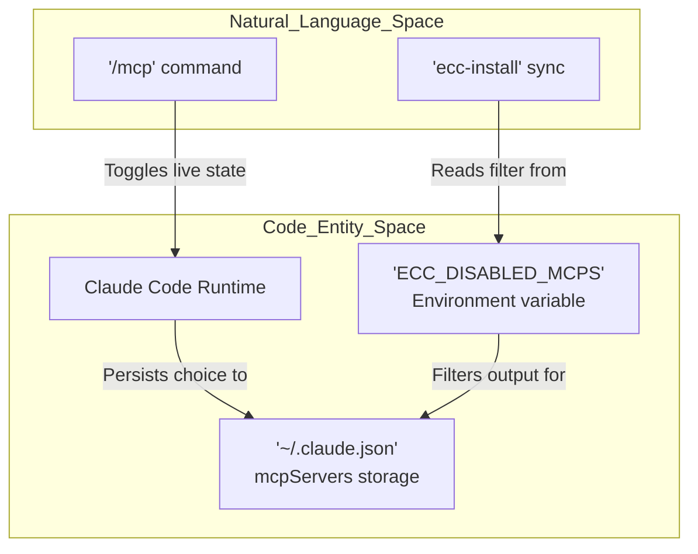
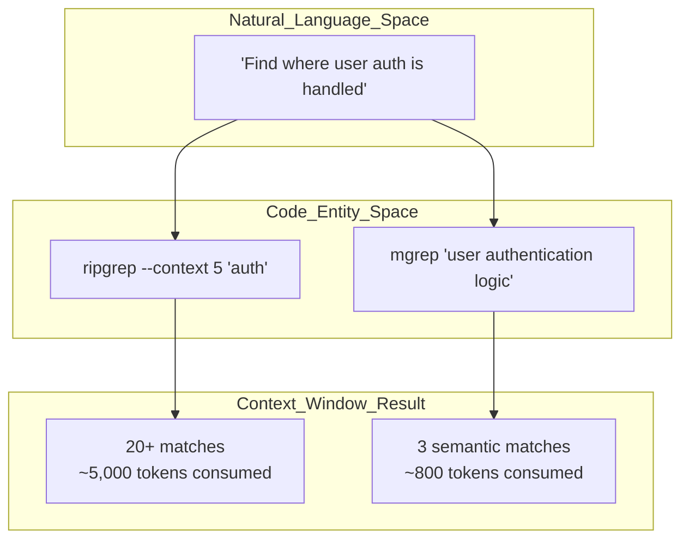
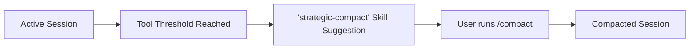

<!-- source: DeepWiki mcp.deepwiki.com · repo affaan-m/everything-claude-code · page 9.3 Context Window Management · fetched 2026-10-26 -->

# Context Window Management

<details>
<summary>Relevant source files</summary>

The following files were used as context for generating this wiki page:

- [docs/TROUBLESHOOTING.md](docs/TROUBLESHOOTING.md)
- [docs/hook-bug-workarounds.md](docs/hook-bug-workarounds.md)
- [docs/token-optimization.md](docs/token-optimization.md)
- [skills/token-budget-advisor/SKILL.md](skills/token-budget-advisor/SKILL.md)
- [tests/docs/mcp-management-docs.test.js](tests/docs/mcp-management-docs.test.js)

</details>


This document explains the technical strategies used by Everything Claude Code (ECC) to manage and preserve Claude's available context window. It addresses the **200k → 70k** context degradation problem caused by Model Context Protocol (MCP) bloat and provides a framework for token budget optimization through skills, model selection, and strategic compaction.

---

## The Context Window Problem

Claude Code sessions start with a baseline of approximately 200,000 tokens. However, the available context window degrades significantly as more Model Context Protocol (MCP) servers and tools are enabled. A session can shrink to 70,000 tokens or less when 15+ MCP servers are active, as each server injects tool definitions and schemas into the system prompt.

### Context Degradation Pattern



**Sources:** [docs/token-optimization.md:95-98](), [docs/TROUBLESHOOTING.md:67-67]()

### Measured Impact of MCP Bloat

| MCPs Enabled | Tools Active | Available Context | Effective Reduction |
|--------------|--------------|-------------------|---------------------|
| 0-3          | 0-20         | 180k-200k         | 0-10%               |
| 5-8          | 40-60        | 150k-180k         | 10-25%              |
| 10-12        | 60-80        | 120k-150k         | 25-40%              |
| 15+          | 80-120       | 70k-100k          | 50-65%              |

**Sources:** [docs/token-optimization.md:97-97](), [docs/TROUBLESHOOTING.md:67-67]()

---

## MCP Discipline: The 20-30/5-10 Rule

To maintain context health, ECC enforces "MCP Discipline" to keep tool-definition pressure low. This is managed through a distinction between configuration and active runtime enablement.

- **20-30 MCPs configured** in `~/.claude.json` (The global library).
- **5-10 MCPs enabled** per project (The active working set).
- **<80 tools active** across all enabled servers.

### Configuration vs. Runtime Enablement
ECC distinguishes between configuration filters and live toggles. `ECC_DISABLED_MCPS` is used as an install/sync filter for generating configurations, while the `/mcp` command is used for live runtime changes [docs/token-optimization.md:104-104](), [tests/docs/mcp-management-docs.test.js:59-59]().



**Sources:** [docs/token-optimization.md:100-104](), [tests/docs/mcp-management-docs.test.js:30-49]()

---

## Token Budget Advisor (TBA)

The `token-budget-advisor` skill allows users to explicitly control response depth to save tokens. It intercepts the flow to offer a choice between 25%, 50%, 75%, and 100% depth **before** Claude generates a long response [skills/token-budget-advisor/SKILL.md:19-21]().

### TBA Implementation Heuristics

The skill uses heuristic estimation rather than a real tokenizer to calculate budget [skills/token-budget-advisor/SKILL.md:108-110]():
- **Prose:** `words × 1.3` [skills/token-budget-advisor/SKILL.md:40-40]()
- **Code-heavy:** `chars / 4` [skills/token-budget-advisor/SKILL.md:41-41]()

### Response Depth Levels

| Depth Level | Multiplier | Content Included |
|-------------|------------|------------------|
| **25% Essential** | `min + (max-min) * 0.25` | Direct answer, key conclusion only [skills/token-budget-advisor/SKILL.md:90-90]() |
| **50% Moderate** | `min + (max-min) * 0.50` | Answer + context + 1 example [skills/token-budget-advisor/SKILL.md:91-91]() |
| **75% Detailed** | `min + (max-min) * 0.75` | Multiple examples, pros/cons, alternatives [skills/token-budget-advisor/SKILL.md:92-92]() |
| **100% Exhaustive**| `max` | Full analysis, all code, all perspectives [skills/token-budget-advisor/SKILL.md:93-93]() |

**Sources:** [skills/token-budget-advisor/SKILL.md:81-93]()

---

## Model Selection & Thinking Limits

Optimizing the context window also involves selecting the right model and limiting "Extended Thinking" output tokens.

### Recommended Configuration (`~/.claude/settings.json`)
```json
{
  "model": "sonnet",
  "env": {
    "MAX_THINKING_TOKENS": "10000",
    "CLAUDE_CODE_SUBAGENT_MODEL": "haiku"
  }
}
```
**Sources:** [docs/token-optimization.md:13-23]()

### Model Escalation Strategy
1. **Haiku:** Lowest cost. Used for subagent exploration and file reading via `CLAUDE_CODE_SUBAGENT_MODEL` [docs/token-optimization.md:50-50]().
2. **Sonnet:** Medium cost. Default for 80% of coding tasks [docs/token-optimization.md:29-29]().
3. **Opus:** Highest cost. Reserved for complex architecture and multi-step reasoning using `/model opus` [docs/token-optimization.md:52-52]().

Reducing `MAX_THINKING_TOKENS` from the default 31,999 to 10,000 cuts hidden context costs by approximately 70% [docs/token-optimization.md:30-30]().

---

## Semantic Optimization via mgrep

`mgrep` is a semantic search tool used to reduce context consumption. Standard search operations often return excessive lines of code that bloat the context window. `mgrep` provides ranked matches, significantly reducing the tokens required for codebase navigation.

### Search Efficiency Comparison



**Sources:** [docs/token-optimization.md:50-60](), [docs/token-optimization.md:91-91]()

---

## Strategic Compaction

ECC utilizes "Strategic Compaction" to prevent auto-compaction from firing at inconvenient times (like mid-debugging).

### Compaction Workflow



**Sources:** [docs/token-optimization.md:74-88](), [docs/TROUBLESHOOTING.md:29-38]()

### Best Practices for Compaction
- **Compact After:** Exploration, completing a milestone, or debugging [docs/token-optimization.md:79-82]().
- **Do NOT Compact During:** Active debugging or multi-file refactoring [docs/token-optimization.md:84-87]().
- **Override Issues:** Users should be cautious with `CLAUDE_AUTOCOMPACT_PCT_OVERRIDE`. In some builds, lowering this value causes compaction to trigger *earlier* rather than later [docs/token-optimization.md:35-35](), [docs/TROUBLESHOOTING.md:31-31]().

**Sources:** [docs/token-optimization.md:1-138](), [skills/token-budget-advisor/SKILL.md:1-134](), [docs/TROUBLESHOOTING.md:1-76](), [tests/docs/mcp-management-docs.test.js:1-78]()

---

