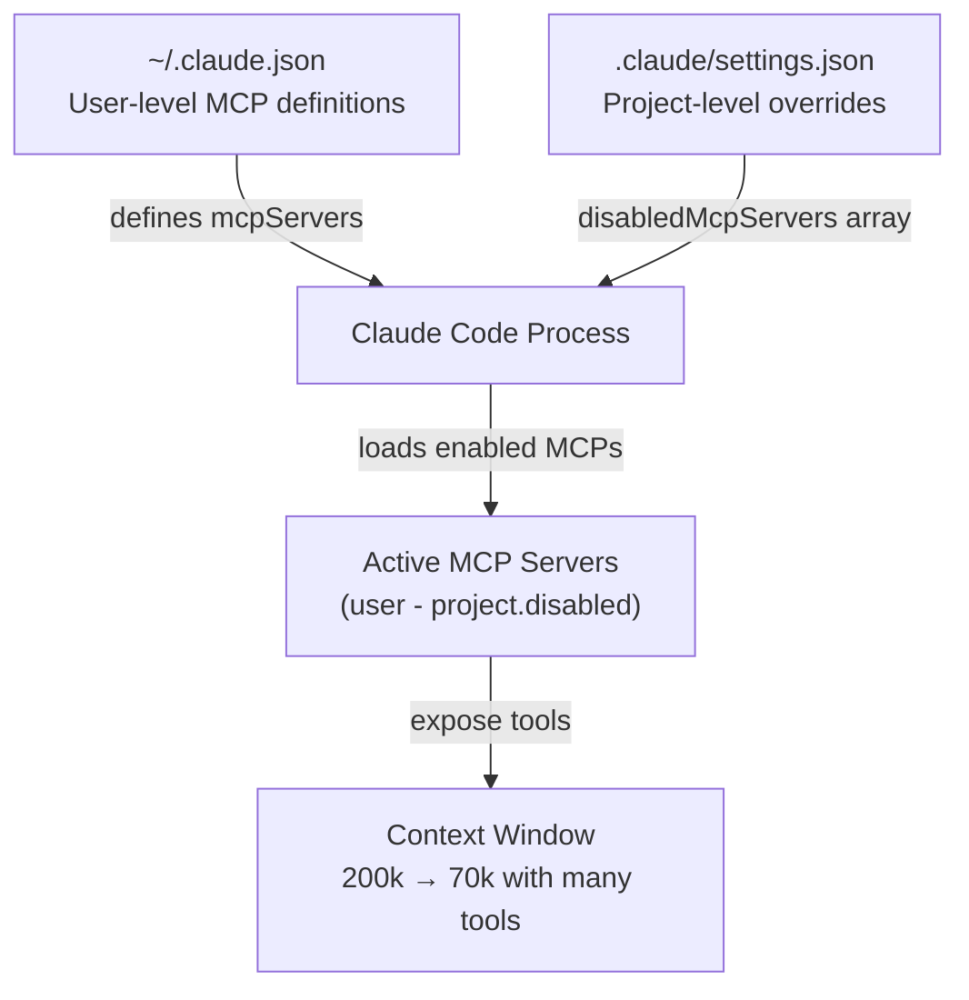
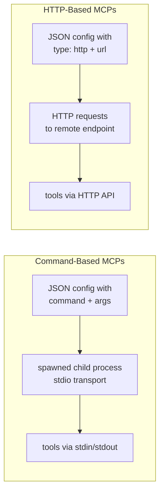
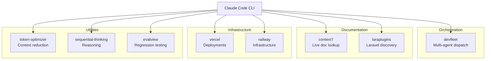
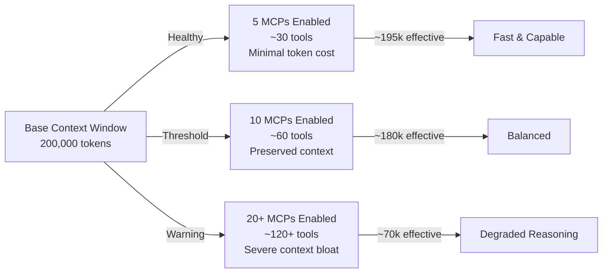
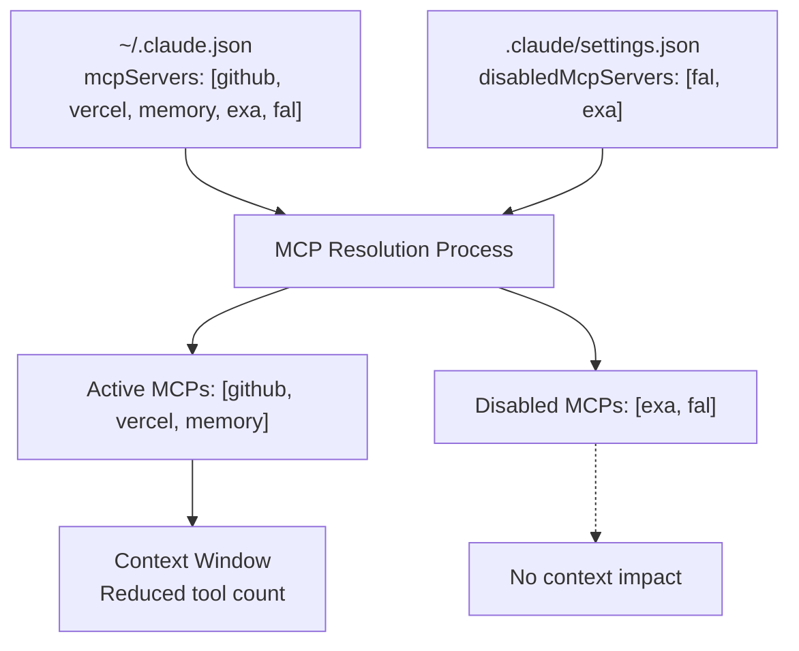
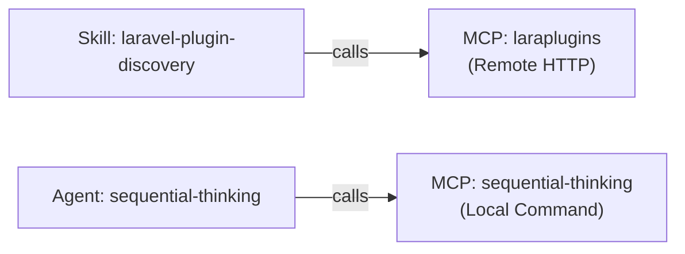

<!-- source: DeepWiki mcp.deepwiki.com · repo affaan-m/everything-claude-code · page 9.4 MCP Server Configuration · fetched 2026-10-26 -->

# MCP Server Configuration

<details>
<summary>Relevant source files</summary>

The following files were used as context for generating this wiki page:

- [.agents/plugins/marketplace.json](.agents/plugins/marketplace.json)
- [.claude-plugin/PLUGIN_SCHEMA_NOTES.md](.claude-plugin/PLUGIN_SCHEMA_NOTES.md)
- [.claude-plugin/README.md](.claude-plugin/README.md)
- [.claude-plugin/marketplace.json](.claude-plugin/marketplace.json)
- [.claude-plugin/plugin.json](.claude-plugin/plugin.json)
- [.codex-plugin/README.md](.codex-plugin/README.md)
- [.codex-plugin/plugin.json](.codex-plugin/plugin.json)
- [.mcp.json](.mcp.json)
- [mcp-configs/mcp-servers.json](mcp-configs/mcp-servers.json)
- [schemas/package-manager.schema.json](schemas/package-manager.schema.json)
- [schemas/plugin.schema.json](schemas/plugin.schema.json)
- [scripts/hooks/insaits-security-monitor.py](scripts/hooks/insaits-security-monitor.py)
- [scripts/hooks/insaits-security-wrapper.js](scripts/hooks/insaits-security-wrapper.js)
- [skills/laravel-plugin-discovery/SKILL.md](skills/laravel-plugin-discovery/SKILL.md)
- [tests/hooks/insaits-security-monitor.test.js](tests/hooks/insaits-security-monitor.test.js)
- [tests/hooks/insaits-security-wrapper.test.js](tests/hooks/insaits-security-wrapper.test.js)
- [tests/hooks/plugin-hook-bootstrap.test.js](tests/hooks/plugin-hook-bootstrap.test.js)
- [tests/hooks/test_insaits_security_monitor.py](tests/hooks/test_insaits_security_monitor.py)
- [tests/plugin-manifest.test.js](tests/plugin-manifest.test.js)

</details>


This page documents the configuration of MCP (Model Context Protocol) servers in Everything Claude Code (ECC), including the `~/.claude.json` configuration structure, API key management, and recommended MCP discipline to preserve context window capacity.

For information about what MCPs are and their role in the system, see [MCPs (Model Context Protocol)](). For information about context window degradation caused by MCP servers, see [Context Window Management]().

---

## Configuration File Locations

MCP servers are configured through two primary locations:

| Configuration Level | File Path | Purpose |
|-------------------|-----------|---------|
| **User-level** | `~/.claude.json` | Global MCP servers available to all projects |
| **Project-level** | `.claude/settings.json` | Project-specific MCP overrides and disabled servers |

The user-level configuration defines which MCP servers are installed. The project-level configuration controls which servers are enabled for a specific project. [mcp-configs/mcp-servers.json:171-173]()

**Configuration Hierarchy Diagram**



Sources: [mcp-configs/mcp-servers.json:171-175]()

---

## MCP Server Types

MCP servers come in two primary transport types, configured differently in `~/.claude.json`:

### Command-Based MCP Servers

Command-based servers are spawned as child processes via `npx`, `python3`, `uvx`, or direct command execution. These typically use `stdio` for communication. [mcp-configs/mcp-servers.json:3-5](), [mcp-configs/mcp-servers.json:162-163]()

**Structure:**
```json
{
  "mcpServers": {
    "server-name": {
      "command": "npx",
      "args": ["-y", "@package/name", "--option", "value"],
      "env": {
        "API_KEY": "your-key-here"
      }
    }
  }
}
```

**Example: GitHub MCP**
```json
{
  "github": {
    "command": "npx",
    "args": ["-y", "@modelcontextprotocol/server-github"],
    "env": {
      "GITHUB_PERSONAL_ACCESS_TOKEN": "YOUR_GITHUB_PAT_HERE"
    }
  }
}
```
Sources: [mcp-configs/mcp-servers.json:13-20]()

### HTTP-Based MCP Servers

HTTP-based servers connect to remote endpoints via URLs. [mcp-configs/mcp-servers.json:49-53]()

**Structure:**
```json
{
  "mcpServers": {
    "server-name": {
      "type": "http",
      "url": "https://mcp.example.com/mcp",
      "headers": {
        "Authorization": "Bearer key"
      }
    }
  }
}
```

**Example: Vercel MCP**
```json
{
  "vercel": {
    "type": "http",
    "url": "https://mcp.vercel.com"
  }
}
```
Sources: [mcp-configs/mcp-servers.json:49-53]()

**MCP Server Type Comparison**



Sources: [mcp-configs/mcp-servers.json:3-10](), [mcp-configs/mcp-servers.json:49-53]()

---

## Common MCP Servers Reference

The ECC repository includes a reference configuration at `mcp-configs/mcp-servers.json` with over 25 battle-tested MCP servers. [mcp-configs/mcp-servers.json:1-169]()

### Version Control & Documentation

| MCP Server | Type | Package/URL | Key Required |
|-----------|------|---------|--------------|
| **github** | command | `@modelcontextprotocol/server-github` | `GITHUB_PERSONAL_ACCESS_TOKEN` |
| **context7** | command | `@upstash/context7-mcp` | None (Live docs lookup) |
| **confluence** | command | `confluence-mcp-server` | `CONFLUENCE_API_TOKEN` |
| **laraplugins** | http | `https://laraplugins.io/mcp/plugins` | None (Laravel discovery) |

Sources: [mcp-configs/mcp-servers.json:13-20](), [mcp-configs/mcp-servers.json:92-96](), [mcp-configs/mcp-servers.json:146-150](), [mcp-configs/mcp-servers.json:151-160]()

### Specialized & AI Tools

| MCP Server | Type | Package/URL | Key Required |
|-----------|------|---------|--------------|
| **devfleet** | http | `http://localhost:18801/mcp` | Multi-agent orchestration |
| **token-optimizer** | command | `token-optimizer-mcp` | 95%+ context reduction |
| **sequential-thinking** | command | `@modelcontextprotocol/server-sequential-thinking` | Chain-of-thought |
| **evalview** | command | `evalview` (Python) | Regression testing |

Sources: [mcp-configs/mcp-servers.json:136-140](), [mcp-configs/mcp-servers.json:141-145](), [mcp-configs/mcp-servers.json:44-48](), [mcp-configs/mcp-servers.json:161-168]()

**MCP Server Ecosystem Diagram**



Sources: [mcp-configs/mcp-servers.json:1-169](), [skills/laravel-plugin-discovery/SKILL.md:21-30]()

---

## API Key Management

### Placeholder Replacement Pattern

The reference configuration at `mcp-configs/mcp-servers.json` contains placeholder keys that must be replaced with real credentials in your local `~/.claude.json`. [mcp-configs/mcp-servers.json:172-173]()

**Common Placeholders:**

| Placeholder | Real Key Format | Service |
|------------|----------------|---------|
| `YOUR_GITHUB_PAT_HERE` | `ghp_...` | GitHub Personal Access Token |
| `YOUR_FIRECRAWL_KEY_HERE` | `fc-...` | Firecrawl API Key |
| `YOUR_EXA_API_KEY_HERE` | UUID/Hash | Exa Web Search Key |
| `YOUR_FAL_KEY_HERE` | `key_...` | fal.ai Key |
| `YOUR_BROWSERBASE_KEY_HERE` | Hash | Browserbase API Key |

Sources: [mcp-configs/mcp-servers.json:17](), [mcp-configs/mcp-servers.json:25](), [mcp-configs/mcp-servers.json:88](), [mcp-configs/mcp-servers.json:116](), [mcp-configs/mcp-servers.json:124]()

---

## MCP Discipline: Recommended Limits

### The Context Window Problem

Each MCP tool description consumes tokens from the 200k context window. With too many MCP servers enabled, the effective context window can degrade significantly (e.g., from 200k down to 70k). [mcp-configs/mcp-servers.json:174-175]()

**Critical Rule from Production Use:**
> Keep under 10 MCPs enabled to preserve context window. [mcp-configs/mcp-servers.json:174-175]()

**Context Window Impact Diagram**



Sources: [mcp-configs/mcp-servers.json:174-175]()

---

## Per-Project MCP Configuration

Project-specific MCP control is managed through `.claude/settings.json` in the project root. This allows different projects to enable only the MCP servers they need. [mcp-configs/mcp-servers.json:173-174]()

### Configuration Structure

**.claude/settings.json:**
```json
{
  "disabledMcpServers": [
    "railway",
    "firecrawl",
    "clickhouse"
  ]
}
```

The `disabledMcpServers` array lists MCP server names (matching keys in `~/.claude.json`) that should be disabled for this specific project. [mcp-configs/mcp-servers.json:173-174]()

**Project-Specific MCP Resolution Diagram**



Sources: [mcp-configs/mcp-servers.json:173-174]()

---

## Integration with Specialized Agents & Skills

ECC provides high-level skills that act as wrappers for MCP tools.

### Laravel Plugin Discovery
The `laravel-plugin-discovery` skill utilizes the `laraplugins` MCP to evaluate package health and compatibility. [skills/laravel-plugin-discovery/SKILL.md:21-30]()

**Key Tools:** [skills/laravel-plugin-discovery/SKILL.md:32-48]()
- `SearchPluginTool`: Search by keyword and health.
- `GetPluginDetailsTool`: Fetch metrics and readme content.

### Implementation Patterns
MCP servers can be configured globally in `~/.claude.json` but toggled per-project. [mcp-configs/mcp-servers.json:171-175]()

**Agent-to-MCP Association Diagram**



Sources: [skills/laravel-plugin-discovery/SKILL.md:32-53](), [mcp-configs/mcp-servers.json:44-48]()

---

## Summary of Best Practices

1. **Lazy Loading**: Define many servers in `~/.claude.json`, but use `disabledMcpServers` in project settings to keep active counts low. [mcp-configs/mcp-servers.json:173-175]()
2. **Security**: Replace placeholders like `YOUR_GITHUB_PAT_HERE` with real keys in your private config; never commit these keys. [mcp-configs/mcp-servers.json:171-173]()
3. **Environment Variable Overrides**: Use `ECC_DISABLED_MCPS` during install/sync to disable bundled MCPs. [mcp-configs/mcp-servers.json:173-174]()

Sources: [mcp-configs/mcp-servers.json:171-175]()

---

