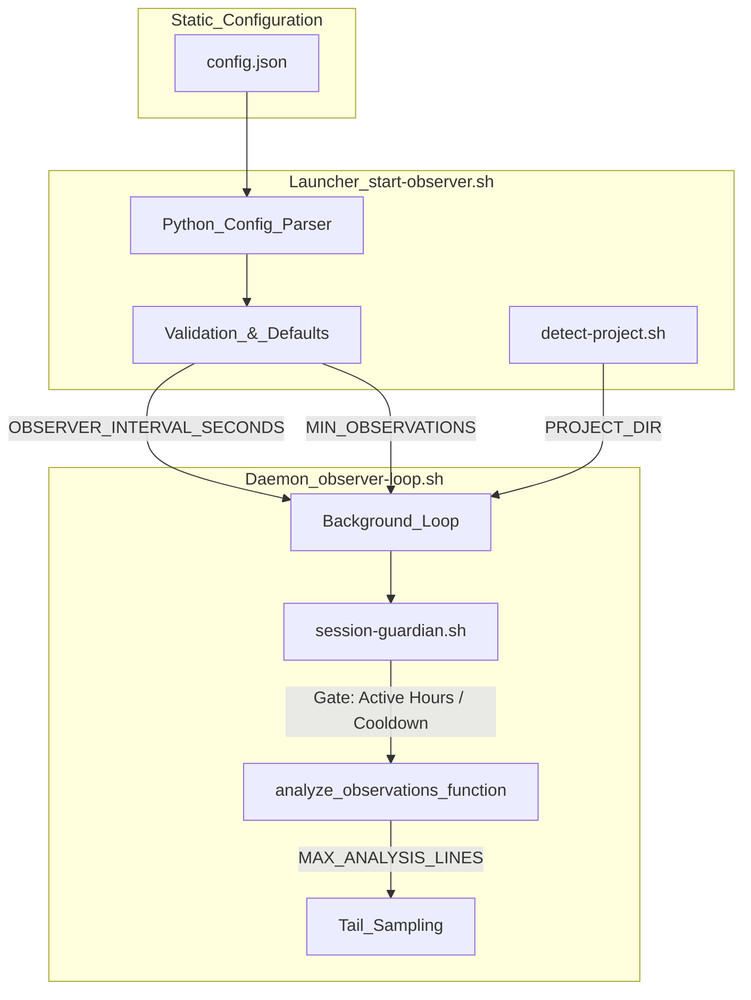
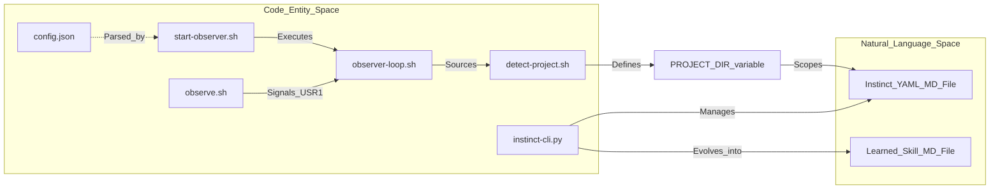

<!-- source: DeepWiki mcp.deepwiki.com · repo affaan-m/everything-claude-code · page 9.5 Continuous Learning Configuration · fetched 2026-10-26 -->

# Continuous Learning Configuration

<details>
<summary>Relevant source files</summary>

The following files were used as context for generating this wiki page:

- [.gitignore](.gitignore)
- [commands/projects.md](commands/projects.md)
- [commands/promote.md](commands/promote.md)
- [scripts/hooks/doc-file-warning.js](scripts/hooks/doc-file-warning.js)
- [scripts/hooks/session-end-marker.js](scripts/hooks/session-end-marker.js)
- [scripts/lib/observer-sessions.js](scripts/lib/observer-sessions.js)
- [scripts/lib/project-detect.js](scripts/lib/project-detect.js)
- [skills/continuous-learning-v2/agents/observer-loop.sh](skills/continuous-learning-v2/agents/observer-loop.sh)
- [skills/continuous-learning-v2/agents/observer.md](skills/continuous-learning-v2/agents/observer.md)
- [skills/continuous-learning-v2/agents/session-guardian.sh](skills/continuous-learning-v2/agents/session-guardian.sh)
- [skills/continuous-learning-v2/agents/start-observer.sh](skills/continuous-learning-v2/agents/start-observer.sh)
- [skills/continuous-learning-v2/config.json](skills/continuous-learning-v2/config.json)
- [skills/continuous-learning-v2/hooks/observe.sh](skills/continuous-learning-v2/hooks/observe.sh)
- [skills/continuous-learning-v2/scripts/detect-project.sh](skills/continuous-learning-v2/scripts/detect-project.sh)
- [skills/continuous-learning-v2/scripts/instinct-cli.py](skills/continuous-learning-v2/scripts/instinct-cli.py)
- [skills/continuous-learning-v2/scripts/test_parse_instinct.py](skills/continuous-learning-v2/scripts/test_parse_instinct.py)
- [skills/strategic-compact/SKILL.md](skills/strategic-compact/SKILL.md)
- [tests/hooks/doc-file-warning.test.js](tests/hooks/doc-file-warning.test.js)
- [tests/hooks/observe-subdirectory-detection.test.js](tests/hooks/observe-subdirectory-detection.test.js)
- [tests/hooks/observer-memory.test.js](tests/hooks/observer-memory.test.js)
- [tests/lib/project-detect.test.js](tests/lib/project-detect.test.js)

</details>


## Purpose and Scope

This page documents the configuration parameters for the Continuous Learning v2 system, specifically focusing on the `config.json` structure, project-scoped path resolution, and the environment variables that govern the observation and analysis lifecycle. It covers how the system manages project detection, analysis intervals, and the safety guards that prevent runaway resource consumption through signal throttling and tail-based sampling.

For the overall architecture of the continuous learning system, see [8.1. Continuous Learning v2 Architecture](). For the background analysis daemon implementation, see [8.3. Observer Agent & Pattern Detection]().

---

## Configuration File Location

The continuous learning system uses a primary JSON configuration file located within the skill directory:

```text
~/.claude/skills/continuous-learning-v2/config.json
```

This file is read by the `start-observer.sh` launcher to initialize the background analysis loop [skills/continuous-learning-v2/agents/start-observer.sh:38-43](). The system can also override this location using the `CLV2_CONFIG` environment variable [skills/continuous-learning-v2/hooks/observe.sh:124-126]().

**Sources:** [skills/continuous-learning-v2/agents/start-observer.sh:39-43](), [skills/continuous-learning-v2/hooks/observe.sh:124-126]()

---

## Configuration File Structure

### Complete Schema

The `config.json` file follows a versioned structure to allow for future schema evolution [skills/continuous-learning-v2/config.json:1-8]().

```json
{
  "version": "2.1",
  "observer": {
    "enabled": false,
    "run_interval_minutes": 5,
    "min_observations_to_analyze": 20
  }
}
```

**Sources:** [skills/continuous-learning-v2/config.json:1-8]()

---

## Observer Configuration Options

### `observer.enabled`

**Type:** Boolean  
**Default:** `false`  

This is the primary master switch for the analysis phase. If set to `false`, the `start-observer.sh` script will refuse to spawn the background `observer-loop.sh` process [skills/continuous-learning-v2/agents/start-observer.sh:172-176](). This prevents unexpected API costs from Claude Haiku analysis.

**Sources:** [skills/continuous-learning-v2/agents/start-observer.sh:78,172-176]()

### `observer.run_interval_minutes`

**Type:** Integer (minutes)  
**Default:** `5`  

Defines the sleep duration for the `observer-loop.sh` background process. This value is read from `config.json` [skills/continuous-learning-v2/agents/start-observer.sh:88](), converted to seconds, and passed to the `sleep` command within the loop.

**Conversion Logic:**
```bash
OBSERVER_INTERVAL_SECONDS=$((OBSERVER_INTERVAL_MINUTES * 60))
```

**Sources:** [skills/continuous-learning-v2/agents/start-observer.sh:76,108]()

### `observer.min_observations_to_analyze`

**Type:** Integer (line count)  
**Default:** `20`  

The minimum number of tool-use events (lines in `observations.jsonl`) required before the observer triggers an LLM analysis session [skills/continuous-learning-v2/agents/observer-loop.sh:114-116](). This ensures that the system has enough data to detect meaningful patterns before spending tokens.

**Sources:** [skills/continuous-learning-v2/agents/start-observer.sh:77,89,101-102](), [skills/continuous-learning-v2/agents/observer-loop.sh:114-116]()

---

## Environment Variables and Runtime Guards

In addition to `config.json`, the system respects several environment variables and file-based guards to control behavior in specialized environments.

### Observation Guards

The `observe.sh` hook uses several layers of guards to prevent self-observation loops or capturing automated sessions [skills/continuous-learning-v2/hooks/observe.sh:128-162]():

| Variable / File | Purpose |
|-----------------|---------|
| `~/.claude/homunculus/disabled` | If this file exists, all observation capture is skipped globally [skills/continuous-learning-v2/hooks/observe.sh:121-123](). |
| `CLAUDE_CODE_ENTRYPOINT` | Must be `cli`, `sdk-ts`, or `claude-desktop`. Other values cause the hook to exit [skills/continuous-learning-v2/hooks/observe.sh:137-140](). |
| `ECC_HOOK_PROFILE` | If set to `minimal`, observation capture is suppressed [skills/continuous-learning-v2/hooks/observe.sh:143](). |
| `ECC_SKIP_OBSERVE` | Set to `1` by internal agents to prevent observing their own actions [skills/continuous-learning-v2/hooks/observe.sh:146](). |
| `ECC_OBSERVE_SKIP_PATHS` | Comma-separated list of path substrings to ignore (default: `observer-sessions,.claude-mem`) [skills/continuous-learning-v2/hooks/observe.sh:153-162](). |

**Sources:** [skills/continuous-learning-v2/hooks/observe.sh:121-162]()

### Analysis Throttling (Memory Protection)

To prevent memory explosion and runaway processes (Fix #521), the following variables control the `observer-loop.sh` and `observe.sh`:

| Variable | Default | Purpose |
|----------|---------|---------|
| `ECC_OBSERVER_ANALYSIS_COOLDOWN` | `60` | Minimum seconds between analysis runs, even if signaled by `USR1` [skills/continuous-learning-v2/agents/observer-loop.sh:16](). |
| `ECC_OBSERVER_MAX_ANALYSIS_LINES` | `500` | Limits the number of lines read from `observations.jsonl` via `tail` [skills/continuous-learning-v2/agents/observer-loop.sh:138](). |
| `ECC_OBSERVER_SIGNAL_EVERY_N` | `20` | `observe.sh` only signals the daemon every N observations using a counter file [tests/hooks/observer-memory.test.js:76](). |
| `ECC_OBSERVER_IDLE_TIMEOUT_SECONDS` | `1800` | Time before the observer exits if no active sessions are detected [skills/continuous-learning-v2/agents/observer-loop.sh:17](). |

**Sources:** [skills/continuous-learning-v2/agents/observer-loop.sh:16-17,138](), [tests/hooks/observer-memory.test.js:76,138,159]()

---

## Configuration Data Flow

The following diagram illustrates how configuration is resolved from the static `config.json` into the active `observer-loop.sh` process.

**Diagram: Configuration Resolution and Process Spawning**



**Sources:** [skills/continuous-learning-v2/agents/start-observer.sh:75-108](), [skills/continuous-learning-v2/agents/observer-loop.sh:131-144](), [skills/continuous-learning-v2/scripts/detect-project.sh:52-156]()

---

## Project-Scoped Storage Configuration

While `config.json` is global, the learning data is strictly project-scoped based on the `PROJECT_ID` (a SHA256 hash of the git remote or local path) [skills/continuous-learning-v2/scripts/detect-project.sh:105-115]().

| Entity | Path Pattern |
|--------|--------------|
| **Observations** | `~/.claude/homunculus/projects/{PROJECT_ID}/observations.jsonl` [skills/continuous-learning-v2/agents/start-observer.sh:47]() |
| **Log File** | `~/.claude/homunculus/projects/{PROJECT_ID}/observer.log` [skills/continuous-learning-v2/agents/start-observer.sh:46]() |
| **PID File** | `~/.claude/homunculus/projects/{PROJECT_ID}/.observer.pid` [skills/continuous-learning-v2/agents/start-observer.sh:45]() |
| **Instincts** | `~/.claude/homunculus/projects/{PROJECT_ID}/instincts/personal/` [skills/continuous-learning-v2/agents/start-observer.sh:48]() |
| **Activity Marker** | `~/.claude/homunculus/projects/{PROJECT_ID}/.observer-last-activity` [tests/hooks/observer-memory.test.js:81]() |
| **Signal Counter** | `~/.claude/homunculus/projects/{PROJECT_ID}/.observer-signal-counter` [tests/hooks/observer-memory.test.js:64]() |

**Sources:** [skills/continuous-learning-v2/agents/start-observer.sh:45-48](), [skills/continuous-learning-v2/scripts/detect-project.sh:22-24,144](), [tests/hooks/observer-memory.test.js:64,81]()

---

## System Interaction Diagram

This diagram maps the relationship between the configuration files, the shell scripts, and the Python-based management utilities.

**Diagram: Configuration and Entity Mapping**



**Sources:** [skills/continuous-learning-v2/agents/start-observer.sh:25-33](), [skills/continuous-learning-v2/scripts/instinct-cli.py:41-50,128-184](), [skills/continuous-learning-v2/scripts/detect-project.sh:7-14](), [tests/hooks/observer-memory.test.js:71]()

---

## Summary of Fallback Behavior

If `config.json` is missing or contains invalid values, the system defaults to a conservative state [skills/continuous-learning-v2/agents/start-observer.sh:91-96]():

| Parameter | Default | Fallback Logic |
|-----------|---------|----------------|
| `enabled` | `false` | Defaults to `false` if the Python parser fails or field is missing [skills/continuous-learning-v2/agents/start-observer.sh:96](). |
| `run_interval_minutes` | `5` | Reverts to `5` if the value is not a positive integer [skills/continuous-learning-v2/agents/start-observer.sh:94](). |
| `min_observations_to_analyze` | `20` | Reverts to `20` if the value is not a positive integer [skills/continuous-learning-v2/agents/start-observer.sh:95](). |

**Sources:** [skills/continuous-learning-v2/agents/start-observer.sh:91-96]()

---

