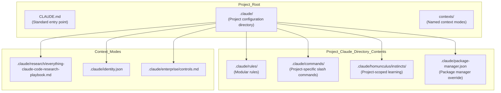
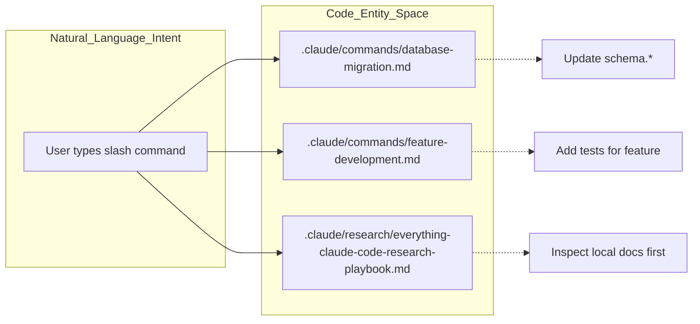

<!-- source: DeepWiki mcp.deepwiki.com · repo affaan-m/everything-claude-code · page 9.6 Project-Specific Configuration · fetched 2026-10-26 -->

# Project-Specific Configuration

Relevant source files

The following files were used as context for generating this wiki page:

- [.claude/commands/add-language-rules.md](.claude/commands/add-language-rules.md)
- [.claude/commands/database-migration.md](.claude/commands/database-migration.md)
- [.claude/commands/feature-development.md](.claude/commands/feature-development.md)
- [.claude/ecc-tools.json](.claude/ecc-tools.json)
- [.claude/enterprise/controls.md](.claude/enterprise/controls.md)
- [.claude/homunculus/instincts/inherited/everything-claude-code-instincts.yaml](.claude/homunculus/instincts/inherited/everything-claude-code-instincts.yaml)
- [.claude/identity.json](.claude/identity.json)
- [.claude/research/everything-claude-code-research-playbook.md](.claude/research/everything-claude-code-research-playbook.md)
- [.claude/rules/everything-claude-code-guardrails.md](.claude/rules/everything-claude-code-guardrails.md)
- [.claude/rules/node.md](.claude/rules/node.md)
- [.claude/skills/everything-claude-code/SKILL.md](.claude/skills/everything-claude-code/SKILL.md)
- [COMMANDS-QUICK-REF.md](COMMANDS-QUICK-REF.md)
- [EVALUATION.md](EVALUATION.md)
- [REPO-ASSESSMENT.md](REPO-ASSESSMENT.md)

## Purpose and Scope

This document covers configuration specific to individual projects using the `.claude/` directory and project-level configuration files. Project-specific configuration allows you to override user-level defaults, define project-specific workflows, and optimize context window usage on a per-project basis. It also documents the use of the `contexts/` directory for named context modes like `dev.md`, `research.md`, and `review.md`.

For user-level configuration (applies to all projects), see [Settings Configuration](9.2). For general directory structure, see [Directory Structure](9.1). For MCP server configuration patterns, see [MCP Server Configuration](9.4).

---

## Configuration File Hierarchy

Project-specific configuration follows a precedence hierarchy where project-level settings override user-level defaults. This is implemented via the configuration loading logic in the utility libraries and specialized managers.

| Configuration Type | User-Level Location | Project-Level Location | Precedence |
|-------------------|---------------------|------------------------|------------|
| Rules | `~/.claude/rules/` | `.claude/rules/` | Project overrides user |
| Agents | `~/.claude/agents/` | `.claude/agents/` | Project extends user |
| Commands | `~/.claude/commands/` | `.claude/commands/` | Project extends user |
| Skills | `~/.claude/skills/` | `.claude/skills/` | Project extends user |
| Package Manager | `~/.claude/package-manager.json` | `.claude/package-manager.json` | Project overrides user |
| Named Contexts | N/A | `.claude/research/` or `contexts/` | Explicitly loaded |

Sources: [.claude/rules/node.md:1-4](), [.claude/skills/everything-claude-code/SKILL.md:260-265](), [.claude/homunculus/instincts/inherited/everything-claude-code-instincts.yaml:115-118]()

---

## Project Directory Structure

**Diagram: Project-Level Configuration Structure**

The `.claude/` directory is the primary container for project-specific settings. In the `everything-claude-code` repository itself, this directory contains specialized guardrails, enterprise controls, and identity metadata [.claude/identity.json:1-14]().

Sources: [.claude/identity.json:1-14](), [.claude/enterprise/controls.md:1-15](), [.claude/research/everything-claude-code-research-playbook.md:1-10]()

---

## Package Manager Configuration

Projects can override global settings to ensure the AI uses the correct toolchain. This is critical for projects with mixed lockfiles or specific runtime requirements.

### Detection and Setup
The `/setup-pm` command allows for interactive or automated configuration of `npm`, `pnpm`, `yarn`, or `bun` [COMMANDS-QUICK-REF.md:143]().

### ECC Internal Stack Example
For the ECC project itself, the stack is strictly defined in the project rules:
*   **Runtime**: Node.js >=18 (Plain CommonJS) [.claude/rules/node.md:7]()
*   **Test Runner**: `node tests/run-all.js` [.claude/rules/node.md:8]()
*   **Linter**: ESLint (flat config) [.claude/rules/node.md:9]()

Sources: [COMMANDS-QUICK-REF.md:143](), [.claude/rules/node.md:7-11]()

---

## Project-Scoped Rules and Guardrails

Project-specific rules are stored in `.claude/rules/` and allow for fine-grained control over agent behavior within a specific codebase.

### Rule Categories
As seen in the ECC's own project rules [.claude/rules/node.md:1-48](), rules typically cover:
*   **File Conventions**: Dictating directory structure (e.g., `scripts/` for utilities, `tests/` for mirrors) and naming patterns (lowercase with hyphens) [.claude/rules/node.md:13-18]().
*   **Code Style**: Enforcing language constraints (e.g., CommonJS only, no TypeScript, prefer `const`) [.claude/rules/node.md:20-24]().
*   **Hook Development**: Specific protocols for hooks, such as requiring `exit 0` on non-critical errors and using the `run-with-flags.js` wrapper [.claude/rules/node.md:25-34]().
*   **Testing Requirements**: Mandatory execution of `node tests/run-all.js` before committing [.claude/rules/node.md:36-40]().

### Automated Guardrails
The system can generate a `guardrails.md` file from repository history to enforce detected patterns like `camelCase` file naming and `relative` imports [.claude/rules/everything-claude-code-guardrails.md:1-20]().

Sources: [.claude/rules/node.md:13-40](), [.claude/rules/everything-claude-code-guardrails.md:1-20]()

---

## Named Context Modes and Playbooks

Named contexts allow projects to define specific "modes" that shift agent behavior. These are often implemented as Markdown playbooks or specialized commands.

### Research Playbook
The `everything-claude-code-research-playbook.md` defines a specific flow for documentation-heavy tasks:
1.  Inspect local code and docs first [.claude/research/everything-claude-code-research-playbook.md:13]().
2.  Browse only for unstable or external facts [.claude/research/everything-claude-code-research-playbook.md:14]().
3.  Summarize findings with file paths and commands [.claude/research/everything-claude-code-research-playbook.md:15]().

### Workflow Commands
Projects can define project-specific slash commands to scaffold common workflows:
*   **/database-migration**: Steps for schema changes and migration files [.claude/commands/database-migration.md:1-32]().
*   **/feature-development**: Standard implementation sequence including tests and documentation [.claude/commands/feature-development.md:1-32]().

**Diagram: Mapping User Commands to Project-Specific Workflow Entities**

Sources: [.claude/research/everything-claude-code-research-playbook.md:1-15](), [.claude/commands/database-migration.md:1-32](), [.claude/commands/feature-development.md:1-32]()

---

## Project-Scoped Learning (Instincts)

ECC uses a "Homunculus" system to store project-specific learned behaviors called instincts. These are stored in `.claude/homunculus/instincts/`.

### Instinct Structure
Instincts capture patterns like commit message conventions or file naming preferences:
*   **Trigger**: The condition under which the instinct applies (e.g., "when making a commit") [.claude/homunculus/instincts/inherited/everything-claude-code-instincts.yaml:6]().
*   **Confidence**: A score (0.0 to 1.0) indicating the reliability of the pattern [.claude/homunculus/instincts/inherited/everything-claude-code-instincts.yaml:7]().
*   **Evidence**: Observations from the repository history that support the instinct [.claude/homunculus/instincts/inherited/everything-claude-code-instincts.yaml:19-22]().

### Management Commands
*   **/instinct-status**: View all project and global instincts [COMMANDS-QUICK-REF.md:96]().
*   **/instinct-import**: Import curated instincts from a file [.claude/homunculus/instincts/inherited/everything-claude-code-instincts.yaml:2]().
*   **/promote**: Elevate a project-scoped instinct to global scope [COMMANDS-QUICK-REF.md:95]().

Sources: [.claude/homunculus/instincts/inherited/everything-claude-code-instincts.yaml:1-162](), [COMMANDS-QUICK-REF.md:90-101]()

---

## Enterprise and Governance Controls

For professional environments, the `.claude/enterprise/controls.md` file provides baseline governance:
*   **Approval Expectations**: Requiring explicit reviewer acknowledgement for security-sensitive changes [.claude/enterprise/controls.md:13]().
*   **Audit Suppressions**: Requiring reasons and narrow matchers for any audit bypasses [.claude/enterprise/controls.md:14]().
*   **Skill Review**: Mandating review of AI-generated skills before team-wide rollout [.claude/enterprise/controls.md:15]().

Sources: [.claude/enterprise/controls.md:1-15]()

---

