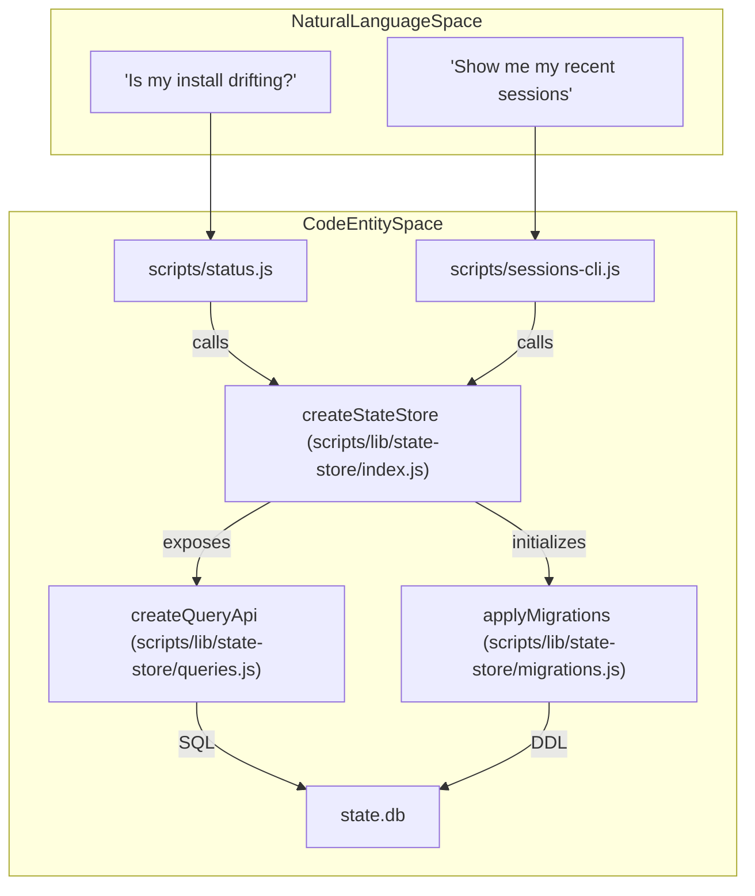
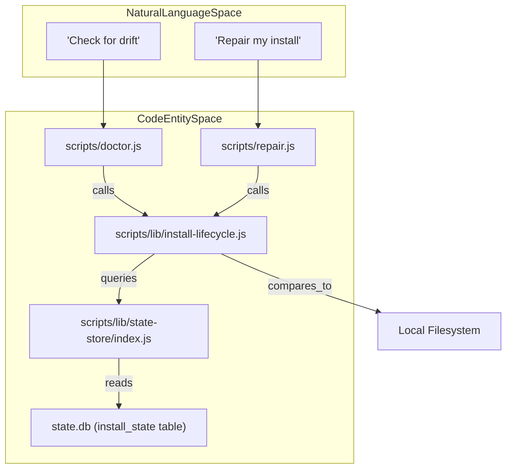

<!-- source: DeepWiki mcp.deepwiki.com · repo affaan-m/everything-claude-code · page 9.7 State Store & SQLite Persistence · fetched 2026-10-26 -->

# State Store & SQLite Persistence

Relevant source files

The following files were used as context for generating this wiki page:

- [schemas/state-store.schema.json](schemas/state-store.schema.json)
- [scripts/doctor.js](scripts/doctor.js)
- [scripts/lib/install-lifecycle.js](scripts/lib/install-lifecycle.js)
- [scripts/lib/state-store/index.js](scripts/lib/state-store/index.js)
- [scripts/lib/state-store/migrations.js](scripts/lib/state-store/migrations.js)
- [scripts/lib/state-store/queries.js](scripts/lib/state-store/queries.js)
- [scripts/lib/state-store/schema.js](scripts/lib/state-store/schema.js)
- [scripts/list-installed.js](scripts/list-installed.js)
- [scripts/repair.js](scripts/repair.js)
- [scripts/sessions-cli.js](scripts/sessions-cli.js)
- [scripts/status.js](scripts/status.js)
- [scripts/uninstall.js](scripts/uninstall.js)
- [tests/lib/state-store.test.js](tests/lib/state-store.test.js)

The Everything Claude Code (ECC) state store provides a centralized, persistent repository for tracking the lifecycle of sessions, skill executions, installation health, and governance events. The system utilizes a SQLite database (~/.claude/ecc/state.db) managed via the `sql.js` library to maintain a structured audit trail of agent activity and environment configuration.

## Overview & Database Location

The ECC state store is the primary persistence layer for cross-session metadata. Unlike temporary session files, the state store is designed for long-term querying and health monitoring.

*   **Database Path:** The default path is `~/.claude/ecc/state.db` [scripts/lib/state-store/index.js:12-24]().
*   **Implementation:** It uses `sql.js` with a wrapper to provide a `better-sqlite3` compatible API, including support for transactions and synchronous disk writes via `fs.writeFileSync` [scripts/lib/state-store/index.js:34-139]().

### Data Flow Architecture

The following diagram illustrates how the `createStateStore` API bridges the gap between raw SQLite storage and the CLI tools used by developers.

**ECC Persistence & Query Architecture**

Sources: [scripts/lib/state-store/index.js:164-185](), [scripts/status.js:141-154](), [scripts/sessions-cli.js:136-151]()

## Schema Entities

The database schema is defined in `migrations.js` and validated against a JSON schema to ensure data integrity [scripts/lib/state-store/migrations.js:3-108](), [schemas/state-store.schema.json:1-44]().

| Entity | Table Name | Purpose |
| :--- | :--- | :--- |
| **Session** | `sessions` | Tracks session lifecycle, harness type (Claude/Cursor), and repo root [scripts/lib/state-store/migrations.js:10-19](). |
| **Skill Run** | `skill_runs` | Records outcomes, token usage, and duration for every skill invocation [scripts/lib/state-store/migrations.js:26-39](). |
| **Skill Version** | `skill_versions` | Tracks skill content hashes and promotion/rollback history [scripts/lib/state-store/migrations.js:48-56](). |
| **Decision** | `decisions` | Logs architectural choices and their rationales [scripts/lib/state-store/migrations.js:61-72](). |
| **Install State** | `install_state` | Tracks installed modules, operations, and source versions per target [scripts/lib/state-store/migrations.js:79-88](). |
| **Governance Event** | `governance_events` | Records security policy reviews and resolutions [scripts/lib/state-store/migrations.js:93-102](). |

Sources: [scripts/lib/state-store/migrations.js:3-108](), [schemas/state-store.schema.json:45-300]()

## State Store API (`createStateStore`)

The `createStateStore` function is the primary entry point for interacting with the database. It handles initialization, migration application, and exports the Query API [scripts/lib/state-store/index.js:164-185]().

### Key API Methods
- `upsertSession(session)`: Inserts or updates session metadata and state snapshots [scripts/lib/state-store/queries.js:304-324]().
- `insertSkillRun(run)`: Logs a completed skill execution with outcome classification (success/failure) [scripts/lib/state-store/queries.js:338-358]().
- `getStatus(options)`: A high-level aggregator used by `ecc status` to summarize active sessions, skill success rates, and installation health [scripts/lib/state-store/queries.js:512-536]().
- `getSessionDetail(id)`: Retrieves a unified view of a session including its associated workers, skill runs, and decisions [scripts/lib/state-store/queries.js:459-491]().

Sources: [scripts/lib/state-store/index.js:164-185](), [scripts/lib/state-store/queries.js:304-536]()

## CLI Tools for State Inspection

### `ecc status`
The `status.js` script provides a dashboard view of the ECC environment. It queries the state store to report:
- **Active Sessions:** List of running sessions and their repo roots [scripts/status.js:47-60]().
- **Skill Performance:** Success/failure statistics for recent skill runs [scripts/status.js:62-83]().
- **Install Health:** Status of recorded installations across targets [scripts/status.js:85-104]().

### `ecc sessions`
The `sessions-cli.js` script allows for deep inspection of historical data:
- **List View:** Shows a paginated list of all recorded sessions [scripts/sessions-cli.js:50-67]().
- **Detail View:** When provided with a `<session-id>`, it displays full worker state, skill execution history, and logged decisions [scripts/sessions-cli.js:111-125]().

Sources: [scripts/status.js:1-178](), [scripts/sessions-cli.js:1-179]()

## Installation Lifecycle & Persistence

ECC manages installation state to detect "drift" (unauthorized changes or missing files). The `install-state` table stores the original `install-modules.json` resolution and the specific file operations performed [scripts/lib/state-store/migrations.js:79-88]().

**Install Health & Repair Flow**

Sources: [scripts/doctor.js:83-110](), [scripts/repair.js:69-96](), [scripts/lib/install-lifecycle.js:4-13]()

### Lifecycle Commands
- **`ecc doctor`**: Diagnoses drift by comparing the `install_state` table against the current filesystem [scripts/doctor.js:9-13]().
- **`ecc repair`**: Re-executes missing or modified operations recorded in the state store to restore integrity [scripts/repair.js:9-13]().
- **`ecc uninstall`**: Uses the `install_state` table to identify and safely remove only the files ECC is responsible for [scripts/uninstall.js:9-13]().

Sources: [scripts/doctor.js:1-112](), [scripts/repair.js:1-99](), [scripts/uninstall.js:1-98]()

---

