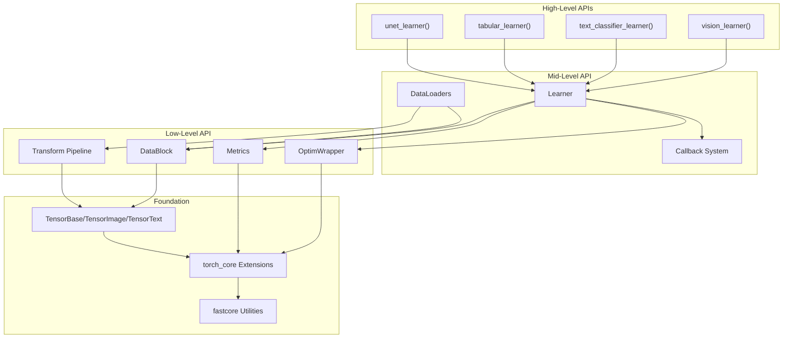
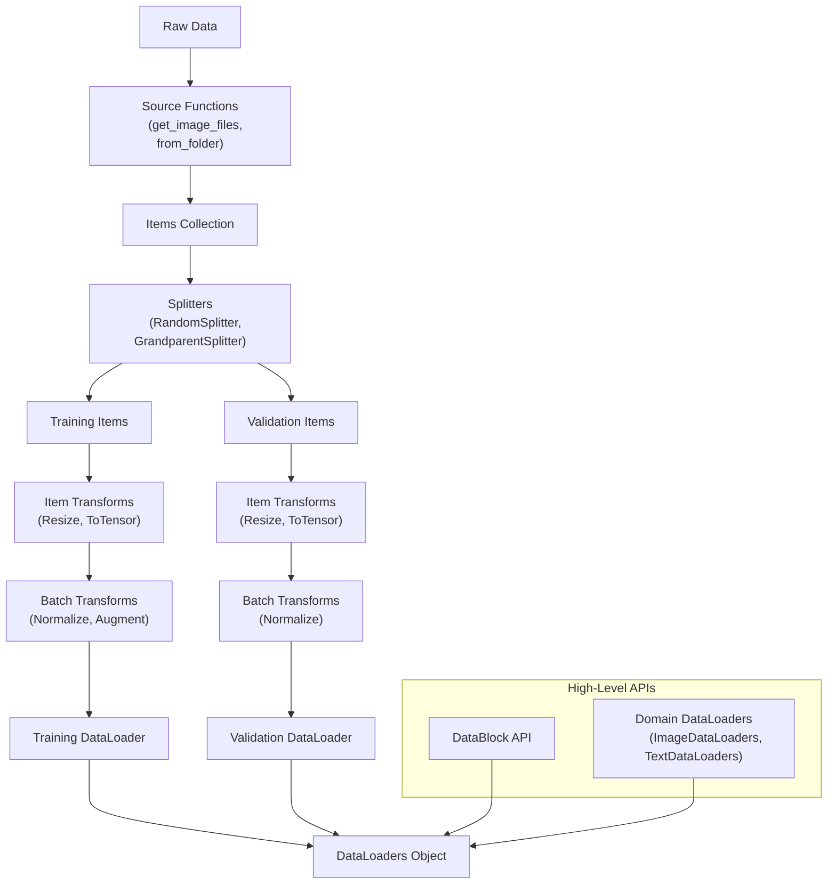
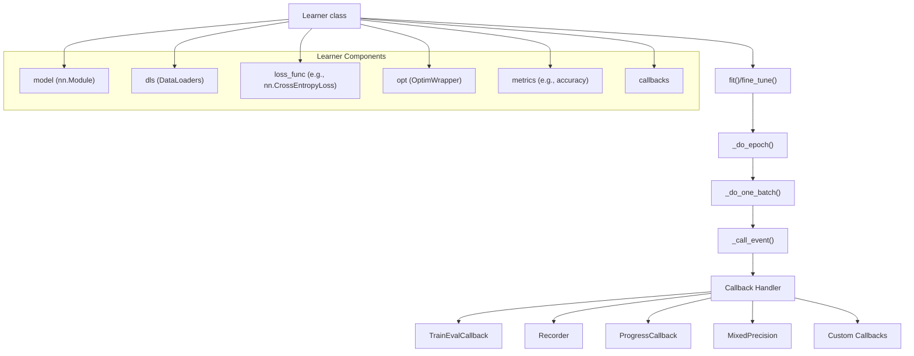
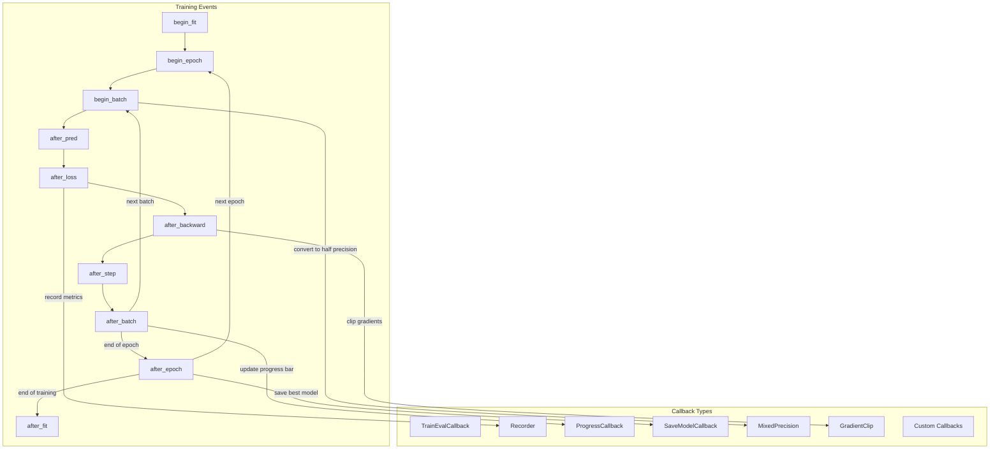
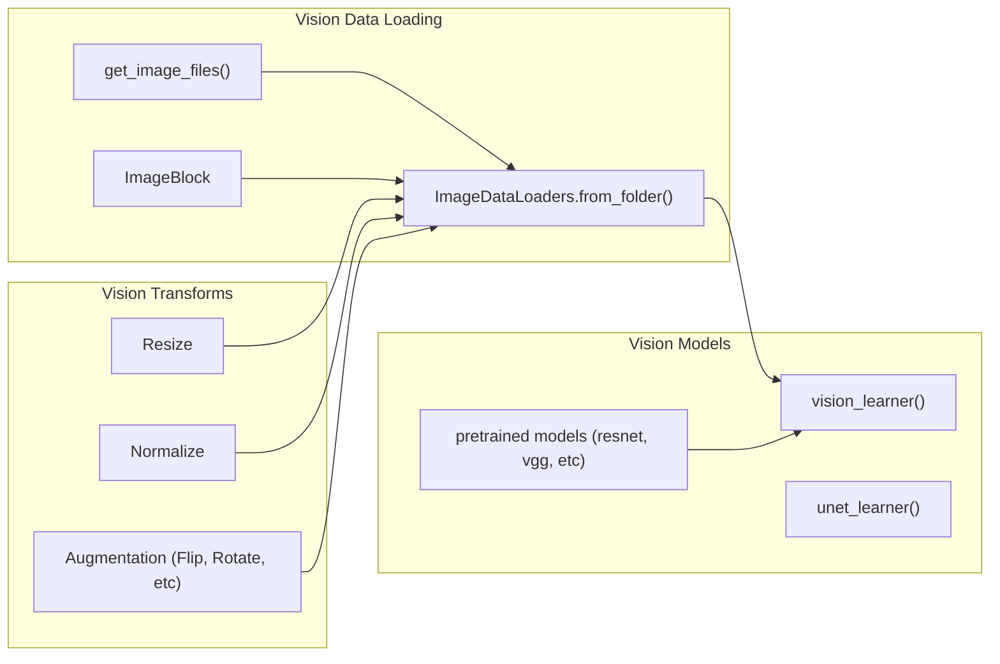

<!-- source: DeepWiki mcp.deepwiki.com · repo fastai/fastai · page 1 Overview · fetched 2026-10-21 -->

# Overview

Relevant source files

The following files were used as context for generating this wiki page:

- [CHANGELOG.md](CHANGELOG.md)
- [README.md](README.md)
- [fastai/__init__.py](fastai/__init__.py)
- [nbs/index.ipynb](nbs/index.ipynb)
- [settings.ini](settings.ini)

This document provides a comprehensive introduction to the fastai library, its architecture, core components, and design philosophy. Fastai is a deep learning library that simplifies training fast and accurate neural networks using modern best practices while building on the PyTorch ecosystem.

## Purpose and Scope

The fastai library is designed with two primary goals:

1. Provide practitioners with high-level components that can quickly and easily achieve state-of-the-art results in standard deep learning domains
2. Provide researchers with low-level components that can be mixed and matched to build new approaches

Fastai achieves these goals without compromising ease of use, flexibility, or performance through a carefully layered architecture of decoupled abstractions.

For installation instructions, see [Installation and Setup](#1.2).

Sources: [settings.ini:7-8]()), [README.md:69-100]())

## Core Architecture

Fastai is built with a layered architecture where each layer builds upon the functionality provided by lower layers:

### Layered Architecture Diagram

This architecture allows users to operate at different levels of abstraction:
- **High-Level APIs**: Domain-specific functions to create complete training systems with minimal code
- **Mid-Level API**: `Learner` and `DataLoaders` classes that manage training and data pipelines
- **Low-Level API**: Building blocks like `DataBlock`, transforms, and optimizers
- **Foundation**: Extensions to PyTorch and core utilities

Sources: [README.md:92-100]()), [settings.ini:16-21]())

## Data Processing Pipeline

Fastai features a flexible data pipeline that transforms raw data into training-ready batches:

### Data Pipeline Diagram

The pipeline consists of:
- **Source functions**: Extract items from files, folders, or other data sources
- **Splitters**: Divide data into training and validation sets
- **Transforms**: Process data at item level (single objects) and batch level (multiple items)
- **DataLoaders**: Efficiently load and batch data for training and validation

This system can be configured using either the flexible `DataBlock` API or more specialized domain DataLoader functions.

Sources: [README.md:92]()), [README.md:86]()), [settings.ini:17]())

## Learner and Training System

The `Learner` class is the central component that orchestrates the training process:

### Learner System Diagram

The `Learner` integrates:
- A neural network model (PyTorch `nn.Module`)
- `DataLoaders` for training and validation data
- A loss function
- An optimizer (usually wrapped with `OptimWrapper`)
- Metrics for evaluation
- Callbacks for customizing behavior

Training methods include:
- `fit()`: Train for a specified number of epochs
- `fine_tune()`: Two-phase training for transfer learning
- `fit_one_cycle()`: Uses the 1cycle policy for faster convergence

Sources: [README.md:87-88]()), [CHANGELOG.md:205-212]())

## Callback System

Fastai features a powerful two-way callback system that allows customization of every aspect of training:

Callbacks:
- Respond to specific events in the training loop
- Can access and modify the `Learner`'s state
- Can be composed to implement complex behaviors
- Are organized by "order" for proper execution sequence

Core callbacks include:
- `TrainEvalCallback`: Manages training and validation modes
- `Recorder`: Tracks metrics and learning rates
- `ProgressCallback`: Displays training progress
- `SaveModelCallback`: Saves best models automatically
- `MixedPrecision`: Enables mixed-precision training

Sources: [README.md:89-90]()), [CHANGELOG.md:206]()), [CHANGELOG.md:467-473]())

## Domain-Specific Modules

Fastai provides specialized modules for different data types and tasks:

### Computer Vision

Key components:
- `vision_learner()`: Creates a learner for image classification
- `unet_learner()`: For image segmentation tasks
- Vision-specific transforms like `Resize`, `Normalize`, and various augmentations
- Pre-trained model support for transfer learning

### Natural Language Processing

Key components:
- `text_classifier_learner()`: For text classification
- `language_model_learner()`: For language modeling
- Text preprocessing and tokenization
- AWD-LSTM and transformer architectures

### Tabular Data

Key components:
- `tabular_learner()`: For structured data
- Automatic preprocessing of categorical and continuous variables
- Entity embeddings for categorical features
- Interpretation tools

Sources: [README.md:81-92]()), [CHANGELOG.md:244-246]())

## Advanced Features

Fastai includes several advanced features for optimizing training and production use:

| Feature | Description | Key Components |
|---------|-------------|----------------|
| Mixed Precision | Train with float16 to improve speed and memory usage | `to_fp16()`, `MixedPrecision` callback |
| Distributed Training | Train across multiple GPUs or machines | `accelerate`, `configure_accelerate` |
| Experiment Tracking | Monitor training with external tools | `WandbCallback`, TensorBoard integration |
| Model Export | Save and deploy trained models | `Learner.export()`, `load_learner()` |
| Interpretation | Analyze model predictions | `ClassificationInterpretation`, `SegmentationInterpretation` |

Sources: [settings.ini:21-22]()), [CHANGELOG.md:196-198]()), [CHANGELOG.md:204-212]())

## Development and Extension

Fastai is designed for easy extension:
- Create custom callbacks to modify training behavior
- Define new transforms for data preprocessing
- Add metrics or loss functions
- Implement custom models while keeping the training loop

For development workflows, fastai uses:
- Jupyter notebooks as the primary development environment
- `nbdev` for literate programming and documentation
- GitHub Actions for continuous integration and testing

Sources: [settings.ini:23-43]()), [README.md:136-144]())

---

