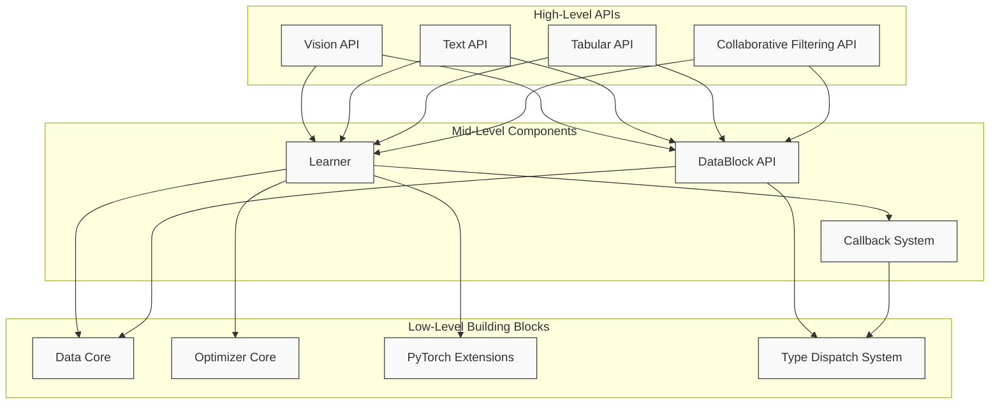
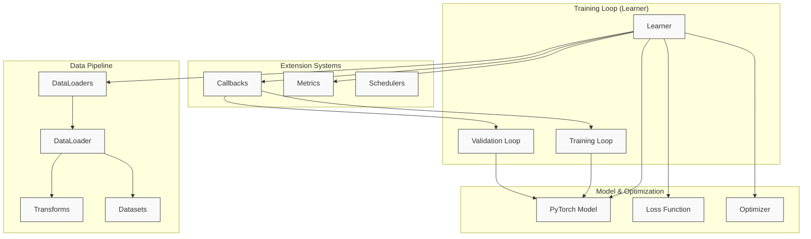
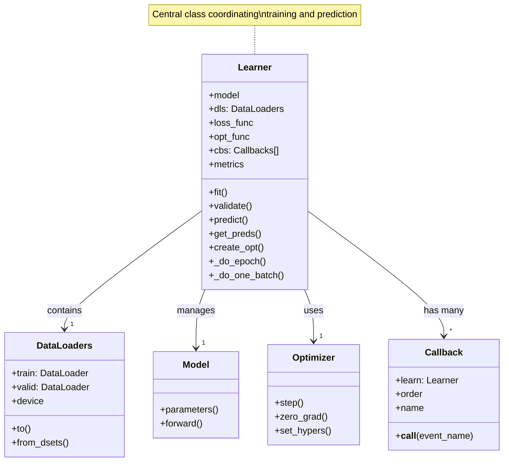
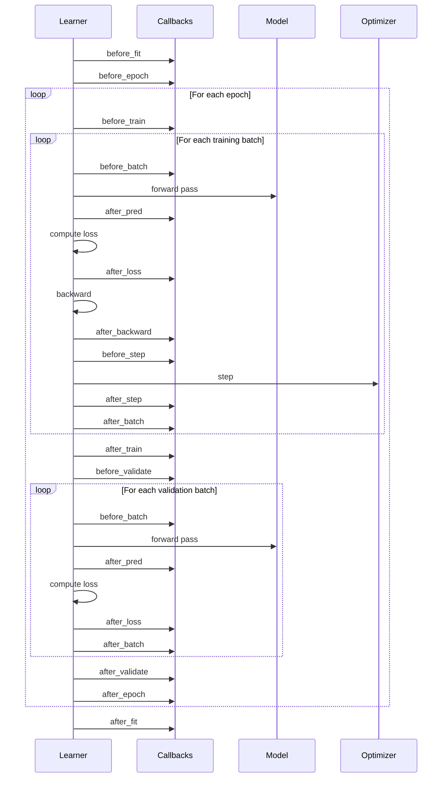
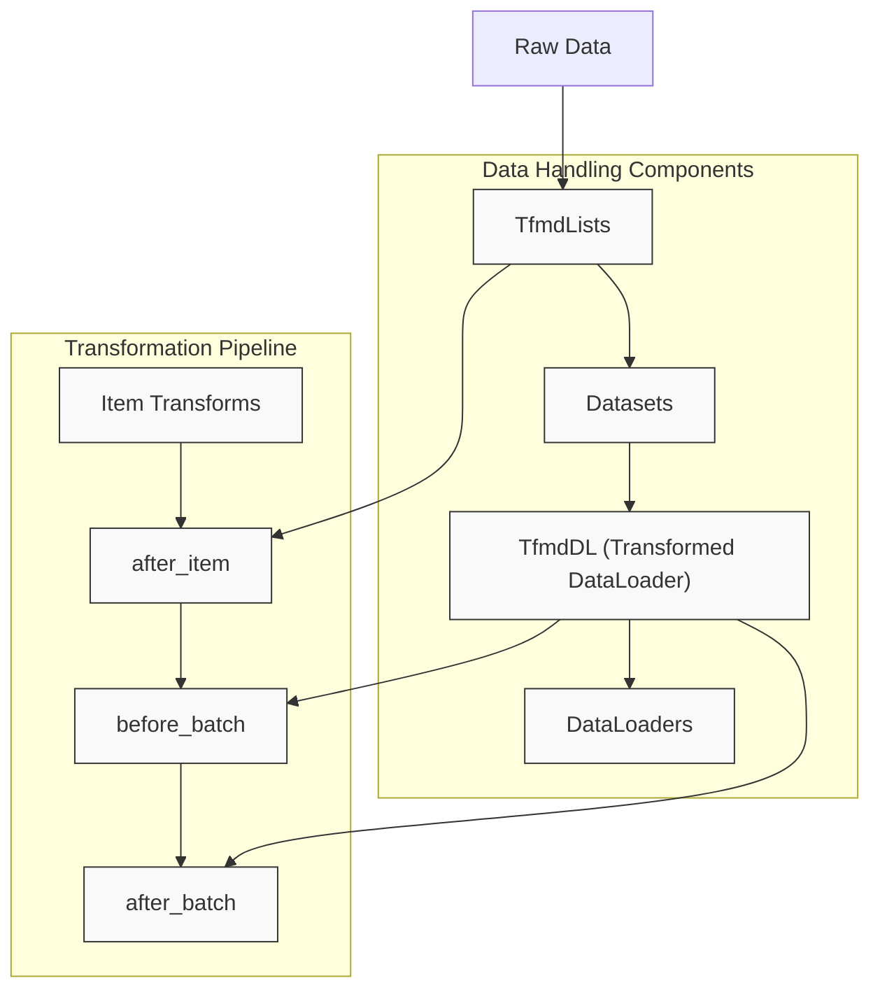
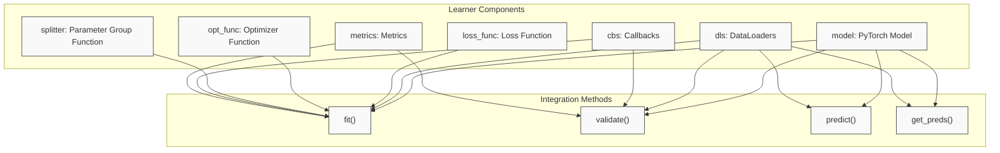

<!-- source: DeepWiki mcp.deepwiki.com · repo fastai/fastai · page 1.1 Architecture and Design · fetched 2026-10-21 -->

# Architecture and Design

Relevant source files

The following files were used as context for generating this wiki page:

- [README.md](README.md)
- [fastai/callback/core.py](fastai/callback/core.py)
- [fastai/data/core.py](fastai/data/core.py)
- [fastai/learner.py](fastai/learner.py)
- [nbs/03_data.core.ipynb](nbs/03_data.core.ipynb)
- [nbs/13_callback.core.ipynb](nbs/13_callback.core.ipynb)
- [nbs/13a_learner.ipynb](nbs/13a_learner.ipynb)
- [nbs/index.ipynb](nbs/index.ipynb)

This document describes the overall architecture and design philosophy of the fastai library. It explains how the core components are organized, the design patterns used, and how these components interact to provide both high-level simplicity for practitioners and low-level flexibility for researchers.

For installation and setup instructions, see [Installation and Setup](#1.2).

## High-Level Architecture

Fastai is built with a carefully layered architecture that expresses common patterns of deep learning in terms of decoupled abstractions. This architecture enables the library to be both approachable for beginners and hackable for experts.

Sources: [README.md:67-109](), [nbs/index.ipynb:85-102]()

The architecture consists of three main layers:

1. **High-Level APIs**: Domain-specific APIs for vision, text, tabular, and collaborative filtering that provide a consistent interface for different applications.

2. **Mid-Level Components**: Core abstractions like Learner, DataBlock API, and the Callback System that coordinate the training process and data handling.

3. **Low-Level Building Blocks**: Fundamental functionality such as data loading, optimizers, PyTorch extensions, and the type dispatch system.

## Core Systems and Their Interactions

Fastai's core functionality is built around several key systems that work together to provide a flexible and powerful deep learning framework.

Sources: [fastai/learner.py:106-220](), [fastai/data/core.py:64-182](), [fastai/callback/core.py:47-77]()

### Learner System

The `Learner` class is the central coordination component of fastai. It brings together the model, data, loss function, and optimizer, and manages the training loop.

#### Learner Components and Responsibilities

Sources: [fastai/learner.py:106-369]()

The `Learner` class implements the training loop with several key methods:

- `fit()`: Trains the model for a specified number of epochs
- `_do_epoch()`: Executes one epoch of training and validation
- `_do_one_batch()`: Processes a single batch through the model
- `validate()`: Evaluates the model on the validation set
- `get_preds()`: Gets predictions from the model

The training loop sequence is:

1. Get a batch of data
2. Pass it through the model to get predictions
3. Calculate the loss between predictions and targets
4. Compute gradients via backpropagation
5. Update model parameters with the optimizer
6. Repeat for all batches and epochs

Sources: [fastai/learner.py:210-261]()

### Callback System

Fastai employs an event-driven callback system that allows for customization of the training process without modifying the core training loop.

Sources: [fastai/callback/core.py:47-77](), [fastai/learner.py:210-261]()

The callback system is built around a set of predefined events that occur during the training loop. The `Callback` class provides a framework for creating custom callbacks that can hook into these events.

Key events include:
- `before_fit`, `after_fit`
- `before_epoch`, `after_epoch`
- `before_train`, `after_train`
- `before_batch`, `after_batch`
- `after_pred`, `after_loss`
- `before_backward`, `after_backward`
- `before_step`, `after_step`

Sources: [fastai/callback/core.py:86-89]()

Callbacks can be used to implement a wide range of functionality, such as:
- Learning rate scheduling
- Early stopping
- Checkpoint saving
- Metrics calculation
- Progress tracking

A core callback is the `TrainEvalCallback` which handles the basic setup of training and evaluation modes for the model.

Sources: [fastai/callback/core.py:80-108]()

### Data Processing Pipeline

The data processing system in fastai is built around a flexible pipeline for loading, transforming, and batching data.

Sources: [fastai/data/core.py:64-182](), [fastai/data/core.py:195-292]()

The key components in the data processing pipeline are:

1. **TfmdLists**: A collection of items with associated transforms
2. **Datasets**: Combines multiple TfmdLists to create input-target pairs
3. **TfmdDL (Transformed DataLoader)**: Applies batch transforms and handles batching
4. **DataLoaders**: Manages training and validation DataLoaders

The transformation pipeline consists of three main stages:
- `after_item`: Transforms applied to individual items
- `before_batch`: Transforms applied before items are collated into a batch
- `after_batch`: Transforms applied to the whole batch

Sources: [fastai/data/core.py:61](), [fastai/data/core.py:64-182]()

### Component Integration

The `Learner` class integrates all these components to provide a cohesive training experience.

Sources: [fastai/learner.py:108-135](), [fastai/learner.py:263-336]()

## Design Patterns and Principles

Fastai employs several key design patterns and principles that enable its flexibility and power.

### 1. Callback-Driven Development

The callback system allows for extensive customization of the training process without modifying the core training loop. This is similar to middleware in web frameworks.

| Callback Type | Purpose | Examples |
|---------------|---------|----------|
| Core Callbacks | Handle basic training loop functionality | TrainEvalCallback |
| Metric Callbacks | Calculate and record model performance | Accuracy, F1Score |
| Scheduling Callbacks | Adjust hyperparameters during training | OneCycleScheduler |
| Data Callbacks | Modify data during training | MixUp, CutMix |
| Utility Callbacks | Provide additional functionality | SaveModelCallback, EarlyStoppingCallback |

Sources: [fastai/callback/core.py:47-77]()

### 2. Type Dispatch System

Fastai uses a type dispatch system that enables function behavior to be determined by the types of its arguments. This allows for specialized processing based on data types.

### 3. Functional-Style Transformations

Data transformations are treated as functional operations that can be composed and chained together.

### 4. Delegation Pattern

Fastai uses delegation extensively to avoid repeating parameter specifications. The `@delegates` decorator passes arguments from one function to another.

### 5. Progressive Disclosure

The API is designed with progressive disclosure, allowing simple use cases to be handled simply while exposing more complexity as needed.

## Exception Handling for Control Flow

Fastai uses exceptions as control flow mechanisms to skip parts of the training loop when needed:

| Exception | Purpose |
|-----------|---------|
| CancelFitException | Stop the entire training session |
| CancelEpochException | Skip to the end of the current epoch |
| CancelTrainException | Skip the rest of training for this epoch |
| CancelValidException | Skip the rest of validation for this epoch |
| CancelBatchException | Skip the rest of processing for this batch |
| CancelStepException | Skip the optimizer step |
| CancelBackwardException | Skip the backward pass |

Sources: [fastai/callback/core.py:35-44](), [fastai/learner.py:20-22]()

## Summary

The fastai library is architected with a layered design that provides both high-level simplicity and low-level flexibility. The core systems - Learner, callbacks, and data processing - work together to provide a powerful framework for deep learning while allowing extensive customization.

This architecture enables both ease of use for practitioners and hackability for researchers, making fastai suitable for a wide range of deep learning applications.

---

