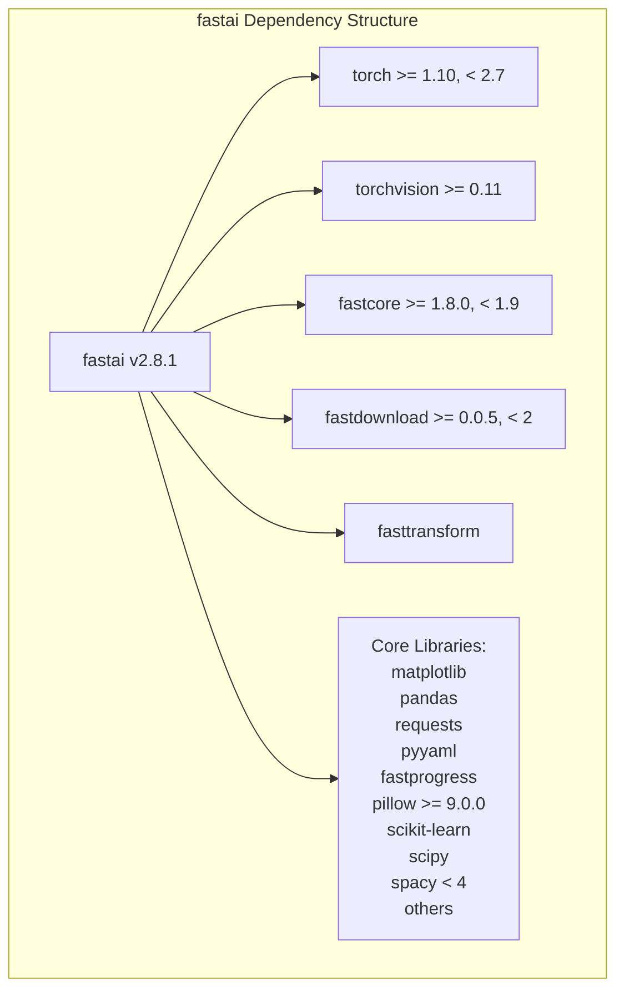

<!-- source: DeepWiki mcp.deepwiki.com · repo fastai/fastai · page 1.2 Installation and Setup · fetched 2026-10-21 -->

# Installation and Setup

<details>
<summary>Relevant source files</summary>

The following files were used as context for generating this wiki page:

- [CHANGELOG.md](CHANGELOG.md)
- [README.md](README.md)
- [fastai/__init__.py](fastai/__init__.py)
- [nbs/index.ipynb](nbs/index.ipynb)
- [settings.ini](settings.ini)

</details>


This page provides detailed instructions for installing and configuring the fastai library on different platforms. It covers various installation methods, dependency management, platform-specific considerations, and troubleshooting tips. For information about the overall architecture of fastai, see [Architecture and Design](#1.1).

## System Requirements

Before installing fastai, ensure your system meets these requirements:

- **Python**: 3.10 or higher
- **PyTorch**: 1.10 or higher (but less than 2.7)
- **Operating Systems**:
  - Linux (fully supported)
  - Windows (supported with some considerations)
  - macOS (limited support, with MPS support added in v2.7.6)

Sources: [settings.ini:14](), [settings.ini:18-19]()

## Installation Methods

There are several ways to install fastai depending on your needs. The following diagram outlines the main installation paths:

### Installation Methods Overview

```mermaid
flowchart LR
    start["Choose Installation Method"]
    
    subgraph "No Local Installation"
        cloud["Cloud Platform"]
        google["Google Colab<br>!pip install -Uqq fastai"]
    end
    
    subgraph "Local Installation"
        conda["Conda Installation<br>(Recommended)"]
        pip["Pip Installation"]
        dev["Development Setup"]
        
        pytorch["1. Install PyTorch"]
        fastai_conda["2. conda install fastai::fastai"]
        
        fastai_pip["pip install fastai"]
        
        clone["1. Clone Repository"]
        edit["2. pip install -e \"fastai[dev]\""]
    end
    
    start --> cloud
    start --> conda
    start --> pip
    start --> dev
    
    cloud --> google
    
    conda --> pytorch
    pytorch --> fastai_conda
    
    dev --> clone
    clone --> edit
```

Sources: [README.md:11-44](), [nbs/index.ipynb:35-58]()

### Using Google Colab (No Installation)

The simplest way to get started with fastai is to use Google Colab, which has GPU support and requires no local installation:

1. Go to [Google Colab](https://colab.research.google.com/)
2. Create a new notebook
3. Run: `!pip install -Uqq fastai` in a code cell
4. Set runtime to GPU: Runtime > Change runtime type > Hardware accelerator > GPU

Sources: [README.md:13-18](), [nbs/index.ipynb:42-43]()

### Conda Installation (Recommended)

The recommended method for installing fastai on your local machine:

1. Install [Miniconda](https://docs.conda.io/en/latest/miniconda.html) or [Miniforge](https://github.com/conda-forge/miniforge)
2. Install PyTorch using conda (check [PyTorch's website](https://pytorch.org/get-started/locally/) for the current command)
3. Install fastai:

```bash
conda install fastai::fastai
```

Sources: [README.md:20-32](), [nbs/index.ipynb:44-49]()

### Pip Installation

For users who prefer pip:

```bash
pip install fastai
```

Sources: [README.md:34](), [nbs/index.ipynb:51]()

### Development Installation (Editable)

For contributors or users who want the cutting-edge version:

1. Install PyTorch following the [PyTorch instructions](https://pytorch.org/get-started/locally/)
2. Clone the fastai repository:

```bash
git clone https://github.com/fastai/fastai
pip install -e "fastai[dev]"
```

Sources: [README.md:36-44](), [nbs/index.ipynb:53-58]()

## Dependencies

fastai has several dependencies that are automatically installed when you install the package:



Sources: [settings.ini:17-21]()

## Platform-Specific Considerations

### Windows

fastai is supported on Windows, but with some important caveats:

- **Jupyter Notebook limitations**: Due to Python multiprocessing issues, `num_workers` is automatically set to 0 in Jupyter to prevent hanging, which makes tasks like computer vision significantly slower
- **Recommended approach**: Use Windows Subsystem for Linux (WSL) instead of native Windows
- **Alternative**: If using native Windows, run fastai from scripts rather than Jupyter notebooks

Sources: [README.md:118-132](), [nbs/index.ipynb:141-146]()

### macOS

macOS has limited official support in fastai:

- Initial Mac GPU (MPS) support was added in version 2.7.6
- Some limitations exist with PyTorch's MPS implementation
- The changelog indicates ongoing improvements for Mac support in recent versions

Sources: [CHANGELOG.md:158-161]()

## Version Compatibility

This table shows the compatibility between fastai, Python, and PyTorch versions:

| fastai Version | Python Requirement | PyTorch Compatibility |
|----------------|-------------------|------------------------|
| 2.8.x | ≥ 3.10 | 1.10 - 2.6 |
| 2.7.x | ≥ 3.10 | 1.10 - 2.5 |
| 2.6.x | ≥ 3.9 | 1.10 - 2.4 |

Sources: [settings.ini:6](), [settings.ini:14](), [settings.ini:18-19](), [CHANGELOG.md:16]()

## Verifying Installation

To verify that fastai is correctly installed:

1. Open a Python interpreter or Jupyter notebook
2. Run the following code:

```python
import fastai
print(fastai.__version__)  # Should display the version number (e.g., 2.8.1)
```

For a more comprehensive check of your entire deep learning environment:

```python
from fastai.basics import *
show_install()  # Displays versions of critical dependencies
```

Sources: [fastai/__init__.py:1-2]()

## Updating fastai

To update fastai to the latest version:

- With conda: `conda update fastai::fastai`
- With pip: `pip install -U fastai`

For Google Colab, run at the start of your notebook:

```python
!pip install -Uqq fastai  # upgrade fastai on colab
```

Sources: [nbs/index.ipynb:9-11]()

## Troubleshooting Common Installation Issues

### PyTorch Compatibility

- **Issue**: `ImportError` related to PyTorch version mismatch
- **Solution**: Ensure you have a compatible PyTorch version: `pip install "torch>=1.10,<2.7"`

### Missing Dependencies

- **Issue**: Import errors for missing packages
- **Solution**: Install all dependencies: `pip install -e "fastai[dev]"` or check the requirements in settings.ini

### CUDA/GPU Issues

- **Issue**: PyTorch cannot find your CUDA installation
- **Solution**: Install the correct PyTorch version for your CUDA version from [pytorch.org](https://pytorch.org)

### Windows-Specific Issues

- **Issue**: Slow performance or hanging in Jupyter notebooks
- **Solution**: Use WSL or run fastai from scripts instead of notebooks

Sources: [settings.ini:17-21](), [README.md:118-132]()

## Additional Installation Options

### Docker Containers

Official Docker containers for fastai are available for those who prefer containerized environments:

```bash
# Pull the latest fastai Docker image
docker pull fastdotai/fastai
```

See the [Docker containers repository](https://github.com/fastai/docker-containers#fastai) for more options.

Sources: [README.md:159-162](), [nbs/index.ipynb:197]()

## Developer Setup

If you're contributing to fastai development:

1. Clone the repository: `git clone https://github.com/fastai/fastai`
2. Install the development dependencies: `pip install -e "fastai[dev]"`
3. Run `nbdev_install_hooks` to set up git hooks for Jupyter notebooks
4. Use `nbdev_test` to run tests

This ensures proper development workflow with the nbdev system that fastai uses.

Sources: [README.md:134-157](), [nbs/index.ipynb:159-183](), [settings.ini:21]()

---

