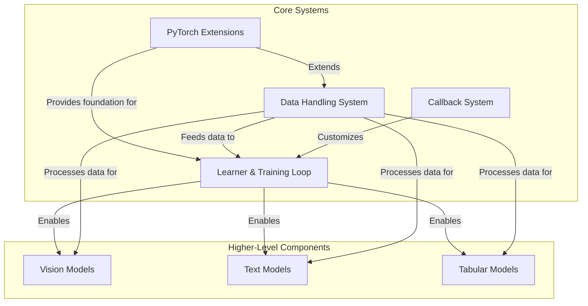
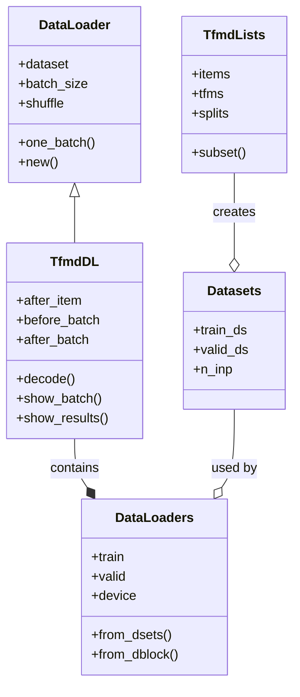
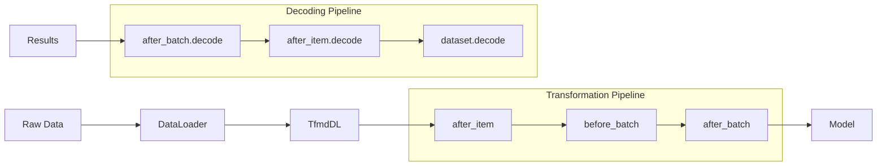
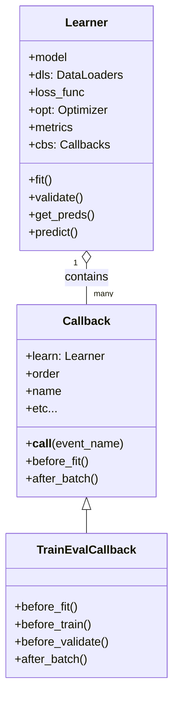
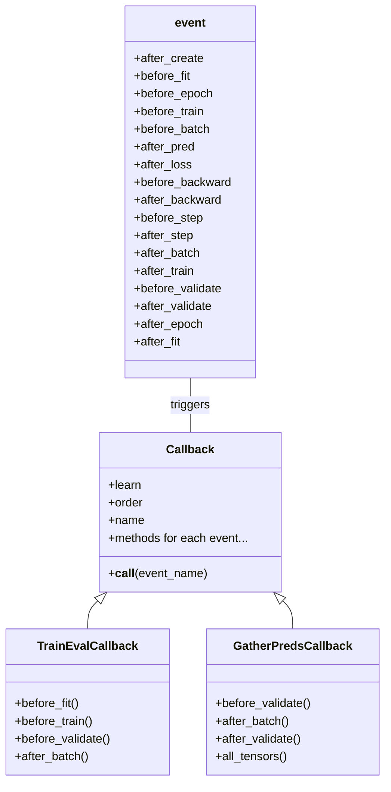
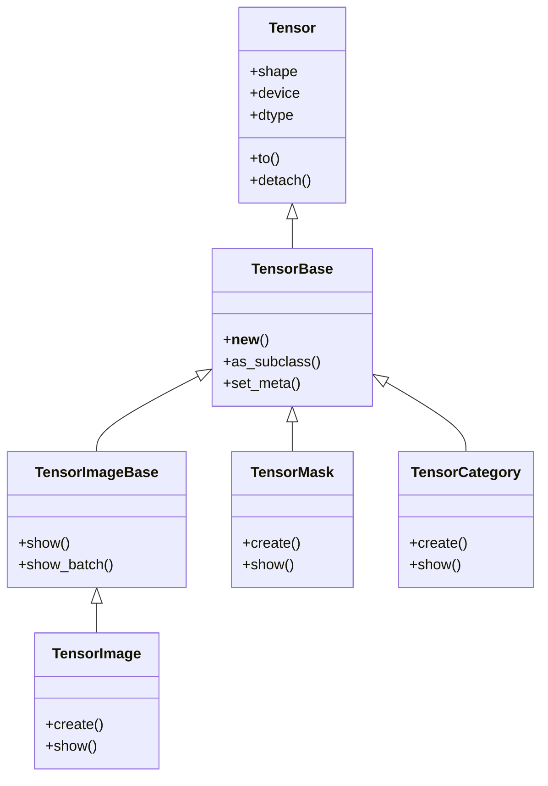
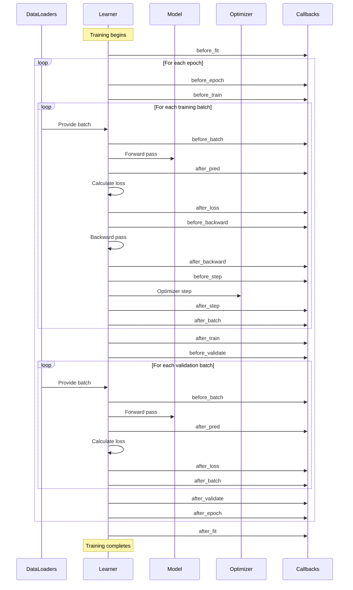

<!-- source: DeepWiki mcp.deepwiki.com · repo fastai/fastai · page 2 Core Systems · fetched 2026-10-21 -->

# Core Systems

Relevant source files

The following files were used as context for generating this wiki page:

- [fastai/callback/core.py](fastai/callback/core.py)
- [fastai/data/core.py](fastai/data/core.py)
- [fastai/learner.py](fastai/learner.py)
- [fastai/torch_core.py](fastai/torch_core.py)
- [nbs/00_torch_core.ipynb](nbs/00_torch_core.ipynb)
- [nbs/03_data.core.ipynb](nbs/03_data.core.ipynb)
- [nbs/13_callback.core.ipynb](nbs/13_callback.core.ipynb)
- [nbs/13a_learner.ipynb](nbs/13a_learner.ipynb)

This document covers the fundamental subsystems that form the foundation of the fastai library. These core systems enable the library's higher-level components and provide the essential infrastructure for building deep learning models. The core systems include data handling, training loop management, callback system for customization, and PyTorch extensions.

For information about domain-specific implementations like computer vision, NLP, or tabular data, see [Domain-Specific Modules](#3).

## Overview of Core Systems Architecture

The fastai library is built upon a set of core systems that work together to provide a flexible and powerful deep learning framework. These systems are designed to be modular, allowing users to customize and extend functionality as needed.

Sources: [fastai/learner.py:106-135](https://github.com/fastai/fastai/tree/master/fastai/learner.py), [fastai/data/core.py:64-183](https://github.com/fastai/fastai/tree/master/fastai/data/core.py), [fastai/callback/core.py:47-77](https://github.com/fastai/fastai/tree/master/fastai/callback/core.py), [fastai/torch_core.py:33-39](https://github.com/fastai/fastai/tree/master/fastai/torch_core.py)

## Data Handling System

The Data Handling System in fastai is responsible for loading, transforming, and batching data for model training and inference. It provides a flexible pipeline that handles various data types and transformations.

### Key Components of the Data Handling System

Sources: [fastai/data/core.py:64-183](https://github.com/fastai/fastai/tree/master/fastai/data/core.py), [fastai/data/core.py:195-264](https://github.com/fastai/fastai/tree/master/fastai/data/core.py), [fastai/data/core.py:294-337](https://github.com/fastai/fastai/tree/master/fastai/data/core.py)

### Data Transformation Pipeline

The data transformation pipeline is a key feature of fastai's data handling system. It allows for consistent application of transformations to data items and batches during both training and inference.

Sources: [fastai/data/core.py:119-134](https://github.com/fastai/fastai/tree/master/fastai/data/core.py)

The key classes in this system include:

1. **TfmdDL (Transformed DataLoader)**: Extends PyTorch's DataLoader with transformation capabilities. It applies three types of transforms:
   - `after_item`: Applied to individual items after they're retrieved from the dataset
   - `before_batch`: Applied to items before they're collated into a batch
   - `after_batch`: Applied to the batch after collation

2. **DataLoaders**: A container for training and validation dataloaders that manages device placement and provides a unified interface.

3. **TfmdLists**: A transform-aware list-like container that applies transformations to items and manages train/validation splits.

The transformation pipeline also includes decoding functionality that reverses transforms for visualization and interpretation of results.

## Learner and Training Loop

The Learner class is the central component of fastai's training system. It coordinates the model, data, optimizer, and callbacks to implement the training loop.

### Learner Architecture

Sources: [fastai/learner.py:106-335](https://github.com/fastai/fastai/tree/master/fastai/learner.py), [fastai/callback/core.py:47-77](https://github.com/fastai/fastai/tree/master/fastai/callback/core.py), [fastai/callback/core.py:80-108](https://github.com/fastai/fastai/tree/master/fastai/callback/core.py)

### Training Loop Phases

The training loop in fastai follows a well-defined sequence of phases, with callback events triggered at specific points. This enables extensive customization of the training process.

```mermaid
flowchart TD
    FIT["Fit"] --> BF["before_fit"]
    BF --> EPOCH["Epoch Loop"]
    EPOCH --> BE["before_epoch"]
    BE --> TRAIN["Training Phase"]
    TRAIN --> BT["before_train"]
    BT --> BATCH_T["Batch Loop (Train)"]
    BATCH_T --> BB_T["before_batch"]
    BB_T --> PRED["Model Prediction"]
    PRED --> AP["after_pred"]
    AP --> LOSS["Loss Calculation"]
    LOSS --> AL["after_loss"]
    AL --> BW["before_backward"]
    BW --> ABW["after_backward"]
    ABW --> BS["before_step"]
    BS --> AS["after_step"]
    AS --> AB_T["after_batch"]
    AB_T --> BATCH_T_END["End Batch Loop"]
    BATCH_T_END --> AT["after_train"]
    
    AT --> VALID["Validation Phase"]
    VALID --> BV["before_validate"]
    BV --> BATCH_V["Batch Loop (Valid)"]
    BATCH_V --> BB_V["before_batch"]
    BB_V --> PRED_V["Model Prediction"]
    PRED_V --> AP_V["after_pred"]
    AP_V --> LOSS_V["Loss Calculation"]
    LOSS_V --> AL_V["after_loss"]
    AL_V --> AB_V["after_batch"]
    AB_V --> BATCH_V_END["End Batch Loop"]
    BATCH_V_END --> AV["after_validate"]
    
    AV --> AE["after_epoch"]
    AE --> EPOCH_END["End Epoch Loop"]
    EPOCH_END --> AF["after_fit"]
```

Sources: [fastai/learner.py:97-103](https://github.com/fastai/fastai/tree/master/fastai/learner.py), [fastai/learner.py:211-262](https://github.com/fastai/fastai/tree/master/fastai/learner.py)

The Learner class orchestrates the full training process:

1. **Initialization**: Sets up model, data, loss function, and optimizer
2. **Training Loop**: Implements the core loop through batches and epochs
3. **Validation**: Evaluates model performance on validation data
4. **Prediction**: Makes predictions with the trained model

Key methods of the Learner class include:

- `fit()`: Main method to train the model for a specified number of epochs
- `validate()`: Evaluates the model on validation data
- `get_preds()`: Gets predictions from the model on a dataset
- `predict()`: Makes a prediction on a single item

The training loop is highly customizable through the callback system, allowing users to modify any part of the process without changing the core code.

## Callback System

The Callback system is a powerful mechanism that enables customization of the training loop without modifying its core implementation. Callbacks can respond to events at various points in the training process.

### Callback Event Flow

Sources: [fastai/callback/core.py:19-26](https://github.com/fastai/fastai/tree/master/fastai/callback/core.py), [fastai/callback/core.py:47-77](https://github.com/fastai/fastai/tree/master/fastai/callback/core.py), [fastai/callback/core.py:80-108](https://github.com/fastai/fastai/tree/master/fastai/callback/core.py), [fastai/callback/core.py:114-167](https://github.com/fastai/fastai/tree/master/fastai/callback/core.py)

### Exception Handling for Flow Control

The callback system uses exceptions to control the flow of training. These exceptions allow callbacks to skip portions of the training loop.

| Exception | Purpose |
|-----------|---------|
| CancelBatchException | Skip the rest of the current batch |
| CancelTrainException | Skip the rest of the training phase |
| CancelValidException | Skip the rest of the validation phase |
| CancelEpochException | Skip the rest of the current epoch |
| CancelFitException | Stop the entire training process |
| CancelBackwardException | Skip the backward pass |
| CancelStepException | Skip the optimizer step |

Sources: [fastai/callback/core.py:34-44](https://github.com/fastai/fastai/tree/master/fastai/callback/core.py), [fastai/learner.py:84-94](https://github.com/fastai/fastai/tree/master/fastai/learner.py)

The Callback base class provides the infrastructure for all callbacks:

1. **Event Method Calling**: Calls the appropriate method on a callback when an event occurs
2. **Order Control**: Callbacks have an `order` attribute to determine execution sequence
3. **Training/Validation Control**: Callbacks can run in training, validation, or both phases
4. **Access to Learner**: Callbacks have access to the learner instance and all its attributes

Common built-in callbacks include:

- **TrainEvalCallback**: Sets up training/evaluation mode and tracks progress
- **GatherPredsCallback**: Collects predictions and targets during validation

## PyTorch Extensions

Fastai extends PyTorch's functionality with additional utilities and custom tensor types. These extensions enhance the developer experience and provide specialized behavior for different data types.

### Tensor Type Hierarchy

Sources: [fastai/torch_core.py:354-365](https://github.com/fastai/fastai/tree/master/fastai/torch_core.py)

### Device and Type Handling

A key part of fastai's PyTorch extensions is the improved handling of devices and tensor types:

1. **Device Management**: 
   - `default_device()`: Determines the best available device (CUDA, MPS, CPU)
   - `to_device()`: Moves tensors to the specified device
   - `to_cpu()`: Moves tensors to CPU
   - `to_detach()`: Detaches tensors from their computation graph

2. **Type Handling**:
   - `tensor()`: Enhanced version of PyTorch's tensor creation
   - `to_np()`: Converts tensors to NumPy arrays
   - Custom tensor types for domain-specific applications

Sources: [fastai/torch_core.py:259-292](https://github.com/fastai/fastai/tree/master/fastai/torch_core.py), [fastai/torch_core.py:129-158](https://github.com/fastai/fastai/tree/master/fastai/torch_core.py)

The PyTorch extensions provide a richer set of tools for:

- Displaying images and other visual data
- Converting between different tensor types
- Moving data between devices efficiently
- Working with batched data
- Handling metadata for tensors

These extensions form the foundation upon which the data handling and training systems are built, providing the necessary functionality for the higher-level components of the library.

## System Integration

Understanding how the core systems interact is essential for leveraging the full power of fastai. The following diagram illustrates the relationships between these systems during the training process:

Sources: [fastai/learner.py:239-261](https://github.com/fastai/fastai/tree/master/fastai/learner.py), [fastai/learner.py:211-238](https://github.com/fastai/fastai/tree/master/fastai/learner.py), [fastai/callback/core.py:56-67](https://github.com/fastai/fastai/tree/master/fastai/callback/core.py)

This integration shows how:

1. The `DataLoaders` provide data to the `Learner`
2. The `Learner` coordinates the model and optimizer operations
3. `Callbacks` are notified at each step, allowing them to monitor and modify the process
4. PyTorch extensions (implicit in the diagram) provide the tensor operations underpinning all components

Understanding these interactions enables effective customization of the training process through the callback system, data transformations, or model modifications.

## Summary

The core systems of fastai provide a flexible and powerful foundation for deep learning applications:

1. **Data Handling System**: Manages data loading, transformation, and batching with a focus on flexibility and ease of use
2. **Learner and Training Loop**: Orchestrates the training process with a well-defined structure
3. **Callback System**: Enables customization of any part of the training process
4. **PyTorch Extensions**: Extends PyTorch with additional utilities and custom tensor types

These systems are designed to work together seamlessly while allowing for extensive customization at each level. By understanding these core systems, you can leverage the full power of fastai for your deep learning projects.

For more information on specific domains like computer vision or NLP, see the [Domain-Specific Modules](#3) documentation.

---

