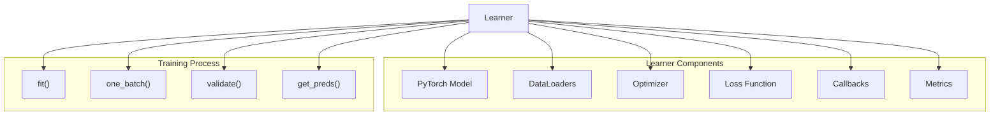
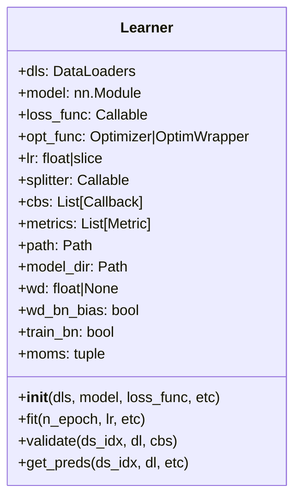
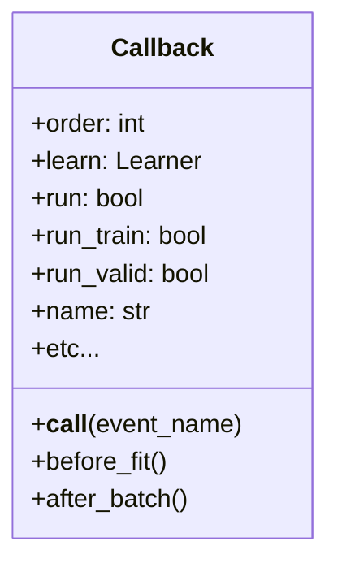
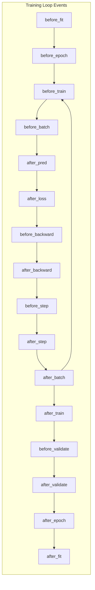
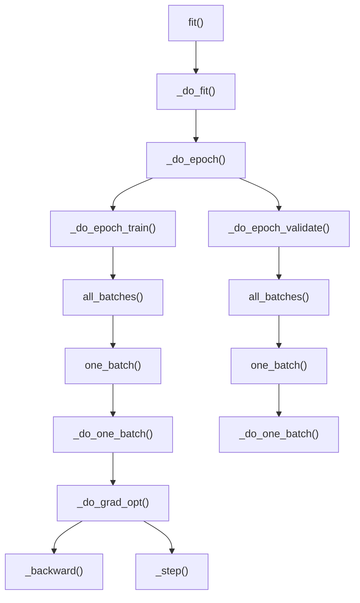
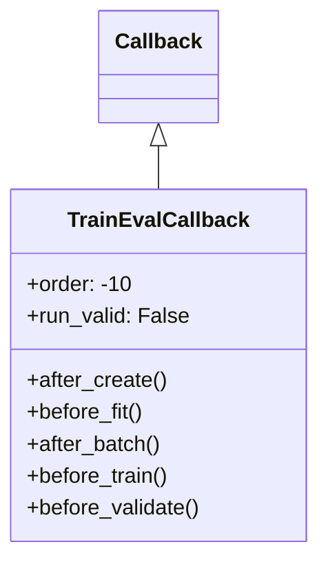
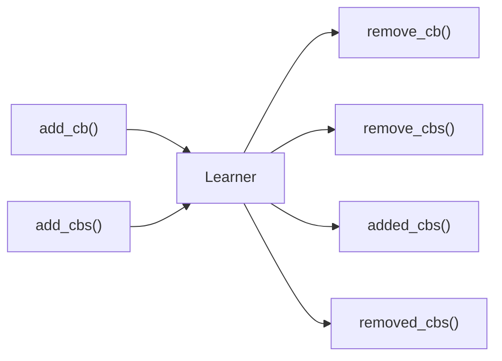
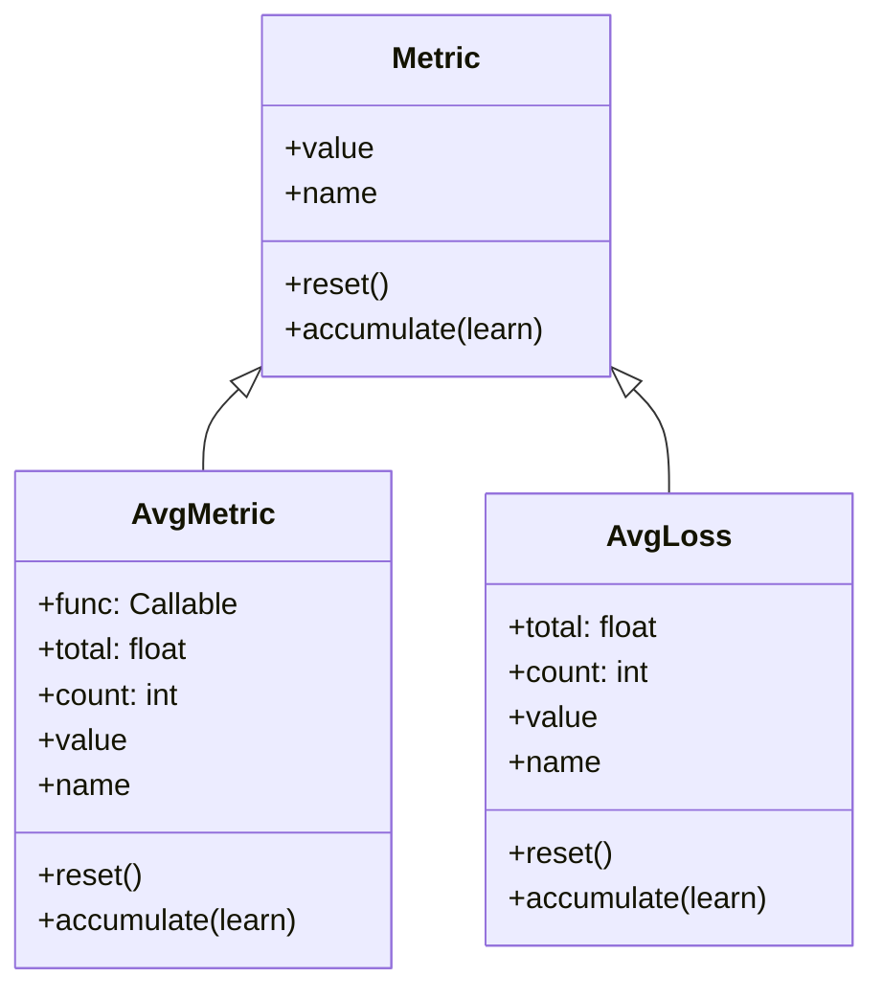

<!-- source: DeepWiki mcp.deepwiki.com · repo fastai/fastai · page 2.1 Learner and Callbacks · fetched 2026-10-21 -->

# Learner and Callbacks

<details>
<summary>Relevant source files</summary>

The following files were used as context for generating this wiki page:

- [fastai/callback/core.py](fastai/callback/core.py)
- [fastai/learner.py](fastai/learner.py)
- [nbs/13_callback.core.ipynb](nbs/13_callback.core.ipynb)
- [nbs/13a_learner.ipynb](nbs/13a_learner.ipynb)

</details>


The Learner and Callbacks system forms the core of fastai's training infrastructure. This page documents how the `Learner` class coordinates model training and how the callback system provides a flexible way to customize the training process. For information about data processing pipelines, see [Data Processing Pipeline](#2.2), and for metrics implementation details, see [Metrics and Loss Functions](#2.3).

## Overview

The `Learner` class is the central coordinator that brings together a model, data, optimizer, loss function, and callbacks to handle the complete training workflow. The callback system allows customizing virtually every aspect of the training process without modifying the core training loop.



Sources: [fastai/learner.py:106-369](). [nbs/13a_learner.ipynb:332-596]()

## Learner Class

The `Learner` class manages the entire training process by coordinating the model, data, optimizer, and callbacks.

### Initialization

The Learner initializes with several key components:



Key parameters include:
- `dls`: DataLoaders containing the training and validation data
- `model`: PyTorch model to train
- `loss_func`: Loss function (defaults to the one in the dataset if available)
- `opt_func`: Optimizer function (default is Adam)
- `cbs`: Additional callbacks to customize training
- `metrics`: Metrics to track during training

Sources: [fastai/learner.py:106-135](). [nbs/13a_learner.ipynb:332-369]()

### Core Methods

The `Learner` class provides several key methods for training and evaluation:

- `fit(n_epoch, lr=None, wd=None, cbs=None)`: Main method to train for n_epoch epochs
- `validate(ds_idx=1, dl=None)`: Validate on a specific dataset or dataloader
- `get_preds(ds_idx=1, dl=None, with_input=False, ...)`: Get model predictions
- `one_batch(i, b)`: Process a single batch (internal method)

Sources: [fastai/learner.py:239-243](). [fastai/learner.py:263-272](). [fastai/learner.py:284-287](). [fastai/learner.py:289-325]()

## The Callback System

The callback system is the primary mechanism for customizing the training process in fastai.

### Callback Class

The `Callback` base class provides the foundation for all callbacks:



Sources: [fastai/callback/core.py:47-77](). [nbs/13_callback.core.ipynb:190-220]()

### Event System

Callbacks respond to events that occur during the training process. The events follow a specific sequence during training:



The event names are defined as attributes of the `event` class to provide tab completion and typo-proofing.

Sources: [fastai/callback/core.py:20-26](). [nbs/13_callback.core.ipynb:86-92]()

### Flow Control with Exceptions

The callback system uses exceptions to control the flow of the training loop:

| Exception | Purpose |
| --- | --- |
| `CancelBatchException` | Skip rest of current batch |
| `CancelTrainException` | Skip rest of training phase |
| `CancelValidException` | Skip rest of validation phase |
| `CancelEpochException` | Skip rest of current epoch |
| `CancelFitException` | Interrupt entire training process |
| `CancelBackwardException` | Skip backward pass |
| `CancelStepException` | Skip optimizer step |

Sources: [fastai/callback/core.py:35-44](). [nbs/13_callback.core.ipynb:171-180]()

## Training Loop Mechanics

The training loop is a hierarchical structure of method calls that emit events at defined points.



At each level, events are emitted that can be intercepted by callbacks:

1. `fit()` triggers `before_fit` and `after_fit` events
2. `_do_epoch()` triggers `before_epoch` and `after_epoch` events
3. `_do_epoch_train()` triggers `before_train` and `after_train` events
4. `_do_epoch_validate()` triggers `before_validate` and `after_validate` events
5. `one_batch()` triggers `before_batch` and `after_batch` events
6. Within each batch, additional events like `after_pred`, `after_loss`, `before_backward`, etc. are triggered

Sources: [fastai/learner.py:258-272](). [fastai/learner.py:239-256](). [fastai/learner.py:214-231]()

## Core Callbacks

### TrainEvalCallback

The `TrainEvalCallback` is a foundational callback that:
- Tracks training iterations
- Sets model to training/evaluation mode
- Places model on the correct device
- Maintains counters and state variables



This callback is automatically added to every `Learner` at initialization.

Sources: [fastai/callback/core.py:80-108](). [nbs/13_callback.core.ipynb:479-507]()

### Recorder

The `Recorder` callback logs training statistics including:
- Learning rates
- Losses
- Metric values
- Training time

It also provides methods to plot learning curves and manages the final training records.

Sources: [fastai/learner.py:548-615](). [nbs/13a_learner.ipynb:548-599]()

### GatherPredsCallback

The `GatherPredsCallback` collects model predictions and targets during validation. It's used internally by `get_preds()` to:
- Gather inputs, predictions, targets, and losses
- Optionally save predictions to disk
- Concatenate results into tensors

Sources: [fastai/callback/core.py:114-167](). [nbs/13_callback.core.ipynb:829-882]()

## Callback Management

The `Learner` class provides several methods to manage callbacks:

- `add_cb(cb)`: Add a single callback
- `add_cbs(cbs)`: Add multiple callbacks
- `remove_cb(cb)`: Remove a single callback
- `remove_cbs(cbs)`: Remove multiple callbacks
- `added_cbs(cbs)`: Context manager to temporarily add callbacks
- `removed_cbs(cbs)`: Context manager to temporarily remove callbacks



Sources: [fastai/learner.py:143-177](). [nbs/13a_learner.ipynb:144-178]()

## Metrics System

Metrics in fastai are integrated with the callback system through the `Metric` base class:



Metrics are calculated during validation (and optionally during training) and logged by the `Recorder` callback.

Metrics can be:
- Functions that are wrapped in `AvgMetric`
- Instances of custom metric classes that inherit from `Metric`

Sources: [fastai/learner.py:472-487](). [fastai/learner.py:490-501](). [fastai/learner.py:504-514]()

## Saving and Loading Models

The `Learner` class provides methods to save and load models:

- `save(file)`: Save model and optimizer state
- `load(file, device=None)`: Load model and optimizer state
- `export(fname='export.pkl')`: Export model without data for inference

Sources: [fastai/learner.py:191-199](). [fastai/learner.py:215-232](). [fastai/learner.py:432-447]()

## Creating Custom Callbacks

To create a custom callback, you can either:

1. Subclass `Callback` and implement desired event methods:

```python
class MyCallback(Callback):
    def before_fit(self):
        # Do something before training
        pass
    
    def after_batch(self):
        # Do something after each batch
        pass
```

2. Use the constructor with event functions:

```python
def my_before_fit(self):
    # Do something before training
    pass

cb = Callback(before_fit=my_before_fit)
```

Callbacks can access `Learner` attributes through the `self.learn` reference or directly (for reading).

Sources: [fastai/callback/core.py:47-77](). [nbs/13_callback.core.ipynb:190-220]()

## Attributes Available to Callbacks

When writing callbacks, you have access to various `Learner` attributes:

| Attribute | Description |
| --- | --- |
| `model` | The PyTorch model |
| `dls` | DataLoaders object |
| `dl` | Current DataLoader |
| `loss_func` | Loss function |
| `opt` | Current optimizer |
| `xb`/`x` | Current input batch |
| `yb`/`y` | Current target batch |
| `pred` | Current predictions |
| `loss` | Current loss value |
| `n_epoch` | Total epochs |
| `epoch` | Current epoch index |
| `n_iter` | Iterations in current dataloader |
| `iter` | Current iteration index |
| `training` | Whether in training mode |
| `pct_train` | Training progress percentage |

Sources: [nbs/13_callback.core.ipynb:574-601]()

## Training Loop Visualization

The `Learner` provides a method to visualize the training loop and the callbacks triggered at each point:

```python
learn.show_training_loop()
```

This displays each event in the training loop and lists the callbacks that respond to each event.

Sources: [fastai/learner.py:344-349](). [nbs/13a_learner.ipynb:575-577]()

---

