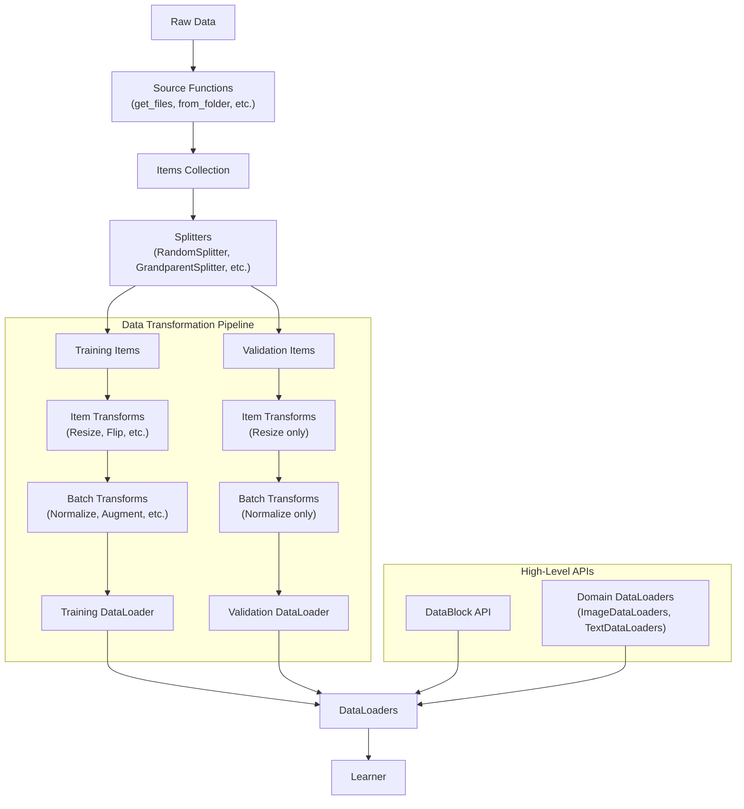
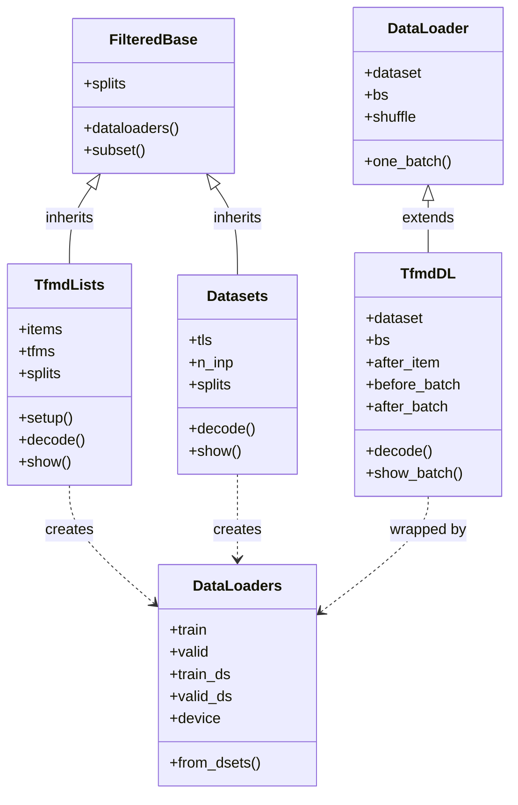

<!-- source: DeepWiki mcp.deepwiki.com · repo fastai/fastai · page 2.2 Data Processing Pipeline · fetched 2026-10-21 -->

# Data Processing Pipeline

<details>
<summary>Relevant source files</summary>

The following files were used as context for generating this wiki page:

- [fastai/data/core.py](fastai/data/core.py)
- [nbs/03_data.core.ipynb](nbs/03_data.core.ipynb)
- [nbs/05_data.transforms.ipynb](nbs/05_data.transforms.ipynb)

</details>


The fastai Data Processing Pipeline is a flexible system for loading, transforming, and batching data for machine learning models. It handles diverse data types while maintaining a consistent interface, enabling users to efficiently prepare data for training and inference. This page explains how data flows through the pipeline and the key components that make this possible.

For information about domain-specific data modules (vision, text, tabular), see related sections under [Domain-Specific Modules](#3).

## Pipeline Architecture Overview

The data processing pipeline in fastai follows a systematic flow from raw data to model-ready batches:



Sources: [nbs/03_data.core.ipynb](), [nbs/05_data.transforms.ipynb]()

## Key Components

The pipeline is built on these core classes that work together to process data:



Sources: [fastai/data/core.py:64-182](), [fastai/data/core.py:196-292]()

### TfmdDL (Transformed DataLoader)

The `TfmdDL` class extends PyTorch's DataLoader with transformation capabilities. It forms the foundation of the data pipeline by handling data loading and applying transformations.

Key features:
- Applies transforms at three key points:
  - `after_item`: Transforms applied to individual items
  - `before_batch`: Transforms applied to batches before device transfer
  - `after_batch`: Transforms applied after moving data to device
- Provides methods for decoding and visualizing batches
- Handles device management

```python
class TfmdDL(DataLoader):
    def __init__(self, dataset, bs=64, shuffle=False, num_workers=None, 
                 verbose=False, do_setup=True, **kwargs)
```

Sources: [fastai/data/core.py:64-182]()

### DataLoaders

The `DataLoaders` class wraps multiple DataLoaders (typically train and validation) and provides a unified interface for working with them.

Key features:
- Properties for accessing train/valid loaders (`train`, `valid`)
- Properties for accessing the underlying datasets (`train_ds`, `valid_ds`)
- Methods for moving data to different devices (`cuda`, `cpu`)
- Factory methods for creating from datasets (`from_dsets`) or DataBlock (`from_dblock`)

```python
class DataLoaders(GetAttr):
    def __init__(self, *loaders, path='.', device=None)
```

Sources: [fastai/data/core.py:196-292]()

### TfmdLists

The `TfmdLists` class combines a list of items with a Pipeline of transformations, forming the basis for dataset creation.

Key features:
- Applies transformations to items when they're accessed
- Handles dataset splits for train/validation 
- Provides methods for decoding (`decode`) and displaying items (`show`)
- Setup method to initialize transformations

```python
class TfmdLists(FilteredBase, L, GetAttr):
    def __init__(self, items, tfms, use_list=None, do_setup=True, 
                 split_idx=None, train_setup=True, splits=None, 
                 types=None, verbose=False, dl_type=None)
```

Sources: [fastai/data/core.py:340-413]()

### Datasets

The `Datasets` class manages multiple `TfmdLists`, each with a different transformation pipeline, typically one for inputs and one for targets.

Key features:
- Creates tuples (inputs, targets) for each item
- Provides methods for decoding and displaying items
- Handles dataset splits for train/validation
- Specifies which elements of the tuple are inputs vs targets

```python
class Datasets(FilteredBase):
    def __init__(self, items=None, tfms=None, tls=None, n_inp=None, 
                 dl_type=None, **kwargs)
```

Sources: [fastai/data/core.py:437-497]()

## Transformation System

Transformations are applied at different stages of the pipeline:

### Item vs Batch Transforms

| Transform Type | Applied To | Timing | Examples |
|----------------|------------|--------|----------|
| Item Transforms | Individual items | Before batching | Opening images, tokenizing text |
| before_batch | Batches | After collation, before device | Padding sequences |
| after_batch | Batches | After moving to device | Normalization, augmentation |

Sources: [fastai/data/core.py:61](), [nbs/05_data.transforms.ipynb]()

### Transform Pipeline Flow

The pipeline manages the application of transforms in the correct order:

1. **Raw items** → **Item transforms** → **Transformed items**
   - Example: Image file path → Open image → Resize → Tensor

2. **Individual items** → **Batching** → **Batch**
   - Example: Tensors → Collate → Batch tensor

3. **Batch** → **before_batch transforms** → **Device transfer** → **after_batch transforms** → **Final batch**
   - Example: Batch → Pad → Move to GPU → Normalize → Ready for model

Sources: [fastai/data/core.py:76-82](), [fastai/data/core.py:119-128]()

## Data Loading Process

The data loading process in fastai follows these steps:

1. **Source Collection**: Gather raw data items using functions like `get_files`, `from_folder`, etc.

2. **Splitting**: Divide data into train and validation sets using splitters like `RandomSplitter`, `GrandparentSplitter`, etc.

3. **Item Transformations**: Apply transforms to individual items before batching
   - Create `TfmdLists` or `Datasets` with the appropriate transforms

4. **DataLoader Creation**: Create `TfmdDL` with batch transforms
   - Specify transforms to apply before and after device transfer

5. **DataLoaders Wrapper**: Combine train and validation DataLoaders
   - Create `DataLoaders` to manage them together

Here's a comparison of transforms applied to training versus validation data:

| Stage | Training Data | Validation Data |
|-------|--------------|-----------------|
| Item Transforms | Full transforms (e.g., resize, augment) | Minimal transforms (e.g., resize only) |
| Batch Transforms | Normalization | Normalization |
| DataLoader | Shuffled | Not shuffled |
| Batch Size | Standard batch size | Sometimes larger batch size |

Sources: [nbs/05_data.transforms.ipynb:47-195](), [fastai/data/core.py:308-335]()

## Usage Examples

### Basic Pipeline Construction

Here's a basic example showing how to construct the data pipeline from scratch:

```python
# 1. Get source items
path = untar_data(URLs.MNIST_TINY)
items = get_image_files(path)

# 2. Split into train/validation
splitter = RandomSplitter(valid_pct=0.2)
splits = splitter(items)

# 3. Define transformations
item_tfms = [PILImage.create, Resize(28)]
batch_tfms = [Normalize.from_stats(*imagenet_stats)]

# 4. Create Datasets with item transforms
dsets = Datasets(items, [item_tfms, [parent_label, Categorize()]], 
                 splits=splits)

# 5. Create DataLoaders with batch transforms
dls = dsets.dataloaders(bs=64, after_batch=batch_tfms)
```

### Using DataBlock API

The DataBlock API provides a higher-level interface to the pipeline:

```python
# Define the pipeline components
data = DataBlock(
    blocks=(ImageBlock, CategoryBlock),
    get_items=get_image_files,
    splitter=RandomSplitter(valid_pct=0.2),
    get_y=parent_label,
    item_tfms=Resize(28),
    batch_tfms=Normalize.from_stats(*imagenet_stats)
)

# Create DataLoaders in one step
dls = data.dataloaders(path, bs=64)
```

Sources: [nbs/05_data.transforms.ipynb:1418-1507]()

## Common Transformation Types

fastai provides various types of transformations for different data types:

### General Transforms

- **ToTensor**: Converts items to appropriate tensor class
- **IntToFloatTensor**: Transforms image tensors to float, dividing by 255

### Categorical Data

- **Categorize**: Transforms category strings to category IDs
- **MultiCategorize**: Handles multi-category data
- **OneHotEncode**: Performs one-hot encoding on targets

### Numeric Data

- **RegressionSetup**: Prepares data for regression tasks
- **Normalize**: Normalizes tensor data based on mean and standard deviation

Sources: [nbs/05_data.transforms.ipynb:1060-1180](), [nbs/05_data.transforms.ipynb:1574-1645]()

## Visualizing and Debugging the Pipeline

fastai provides several utilities for visualizing and debugging the data pipeline:

### Batch Visualization

```python
# Show a batch of data
dls.show_batch()

# Show the results of a model on a batch
learner.show_results()
```

### Item Inspection

```python
# Show a single item from a dataset
show_at(dsets, idx)

# Decode and examine a transformed item
decoded_item = decode_at(dsets, idx)
```

Sources: [fastai/data/core.py:15-55](), [fastai/data/core.py:427-434]()

## Conclusion

The fastai Data Processing Pipeline provides a flexible system for preparing data for machine learning models. By understanding the key components and how they interact, you can efficiently build pipelines for various data types and tasks.

The power of this system lies in its ability to handle diverse data types through a consistent interface while enabling customization at each stage of the pipeline.

Sources: [nbs/03_data.core.ipynb:55-69]()

---

