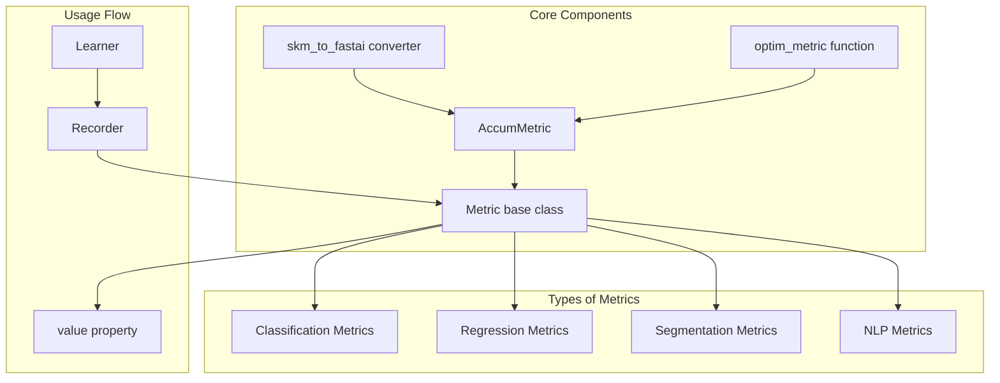
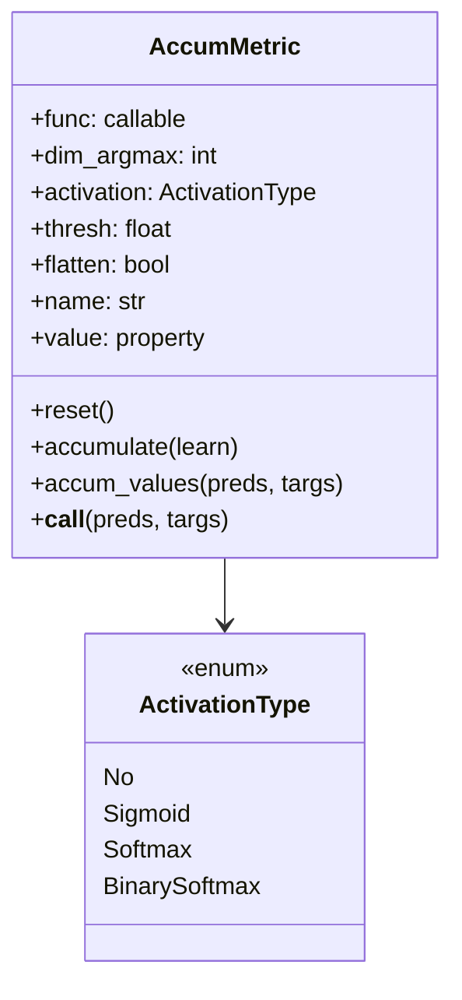
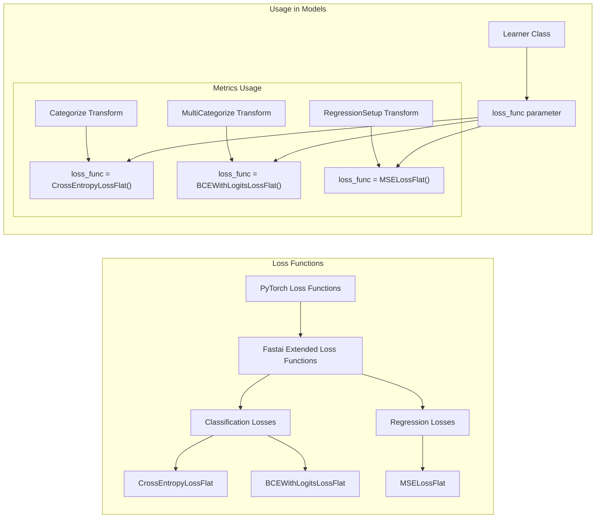
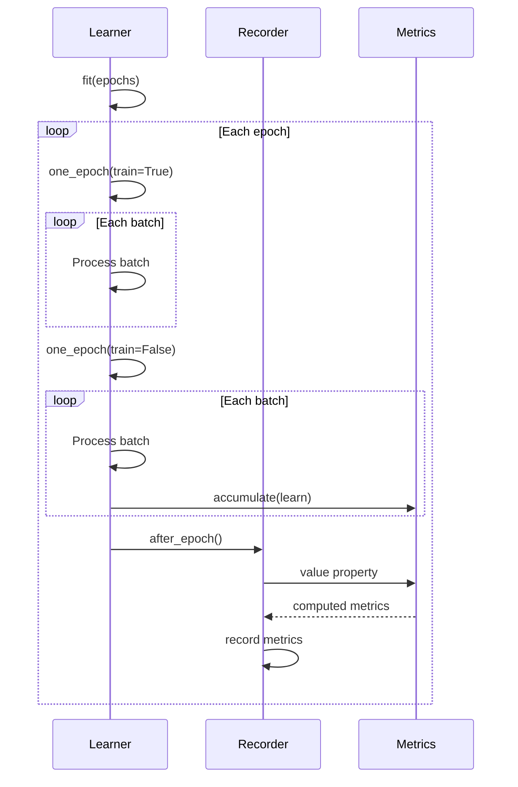

<!-- source: DeepWiki mcp.deepwiki.com · repo fastai/fastai · page 2.3 Metrics and Loss Functions · fetched 2026-10-21 -->

# Metrics and Loss Functions

<details>
<summary>Relevant source files</summary>

The following files were used as context for generating this wiki page:

- [fastai/_modidx.py](fastai/_modidx.py)
- [fastai/data/transforms.py](fastai/data/transforms.py)
- [fastai/imports.py](fastai/imports.py)
- [fastai/metrics.py](fastai/metrics.py)
- [fastai/tabular/core.py](fastai/tabular/core.py)
- [nbs/13b_metrics.ipynb](nbs/13b_metrics.ipynb)

</details>


This document describes the metrics and loss functions available in fastai for evaluating and training deep learning models. Metrics measure model performance, while loss functions guide the optimization process during training. For information on the training and validation process, see [Learner and Callbacks](#2.1).

## Core Metrics System Architecture

The metrics system in fastai is built around the `AccumMetric` class, which accumulates predictions and targets across batches to compute metrics at the end of each epoch.



Sources: [fastai/metrics.py:30-79](), [nbs/13b_metrics.ipynb:98-148]()

### AccumMetric Class

The `AccumMetric` class is the foundation of most metrics in fastai:



The key aspects of `AccumMetric`:

- Stores predictions and targets on CPU and applies `func` at the end of validation
- Supports different activation types (None, Sigmoid, Softmax, BinarySoftmax)
- Can apply transformations like argmax and thresholding to predictions
- Flattens tensors appropriately for metric computation

Sources: [fastai/metrics.py:30-79](), [nbs/13b_metrics.ipynb:98-148]()

### Scikit-learn Integration

Fastai provides seamless integration with scikit-learn metrics via the `skm_to_fastai` function:

```python
def skm_to_fastai(func, is_class=True, thresh=None, axis=-1, activation=None, **kwargs):
    "Convert `func` from sklearn.metrics to a fastai metric"
    dim_argmax = axis if is_class and thresh is None else None
    if activation is None:
        activation = ActivationType.Sigmoid if (is_class and thresh is not None) else ActivationType.No
    return AccumMetric(func, dim_argmax=dim_argmax, activation=activation, thresh=thresh,
                       to_np=True, invert_arg=True, **kwargs)
```

Sources: [fastai/metrics.py:82-88](), [nbs/13b_metrics.ipynb:263-269]()

## Classification Metrics

Fastai provides metrics for both single-label and multi-label classification problems.

### Single-label Classification Metrics

Single-label classification metrics work with outputs where each example belongs to exactly one class:

| Metric | Description | Source |
|--------|-------------|--------|
| `accuracy` | Percentage of correct predictions | [metrics.py:106-109]() |
| `error_rate` | 1 - accuracy | [metrics.py:112-114]() |
| `top_k_accuracy` | Whether true class is in top k predictions | [metrics.py:117-121]() |
| `F1Score` | Harmonic mean of precision and recall | [metrics.py:148-151]() |
| `Precision` | True positives / (True positives + False positives) | [metrics.py:172-175]() |
| `Recall` | True positives / (True positives + False negatives) | [metrics.py:178-181]() |
| `RocAuc` | Area under ROC curve | [metrics.py:184-188]() |
| `RocAucBinary` | ROC AUC for binary classification | [metrics.py:191-194]() |
| `MatthewsCorrCoef` | Correlation coefficient between predicted and actual classes | [metrics.py:197-199]() |

Sources: [fastai/metrics.py:106-199](), [nbs/13b_metrics.ipynb:363-732]()

### Multi-label Classification Metrics

Multi-label metrics are for problems where each example can belong to multiple classes simultaneously:

| Metric | Description | Parameters |
|--------|-------------|------------|
| `accuracy_multi` | Accuracy for multi-label problems | thresh=0.5, sigmoid=True |
| `F1ScoreMulti` | F1 score for multi-label problems | thresh=0.5, sigmoid=True, average='macro' |
| `PrecisionMulti` | Precision for multi-label problems | thresh=0.5, sigmoid=True, average='macro' |
| `RecallMulti` | Recall for multi-label problems | thresh=0.5, sigmoid=True, average='macro' |
| `RocAucMulti` | ROC AUC for multi-label problems | sigmoid=True, average='macro' |

All multi-label metrics include `thresh` and `sigmoid` parameters:
- `thresh`: Threshold for converting probabilities to binary predictions (default: 0.5)
- `sigmoid`: Whether to apply sigmoid activation to model outputs (default: True)

Sources: [fastai/metrics.py:202-275](), [nbs/13b_metrics.ipynb:747-997]()

## Regression Metrics

Regression metrics measure the performance of models that predict continuous values:

| Metric | Description | Formula |
|--------|-------------|---------|
| `mse` | Mean Squared Error | Mean((pred - target)²) |
| `rmse` | Root Mean Squared Error | √MSE |
| `mae` | Mean Absolute Error | Mean(|pred - target|) |
| `msle` | Mean Squared Logarithmic Error | MSE(log(1+pred), log(1+target)) |
| `exp_rmspe` | Root Mean Square Percentage Error on exponential | √Mean(((exp(target) - exp(pred))/exp(target))²) |
| `R2Score` | Coefficient of determination | 1 - SSres/SStot |
| `ExplainedVariance` | Explained variance regression score | 1 - Var(y - ŷ)/Var(y) |
| `PearsonCorrCoef` | Pearson correlation coefficient | cov(X,Y)/(σX·σY) |
| `SpearmanCorrCoef` | Spearman rank correlation | Pearson correlation of ranks |

Sources: [fastai/metrics.py:278-329](), [nbs/13b_metrics.ipynb:978-1111]()

## Special Purpose Metrics

### Segmentation Metrics

For image segmentation tasks:

| Metric | Description |
|--------|-------------|
| `foreground_acc` | Accuracy ignoring background class |
| `Dice` | Dice coefficient (2 * intersection / union) for binary segmentation |
| `DiceMulti` | Averaged Dice score across multiple classes |
| `JaccardCoeff` | Jaccard coefficient (IoU) for binary segmentation |
| `JaccardCoeffMulti` | Mean IoU across multiple classes |

Sources: [fastai/metrics.py:332-392](), [nbs/13b_metrics.ipynb:1121-1386]()

### NLP Metrics

For natural language processing tasks:

| Metric | Description |
|--------|-------------|
| `CorpusBLEUMetric` | BLEU score for machine translation evaluation |
| `Perplexity` | Exponential of the cross-entropy loss, for language models |

Sources: [fastai/metrics.py:395-454](), [nbs/13b_metrics.ipynb:1241-1453]()

## Loss Functions

Fastai extends PyTorch's loss functions with added functionality. Here are some key loss functions:



### Classification Loss Functions

- `CrossEntropyLossFlat`: Cross-entropy loss with flattening for single-label classification
- `BCEWithLogitsLossFlat`: Binary cross-entropy with logits for multi-label classification

### Regression Loss Functions

- `MSELossFlat`: Mean squared error loss with flattening for regression tasks

Sources: [fastai/data/transforms.py:250-254, 273-274, 323-324](), [nbs/05_data.transforms.ipynb:251-278]()

## Custom Metrics

### LossMetric and LossMetrics

Fastai provides `LossMetric` and `LossMetrics` for creating metrics from loss function attributes:

```python
class LossMetric(AvgMetric):
    "Create a metric from `loss_func.attr` named `nm`"
    def __init__(self, attr, nm=None): store_attr('attr,nm')
    def accumulate(self, learn):
        bs = find_bs(learn.yb)
        self.total += learn.to_detach(getattr(learn.loss_func, self.attr, 0))*bs
        self.count += bs
```

```python
def LossMetrics(attrs, nms=None):
    "List of `LossMetric` for each of `attrs` and `nms`"
    if isinstance(attrs, str): attrs = attrs.split(',')
    nms = attrs if nms is None else nms.split(',') if isinstance(nms, str) else nms
    return [LossMetric(a, n) for a,n in zip(attrs,nms)]
```

Sources: [fastai/metrics.py:457-473](), [nbs/13b_metrics.ipynb:1456-1473]()

### Creating Custom Metrics

Custom metrics can be created by:

1. Defining a function that takes predictions and targets
2. Wrapping the function with `AccumMetric`
3. Optional: defining the `reset`, `accumulate`, and `value` methods if more complex behavior is needed

Example:

```python
def custom_metric(preds, targs):
    # Calculate your metric here
    return result

my_metric = AccumMetric(custom_metric)
```

For metrics that cannot be expressed as simple functions, you can subclass `Metric` directly:

```python
class CustomMetric(Metric):
    def reset(self): 
        # Initialize accumulators
    
    def accumulate(self, learn):
        # Process batch results
    
    @property
    def value(self):
        # Calculate final metric value
```

Sources: [fastai/metrics.py:30-79, 339-392](), [nbs/13b_metrics.ipynb:98-148]()

## Integration with Training

Metrics in fastai are automatically computed during training and validation phases:



Metrics are passed to the `Learner` constructor and stored in `learn.metrics`. During validation, each metric's `accumulate` method is called for each batch, and the `value` property is accessed at the end of the epoch.

Sources: [fastai/metrics.py:30-79](), [nbs/13b_metrics.ipynb:98-148]()

---

