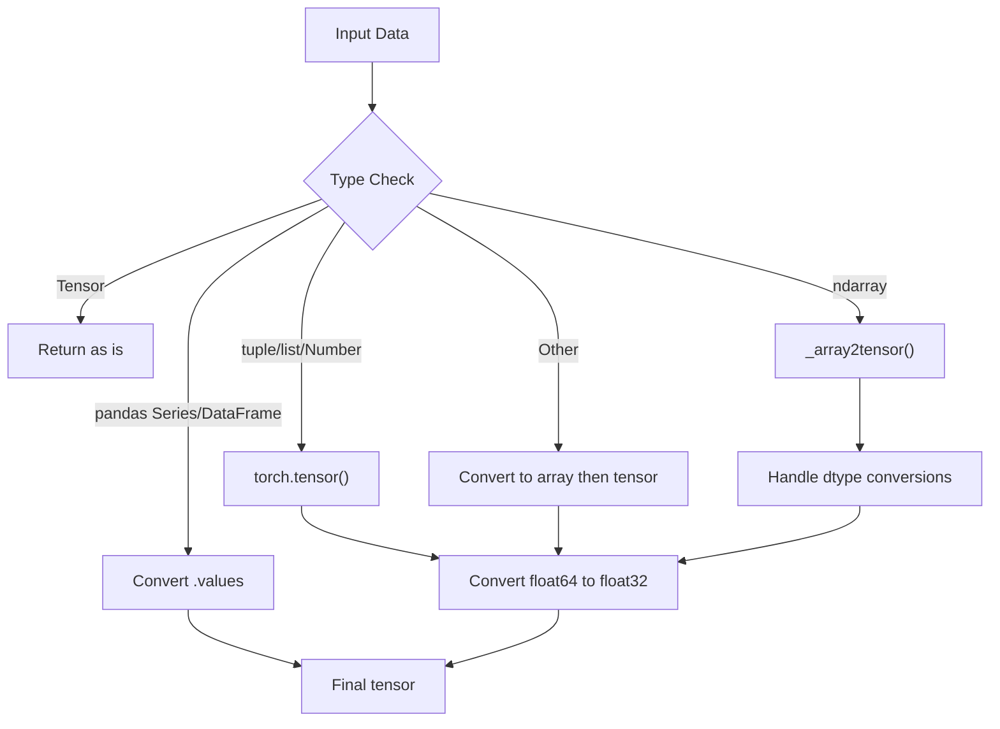
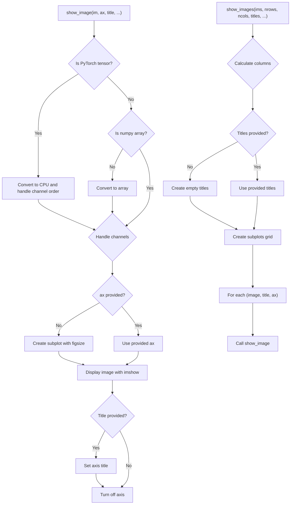

<!-- source: DeepWiki mcp.deepwiki.com · repo fastai/fastai · page 2.4 PyTorch Extensions · fetched 2026-10-21 -->

# PyTorch Extensions

<details>
<summary>Relevant source files</summary>

The following files were used as context for generating this wiki page:

- [fastai/torch_core.py](fastai/torch_core.py)
- [nbs/00_torch_core.ipynb](nbs/00_torch_core.ipynb)

</details>


## Introduction

The PyTorch Extensions module in fastai extends PyTorch's base functionality by providing custom tensor types, utility functions, and enhanced capabilities for working with deep learning models. This page documents these extensions, which serve as a foundation for other fastai systems.

For information about data processing, see [Data Processing Pipeline](#2.2), and for the Learner system that builds on these extensions, see [Learner and Callbacks](#2.1).

Sources: [fastai/torch_core.py:1-5]()

## Custom Tensor Types Hierarchy

Fastai extends PyTorch's tensor system with custom tensor types that add specialized functionality while maintaining compatibility with PyTorch's ecosystem. These custom types provide domain-specific behavior, metadata preservation, and enhanced visualization capabilities.

### The Tensor Type System

```mermaid
classDiagram
    class "torch.Tensor" {
        Base PyTorch tensor
    }
    class "TensorBase" {
        __new__(cls, x, **kwargs)
        _before_cast(cls, x)
        __torch_function__(cls, func, types, args, kwargs)
        set_meta(self, x, as_copy)
    }
    class "TensorImageBase" {
        _show_args
        show(self, ctx, **kwargs)
    }
    class "TensorImage" {
        Image tensor representation
    }
    class "TensorImageBW" {
        Black and white image tensor
        _show_args: cmap='Greys'
    }
    class "TensorMask" {
        Image mask tensor
        _show_args
    }
    class "TensorFlowField" {
        Flow field representation
    }
    class "TensorCategory" {
        Category representation
    }
    class "TensorMultiCategory" {
        Multi-category representation
    }
    
    "torch.Tensor" <|-- "TensorBase"
    "TensorBase" <|-- "TensorImageBase"
    "TensorBase" <|-- "TensorCategory"
    "TensorBase" <|-- "TensorFlowField"
    "TensorImageBase" <|-- "TensorImage"
    "TensorImage" <|-- "TensorImageBW"
    "TensorImageBase" <|-- "TensorMask"
    "TensorCategory" <|-- "TensorMultiCategory"
```

The `TensorBase` class is the foundation of fastai's custom tensor types, adding critical functionality:

1. **Metadata Preservation**: Preserves metadata across tensor operations via the `set_meta` method
2. **Custom Serialization**: Ensures proper pickling/unpickling of tensor subclasses
3. **Type-based Dispatch**: Handles specialized behavior based on tensor types

Domain-specific tensor types add functionality for working with particular data types:
- `TensorImage`, `TensorImageBW`: For RGB and grayscale images
- `TensorMask`: For segmentation masks
- `TensorFlowField`: For optical flow or coordinate fields
- `TensorCategory`/`TensorMultiCategory`: For categorical data

Sources: [fastai/torch_core.py:354-426](), [fastai/torch_core.py:429-467]()

### Array Base Classes

Similarly, fastai provides NumPy array extensions that mirror the tensor hierarchy:

```mermaid
classDiagram
    class "numpy.ndarray" {
        Base NumPy array
    }
    class "ArrayBase" {
        _before_cast(cls, x)
    }
    class "ArrayImageBase" {
        _show_args
        show(self, ctx, **kwargs)
    }
    class "ArrayImage" {
        Image array representation
    }
    class "ArrayImageBW" {
        Black and white image array
        _show_args: cmap='Greys'
    }
    class "ArrayMask" {
        Image mask array
        _show_args
    }
    
    "numpy.ndarray" <|-- "ArrayBase"
    "ArrayBase" <|-- "ArrayImageBase"
    "ArrayImageBase" <|-- "ArrayImage"
    "ArrayImage" <|-- "ArrayImageBW"
    "ArrayImageBase" <|-- "ArrayMask"
```

These array classes provide consistent functionality between NumPy arrays and PyTorch tensors, particularly for visualization.

Sources: [fastai/torch_core.py:101-127]()

## Tensor Creation and Conversion

Fastai provides enhanced tensor creation and conversion utilities that handle common edge cases and add convenience features.

### The Enhanced `tensor` Function

The `tensor` function extends PyTorch's tensor creation capabilities:



Key features of fastai's `tensor` function:
- Handles various input types: lists, tuples, NumPy arrays, pandas objects
- Auto-converts float64 to float32 (PyTorch default)
- Fixes platform-specific integer type issues
- Supports direct pinning to memory
- Handles requires_grad setting

Sources: [fastai/torch_core.py:134-158]()

### Tensor Conversion Functions

Fastai provides a rich set of conversion utilities:
- `to_device(b, device)`: Move tensors to specified device
- `to_cpu(b)`: Move tensors to CPU
- `to_np(x)`: Convert tensors to NumPy arrays
- `to_half(b)`: Convert to half precision (float16)
- `to_float(b)`: Convert to full precision (float32)
- `to_detach(b, cpu, gather)`: Detach tensors from computation graph
- `to_concat(xs, dim)`: Concatenate tensors, handling edge cases

These functions recursively traverse complex nested structures (lists, tuples, dictionaries) and apply the conversion to all contained tensors.

Sources: [fastai/torch_core.py:239-309]()

## Device Management

Fastai simplifies working with different device types (CPU, CUDA, MPS) through a unified interface.

### Device Detection and Configuration

```mermaid
flowchart TD
    default_device["default_device(use)"] --> check_use{"Check use parameter"}
    check_use -->|"use=-1"| use_default["Use defaults.use_cuda"]
    check_use -->|"specified"| set_default["Set defaults.use_cuda"]
    
    use_default --> check_null{"Is defaults.use_cuda null?"}
    check_null -->|"Yes"| check_available{"CUDA or MPS available?"}
    check_null -->|"No"| use_defaults["Use defaults.use_cuda value"]
    
    check_available -->|"Yes"| set_true["Set use=True"]
    check_available -->|"No"| keep_null["Keep use=None"]
    
    set_true --> decide_device{"Decide device"}
    use_defaults --> decide_device
    keep_null --> decide_device
    set_default --> decide_device
    
    decide_device -->|"use=True & CUDA available"| cuda["Return CUDA device"]
    decide_device -->|"use=True & MPS available"| mps["Return MPS device"]
    decide_device -->|"use=False or None available"| cpu["Return CPU device"]
    
    setup_cuda["setup_cuda()"] --> check_cuda{"CUDA available?"}
    check_cuda -->|"Yes"| check_device{"Current device = 0?"}
    check_cuda -->|"No"| end["End"]
    
    check_device -->|"Yes"| env_var{"DEFAULT_GPU env var?"}
    check_device -->|"No"| end
    
    env_var -->|"Yes"| set_gpu["Set device to DEFAULT_GPU"]
    env_var -->|"No"| set_zero["Use device 0"]
    set_gpu --> set_benchmark["Set cudnn.benchmark"]
    set_zero --> set_benchmark
```

The device management system provides:
- Automatic detection of available CUDA and MPS (Apple Metal) devices
- Environment variable control (`DEFAULT_GPU`)
- Simple API for moving tensors between devices
- Transparent handling of nested data structures

Sources: [fastai/torch_core.py:33-39](), [fastai/torch_core.py:263-292]()

## Random State Management

Fastai provides utilities for managing random states, essential for reproducibility:

- `set_seed(s, reproducible)`: Set random seed for PyTorch, NumPy, and Python's random
- `get_random_states()`: Capture current states of all random number generators
- `set_random_states()`: Restore previously captured random states
- `no_random(seed, reproducible)`: Context manager for temporary seed setting

The `no_random` context manager is particularly useful for ensuring reproducibility in specific code blocks without affecting the rest of the program.

Sources: [fastai/torch_core.py:161-203]()

## Visualization Utilities

Fastai extends PyTorch with powerful visualization tools for tensors, especially for image data.

### Image Display Functions



Key visualization functions:
- `show_image(im, ax, title, ...)`: Display a single tensor or array as an image
- `show_images(ims, nrows, ncols, titles, ...)`: Display multiple images in a grid
- `show_titled_image(o, ...)`: Display an image with a title
- `show_image_batch(b, show, items, cols, ...)`: Display a batch of images

Custom tensor types like `TensorImage` and `TensorMask` have built-in `show()` methods that use these functions with appropriate display parameters.

Sources: [fastai/torch_core.py:60-98](), [fastai/torch_core.py:429-447]()

## Model Utilities

Fastai extends PyTorch's model functionality with utilities for initialization, parameter access, and custom modules.

### Enhanced Module Class

The `Module` class extends PyTorch's `nn.Module` with automatic initialization:

```python
class Module(nn.Module, metaclass=PrePostInitMeta):
    "Same as `nn.Module`, but no need for subclasses to call `super().__init__`"
    def __pre_init__(self, *args, **kwargs): super().__init__()
    def __init__(self): pass
```

This simplifies module creation by eliminating the need for subclasses to call `super().__init__()`.

### Parameter and Initialization Utilities

Functions for working with model parameters:
- `params(m)`: Get all parameters of a model
- `trainable_params(m)`: Get only trainable parameters
- `norm_bias_params(m, with_bias)`: Get normalization and bias parameters
- `get_model(model)`: Retrieve model from wrappers like `DistributedDataParallel`

Initialization utilities:
- `init_default(m, func)`: Initialize weights with a function and set bias to 0
- `cond_init(m, func)`: Apply initialization if not a normalization layer
- `apply_init(m, func)`: Apply initialization recursively to all layers
- `apply_leaf(m, f)`: Apply a function to all leaf modules

Sources: [fastai/torch_core.py:648-651](), [fastai/torch_core.py:658-843]()

## JIT Scripting Support

Fastai provides decorators that simplify working with PyTorch's JIT compiler:

- `script_use_ctx(f)`: Create JIT script for backward functions
- `script_save_ctx(static, *argidx)`: Save tensors for backward pass
- `script_fwd(*argidx)`: Decorator for forward functions
- `script_bwd(f)`: Decorator for backward functions
- `grad_module(cls)`: Convert a class to an autograd function

These utilities make it easier to create custom autograd functions with JIT scripting.

Sources: [fastai/torch_core.py:846-881]()

## Version Compatibility

Fastai manages PyTorch version differences with utilities:

- `ismin_torch(min_version)`: Check if PyTorch version is >= min_version
- `notmax_torch(max_version)`: Check if PyTorch version is < max_version

The module also includes version-specific patches, like the formatting fix for PyTorch 1.13:

```python
if ismin_torch('1.13') and notmax_torch('1.14'):
    # Apply formatting patch for tensor subclasses
```

These utilities ensure fastai works across different PyTorch versions despite API changes.

Sources: [fastai/torch_core.py:883-905]()

## Conclusion

The PyTorch Extensions module in fastai provides a rich set of utilities and custom types that enhance PyTorch's functionality. These extensions form the foundation for other fastai systems, enabling more concise code, better type handling, and specialized domain-specific behaviors for computer vision, NLP, and other applications.

---

