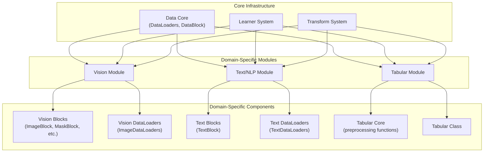
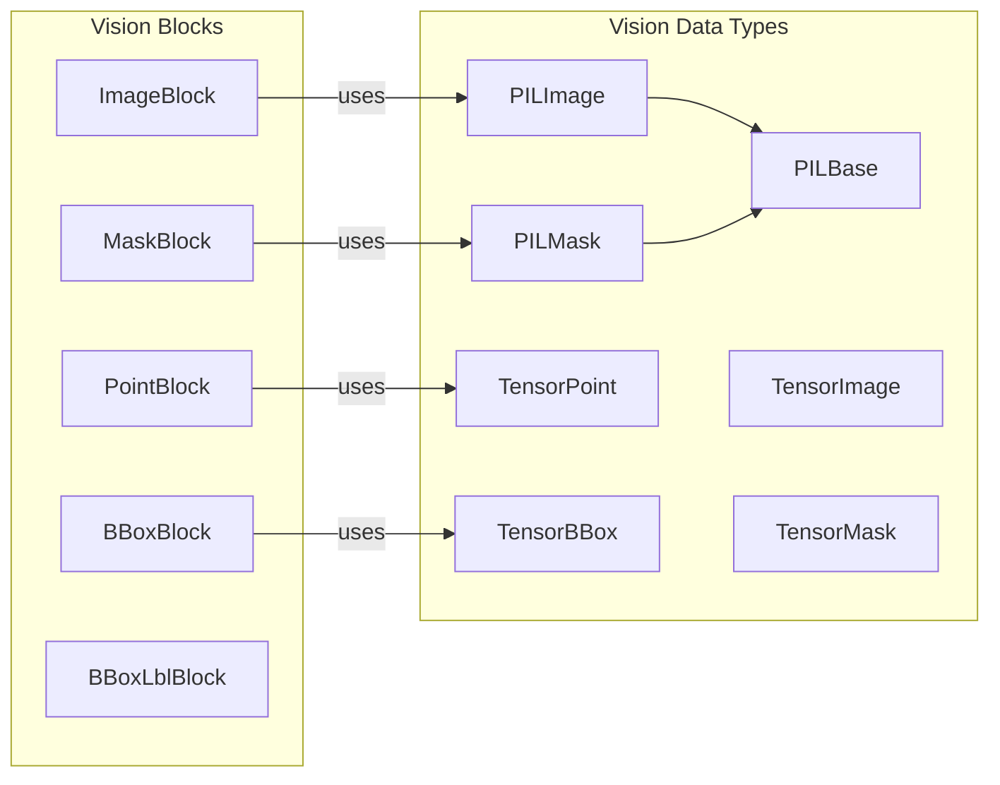
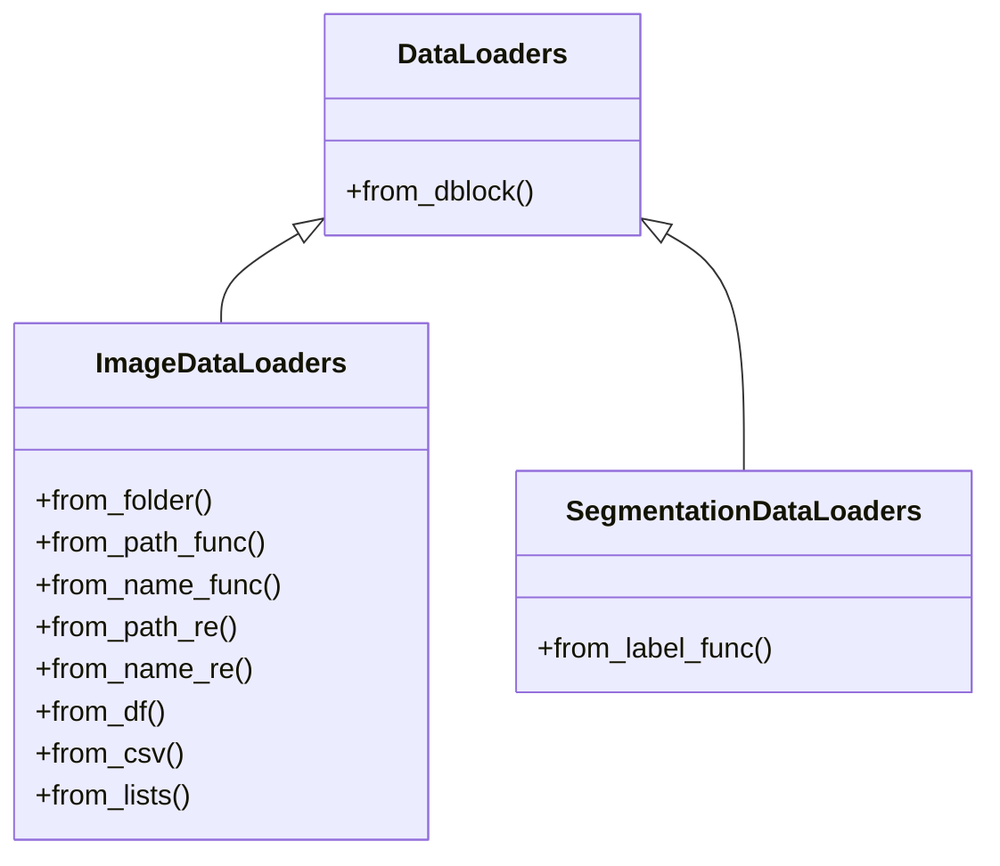
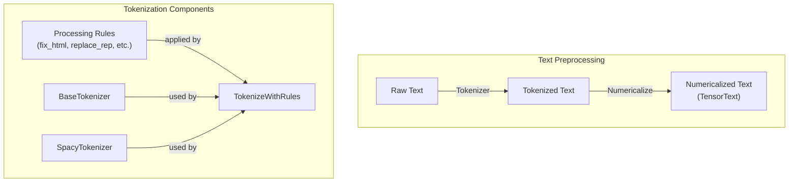
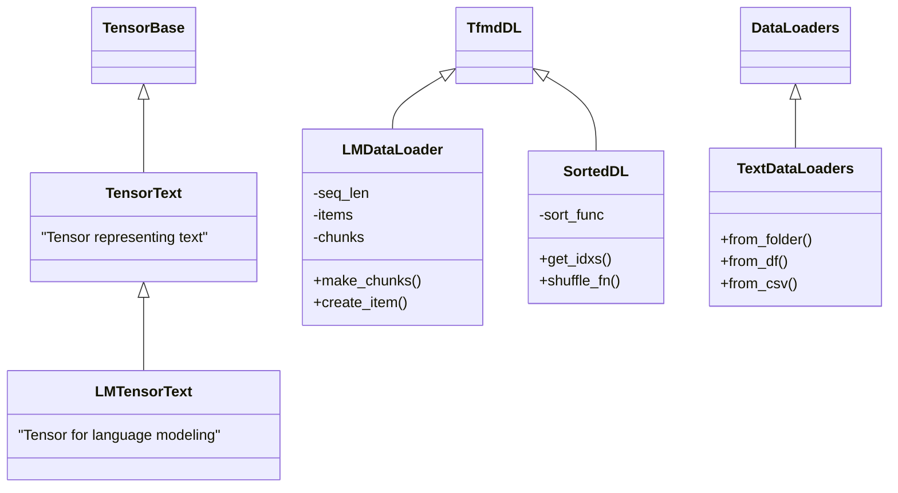
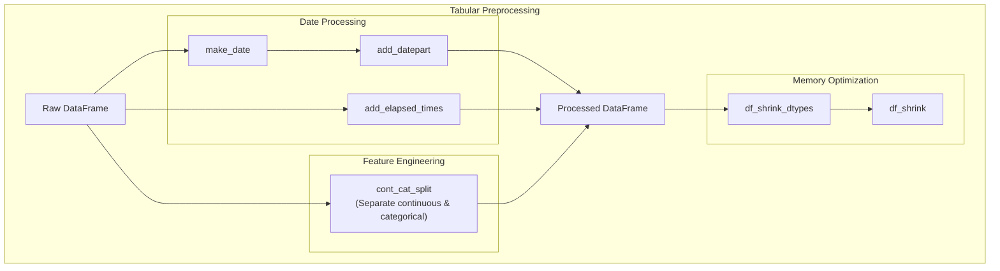
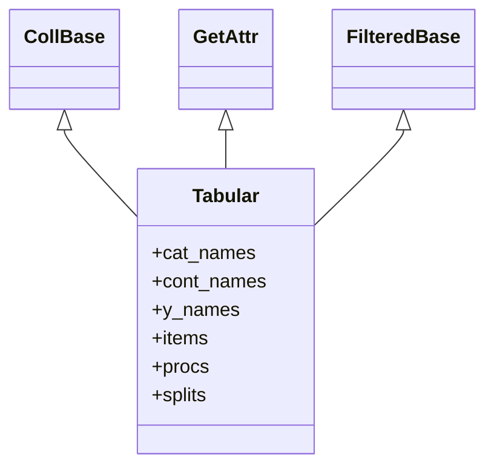
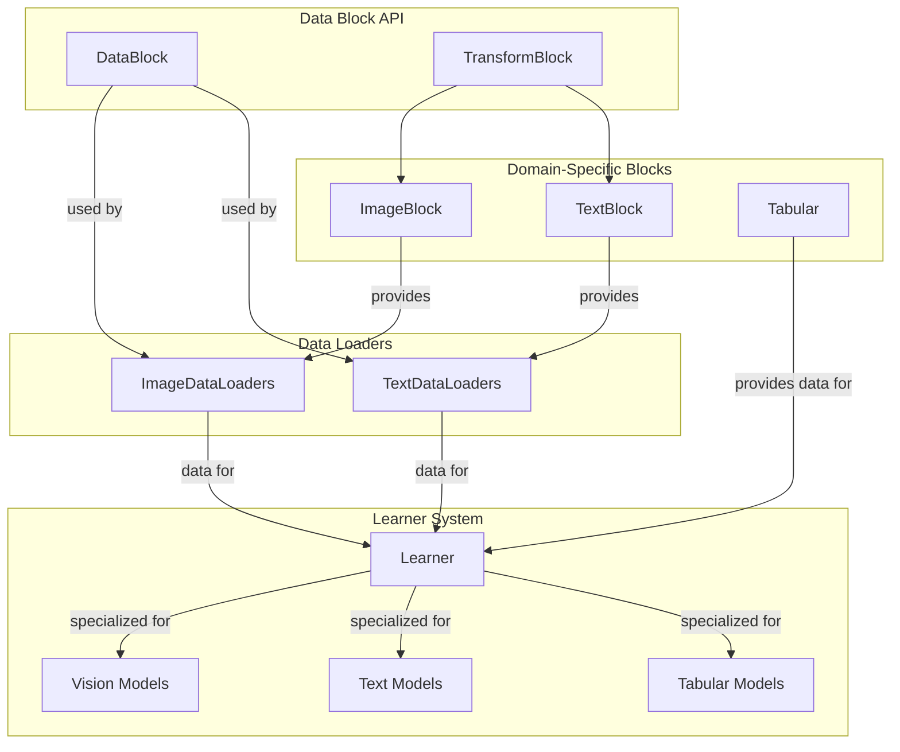

<!-- source: DeepWiki mcp.deepwiki.com · repo fastai/fastai · page 3 Domain-Specific Modules · fetched 2026-10-21 -->

# Domain-Specific Modules

Relevant source files

The following files were used as context for generating this wiki page:

- [fastai/text/data.py](fastai/text/data.py)
- [fastai/vision/data.py](fastai/vision/data.py)
- [nbs/08_vision.data.ipynb](nbs/08_vision.data.ipynb)
- [nbs/30_text.core.ipynb](nbs/30_text.core.ipynb)
- [nbs/31_text.data.ipynb](nbs/31_text.data.ipynb)
- [nbs/40_tabular.core.ipynb](nbs/40_tabular.core.ipynb)

This page describes the specialized modules in the fastai library designed for specific data domains: Computer Vision, Natural Language Processing (NLP), and Tabular Data. These modules build upon the core systems described in [Core Systems](#2) to provide high-level, domain-specific functionality that simplifies working with different types of data.

## Overview of Domain-Specific Architecture

The fastai library implements domain specialization through a layered approach where each domain (Vision, Text, Tabular) builds upon the same core infrastructure but provides customized components for data loading, preprocessing, and modeling.

Sources: [fastai/vision/data.py:16-106](), [fastai/text/data.py:15-247](), [nbs/40_tabular.core.ipynb:56-1112]()

## Computer Vision Module

The vision module provides specialized components for working with image data, including image classification, segmentation, object detection, and other computer vision tasks.

### Data Types and Blocks

Vision-specific tensor types and transformation blocks form the foundation of the vision module:

Sources: [fastai/vision/data.py:82-106]()

The vision module defines several specialized `TransformBlock` classes for different image-related data types:

- `ImageBlock`: For image data, converting to `PILImage` and then to tensors
- `MaskBlock`: For segmentation masks with optional code mapping
- `PointBlock`: For point coordinates within an image
- `BBoxBlock`: For bounding box coordinates
- `BBoxLblBlock`: For labeled bounding boxes with optional vocabulary

These blocks handle the type conversions and transformations needed for each specific vision task.

### Vision DataLoaders

The `ImageDataLoaders` class is the primary interface for loading and preparing image data:

Sources: [fastai/vision/data.py:109-204](), [fastai/vision/data.py:207-220]()

`ImageDataLoaders` provides numerous factory methods to create dataloaders from different data sources:

- `from_folder`: Creates dataloaders from an "imagenet-style" folder structure with class subfolders
- `from_df`: Creates dataloaders from a DataFrame with file paths and labels
- `from_csv`: Creates dataloaders from a CSV file with file paths and labels
- `from_lists`: Creates dataloaders from explicit lists of filenames and labels
- `from_path_func`, `from_name_func`, `from_path_re`, `from_name_re`: Create dataloaders using custom functions or regex to extract labels

For segmentation tasks, `SegmentationDataLoaders` provides similar functionality but customized for image masks.

### Vision-Specific Functions

The vision module includes numerous helper functions for working with image data:

- `get_grid`: Creates a grid of matplotlib axes for displaying batches of images
- `clip_remove_empty`: For removing empty bounding boxes
- `bb_pad`: For padding batches of bounding boxes to consistent sizes
- `show_batch`: Type-dispatched functions for displaying batches of images and their labels

Sources: [fastai/vision/data.py:17-79]()

## Text/NLP Module

The text module provides specialized components for working with text data, including text classification, language modeling, and other NLP tasks.

### Text Processing and Tokenization

Text data processing begins with tokenization and numericalization:

Sources: [nbs/30_text.core.ipynb:77-401](), [nbs/30_text.core.ipynb:502-521](), [nbs/31_text.data.ipynb:37-54]()

The text module offers several tokenization options:

- `BaseTokenizer`: A simple tokenizer that splits text on spaces
- `SpacyTokenizer` (alias `WordTokenizer`): Uses spaCy for more advanced tokenization
- `TokenizeWithRules`: Applies preprocessing rules before tokenization and post-processing rules after

Text processing rules include:
- `fix_html`: Cleans up HTML artifacts
- `replace_rep`: Replaces character repetitions
- `replace_wrep`: Replaces word repetitions
- `replace_all_caps`: Handles ALL CAPS text
- `replace_maj`: Handles Capitalized text
- `spec_add_spaces`: Adds spaces around special characters
- `rm_useless_spaces`: Removes extra spaces

After tokenization, the `Numericalize` transform converts tokens to numeric indices using a vocabulary.

### Text Data Types and DataLoaders

Sources: [fastai/text/data.py:30-111](), [fastai/text/data.py:185-221](), [fastai/text/data.py:248-288]()

Key text-specific components include:

- `TensorText` and `LMTensorText`: Specialized tensor types for text data
- `TextBlock`: A `TransformBlock` specifically for text data
- `LMDataLoader`: A custom `DataLoader` for language modeling that handles text sequences
- `SortedDL`: A `DataLoader` that sorts items by length for efficiency
- `TextDataLoaders`: High-level class with factory methods for creating text dataloaders

The text module also includes several padding utilities that are crucial for handling variable-length text sequences:

- `Pad_Input`: Adds padding to make all sequences the same length
- `pad_chunk` and `Pad_Chunk`: Padding functions that work with sequence chunks

### Factory Methods for Text Data

`TextDataLoaders` provides factory methods similar to `ImageDataLoaders`:

- `from_folder`: Creates dataloaders from a folder of text files
- `from_df`: Creates dataloaders from a DataFrame
- `from_csv`: Creates dataloaders from a CSV file

Sources: [fastai/text/data.py:248-288]()

## Tabular Module

The tabular module provides specialized components for working with structured tabular data, such as spreadsheets and database tables.

### Tabular Data Preprocessing

Sources: [nbs/40_tabular.core.ipynb:77-119](), [nbs/40_tabular.core.ipynb:402-449](), [nbs/40_tabular.core.ipynb:557-857]()

The tabular module offers several functions for preprocessing tabular data:

- Date-related features:
  - `make_date`: Ensures a column is the correct date type
  - `add_datepart`: Extracts features from date columns (year, month, day, etc.)
  - `add_elapsed_times`: Calculates time-based features between events

- Feature categorization:
  - `cont_cat_split`: Separates continuous and categorical variables

- Memory optimization:
  - `df_shrink_dtypes`: Identifies smaller data types that can hold the same data
  - `df_shrink`: Reduces memory usage by applying smaller data types

### Tabular Class

The `Tabular` class is the foundation of tabular data handling in fastai:

Sources: [nbs/40_tabular.core.ipynb:1094-1112]()

The `Tabular` class wraps a DataFrame and provides additional functionality:
- Awareness of which columns are categorical, continuous, or target variables
- Handling of preprocessing transforms through the `procs` attribute
- Integration with the fastai data block API
- Support for data splits (training/validation)

## Integration and Cross-Domain Application

Domain-specific modules in fastai are designed to be interoperable with the core systems, creating a consistent experience across domains.

Sources: [fastai/vision/data.py:82-106](), [fastai/text/data.py:223-245](), [nbs/40_tabular.core.ipynb:1094-1112]()

Despite different data types and preprocessing needs, all domain-specific modules follow a similar pattern:

1. **Type-specific Tensor Subclasses**: Each domain defines tensor subclasses for its data types (e.g., `TensorImage`, `TensorText`)

2. **Domain-Specific Blocks**: Each domain provides `TransformBlock` subclasses that handle the appropriate data transformations

3. **Factory Methods**: Each domain offers high-level factory methods for common data loading patterns

4. **Display Functions**: Each domain implements type-dispatched `show_batch` methods for displaying its data

This consistency allows users to apply the same workflow patterns across different domains while still benefiting from domain-specific optimizations.

## Summary

The domain-specific modules in fastai extend the core functionality with specialized components for different data types:

| Domain | Key Classes | Primary Use Cases |
|--------|-------------|------------------|
| **Vision** | `ImageDataLoaders`, `ImageBlock`, `MaskBlock` | Image classification, segmentation, object detection |
| **Text/NLP** | `TextDataLoaders`, `TextBlock`, `Tokenizer` | Text classification, language modeling |
| **Tabular** | `Tabular`, preprocessing functions | Structured data analysis, tabular prediction |

These modules build upon the common core infrastructure while providing domain-specific optimizations, allowing users to work effectively with different types of data within a consistent framework.

---

