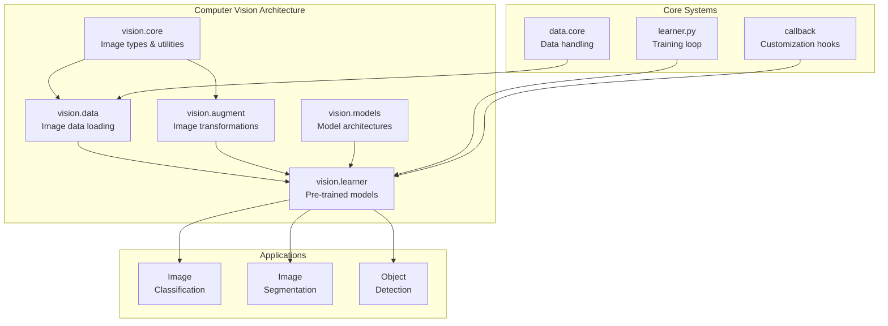
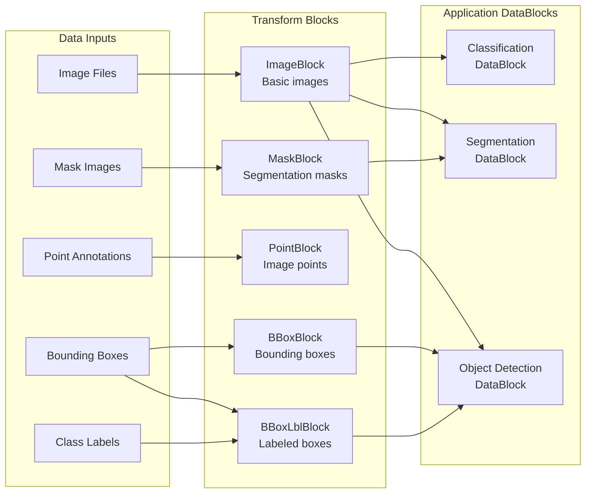
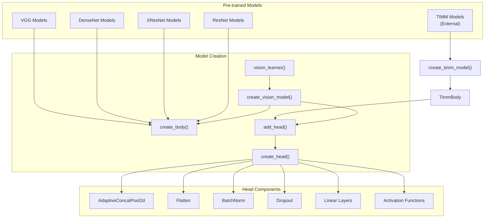
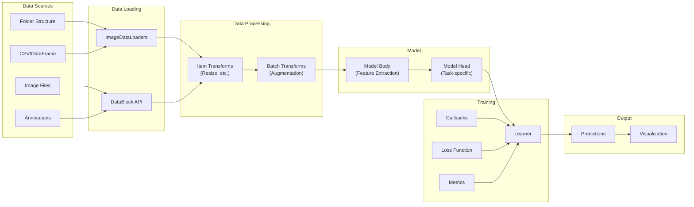

<!-- source: DeepWiki mcp.deepwiki.com · repo fastai/fastai · page 3.1 Computer Vision · fetched 2026-10-21 -->

# Computer Vision

<details>
<summary>Relevant source files</summary>

The following files were used as context for generating this wiki page:

- [fastai/vision/augment.py](fastai/vision/augment.py)
- [fastai/vision/data.py](fastai/vision/data.py)
- [fastai/vision/learner.py](fastai/vision/learner.py)
- [nbs/08_vision.data.ipynb](nbs/08_vision.data.ipynb)
- [nbs/09_vision.augment.ipynb](nbs/09_vision.augment.ipynb)
- [nbs/21_vision.learner.ipynb](nbs/21_vision.learner.ipynb)

</details>


The Computer Vision module in fastai provides a comprehensive set of tools and high-level APIs for building computer vision models with minimal code. This module handles tasks like image classification, segmentation, object detection, and more, with built-in support for data loading, augmentation, transfer learning, and model visualization.

## Overview and Architecture

The Computer Vision module is built on top of fastai's core functionality and PyTorch, providing specialized components for vision-specific tasks. 



Sources: [fastai/vision/data.py](fastai/vision/data.py), [fastai/vision/augment.py](fastai/vision/augment.py), [fastai/vision/learner.py](fastai/vision/learner.py)

## Data Loading and Preprocessing

Data loading in Computer Vision is handled primarily through `ImageDataLoaders`, which provides multiple factory methods to create data loaders from various sources.

### ImageDataLoaders

`ImageDataLoaders` includes factory methods for:

| Method | Description | Primary Use Case |
|--------|-------------|------------------|
| `from_folder` | Creates dataloaders from folder structure | Image classification with folder-per-class |
| `from_df` | Creates dataloaders from a DataFrame | Custom metadata in DataFrame format |
| `from_csv` | Creates dataloaders from a CSV file | Tabular data with image paths |
| `from_path_func` | Creates dataloaders using custom label function | Custom labeling logic |
| `from_name_func` | Creates dataloaders using filename parsing | Labels encoded in filenames |
| `from_path_re` | Creates dataloaders using regex on paths | Pattern-based labeling from paths |
| `from_name_re` | Creates dataloaders using regex on filenames | Pattern-based labeling from filenames |
| `from_lists` | Creates dataloaders from separate lists | Pre-processed data in separate lists |

Example usage pattern:
```python
dls = ImageDataLoaders.from_folder(path, 
                                  valid_pct=0.2,
                                  item_tfms=Resize(224),
                                  batch_tfms=aug_transforms())
```

Sources: [fastai/vision/data.py:109-204](fastai/vision/data.py:109-204)

### Transform Blocks

The library provides specialized transform blocks for different types of vision data:



Sources: [fastai/vision/data.py:82-106](fastai/vision/data.py:82-106)

## Data Augmentation

The Computer Vision module offers a comprehensive set of data augmentation transformations to improve model generalization. These are divided into item transforms (applied to individual items) and batch transforms (applied to batches).

### Key Augmentation Transforms

- Geometric transformations
  - `FlipItem`/`Flip`: Horizontal flipping
  - `DihedralItem`/`Dihedral`: Rotation and reflection
  - `Resize`, `RandomCrop`, `RandomResizedCrop`: Size transformations
  - `Rotate`, `Zoom`, `Warp`: More complex geometric transformations

- Color transformations
  - `Brightness`: Adjusts image brightness
  - `Contrast`: Modifies image contrast
  - `Saturation`: Changes color saturation
  - `Hue`: Shifts the colors in the image

- Advanced techniques
  - `RandomErasing`: Randomly erases rectangular regions (cutout technique)
  - `Affine transformations`: Various matrix-based transformations

The `aug_transforms()` function provides a convenient way to create a standard augmentation pipeline:

```python
batch_tfms = aug_transforms(mult=1.0, do_flip=True, flip_vert=False, max_rotate=10.0,
                           max_zoom=1.1, max_lighting=0.2, max_warp=0.2, p_affine=0.75,
                           p_lighting=0.75, xtra_tfms=None)
```

Sources: [fastai/vision/augment.py:25-51](fastai/vision/augment.py:25-51), [fastai/vision/augment.py:115-198](fastai/vision/augment.py:115-198), [fastai/vision/augment.py:243-347](fastai/vision/augment.py:243-347)

## Model Building and Transfer Learning

The Computer Vision module makes it easy to create models for different vision tasks, with built-in support for transfer learning.

### Vision Learner

The `vision_learner` function is the main entry point for creating a learner for computer vision tasks. It handles:

1. Creating a model with a suitable architecture
2. Applying appropriate normalization based on the pretrained model
3. Setting up transfer learning with proper layer splitting
4. Freezing pretrained layers for initial training

```python
learn = vision_learner(dls, resnet34, metrics=accuracy)
```

Sources: [fastai/vision/learner.py:219-246](fastai/vision/learner.py:219-246)

### Model Architecture Components



Sources: [fastai/vision/learner.py:90-177](fastai/vision/learner.py:90-177), [fastai/vision/learner.py:180-198](fastai/vision/learner.py:180-198)

### Special-Purpose Learners

For specific tasks, fastai provides specialized learner creation functions:

1. `unet_learner`: For image segmentation tasks
   ```python
   learn = unet_learner(dls, resnet34, metrics=dice)
   ```

2. External model integration through `timm` library:
   ```python
   learn = vision_learner(dls, "efficientnet_b0", metrics=accuracy)
   ```

Sources: [fastai/vision/learner.py:265-292](fastai/vision/learner.py:265-292)

## Training and Fine-tuning

The training process in fastai's Computer Vision module leverages fastai's core training capabilities with vision-specific enhancements.

### Transfer Learning Workflow

A typical transfer learning workflow with fastai's vision module:

1. Create a learner with a pretrained model
2. Fine-tune in stages:
   - Train the head with frozen body (`learn.fine_tune(1)`)
   - Gradually unfreeze and train more layers (`learn.unfreeze()`)
   - Use discriminative learning rates to update different parts of the model at different rates

```python
learn = vision_learner(dls, resnet34, metrics=accuracy)
learn.fine_tune(1)  # Fine-tunes in two steps: first head, then full model
```

### Result Visualization

The module provides specialized functions to visualize predictions:

1. `show_results`: Displays model predictions alongside ground truth
2. `plot_top_losses`: Visualizes samples with the highest loss values

Both functions dispatch to task-specific implementations based on the type of data:
- Classification (image → category)
- Segmentation (image → mask)
- Object detection (image → bounding boxes)

Sources: [fastai/vision/learner.py:307-374](fastai/vision/learner.py:307-374)

## Specialized Vision Tasks

The Computer Vision module provides specialized components for different vision tasks.

### Image Classification

The most basic and common task, handled with standard `vision_learner`:

```python
dls = ImageDataLoaders.from_folder(path, valid_pct=0.2, 
                                  item_tfms=Resize(224),
                                  batch_tfms=aug_transforms())
learn = vision_learner(dls, resnet34, metrics=accuracy)
learn.fine_tune(1)
```

### Image Segmentation

For pixel-wise classification, handled with `unet_learner`:

```python
dls = SegmentationDataLoaders.from_label_func(path, files, label_func, 
                                             codes=codes, 
                                             bs=8)
learn = unet_learner(dls, resnet34, metrics=dice)
learn.fine_tune(1)
```

### Object Detection

Uses `BBoxBlock` and `BBoxLblBlock` for bounding box tasks:

```python
dls = DataBlock(
    blocks=(ImageBlock, BBoxBlock, BBoxLblBlock),
    get_items=get_image_files,
    get_y=get_annotations,
    splitter=RandomSplitter(),
    batch_tfms=Normalize.from_stats(*imagenet_stats)
).dataloaders(path, bs=16)

learn = vision_learner(dls, resnet34, metrics=detection_metrics)
```

Sources: [fastai/vision/data.py:94-95](fastai/vision/data.py:94-95), [fastai/vision/data.py:101-106](fastai/vision/data.py:101-106)

## Data Flow Pipeline

The overall data flow in the Computer Vision module can be visualized as:



Sources: [fastai/vision/data.py](fastai/vision/data.py), [fastai/vision/augment.py](fastai/vision/augment.py), [fastai/vision/learner.py](fastai/vision/learner.py)

## Key Design Patterns

The Computer Vision module employs several key design patterns that make it flexible and powerful:

1. **Factory Methods**: Numerous factory methods like `from_folder`, `from_csv`, etc., to create data loaders from different sources.

2. **Type Dispatching**: The module uses type dispatching to select appropriate behavior based on data types, especially for visualization and transformation functions.

3. **Method Chaining**: Many methods return objects that can be further configured, enabling clean method chaining.

4. **Transform Composition**: Transforms can be composed together to create complex data processing pipelines.

5. **Transfer Learning**: The module leverages pretrained models with appropriate splitting for efficient fine-tuning.

## Best Practices for Using the Vision Module

1. **Data Preparation**:
   - Ensure consistent image formats and organization
   - Use appropriate factory methods based on your data structure
   - Validate your data by viewing batches with `show_batch()`

2. **Model Selection**:
   - Start with proven architectures like ResNet34 before trying more complex models
   - Use smaller image sizes initially for faster iteration
   - Scale up image size and model complexity as needed

3. **Training Strategy**:
   - Begin with `learn.fine_tune()` for transfer learning
   - Try different learning rates with `learn.lr_find()`
   - Use appropriate metrics for your task
   - Monitor training with callbacks like `SaveModelCallback`

4. **Augmentation Tuning**:
   - Start with default augmentations from `aug_transforms()`
   - Customize based on your specific data characteristics
   - Visually inspect augmentations with `show_batch()`

The fastai Computer Vision module provides a powerful, high-level interface for building various vision applications while still allowing advanced customization when needed.

---

