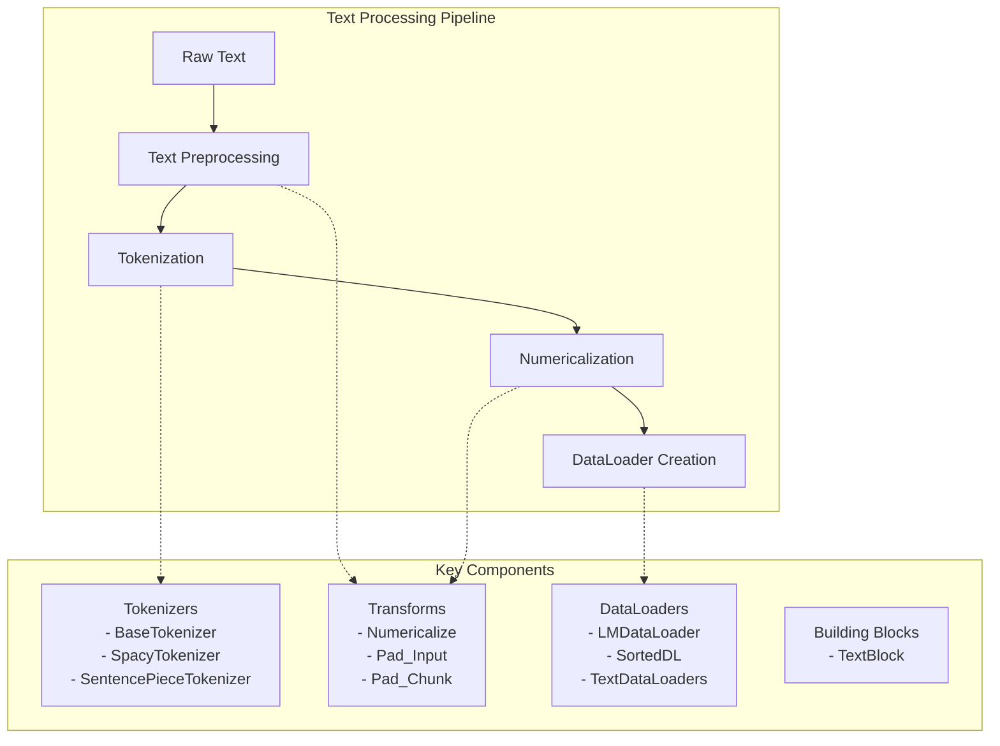
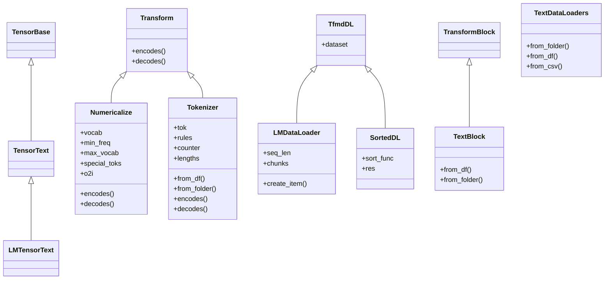
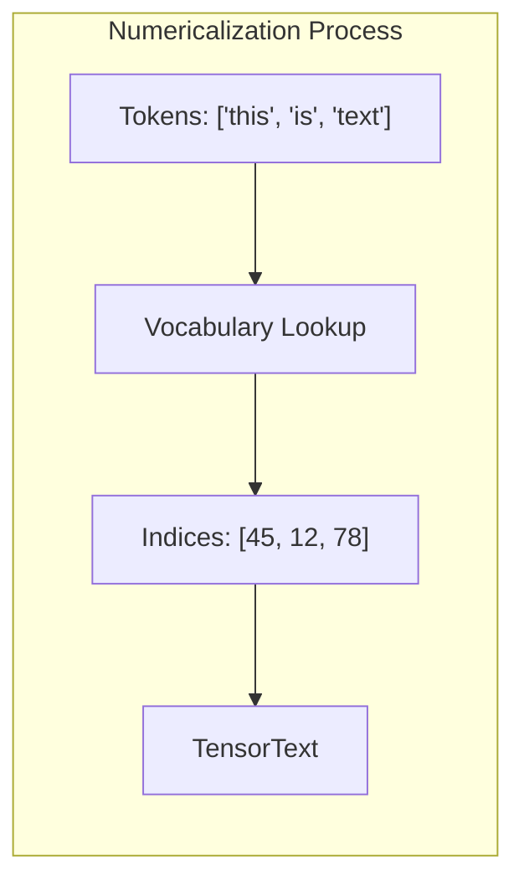
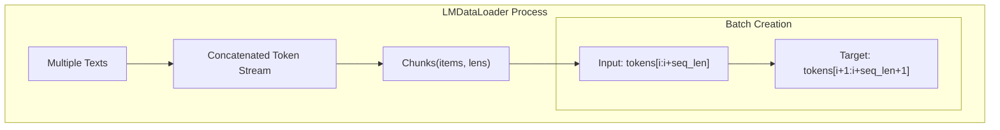
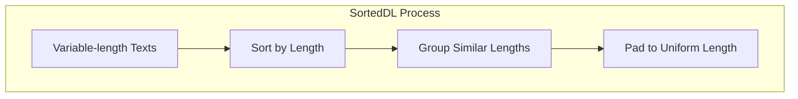
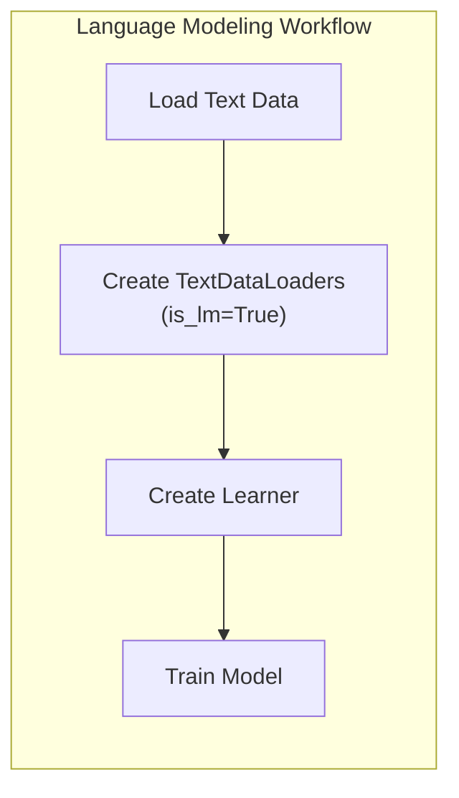
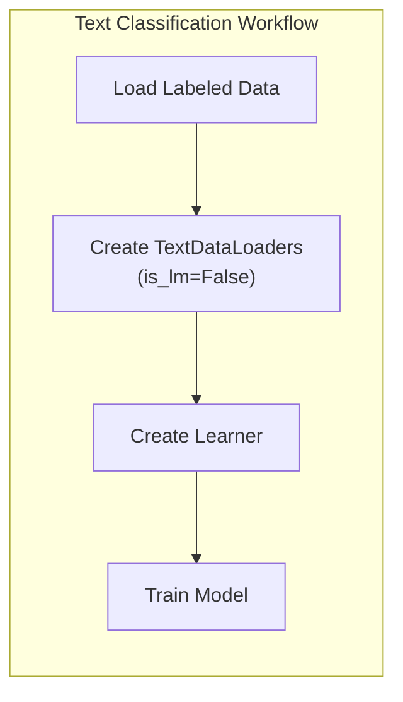

<!-- source: DeepWiki mcp.deepwiki.com · repo fastai/fastai · page 3.2 Natural Language Processing · fetched 2026-10-21 -->

# Natural Language Processing

<details>
<summary>Relevant source files</summary>

The following files were used as context for generating this wiki page:

- [fastai/text/data.py](fastai/text/data.py)
- [nbs/30_text.core.ipynb](nbs/30_text.core.ipynb)
- [nbs/31_text.data.ipynb](nbs/31_text.data.ipynb)
- [nbs/35_tutorial.wikitext.ipynb](nbs/35_tutorial.wikitext.ipynb)

</details>


The Natural Language Processing (NLP) module in fastai provides a comprehensive toolkit for working with text data. It includes components for text preprocessing, tokenization, numericalization, and data loading for both language modeling and text classification tasks.

This document explores the core NLP capabilities in fastai, focusing on the data processing pipeline and available APIs. For information about specific NLP models and training workflows, see [Domain-Specific Modules](#3).

## Core Components and Architecture

The fastai NLP system consists of several interrelated components that form a processing pipeline for text data:



Sources: [fastai/text/core.py](), [fastai/text/data.py]()

### Key Classes and Their Relationships



Sources: [fastai/text/data.py:30-53](), [fastai/text/data.py:73-110](), [fastai/text/data.py:223-245]()

## Text Processing and Tokenization

### Special Tokens and Processing Rules

fastai defines several special tokens for text processing:

| Token    | Description                            |
|----------|----------------------------------------|
| `UNK`    | Unknown token                          |
| `PAD`    | Padding token                          |
| `BOS`    | Beginning of sequence                  |
| `EOS`    | End of sequence                        |
| `FLD`    | Field separator                        |
| `TK_REP` | Token for character repetitions        |
| `TK_WREP`| Token for word repetitions             |
| `TK_UP`  | Token for words in ALL CAPS            |
| `TK_MAJ` | Token for Capitalized words            |

The library provides standard text processing rules:

```python
defaults.text_proc_rules = [fix_html, replace_rep, replace_wrep, spec_add_spaces, 
                           rm_useless_spaces, replace_all_caps, replace_maj, lowercase]
```

These rules handle common text normalization tasks:
- Cleaning HTML artifacts
- Replacing repetitive characters and words
- Normalizing capitalization
- Adding spaces around special characters

Sources: [fastai/text/core.py:85-87](), [fastai/text/core.py:408-412]()

### Tokenization Options

fastai offers multiple tokenization approaches:

1. **BaseTokenizer**: Simple tokenizer that splits on spaces
   ```python
   tok = BaseTokenizer()
   tokens = tok(["This is a text"])  # [["This", "is", "a", "text"]]
   ```

2. **SpacyTokenizer** (alias `WordTokenizer`): Uses spaCy for linguistically-aware tokenization
   ```python
   tok = SpacyTokenizer()
   tokens = tok(["This isn't easy."])  # [["This", "is", "n't", "easy", "."]]
   ```

3. **SentencePieceTokenizer**: Uses SentencePiece library for subword tokenization

The `TokenizeWithRules` class combines preprocessing rules with tokenization:

```python
tfm = TokenizeWithRules(SpacyTokenizer(), rules=[replace_all_caps])
tokens = tfm(["THIS is text"])  # [[TK_UP, "this", "is", "text"]]
```

For large datasets, parallel tokenization is supported:
```python
tokens = parallel_tokenize(texts, tok=SpacyTokenizer(), n_workers=4)
```

Sources: [fastai/text/core.py:434-440](), [fastai/text/core.py:461-473](), [fastai/text/core.py:500-512](), [fastai/text/core.py:577-583]()

## Numericalization

After tokenization, tokens need to be converted to numeric indices for neural networks. The `Numericalize` transform handles this:



The `make_vocab` function creates a vocabulary from token frequencies:

```python
vocab = make_vocab(counter, min_freq=3, max_vocab=60000)
```

Key features:
- Filters tokens by minimum frequency
- Limits vocabulary size
- Ensures special tokens are included
- Pads vocabulary size to a multiple of 8 for performance

The `Numericalize` transform uses this vocabulary to convert tokens to indices:

```python
num = Numericalize(vocab=vocab)
ids = num(['this', 'is', 'text'])  # TensorText([45, 12, 78])
```

This transform is reversible, allowing conversion back to tokens:
```python
tokens = num.decode(ids)  # ['this', 'is', 'text']
```

Sources: [fastai/text/data.py:19-27](), [fastai/text/data.py:37-53]()

## Data Loading for NLP Tasks

fastai provides specialized DataLoaders for text processing tasks:

### Language Modeling with LMDataLoader

The `LMDataLoader` is designed specifically for language modeling:



Key features:
- Concatenates all texts into a continuous stream
- Divides the stream into batches of sequence length `seq_len`
- Creates inputs and targets shifted by one position
- Uses `LMTensorText` type to identify language modeling data

```python
# Create LMDataLoader with sequence length 72
dl = LMDataLoader(tokenized_texts, bs=64, seq_len=72)

# First batch: (inputs, targets)
x, y = first(dl)
```

Sources: [fastai/text/data.py:73-110]()

### Text Classification with SortedDL

For text classification and other non-language-modeling tasks, the `SortedDL` optimizes processing:



Key features:
- Sorts texts by length for efficient processing
- Minimizes padding by grouping similar lengths
- Provides efficient shuffling while preserving batching benefits
- Uses padding transforms to create uniform-length batches

```python
# Create SortedDL with padding
dl = SortedDL(tokenized_texts, bs=32, before_batch=partial(pad_input, pad_idx=0))
```

The library provides two main padding approaches:
1. `Pad_Input`: Basic padding to match the longest sequence in a batch
2. `Pad_Chunk`: More sophisticated padding for recurrent models, adding padding in chunks of size `seq_len`

Sources: [fastai/text/data.py:184-220](), [fastai/text/data.py:127-147](), [fastai/text/data.py:167-181]()

## High-Level API

fastai provides high-level APIs for easy creation of text datasets:

### TextBlock

The `TextBlock` class integrates text processing into the DataBlock API:

```python
# Text classification with DataBlock API
blocks = (TextBlock.from_df('text', seq_len=72), CategoryBlock)
dblock = DataBlock(blocks=blocks, get_x=ColReader('text'), get_y=ColReader('label'))
```

Key features:
- Encapsulates the entire text processing pipeline
- Supports different tokenizer options
- Configures appropriate DataLoader based on task type
- Handles backward text processing for bidirectional models

Factory methods simplify creation:
- `TextBlock.from_df()`: Create from DataFrame columns
- `TextBlock.from_folder()`: Create from text files in folders

Sources: [fastai/text/data.py:223-245]()

### TextDataLoaders

For the highest level of abstraction, `TextDataLoaders` provides factory methods for common tasks:

```python
# Language modeling
dls = TextDataLoaders.from_folder(path, is_lm=True, seq_len=72)

# Classification from DataFrame
dls = TextDataLoaders.from_df(df, text_col='text', label_col='label')

# Classification from CSV file
dls = TextDataLoaders.from_csv(path, 'labels.csv')
```

This class automatically configures the appropriate blocks, tokenization, and data loading based on the task type.

Sources: [fastai/text/data.py:248-288]()

## Example Workflows

### Language Modeling Example



Example from Wikitext tutorial:
```python
path = untar_data(URLs.WIKITEXT_TINY)
dls = TextDataLoaders.from_folder(path, is_lm=True, seq_len=72, bs=64)
learn = text_classifier_learner(dls, AWD_LSTM, drop_mult=0.5)
learn.fit_one_cycle(1, 1e-2)
```

Sources: [nbs/35_tutorial.wikitext.ipynb:186-201](), [nbs/35_tutorial.wikitext.ipynb:262-285]()

### Text Classification Example



Example with IMDB dataset:
```python
path = untar_data(URLs.IMDB_SAMPLE)
df = pd.read_csv(path/'texts.csv')

imdb_clas = DataBlock(
    blocks=(TextBlock.from_df('text', seq_len=72), CategoryBlock),
    get_x=ColReader('text'), 
    get_y=ColReader('label'), 
    splitter=ColSplitter()
)

dls = imdb_clas.dataloaders(df, bs=64)
```

Sources: [nbs/31_text.data.ipynb:1082-1088]()

## Advanced Features

### Semantic Tensor Types

fastai uses semantic types to distinguish text representations:
- `TensorText`: Base type for text tensors
- `LMTensorText`: Specialized type for language modeling

```python
# Created during numericalization
text_tensor = TensorText(tensor([45, 12, 78]))

# Created by LMDataLoader
x, y = first(lm_dl)  # x is LMTensorText
```

Sources: [fastai/text/data.py:30-34]()

### Reversible Transforms

All text transforms in fastai are reversible:
- `encodes()`: Forward transformation (e.g., tokens → indices)
- `decodes()`: Reverse transformation (e.g., indices → tokens)

This enables inspection and debugging at any stage of the pipeline.

### Special Features

- **Backward text processing** using `reverse_text`: Process text in reverse order for bidirectional models
- **Token repetition handling**: Special tokens compress repetitive patterns
- **Capitalization normalization**: Preserve capitalization information while normalizing text
- **Parallel processing**: Process large datasets efficiently with multi-worker tokenization

Sources: [fastai/text/data.py:16](), [fastai/text/core.py:577-583]()

---

This overview covers the core NLP capabilities in fastai. The architecture follows fastai's layered API design, providing both low-level components for customization and high-level APIs for common workflows.

---

