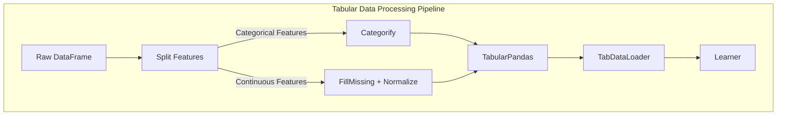
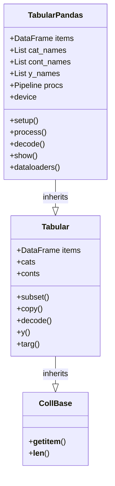
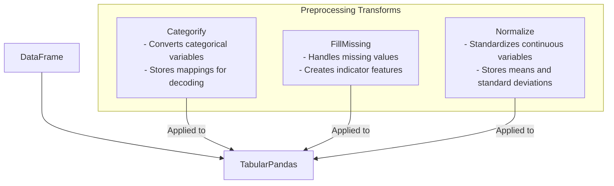
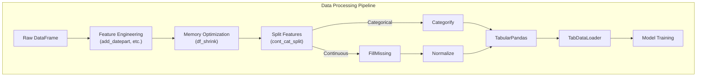
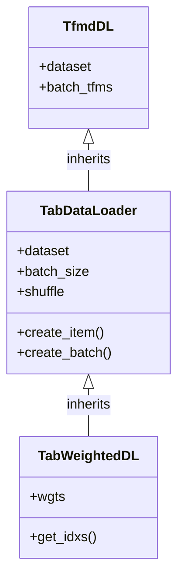
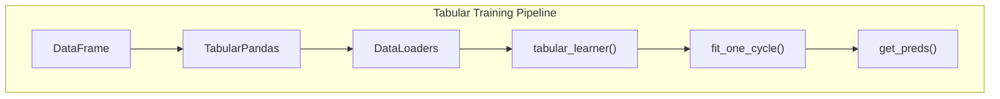

<!-- source: DeepWiki mcp.deepwiki.com · repo fastai/fastai · page 3.3 Tabular Data · fetched 2026-10-21 -->

# Tabular Data

<details>
<summary>Relevant source files</summary>

The following files were used as context for generating this wiki page:

- [nbs/40_tabular.core.ipynb](nbs/40_tabular.core.ipynb)

</details>


This page documents fastai's capabilities for handling structured tabular data (data in rows and columns like spreadsheets and SQL tables). The fastai tabular module provides specialized tools for preprocessing, transforming, and loading tabular data for machine learning tasks such as classification and regression.

For text data handling, see [Natural Language Processing](#3.2). For image data, see [Computer Vision](#3.1).

## Overview

Tabular data presents unique challenges including handling categorical variables, missing values, and preprocessing both numerical and text-based features. The fastai tabular module provides a streamlined pipeline to address these challenges, built around the central `TabularPandas` class.



Sources: [nbs/40_tabular.core.ipynb:1094-1146](). [nbs/40_tabular.core.ipynb:1173-1177]().

## Core Components

### TabularPandas

The `TabularPandas` class is the central component of fastai's tabular data processing system. It wraps a pandas DataFrame and adds knowledge about which columns are categorical, continuous, or targets.



Key parameters of `TabularPandas`:

| Parameter | Description |
|-----------|-------------|
| `df` | The pandas DataFrame containing the data |
| `procs` | List of preprocessing transforms to apply |
| `cat_names` | List of categorical column names |
| `cont_names` | List of continuous column names |
| `y_names` | Name(s) of target column(s) |
| `y_block` | Block specifying type of target (regression, classification) |
| `splits` | Optional indices for train/validation split |
| `inplace` | If True, modify the dataframe directly (more memory efficient) |
| `reduce_memory` | If True, optimize memory usage of the dataframe |

Sources: [nbs/40_tabular.core.ipynb:1094-1146](). [nbs/40_tabular.core.ipynb:1173-1177]().

### Preprocessing Transforms

fastai provides specialized transforms for tabular data:



1. **Categorify** (lines 1303-1311): Transforms categorical variables into numeric codes suitable for neural networks, tracking mappings for later decoding.

2. **FillMissing** (lines 1690-1710): Fills missing values using strategies like median, mode, or constant values, and optionally creates indicator columns showing which values were missing.

3. **Normalize** (lines 1583-1597): Standardizes continuous variables by subtracting the mean and dividing by the standard deviation, storing these values for later decoding.

Sources: [nbs/40_tabular.core.ipynb:1303-1311](). [nbs/40_tabular.core.ipynb:1690-1710](). [nbs/40_tabular.core.ipynb:1583-1597]().

### Feature Engineering Utilities

fastai provides helper functions for creating features from raw data:

1. **add_datepart** (lines 105-119): Extracts date components (year, month, day, etc.) from date columns, creating multiple features from a single date.

2. **add_elapsed_times** (lines 423-448): Calculates time elapsed between events, useful for time-series analysis.

3. **cont_cat_split** (lines 558-568): Automatically identifies continuous and categorical columns based on data types and cardinality.

Sources: [nbs/40_tabular.core.ipynb:105-119](). [nbs/40_tabular.core.ipynb:423-448](). [nbs/40_tabular.core.ipynb:558-568]().

### Memory Optimization

Two key functions help optimize memory usage:

1. **df_shrink_dtypes** (lines 707-733): Identifies smaller data types that can hold the data, reducing memory usage.

2. **df_shrink** (lines 852-855): Applies the optimized data types identified by `df_shrink_dtypes`.

Sources: [nbs/40_tabular.core.ipynb:707-733](). [nbs/40_tabular.core.ipynb:852-855]().

## Data Processing Pipeline

The typical workflow for tabular data in fastai follows these steps:



1. **Feature Engineering**: Create meaningful features from raw data (e.g., extract date components).
2. **Memory Optimization**: Reduce memory usage with `df_shrink`.
3. **Feature Splitting**: Identify categorical and continuous columns with `cont_cat_split`.
4. **Preprocessing**: Apply `Categorify`, `FillMissing`, and `Normalize`.
5. **Create TabularPandas**: Wrap data with `TabularPandas`.
6. **Create DataLoaders**: Use `TabDataLoader` to prepare data for training.

Sources: [nbs/40_tabular.core.ipynb:1936-1946](). [nbs/40_tabular.core.ipynb:1935-1946]().

## Handling Different Target Types

fastai supports several types of target variables for tabular data:

### Classification

For binary or multi-class classification, fastai uses `CategoryBlock` for categorical targets:

```python
to = TabularPandas(df, procs, cat_names, cont_names, y_names="target", y_block=CategoryBlock())
```

Sources: [nbs/40_tabular.core.ipynb:1109-1111]().

### Regression

For regression tasks, fastai uses `RegressionBlock`:

```python
to = TabularPandas(df, procs, cat_names, cont_names, y_names="value", y_block=RegressionBlock())
```

Sources: [nbs/40_tabular.core.ipynb:1111-1112]().

### Multi-label Classification

For multi-label targets (where each observation can have multiple labels), fastai provides two options:

1. **One-hot encoded targets**: Use `MultiCategoryBlock(encoded=True)`.
2. **Space-separated text labels**: Use `MultiCategoryBlock()`.

Sources: [nbs/40_tabular.core.ipynb:3976-3986](). [nbs/40_tabular.core.ipynb:3426-3437]().

## Data Loading

fastai provides specialized data loaders for tabular data:



1. **TabDataLoader** (lines 1935-1946): A data loader specialized for tabular data.
2. **TabWeightedDL** (lines 1956-1970): An extension that supports weighted sampling, useful for imbalanced datasets.

The `TabularPandas.dataloaders()` method creates these data loaders automatically, making it easy to prepare data for training.

Sources: [nbs/40_tabular.core.ipynb:1935-1946](). [nbs/40_tabular.core.ipynb:1956-1970]().

## Example Usage

Here's a typical workflow for using tabular data in fastai:

1. **Data Preparation**:
```python
cat_names = ['workclass', 'education', 'marital-status', 'occupation', 'relationship', 'race']
cont_names = ['age', 'fnlwgt', 'education-num']
procs = [Categorify, FillMissing, Normalize]
```

2. **Create TabularPandas**:
```python
to = TabularPandas(df, procs, cat_names, cont_names, 
                  y_names="salary", splits=splits)
```

3. **Create DataLoaders**:
```python
dls = to.dataloaders(bs=64)
```

4. **Train Model**:
```python
learn = tabular_learner(dls, metrics=accuracy)
learn.fit_one_cycle(5)
```

5. **Inference**:
```python
# Process new data
to_test = to.new(df_test)
to_test.process()
# Create dataloader
test_dl = dls.valid.new(to_test)
# Get predictions
preds = learn.get_preds(dl=test_dl)
```

Sources: [nbs/40_tabular.core.ipynb:2162-2174](). [nbs/40_tabular.core.ipynb:2764-2766]().

## Additional Features

### Decoding

The `decode` method converts processed data back to its original form:
```python
decoded_data = to.decode()
```

This is useful for interpreting model inputs and outputs after preprocessing.

Sources: [nbs/40_tabular.core.ipynb:1126-1127]().

### Memory Efficiency

The `inplace` parameter in `TabularPandas` allows modifying the dataframe in-place:
```python
to = TabularPandas(df, procs, cat_names, cont_names, inplace=True)
```

Use `pd.options.mode.chained_assignment = None` to avoid pandas warnings when using `inplace=True` with splits.

Sources: [nbs/40_tabular.core.ipynb:1098-1101]().

## Integration with fastai Training

The tabular module integrates seamlessly with fastai's training system:



The `tabular_learner` function creates a Learner specialized for tabular data, automatically configuring appropriate model architectures based on the data characteristics.

Sources: [nbs/40_tabular.core.ipynb:1094-1146](). [nbs/40_tabular.core.ipynb:1935-1946]().

## Summary

fastai's tabular module provides a comprehensive system for processing tabular data. The central `TabularPandas` class, combined with preprocessing transforms like `Categorify`, `FillMissing`, and `Normalize`, makes it easy to prepare tabular data for machine learning. The system handles various challenges such as categorical variables, missing values, and different target types, while integrating seamlessly with fastai's training infrastructure.

---

