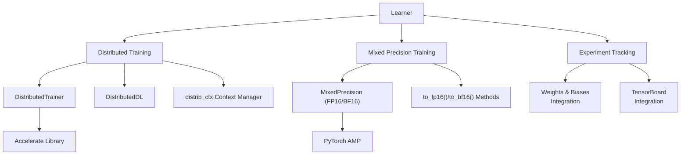
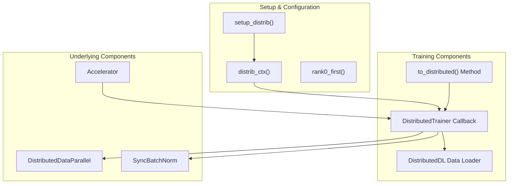
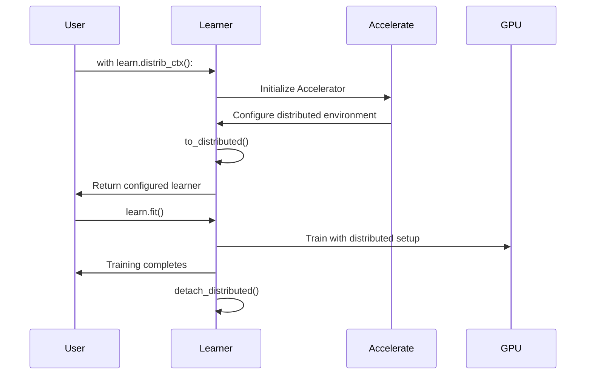
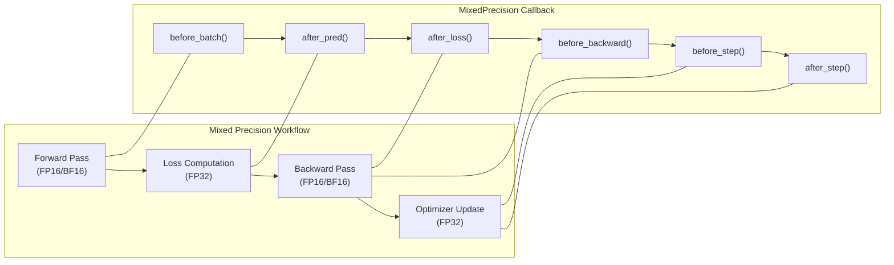
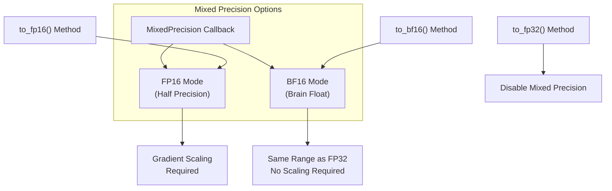
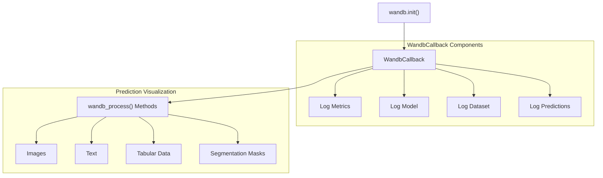
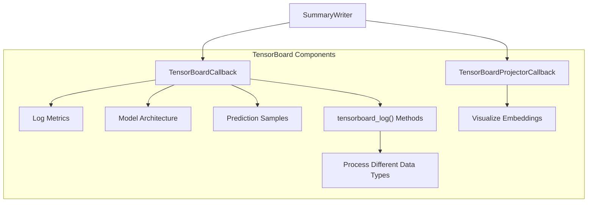
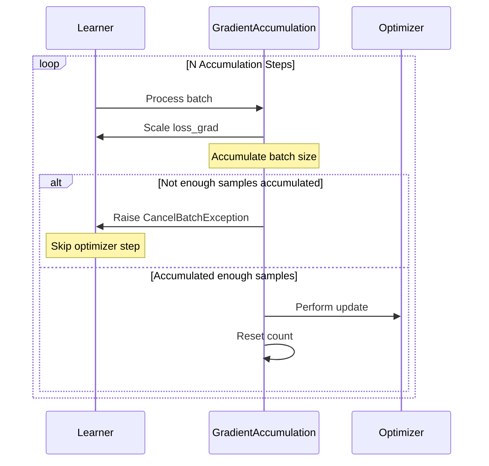
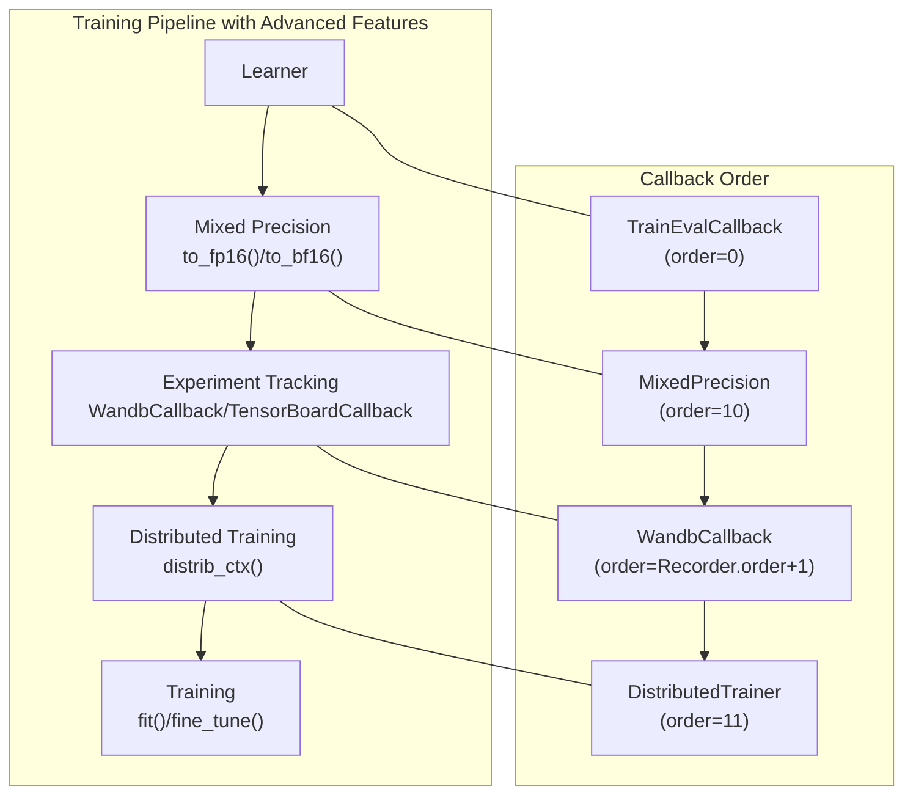

<!-- source: DeepWiki mcp.deepwiki.com · repo fastai/fastai · page 4 Advanced Features · fetched 2026-10-21 -->

# Advanced Features

<details>
<summary>Relevant source files</summary>

The following files were used as context for generating this wiki page:

- [fastai/_nbdev.py](fastai/_nbdev.py)
- [fastai/callback/fp16.py](fastai/callback/fp16.py)
- [fastai/callback/tensorboard.py](fastai/callback/tensorboard.py)
- [fastai/callback/training.py](fastai/callback/training.py)
- [fastai/callback/wandb.py](fastai/callback/wandb.py)
- [fastai/distributed.py](fastai/distributed.py)
- [nbs/18_callback.fp16.ipynb](nbs/18_callback.fp16.ipynb)
- [nbs/18a_callback.training.ipynb](nbs/18a_callback.training.ipynb)
- [nbs/20a_distributed.ipynb](nbs/20a_distributed.ipynb)
- [nbs/20b_tutorial.distributed.ipynb](nbs/20b_tutorial.distributed.ipynb)
- [nbs/70_callback.wandb.ipynb](nbs/70_callback.wandb.ipynb)
- [nbs/examples/app_examples.ipynb](nbs/examples/app_examples.ipynb)

</details>


This page covers the advanced features in the fastai library that enable efficient training and tracking of deep learning models. These features include distributed training across multiple GPUs, mixed precision training for faster computation, and integrations with experiment tracking platforms.

For general information about the core library architecture, see [Architecture and Design](#1.1).

## Overview of Advanced Features

The fastai library provides several advanced features designed to optimize the training process and help track experiments. These features extend the base functionality of the library to address specific needs such as training on multiple GPUs, reducing memory usage, and tracking experiment results.



Sources: 
- [fastai/distributed.py]()
- [fastai/callback/fp16.py]()
- [fastai/callback/wandb.py]()
- [fastai/callback/tensorboard.py]()

## Distributed Training

Distributed training allows you to leverage multiple GPUs (either on a single machine or across multiple machines) to train models faster. The fastai library provides a simplified interface to PyTorch's distributed training capabilities through integration with the Accelerate library.

### Key Components of Distributed Training



Sources:
- [fastai/distributed.py:188-214]()
- [fastai/distributed.py:141-164]()
- [fastai/distributed.py:80-135]()

### Using Distributed Training

The simplest way to use distributed training is with the `distrib_ctx` context manager:



Sources:
- [fastai/distributed.py:188-214]()
- [nbs/20a_distributed.ipynb:33-67]()
- [nbs/20a_distributed.ipynb:71-84]()

### Three Steps for Distributed Training

To use distributed training, follow these steps:

1. Add `with learn.distrib_ctx():` before your `learn.fit` call
2. Configure Accelerate by either running `accelerate config` from the command line or using `write_basic_config()` from the `accelerate.utils` module
3. Run your training script with `accelerate launch scriptname.py ...args...`

If you're downloading or preparing data/models, wrap that code with `rank0_first`:

```python
path = rank0_first(untar_data, URLs.IMAGEWOOF_320)
```

This ensures the data preparation happens once on the master process before other processes run it.

Sources:
- [nbs/20a_distributed.ipynb:44-84]()
- [fastai/distributed.py:217-225]()

### Using the Notebook Launcher

For Jupyter notebook users, Accelerate provides a `notebook_launcher` that enables distributed training in notebooks:

1. Configure Accelerate
2. Move your training code into a function
3. Pass this function to `notebook_launcher` with the desired number of processes

Sources:
- [nbs/20a_distributed.ipynb:631-662]()

## Mixed Precision Training

Mixed precision training uses a combination of single-precision (FP32) and half-precision (FP16 or BF16) floating point types to reduce memory usage and speed up training, especially on modern GPUs with tensor cores.

### How Mixed Precision Works



Sources:
- [fastai/callback/fp16.py:25-69]()
- [nbs/18_callback.fp16.ipynb:85-222]()

### Types of Mixed Precision

The fastai library supports two types of mixed precision:

1. **FP16 Mixed Precision**: Uses 16-bit floating point for most operations. Requires gradient scaling to prevent underflow.
2. **BF16 Mixed Precision**: Uses bfloat16 format which has the same exponent as FP32 but reduced mantissa. Doesn't require gradient scaling but needs Ampere or newer NVIDIA GPUs.



Sources:
- [fastai/callback/fp16.py:18-22]()
- [fastai/callback/fp16.py:25-69]()
- [nbs/18_callback.fp16.ipynb:188-202]()

### Using Mixed Precision

To enable mixed precision training, simply call one of the following methods on your learner:

- `learn.to_fp16()` - For FP16 mixed precision
- `learn.to_bf16()` - For BF16 mixed precision (requires hardware support)
- `learn.to_fp32()` - To return to full precision training

Sources:
- [fastai/callback/fp16.py:72-76]()
- [fastai/callback/fp16.py:77-81]()
- [fastai/callback/fp16.py:84-87]()

## Experiment Tracking

Experiment tracking allows you to log metrics, hyperparameters, model architectures, and prediction samples during training. The fastai library integrates with two popular experiment tracking platforms: Weights & Biases and TensorBoard.

### Weights & Biases Integration



Sources:
- [fastai/callback/wandb.py:21-160]()
- [nbs/70_callback.wandb.ipynb:98-239]()
- [nbs/70_callback.wandb.ipynb:261-276]()

#### Using Weights & Biases

To use Weights & Biases with fastai:

1. Install the wandb package: `pip install wandb`
2. Create a free account and run `wandb login` in your terminal
3. Initialize wandb in your notebook or script with `wandb.init()`
4. Add the `WandbCallback` to your learner

```python
from fastai.callback.wandb import *
wandb.init()
learn = learner(..., cbs=WandbCallback())
```

The callback can log metrics, model architecture, gradients, predictions, and more.

Sources:
- [nbs/70_callback.wandb.ipynb:71-80]()
- [nbs/70_callback.wandb.ipynb:656-676]()

### TensorBoard Integration



Sources:
- [fastai/callback/tensorboard.py:20-46]()
- [fastai/callback/tensorboard.py:48-82]()
- [fastai/callback/tensorboard.py:85-97]()

#### Using TensorBoard

To use TensorBoard with fastai:

1. Install TensorBoard: `pip install tensorboard`
2. Add the `TensorBoardCallback` to your learner

```python
from fastai.callback.tensorboard import *
learn = learner(..., cbs=TensorBoardCallback())
```

This will log metrics, model architecture, and prediction samples to TensorBoard. You can also use the `TensorBoardProjectorCallback` to visualize embeddings.

Sources:
- [fastai/callback/tensorboard.py:48-82]()
- [fastai/callback/tensorboard.py:85-97]()

## Additional Training Callbacks

The fastai library includes several other callbacks that can enhance training:

| Callback | Purpose |
|----------|---------|
| `GradientAccumulation` | Accumulates gradients over multiple batches before updating weights, allowing for effectively larger batch sizes |
| `GradientClip` | Clips gradient norms to prevent explosive gradients during training |
| `ShortEpochCallback` | Runs a small percentage of an epoch, useful for debugging |
| `BnFreeze` | Freezes BatchNorm layers during training |

Sources:
- [fastai/callback/training.py:24-35]()
- [fastai/callback/training.py:38-42]()
- [fastai/callback/training.py:15-21]()
- [fastai/callback/training.py:55-59]()

### Gradient Accumulation

Gradient accumulation is particularly useful when you want to use a larger effective batch size than your GPU memory allows. It works by accumulating gradients over multiple mini-batches before performing a weight update.



Sources:
- [fastai/callback/training.py:24-35]()
- [nbs/18a_callback.training.ipynb:209-230]()

## Integration Between Advanced Features

The advanced features in fastai are designed to work together seamlessly:



Sources:
- [fastai/callback/fp16.py:25-26]()
- [fastai/callback/wandb.py:21-23]()
- [fastai/distributed.py:141-143]()

### Example Combined Usage

Here's how you might combine these advanced features in a training workflow:

1. Start with a basic learner
2. Add mixed precision for faster training
3. Add experiment tracking to log results
4. Enable distributed training for multi-GPU setup
5. Run the training

```python
# Import required modules
from fastai.vision.all import *
from fastai.callback.wandb import *
import wandb

# Initialize wandb
wandb.init()

# Create learner with mixed precision and WandB
learn = vision_learner(dls, resnet34, metrics=error_rate)
learn = learn.to_fp16()
learn.add_cb(WandbCallback())

# Train with distributed context
with learn.distrib_ctx():
    learn.fine_tune(1)
```

Sources:
- [nbs/examples/app_examples.ipynb:127-130]()
- [nbs/20a_distributed.ipynb:644-662]()

## Performance Considerations

When using these advanced features, keep the following considerations in mind:

1. **Mixed Precision Training**:
   - FP16 works on most modern NVIDIA GPUs
   - BF16 requires Ampere or newer architecture
   - Mixed precision generally gives a 2-3x speedup

2. **Distributed Training**:
   - Single-machine multi-GPU training provides near-linear scaling with good implementation
   - Multi-machine training requires proper network setup
   - DataParallel (single machine) has more overhead than DistributedDataParallel

3. **Experiment Tracking**:
   - Logging too many items can slow down training
   - Consider logging predictions only periodically rather than every epoch

Sources:
- [nbs/18_callback.fp16.ipynb:85-165]()
- [nbs/20a_distributed.ipynb:44-63]()
- [nbs/70_callback.wandb.ipynb:292-304]()

## Conclusion

The advanced features in fastai provide powerful tools to optimize your deep learning workflows. By leveraging distributed training, mixed precision, and experiment tracking, you can train larger models faster and keep better track of your experiments.

These features integrate seamlessly with the core fastai API, maintaining the library's focus on simplicity while providing access to powerful capabilities when needed.

---

