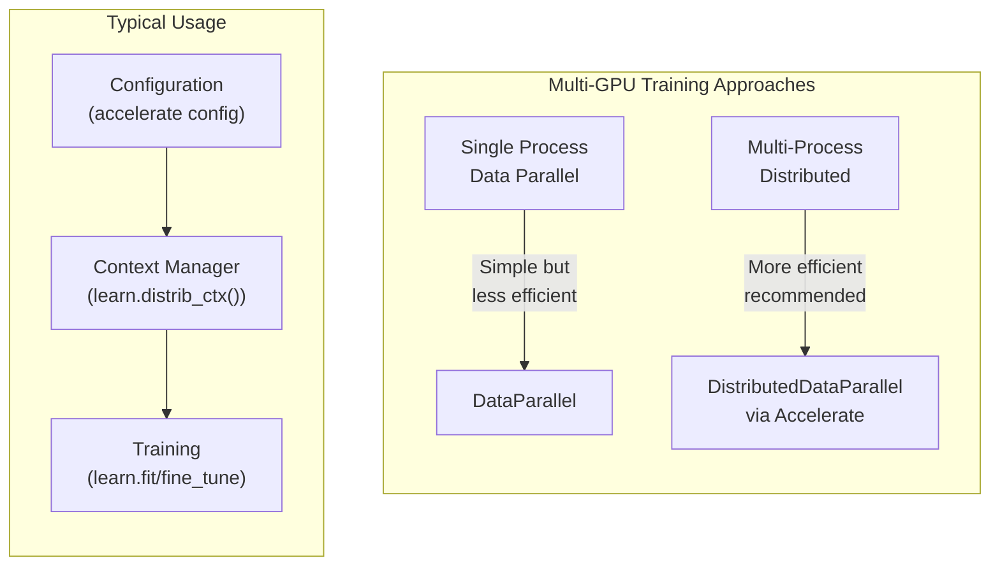
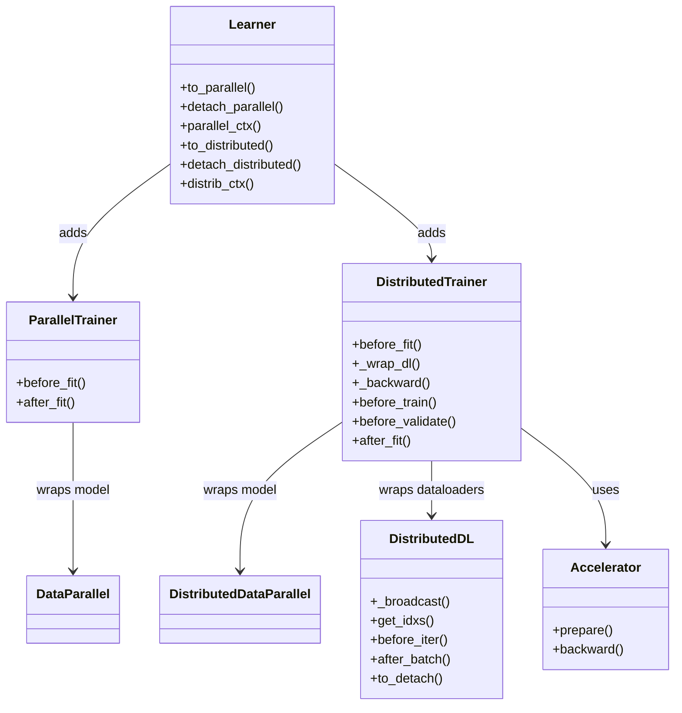
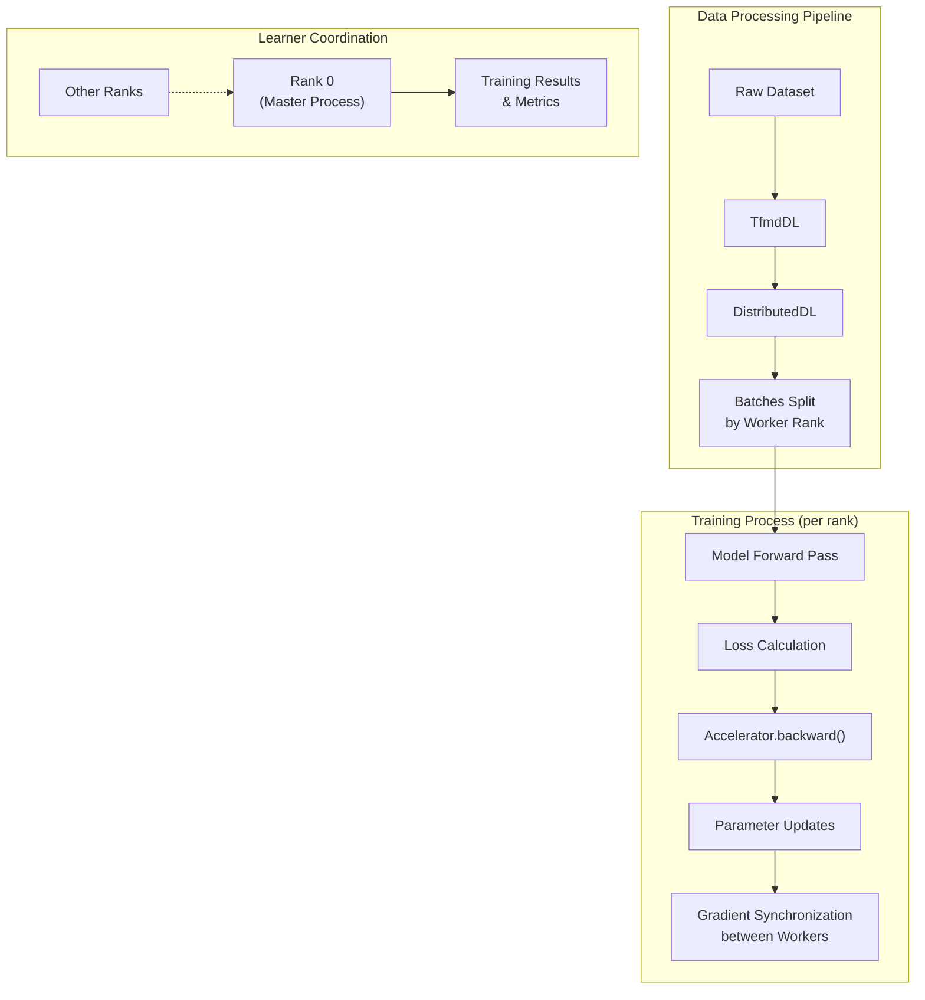
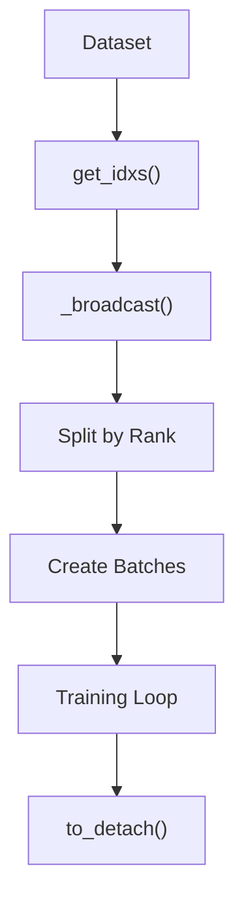

<!-- source: DeepWiki mcp.deepwiki.com · repo fastai/fastai · page 4.1 Distributed Training · fetched 2026-10-21 -->

# Distributed Training

<details>
<summary>Relevant source files</summary>

The following files were used as context for generating this wiki page:

- [fastai/_nbdev.py](fastai/_nbdev.py)
- [fastai/distributed.py](fastai/distributed.py)
- [nbs/20a_distributed.ipynb](nbs/20a_distributed.ipynb)
- [nbs/20b_tutorial.distributed.ipynb](nbs/20b_tutorial.distributed.ipynb)

</details>


This document explains how to use fastai's distributed training capabilities to leverage multiple GPUs and machines for faster model training. Distributed training in fastai is built on top of PyTorch's distributed training functionality and Hugging Face's Accelerate library, providing a simplified interface for users to scale their training processes.

## Overview

Fastai provides two main approaches for multi-GPU training:

1. **Data Parallel Training** - Simpler approach where a model is replicated across GPUs, but with limitations
2. **Distributed Data Parallel Training** - More efficient approach that leverages PyTorch's DistributedDataParallel

For most users, the distributed approach is recommended as it provides better performance and resource utilization.



Sources: [fastai/distributed.py:25-54](), [fastai/distributed.py:141-164]()

## Quick Start Guide

To use distributed training with fastai, follow these three simple steps:

1. Install Accelerate: `pip install accelerate`
2. Configure Accelerate (either method):
   - Run `accelerate config` from command line
   - Or add this to your script:
     ```python
     from accelerate.utils import write_basic_config
     write_basic_config()
     ```
3. Wrap your training code with the distributed context manager:
   ```python
   with learn.distrib_ctx():
       learn.fit_one_cycle(5)
   ```

Then run your script with:
```
accelerate launch your_script.py
```

When loading or processing data that should only happen once (e.g., downloading datasets), use the `rank0_first` function:

```python
from fastai.distributed import rank0_first
path = rank0_first(untar_data, URLs.IMAGEWOOF_320)
```

Sources: [fastai/distributed.py:188-214](), [fastai/distributed.py:217-225]()

## Architecture and Components

The distributed training system in fastai consists of several key components that work together to enable efficient multi-GPU and multi-node training.



Sources: [fastai/distributed.py:25-30](), [fastai/distributed.py:80-135](), [fastai/distributed.py:141-164]()

### Context Managers

Fastai provides two context managers to simplify the setup and cleanup of distributed training:

1. **`parallel_ctx`** - For simple data parallel training using `DataParallel`
2. **`distrib_ctx`** - For distributed data parallel training using `DistributedDataParallel` and Accelerate

The `distrib_ctx` context manager is the recommended approach and handles:
- Checking for Accelerate installation
- Setting up the distributed environment
- Adapting the learner for distributed training
- Cleaning up after training

Sources: [fastai/distributed.py:47-54](), [fastai/distributed.py:188-214]()

### Data Flow in Distributed Training

The following diagram illustrates how data flows through the system during distributed training:



Sources: [fastai/distributed.py:80-135](), [fastai/distributed.py:141-164]()

## ParallelTrainer vs DistributedTrainer

Fastai offers two different trainers for multi-GPU scenarios:

| Feature | ParallelTrainer | DistributedTrainer |
|---------|----------------|-------------------|
| Implementation | Uses PyTorch's `DataParallel` | Uses PyTorch's `DistributedDataParallel` with Accelerate |
| Process model | Single process, multiple GPUs | Multiple processes, one GPU per process |
| Data loading | Single process bottleneck | Distributed data loading (more efficient) |
| Communication | Through Python GIL | Through NCCL backend (more efficient) |
| Batch norm | Not synchronized between GPUs | Can be synchronized with `sync_bn=True` |
| Setup | Simple `learn.to_parallel()` | Requires Accelerate configuration |
| Performance | Lower efficiency, especially with many GPUs | Higher efficiency, scales better |
| Recommended for | Quick experiments with 2-3 GPUs | Production training with many GPUs |

Sources: [fastai/distributed.py:25-30](), [fastai/distributed.py:141-164]()

## The DistributedDL Class

The `DistributedDL` class is a specialized data loader that handles the distribution of batches across workers in a distributed training setup.

Key features:
- Splits batches evenly across workers based on rank
- Handles broadcasting of indices from rank 0 to other ranks
- Ensures even division of work by padding the dataset if necessary
- Manages gathering and detaching of results



Sources: [fastai/distributed.py:80-135]()

## Using Distributed Training in a Script

Here's the typical flow for setting up distributed training in a Python script:

1. Install Accelerate: `pip install accelerate`
2. Configure Accelerate using `accelerate config` or `write_basic_config()`
3. Wrap data loading code with `rank0_first` to avoid conflicts
4. Use `distrib_ctx` to wrap your training code
5. Run with `accelerate launch your_script.py`

Example script structure:
```python
from fastai.vision.all import *
from fastai.distributed import *

# Data operations that should happen once
path = rank0_first(untar_data, URLs.PETS)
    
# Regular fastai code
dls = ImageDataLoaders.from_folder(path, valid_pct=0.2)
learn = vision_learner(dls, resnet34, metrics=error_rate)

# Wrap training in distributed context
with learn.distrib_ctx():
    learn.fit_one_cycle(5)
```

Sources: [fastai/distributed.py:188-214](), [fastai/distributed.py:217-225]()

## Using Distributed Training in a Notebook

Fastai also supports distributed training directly from Jupyter notebooks using Accelerate's `notebook_launcher`. This allows you to train across multiple GPUs without leaving your notebook environment.

Steps to use notebook-based distributed training:
1. Import the required modules:
   ```python
   from fastai.vision.all import *
   from fastai.distributed import *
   from accelerate import notebook_launcher
   from accelerate.utils import write_basic_config
   ```

2. Configure Accelerate (only once per session):
   ```python
   write_basic_config()
   ```

3. Define a training function:
   ```python
   def train():
       # Your normal fastai code
       dls = ImageDataLoaders.from_folder(path, valid_pct=0.2)
       learn = vision_learner(dls, resnet34, metrics=error_rate)
       
       # Add the distributed context manager with in_notebook=True
       with learn.distrib_ctx(in_notebook=True):
           learn.fit_one_cycle(5)
   ```

4. Launch the training function using notebook_launcher:
   ```python
   notebook_launcher(train, num_processes=2)  # Use 2 GPUs
   ```

Sources: [nbs/20b_tutorial.distributed.ipynb:156-194](), [nbs/20b_tutorial.distributed.ipynb:282]()

## The rank0_first Function

When using distributed training, certain operations should only be performed once (e.g., downloading datasets, initializing resources). The `rank0_first` function ensures these operations are performed on the rank 0 process first, and then on other ranks in parallel.

```python
def rank0_first(func, *args, **kwargs):
    """Execute `func` in the Rank-0 process first, then in other ranks in parallel."""
    if args or kwargs: func = partial(func, *args, **kwargs)
    dummy_l = Learner(DataLoaders(device='cpu'), nn.Linear(1,1), loss_func=lambda: 0)
    with dummy_l.distrib_ctx():
        if not rank_distrib(): res = func()
        distrib_barrier()
        if rank_distrib(): res = func()
    return res
```

This is particularly useful for:
- Downloading datasets with `untar_data`
- Creating directories
- Initializing shared resources
- Loading pretrained models

Sources: [fastai/distributed.py:217-225]()

## Synchronizing Batch Normalization

When training with multiple GPUs, batch normalization statistics can become inconsistent across devices. The `DistributedTrainer` supports synchronized batch normalization to address this issue.

To enable synchronized batch normalization:
```python
with learn.distrib_ctx(sync_bn=True):
    learn.fit_one_cycle(5)
```

This replaces all batch normalization layers with `nn.SyncBatchNorm` which synchronizes statistics across all processes.

Sources: [fastai/distributed.py:146-147](), [fastai/distributed.py:152-154]()

## Conclusion

Distributed training in fastai provides a straightforward way to leverage multiple GPUs and machines for faster model training. By using the `distrib_ctx` context manager and `rank0_first` for data operations, you can easily adapt your existing fastai code to run in a distributed environment with minimal changes.

For most use cases, the recommended approach is to:
1. Configure Accelerate
2. Use `rank0_first` for data operations
3. Wrap your training code with `learn.distrib_ctx()`
4. Run your script with `accelerate launch`

For notebook workflows, use Accelerate's `notebook_launcher` to launch training directly from your Jupyter notebook.

---

