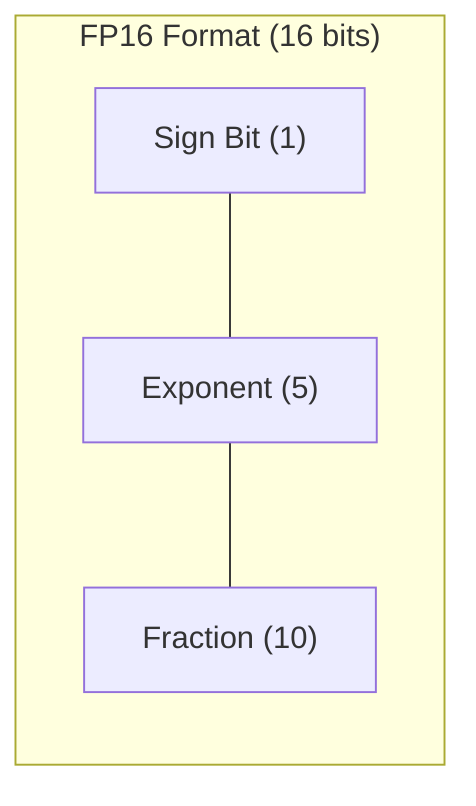
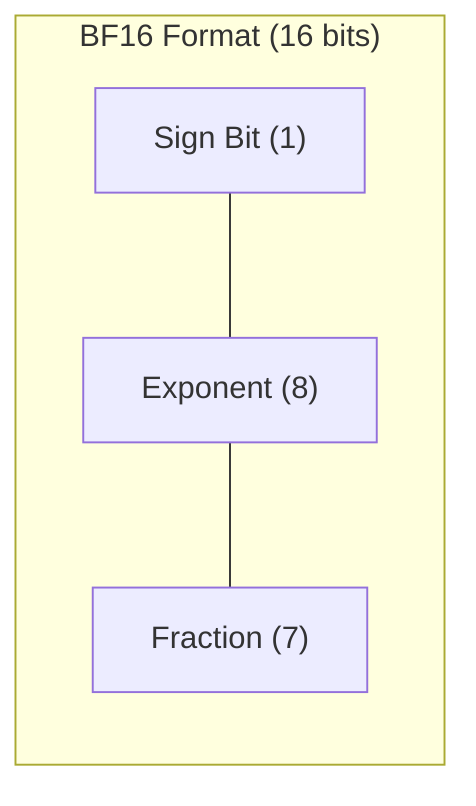
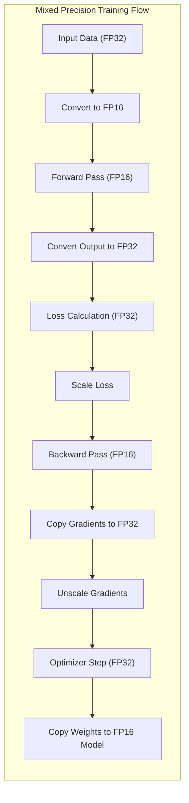
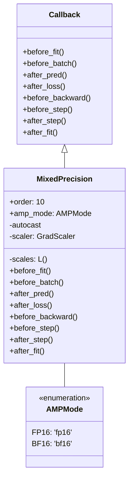
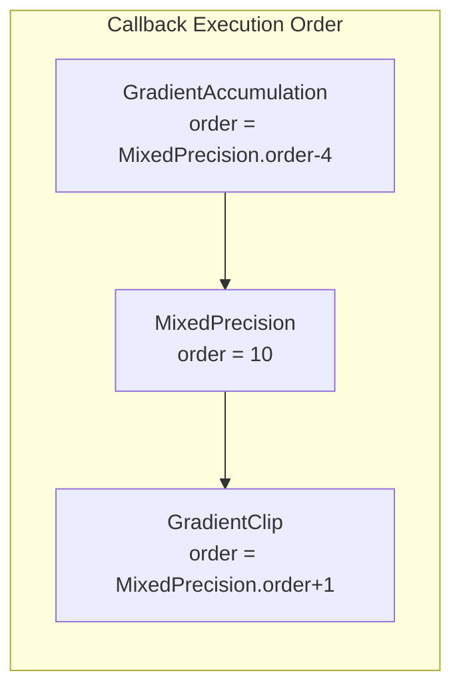
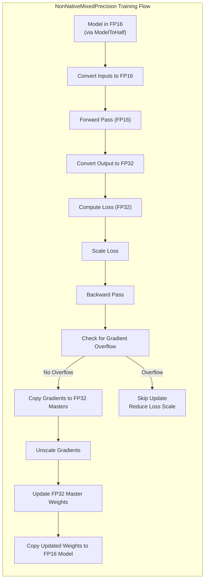

<!-- source: DeepWiki mcp.deepwiki.com · repo fastai/fastai · page 4.2 Mixed Precision Training · fetched 2026-10-21 -->

# Mixed Precision Training

<details>
<summary>Relevant source files</summary>

The following files were used as context for generating this wiki page:

- [fastai/callback/fp16.py](fastai/callback/fp16.py)
- [fastai/callback/training.py](fastai/callback/training.py)
- [nbs/18_callback.fp16.ipynb](nbs/18_callback.fp16.ipynb)
- [nbs/18a_callback.training.ipynb](nbs/18a_callback.training.ipynb)
- [nbs/examples/app_examples.ipynb](nbs/examples/app_examples.ipynb)

</details>


Mixed Precision Training is a technique that uses both 16-bit and 32-bit floating-point representations during model training to reduce memory usage and increase training speed. In fastai, this is implemented as a callback that integrates with PyTorch's Automatic Mixed Precision (AMP) system. This document covers how mixed precision training works, the implementation details in fastai, and how to use it effectively in your training workflows.

For information about distributed training across multiple GPUs, see [Distributed Training](#4.1).

## Why Use Mixed Precision Training?

Mixed precision training offers several benefits:

1. **Reduced Memory Usage**: Using 16-bit floats (FP16 or BF16) for certain operations can cut memory requirements by up to 50% compared to 32-bit floats (FP32).
2. **Faster Training**: Modern GPUs (especially NVIDIA's Volta, Turing, and Ampere architectures) have specialized hardware for accelerating 16-bit operations.
3. **Larger Batch Sizes**: The memory savings allow for larger batch sizes, which can improve training efficiency.

Sources: [nbs/18_callback.fp16.ipynb:85-97]()

## Understanding Precision Formats

### FP16 (Half Precision)

FP16 uses 16 bits to represent a floating-point number:
- 1 sign bit
- 5 exponent bits
- 10 fraction bits

This format has a smaller range (roughly 2e-14 to 2e15) and lower precision than FP32.



Sources: [nbs/18_callback.fp16.ipynb:110-114]()

### BF16 (Brain Floating Point)

BF16 is another 16-bit format developed by Google Brain:
- 1 sign bit
- 8 exponent bits (same as FP32)
- 7 fraction bits

It has the same range as FP32 but with less precision, which simplifies mixed precision implementation.



Sources: [nbs/18_callback.fp16.ipynb:188-201]()

## Challenges with Half Precision

Training directly in FP16 introduces three main challenges:

1. **Weight Update Imprecision**: When weights and gradients differ by orders of magnitude, updates can be lost due to precision limitations (e.g., 1 + 0.0001 = 1 in FP16).

2. **Gradient Underflow**: Gradients can become too small to be represented in FP16 and get replaced by zero.

3. **Activation/Loss Overflow**: Values can exceed the representable range in FP16, leading to NaN or infinity values.

Sources: [nbs/18_callback.fp16.ipynb:103-123]()

## Mixed Precision Training Approach

To address these challenges, mixed precision training uses a combination of FP16 and FP32 operations:



The key steps are:
1. Forward pass in FP16 for speed
2. Loss calculation in FP32 for stability
3. Gradient scaling to prevent underflow
4. Weight updates in FP32 for precision
5. Keep BatchNorm layers in FP32 for stability

Sources: [nbs/18_callback.fp16.ipynb:129-165]()

### Dynamic Loss Scaling

To address gradient underflow without manual tuning, fastai implements dynamic loss scaling:

1. Start with a high loss scale (e.g., 2^24)
2. If gradients overflow, reduce the scale by a factor (typically 2)
3. If training proceeds without overflow for a set number of iterations, increase the scale

This automatically finds the optimal loss scale for your model.

Sources: [nbs/18_callback.fp16.ipynb:171-182]()

## Implementation in fastai

### MixedPrecision Callback

The mixed precision functionality is primarily implemented through the `MixedPrecision` callback, which integrates with PyTorch's AMP system:



The `MixedPrecision` callback:
- Handles both FP16 and BF16 training modes via the `AMPMode` enum
- Uses PyTorch's `autocast` context manager to automatically cast operations to the appropriate precision
- Uses `GradScaler` to handle loss scaling for FP16 (not needed for BF16)
- Integrates with the fastai callback system at every stage of training

Sources: [fastai/callback/fp16.py:24-69]()

### Training Flow with Mixed Precision

The callback hooks into different stages of the training loop:

1. **before_fit**: Initialize `autocast` context and `GradScaler`
2. **before_batch**: Enter the `autocast` context for mixed precision operations
3. **after_pred**: Convert predictions back to FP32
4. **after_loss**: Exit the `autocast` context
5. **before_backward**: Scale the gradients to prevent underflow
6. **before_step**: Check for gradient overflow and update optimizer
7. **after_step**: Update the scaler based on whether gradients overflowed
8. **after_fit**: Clean up resources

Sources: [fastai/callback/fp16.py:36-69]()

### Extension Methods for Learner

For convenience, fastai adds extension methods to the `Learner` class:

```python
# Convert a learner to use FP16 mixed precision
learner.to_fp16()

# Convert a learner to use BF16 mixed precision
learner.to_bf16()

# Return to standard FP32 training
learner.to_fp32()
```

Sources: [fastai/callback/fp16.py:72-88]()

## Using Mixed Precision in fastai

### Basic Usage

To enable mixed precision training in fastai, simply call one of the extension methods on your learner:

```python
# Create a standard learner
learn = vision_learner(dls, 'resnet34')

# Enable FP16 mixed precision (most common)
learn = learn.to_fp16()

# Train as usual
learn.fit_one_cycle(10, 1e-3)
```

### BF16 vs FP16

Choose between FP16 and BF16 based on your hardware and needs:

| Format | Hardware Requirements | Benefits | Use When |
|--------|-------------------------|----------|----------|
| FP16   | NVIDIA Pascal+ GPUs     | Widest hardware support | Default choice for most NVIDIA GPUs |
| BF16   | NVIDIA Ampere+ or specialized hardware | No need for loss scaling, better numerical stability | Training very deep models or working with large dynamic ranges |

BF16 is particularly useful for avoiding overflow issues in certain models but requires newer hardware.

Sources: [nbs/18_callback.fp16.ipynb:188-201](), [fastai/callback/fp16.py:79-82]()

## Integration with Other Training Callbacks

Mixed precision training works with other fastai callbacks, but order matters for some:



Key interactions include:

1. **GradientAccumulation**: Must run before `MixedPrecision` to properly accumulate gradients
2. **GradientClip**: Should run after `MixedPrecision` to clip the unscaled gradients

Example with multiple callbacks:

```python
learn = vision_learner(dls, 'resnet34')
learn = learn.to_fp16()
learn.fit_one_cycle(10, 1e-3, cbs=[
    GradientAccumulation(n_acc=4),  # Accumulate over 4 batches
    GradientClip(max_norm=1.0)      # Clip gradients to norm 1.0
])
```

Sources: [fastai/callback/training.py:24-42]()

## Legacy Implementation: NonNativeMixedPrecision

Fastai also includes a legacy implementation that manually handles the mixed precision process, useful for educational purposes or very specific use cases:



The main components are:
- `NonNativeMixedPrecision`: Manages the detailed mixed precision workflow
- `ModelToHalf`: Converts the model to FP16 at the start of training
- Manual management of FP32 master copies of parameters

This implementation is more complex but shows the inner workings of mixed precision training.

Sources: [fastai/callback/fp16.py:166-239]()

## Troubleshooting Mixed Precision

Common issues with mixed precision training include:

1. **Training Divergence**: May indicate loss scaling issues or model architecture incompatibilities
   - Solution: Try a lower learning rate or use BF16 if hardware supports it

2. **Slower Performance**: Not all operations benefit from mixed precision
   - Solution: Profile your model to identify bottlenecks

3. **NaN Losses**: May indicate numerical overflow issues
   - Solution: Use gradient clipping or switch to BF16

4. **GPU Compatibility**: Not all GPUs support mixed precision equally
   - Solution: Check hardware requirements (FP16 works on Pascal+ GPUs, BF16 on Ampere+)

Sources: [nbs/18_callback.fp16.ipynb:91-97](), [fastai/callback/fp16.py:37-39]()

## Conclusion

Mixed precision training is a powerful technique for accelerating deep learning while reducing memory usage. Fastai's implementation makes it accessible with a simple API call while handling the complex details automatically. For most users, simply calling `learn.to_fp16()` is all that's needed to realize these benefits.

Always consider the numerical stability needs of your specific model when choosing between FP16, BF16, or standard FP32 training.

---

