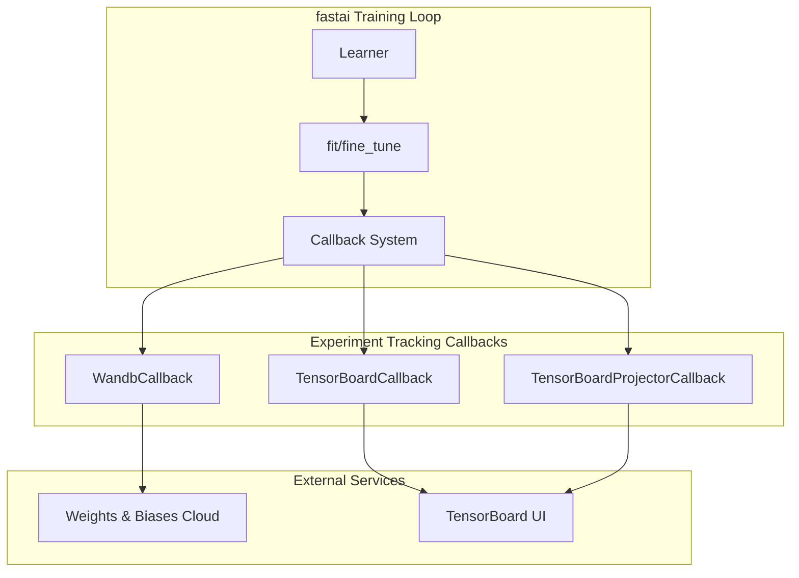
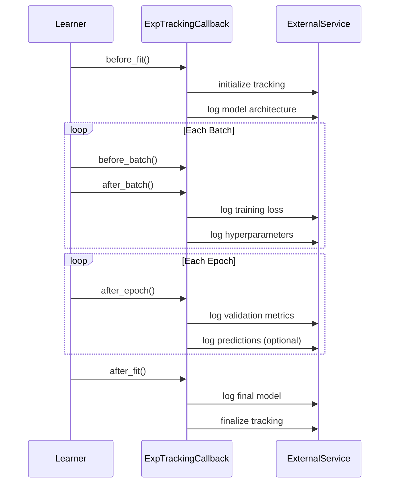
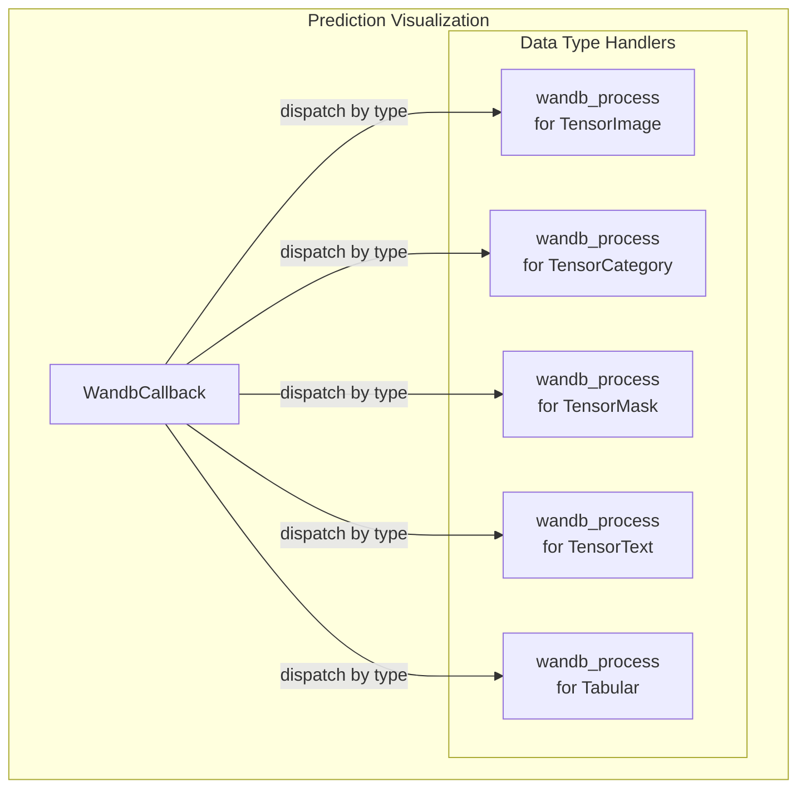
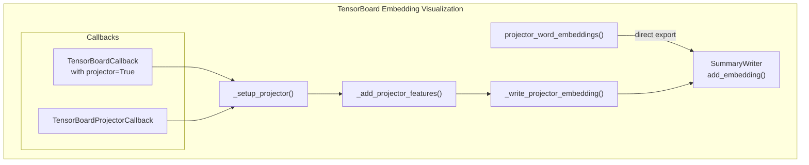
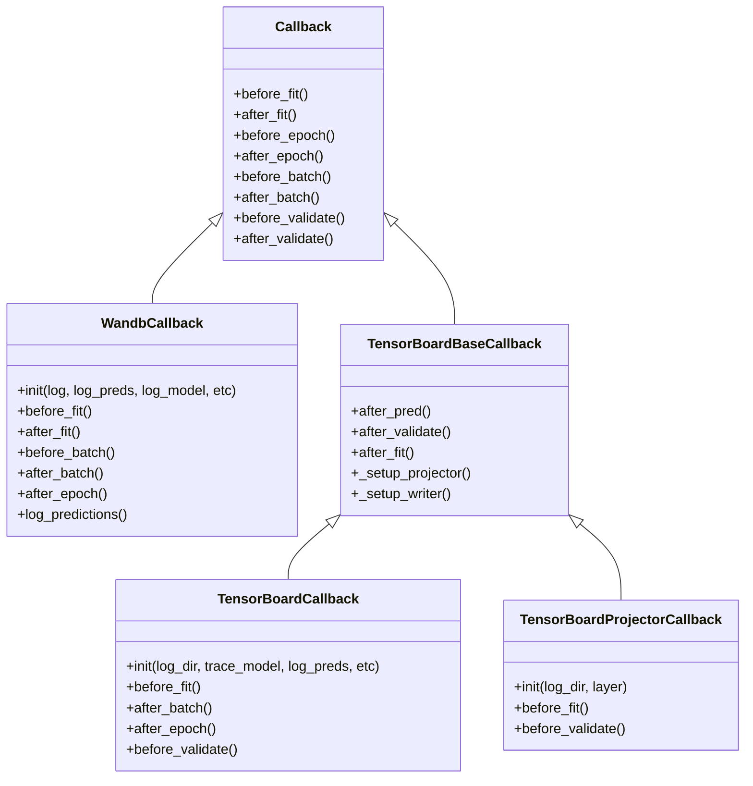

<!-- source: DeepWiki mcp.deepwiki.com · repo fastai/fastai · page 4.3 Experiment Tracking · fetched 2026-10-21 -->

# Experiment Tracking

<details>
<summary>Relevant source files</summary>

The following files were used as context for generating this wiki page:

- [fastai/callback/tensorboard.py](fastai/callback/tensorboard.py)
- [fastai/callback/wandb.py](fastai/callback/wandb.py)
- [nbs/70_callback.wandb.ipynb](nbs/70_callback.wandb.ipynb)

</details>


## Purpose and Overview

This page documents fastai's experiment tracking capabilities - a system that enables monitoring, visualizing, and comparing training metrics, hyperparameters, model predictions, and artifacts. The experiment tracking functionality is implemented as callbacks that integrate with external visualization tools, primarily Weights & Biases (W&B) and TensorBoard.

Experiment tracking in fastai allows you to:
- Log metrics, losses, and hyperparameters during training
- Visualize model predictions on sample data
- Track datasets and model artifacts
- Analyze and compare multiple experiments
- Share results with collaborators

## Architecture and Integration

Experiment tracking in fastai is implemented through the callback system, with specialized callbacks for each supported platform.



Sources: [fastai/callback/wandb.py:21-160](), [fastai/callback/tensorboard.py:20-83]()

The experiment tracking callbacks hook into different phases of the training loop through the callback event system:



Sources: [fastai/callback/wandb.py:52-159](), [fastai/callback/tensorboard.py:54-82]()

## Weights & Biases Integration

Weights & Biases (W&B) is a popular experiment tracking tool that provides a comprehensive platform for tracking, visualizing, and comparing machine learning experiments.

### Setup and Configuration

To use W&B with fastai:

1. Install the W&B package: `pip install wandb`
2. Create a W&B account and login: `wandb login`
3. Initialize W&B before training: `wandb.init()`
4. Add the `WandbCallback` to your learner or fit call

```python
from fastai.callback.wandb import *
import wandb

# Initialize wandb
wandb.init(project="my_project")

# Add callback to learner
learn = vision_learner(dls, resnet34, cbs=WandbCallback())

# Or add it during training
learn.fit_one_cycle(10, cbs=WandbCallback())
```

### WandbCallback Features

The `WandbCallback` provides extensive logging capabilities:

| Feature | Description | Parameter |
|---------|-------------|-----------|
| Model architecture | Log model topology, optionally with gradients and weights | `log` |
| Metrics & losses | Log training and validation metrics | (automatic) |
| Hyperparameters | Log learning rates, weight decay, momentum, etc. | (automatic) |
| Predictions | Log model predictions on sample data | `log_preds` |
| Model checkpoints | Save model as W&B artifacts | `log_model` |
| Datasets | Save datasets as W&B artifacts | `log_dataset` |

Sources: [fastai/callback/wandb.py:21-160]()

### Prediction Visualization

The `WandbCallback` can automatically visualize model predictions for different data types:



Sources: [fastai/callback/wandb.py:261-321]()

### Manual Artifact Logging

In addition to automatic logging through the callback, you can manually log datasets and models using dedicated functions:

```python
# Log a dataset
log_dataset(path='path/to/dataset', name='my_dataset')

# Log a model
log_model(path='path/to/model.pth', name='my_model')
```

Sources: [fastai/callback/wandb.py:227-258]()

## TensorBoard Integration

TensorBoard is a visualization toolkit that comes with TensorFlow but can be used with PyTorch models through the `torch.utils.tensorboard` package.

### Setup and Configuration

To use TensorBoard with fastai:

1. Install the required packages: `pip install tensorboard`
2. Add the `TensorBoardCallback` to your learner or fit call

```python
from fastai.callback.tensorboard import *

# Add callback to learner
learn = vision_learner(dls, resnet34, cbs=TensorBoardCallback())

# Or add it during training
learn.fit_one_cycle(10, cbs=TensorBoardCallback())
```

### TensorBoardCallback Features

The `TensorBoardCallback` provides several logging capabilities:

| Feature | Description | Parameter |
|---------|-------------|-----------|
| Model architecture | Log model computational graph | `trace_model` |
| Metrics & losses | Log training and validation metrics | (automatic) |
| Hyperparameters | Log learning rates, weight decay, momentum, etc. | (automatic) |
| Predictions | Log model predictions on sample data | `log_preds` |
| Embeddings | Visualize feature embeddings with projector | `projector` |

Sources: [fastai/callback/tensorboard.py:48-82]()

### Embedding Visualization

The TensorBoard Projector is a powerful tool for visualizing high-dimensional embeddings. fastai provides two ways to use it:

1. Through the `TensorBoardCallback` with `projector=True`
2. Through the `TensorBoardProjectorCallback` for dedicated embedding export
3. Using the `projector_word_embeddings` function for language models



Sources: [fastai/callback/tensorboard.py:85-148]()

## Callback Implementation Details

Both experiment tracking callbacks extend the fastai callback system and hook into specific events in the training loop to capture and log data at the appropriate times.



Sources: [fastai/callback/wandb.py:21-160](), [fastai/callback/tensorboard.py:20-97]()

## Usage Examples

### Weights & Biases Example

```python
import wandb
from fastai.vision.all import *
from fastai.callback.wandb import *

# Initialize wandb
wandb.init(project="my_project", name="experiment1")

# Create learner with WandbCallback
learn = vision_learner(
    dls, 
    resnet34, 
    metrics=accuracy,
    cbs=WandbCallback(
        log="all",               # Log model topology, gradients, and weights
        log_preds=True,          # Log predictions
        log_preds_every_epoch=True,  # Log predictions every epoch
        log_model=True,          # Save model as artifact
        log_dataset=True,        # Save dataset as artifact
    )
)

# Train model
learn.fit_one_cycle(10)

# Close wandb
wandb.finish()
```

### TensorBoard Example

```python
from fastai.vision.all import *
from fastai.callback.tensorboard import *

# Create learner with TensorBoardCallback
learn = vision_learner(
    dls, 
    resnet34, 
    metrics=accuracy,
    cbs=TensorBoardCallback(
        trace_model=True,    # Log model graph
        log_preds=True,      # Log predictions
        projector=True,      # Use TensorBoard Projector
    )
)

# Train model
learn.fit_one_cycle(10)
```

### Word Embeddings Visualization

```python
from fastai.text.all import *
from fastai.callback.tensorboard import *

# Create language model learner
learn = text_classifier_learner(dls, AWD_LSTM)

# Train model
learn.fit_one_cycle(3)

# Export word embeddings for visualization
projector_word_embeddings(
    learn=learn,
    log_dir="./logs/word_embeddings",
    limit=1000  # Only export first 1000 words
)
```

## Comparison of Tracking Options

| Feature | Weights & Biases | TensorBoard |
|---------|-----------------|-------------|
| Setup | Requires account, API key | No account needed |
| Hosting | Cloud-based | Local only (file system) |
| Team collaboration | Built-in | Manual file sharing |
| UI | Modern web interface | Local web server |
| Model artifacts | Yes | No |
| Dataset artifacts | Yes | No |
| Hyperparameter tuning | Yes (Sweeps) | No |
| Learning curve comparison | Yes | Yes |
| Embedding visualization | Tables | Projector |
| Report generation | Yes | No |

## Summary

fastai's experiment tracking system provides seamless integration with both Weights & Biases and TensorBoard, allowing users to monitor and visualize their model training process. The callback-based approach makes it easy to add experiment tracking to any fastai training workflow with minimal code changes.

The choice between W&B and TensorBoard depends on specific requirements:
- For team collaboration, cloud storage, and comprehensive experiment management, Weights & Biases is recommended
- For local development and simpler visualization needs, TensorBoard may be sufficient

Both options provide valuable insights into the training process and help with experiment comparison, hyperparameter tuning, and result sharing.

---

