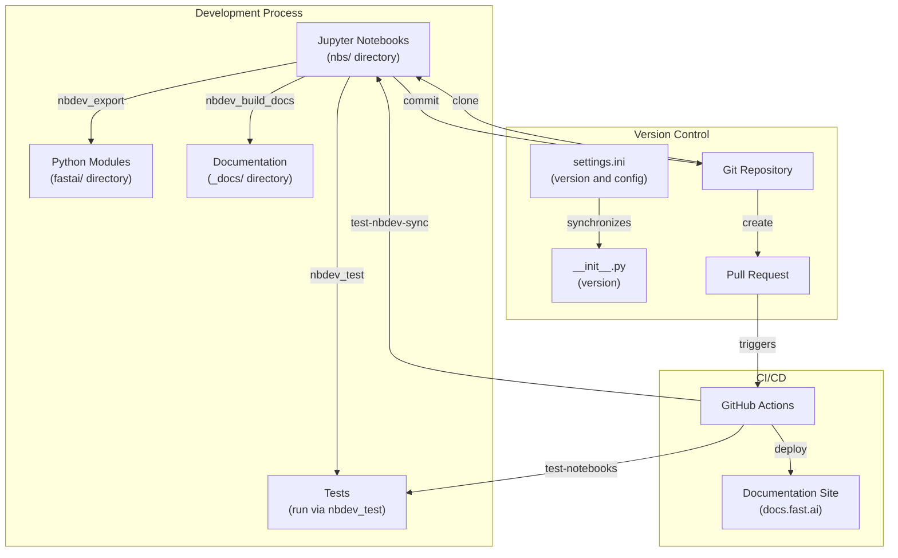
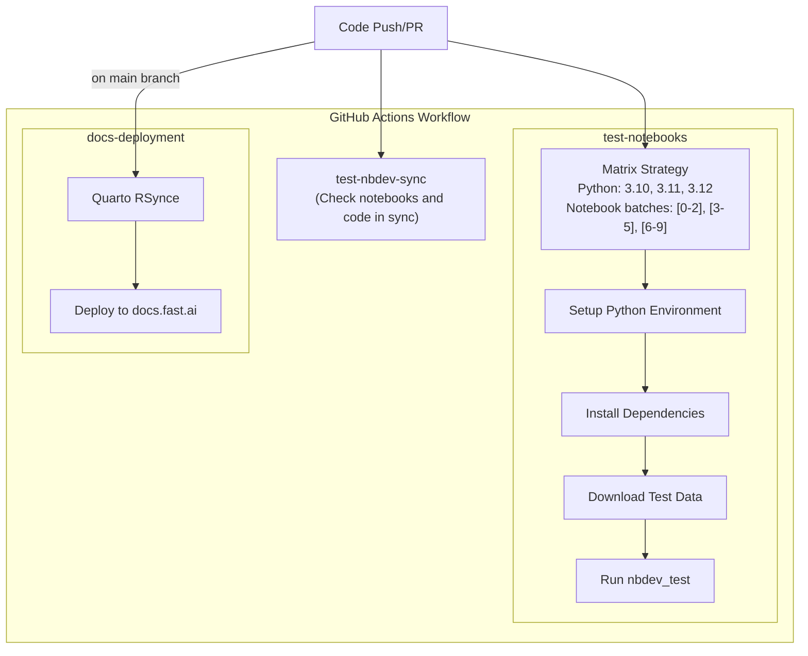

<!-- source: DeepWiki mcp.deepwiki.com · repo fastai/fastai · page 5 Development and Contribution · fetched 2026-10-21 -->

# Development and Contribution

<details>
<summary>Relevant source files</summary>

The following files were used as context for generating this wiki page:

- [.github/workflows/docs.yml](.github/workflows/docs.yml)
- [.github/workflows/main.yml](.github/workflows/main.yml)
- [CHANGELOG.md](CHANGELOG.md)
- [fastai/__init__.py](fastai/__init__.py)
- [nbs/examples/.gitignore](nbs/examples/.gitignore)
- [nbs/examples/migrating_catalyst.py](nbs/examples/migrating_catalyst.py)
- [nbs/examples/migrating_ignite.py](nbs/examples/migrating_ignite.py)
- [nbs/examples/migrating_lightning.py](nbs/examples/migrating_lightning.py)
- [settings.ini](settings.ini)

</details>


This document provides information for developers who want to contribute to the fastai library. It explains the development environment, workflow, contribution process, and CI/CD infrastructure used in the fastai project. For specific information about continuous integration and testing, see [CI/CD and Testing](#5.1). For details on configuration management, see [Configuration and Version Management](#5.2).

## Development Philosophy

The fastai library follows a "notebook-first" development approach using the nbdev tool. Code, documentation, and tests are all developed within Jupyter notebooks, which are then exported to Python modules. This ensures that documentation and code are kept in sync, and that examples are tested as part of the development process.

### Notebook-First Development Workflow



Sources: [settings.ini:23-44](), [.github/workflows/main.yml:18-70](), [.github/workflows/docs.yml:11-22]()

## Setting Up the Development Environment

### Prerequisites

To contribute to fastai, you need:

- Python 3.10 or higher
- Git
- Jupyter notebook environment
- nbdev

### Installation for Development

1. Clone the repository:
   ```bash
   git clone https://github.com/fastai/fastai.git
   cd fastai
   ```

2. Install the development version with dependencies:
   ```bash
   pip install -e ".[dev]"
   ```

### Development Dependencies

The development requirements include:

| Category | Packages |
|----------|----------|
| **ML Frameworks** | pytorch-ignite, transformers, lightning, catalyst |
| **Visualization** | tensorboard, wandb, comet_ml |
| **Image Processing** | albumentations, opencv-python, kornia |
| **Medical Imaging** | pydicom |
| **Web Tools** | flask, flask_compress |
| **Performance** | accelerate, ninja |
| **Model Support** | timm, captum |

Sources: [settings.ini:15-21]()

## Development Workflow

### Writing Code in Notebooks

All code in fastai is developed within Jupyter notebooks located in the `nbs/` directory. These notebooks contain:

- Code implementations
- Documentation and examples
- Tests
- Additional explanatory material

### Exporting Code to Python Modules

After developing in notebooks, code is exported to Python modules in the `fastai/` directory using nbdev:

```bash
nbdev_export
```

### Testing Your Changes

Run tests using nbdev's test command:

```bash
nbdev_test
```

For testing specific notebooks, you can use pattern matching:

```bash
nbdev_test --file_re "01_.*"
```

### Building Documentation

Documentation is generated from the notebooks:

```bash
nbdev_build_docs
```

Sources: [settings.ini:23-29](), [.github/workflows/main.yml:69-70]()

## Continuous Integration

fastai uses GitHub Actions for continuous integration. The CI pipeline is triggered on pull requests and commits to the main branch.

### CI/CD Pipeline Structure



The CI process:

1. Checks that notebooks and Python modules are in sync
2. Tests notebooks with different Python versions (3.10, 3.11, 3.12)
3. Tests are split across notebook batches for parallel execution
4. Deploys documentation when changes are merged to the main branch

Sources: [.github/workflows/main.yml:19-70](), [.github/workflows/docs.yml:12-22]()

## Contributing to fastai

### Contribution Process

1. **Fork the Repository**: Create your own fork of the fastai repository
2. **Set Up Development Environment**: Install dependencies as described above
3. **Create a Branch**: Create a branch for your changes
4. **Make Changes**: Edit notebooks in the `nbs/` directory
5. **Run Tests**: Ensure tests pass with `nbdev_test`
6. **Export Code**: Run `nbdev_export` to update Python modules
7. **Create Pull Request**: Submit your changes for review

### Code Style and Guidelines

- Follow the existing code style in the notebooks
- Include documentation for new features
- Add tests for new functionality
- Update the CHANGELOG.md for significant changes

### Versioning Conventions

fastai uses semantic versioning (MAJOR.MINOR.PATCH):

- Version is specified in `settings.ini` and `fastai/__init__.py`
- Breaking changes increment the MAJOR or MINOR version
- Bug fixes increment the PATCH version
- Breaking changes are clearly marked in the CHANGELOG.md

Sources: [settings.ini:6](), [fastai/__init__.py:1](), [CHANGELOG.md:1-30]()

## Configuration System

fastai uses a central `settings.ini` file for all configuration aspects of the project:

| Section | Configuration |
|---------|---------------|
| Library Info | Name, version, author, description |
| Dependencies | Requirements, min Python version |
| Development | Dev requirements, test flags |
| Paths | Notebooks, docs, library paths |
| Build Settings | Documentation settings, nbdev options |

The configuration is used by:
- Setup tools for package building
- nbdev for notebook processing
- CI/CD for testing and deployment

Sources: [settings.ini:1-45]()

## Integration with Other Frameworks

fastai is designed to work well with other ML frameworks. The `DataLoader` class is a drop-in replacement for PyTorch's DataLoader, making it easy to integrate with:

- PyTorch Lightning
- Catalyst
- PyTorch Ignite

Examples of integration can be found in the `nbs/examples/` directory.

Sources: [nbs/examples/migrating_catalyst.py:1-36](), [nbs/examples/migrating_lightning.py:1-44](), [nbs/examples/migrating_ignite.py:1-93]()

## Debugging and Troubleshooting

### Common Issues

1. **Notebook-Code Sync Issues**: If CI fails with nbdev sync errors, run `nbdev_export` locally
2. **Test Failures**: Run the specific failing test locally with `nbdev_test --file_re "pattern"`
3. **Import Errors**: Ensure all dependencies are installed with `pip install -e ".[dev]"`

### Getting Help

If you encounter issues while contributing to fastai:
- Check existing GitHub issues
- Join the fastai forums for community support
- Refer to the documentation for more detailed guidance

## Release Process

The release process for fastai:

1. Update version in `settings.ini` and `fastai/__init__.py`
2. Update `CHANGELOG.md` with release notes
3. Tag the commit with the version number
4. Build and upload the package to PyPI
5. Deploy updated documentation

Sources: [settings.ini:6](), [fastai/__init__.py:1](), [CHANGELOG.md:5-10]()

## Conclusion

Contributing to fastai follows a notebook-first development approach using nbdev. By understanding the workflow and setup described in this document, you can effectively contribute to the library. Remember to follow the existing patterns and code style, write tests for your changes, and keep documentation up to date.

---

