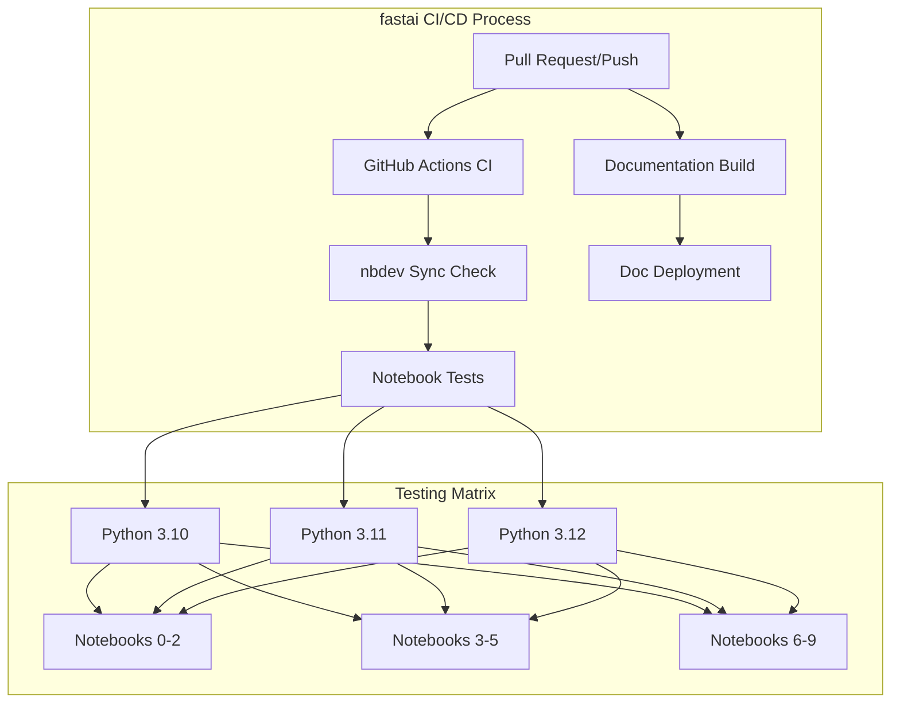
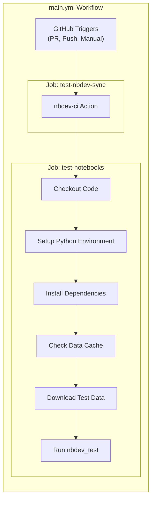
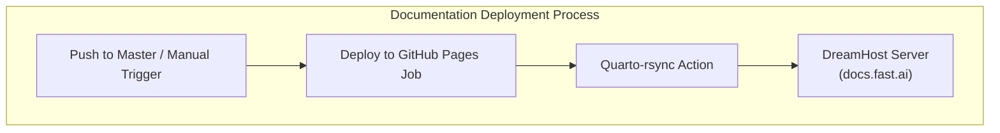
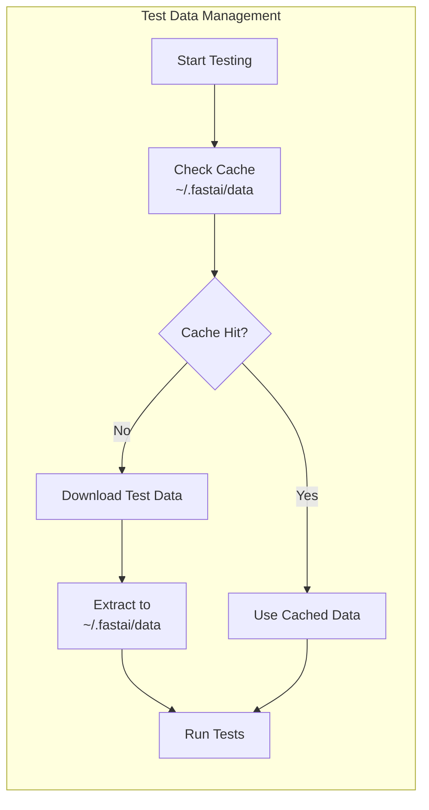
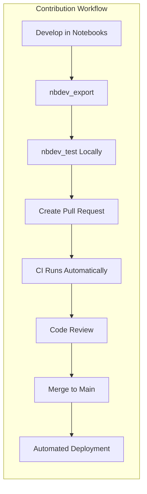

<!-- source: DeepWiki mcp.deepwiki.com · repo fastai/fastai · page 5.1 CI/CD and Testing · fetched 2026-10-21 -->

# CI/CD and Testing

<details>
<summary>Relevant source files</summary>

The following files were used as context for generating this wiki page:

- [.github/workflows/docs.yml](.github/workflows/docs.yml)
- [.github/workflows/main.yml](.github/workflows/main.yml)
- [nbs/examples/.gitignore](nbs/examples/.gitignore)
- [nbs/examples/migrating_catalyst.py](nbs/examples/migrating_catalyst.py)
- [nbs/examples/migrating_ignite.py](nbs/examples/migrating_ignite.py)
- [nbs/examples/migrating_lightning.py](nbs/examples/migrating_lightning.py)

</details>


This page documents the Continuous Integration, Continuous Deployment (CI/CD), and testing infrastructure for the fastai library. It covers the automated testing systems, test organization, and deployment processes used to maintain code quality and reliability. For information about how to contribute to the codebase, see [Development and Contribution](#5).

## Overview

The fastai library uses GitHub Actions for both continuous integration and continuous deployment. The CI/CD infrastructure serves several key purposes:

1. Ensuring code quality and preventing regressions
2. Validating notebook-to-code synchronization via nbdev
3. Testing across multiple Python versions (3.10, 3.11, 3.12)
4. Automated documentation deployment



Sources: [.github/workflows/main.yml:1-71](), [.github/workflows/docs.yml:1-23]()

## Continuous Integration System

### Main CI Workflow

The main CI workflow is defined in the GitHub Actions configuration and is triggered by:
- Pull requests
- Pushes to the main branch
- Manual triggers from the Actions tab



Sources: [.github/workflows/main.yml:1-71]()

### Workflow Components

#### 1. nbdev Synchronization Check

The `test-nbdev-sync` job ensures that the Python modules are in sync with their source notebooks. This is critical for fastai, which uses a notebook-first development approach with nbdev.

```
test-nbdev-sync:
  runs-on: ubuntu-latest
  steps:
    - uses: fastai/workflows/nbdev-ci@master
      with:
        skip_test: true
```

Sources: [.github/workflows/main.yml:19-24]()

#### 2. Notebook Testing

The notebook testing job runs after the nbdev synchronization check and:
- Runs on multiple Python versions (3.10, 3.11, 3.12)
- Splits tests into batches to improve parallelization
- Caches test data to avoid re-downloading for each run

The testing process involves setting up the Python environment, installing dependencies, ensuring test data is available, and running the tests on notebook files.

| Test Matrix Parameter | Values |
|-----------------------|--------|
| Python versions | 3.10, 3.11, 3.12 |
| Notebook decimal groups | [0-2], [3-5], [6-9] |
| Notebook unit groups | [0-2], [3-5], [6-9] |

Sources: [.github/workflows/main.yml:26-70]()

## Documentation Deployment

The documentation deployment workflow is triggered on pushes to the master branch or manually. It uses Quarto for documentation generation and rsync to deploy to the docs.fast.ai website.



Sources: [.github/workflows/docs.yml:1-23]()

## Testing Approach

### Notebook-Based Testing

Fastai employs a notebook-first development approach where:
1. Development is primarily done in Jupyter notebooks (`nbs/` directory)
2. Python code is exported from notebooks using nbdev
3. Tests are written within the notebooks themselves
4. The CI system executes these notebooks to validate functionality

### Test Data Management

The CI system uses a caching mechanism to optimize test data management:
1. Test data is cached using GitHub Actions' cache feature
2. If no cache is available, data is downloaded using a script
3. Downloaded data is extracted to the `.fastai/data` directory



Sources: [.github/workflows/main.yml:54-68]()

### Test Parallelization

To improve testing efficiency, the workflow uses a matrix strategy to run tests in parallel:
1. Tests are run with multiple Python versions simultaneously
2. Within each Python version, notebook tests are split into groups based on their numbering
3. Each group runs in a separate job, allowing parallel execution

The test command used is `nbdev_test` with specific file patterns to target particular notebook groups:

```
nbdev_test --flags '' --n_workers 3 --pause 1.0 --file_re "${{matrix.nb_dec}}${{matrix.nb_unit}}.*"
```

Sources: [.github/workflows/main.yml:33-36](), [.github/workflows/main.yml:69-70]()

## Framework Compatibility Testing

Fastai maintains compatibility with other popular deep learning frameworks. Example integrations with frameworks like Catalyst, PyTorch Lightning, and Ignite are included in the `nbs/examples/` directory to demonstrate and test interoperability.

| Framework | Integration Example |
|-----------|---------------------|
| Catalyst | migrating_catalyst.py |
| PyTorch Lightning | migrating_lightning.py |
| Ignite | migrating_ignite.py |

These examples primarily demonstrate the drop-in replacement capabilities of fastai's DataLoader with other frameworks.

Sources: [nbs/examples/migrating_catalyst.py:1-37](), [nbs/examples/migrating_lightning.py:1-45](), [nbs/examples/migrating_ignite.py:1-94]()

## Best Practices for Contributors

When contributing to fastai, developers should be mindful of the testing infrastructure:

1. **Notebook-First Development**: Write code and tests in notebooks following nbdev conventions
2. **Run Tests Locally**: Use `nbdev_test` to validate changes before submitting PRs
3. **Check nbdev Sync**: Ensure notebooks and exported code are in sync with `nbdev_export`
4. **Test Data Consideration**: Be mindful of test data requirements and minimize dependencies on large datasets
5. **Python Version Compatibility**: Ensure code works with all supported Python versions (3.10, 3.11, 3.12)



Sources: [.github/workflows/main.yml:1-71](), [.github/workflows/docs.yml:1-23]()

## Summary

The fastai CI/CD and testing system leverages GitHub Actions, nbdev, and a matrix-based testing approach to ensure code quality across multiple Python versions. The notebook-first development approach is central to both the development and testing process, with automatic synchronization checks ensuring consistency between notebooks and exported code. Automated documentation deployment completes the CI/CD pipeline, ensuring that documentation stays current with code changes.

---

