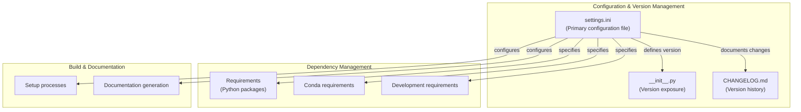
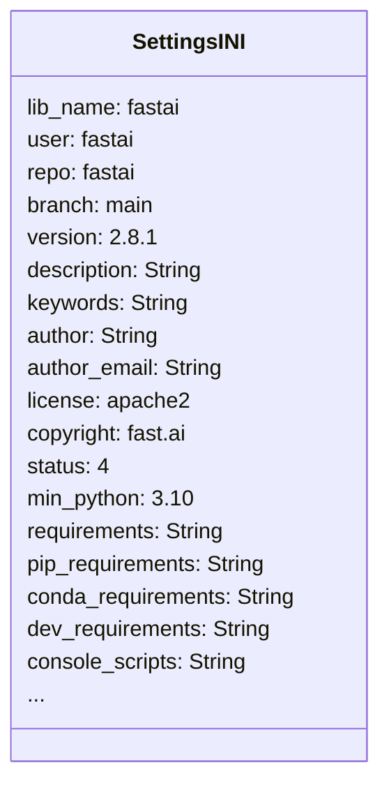
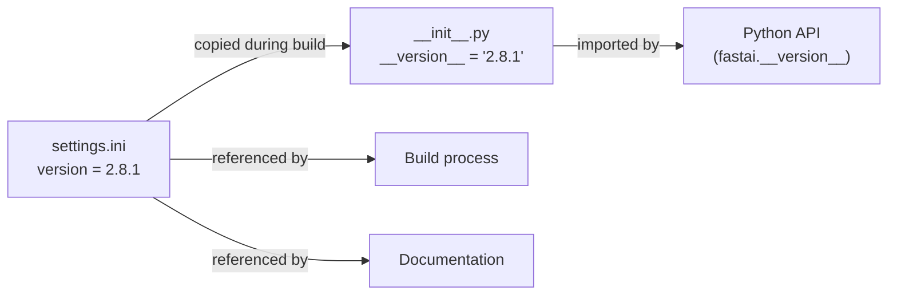
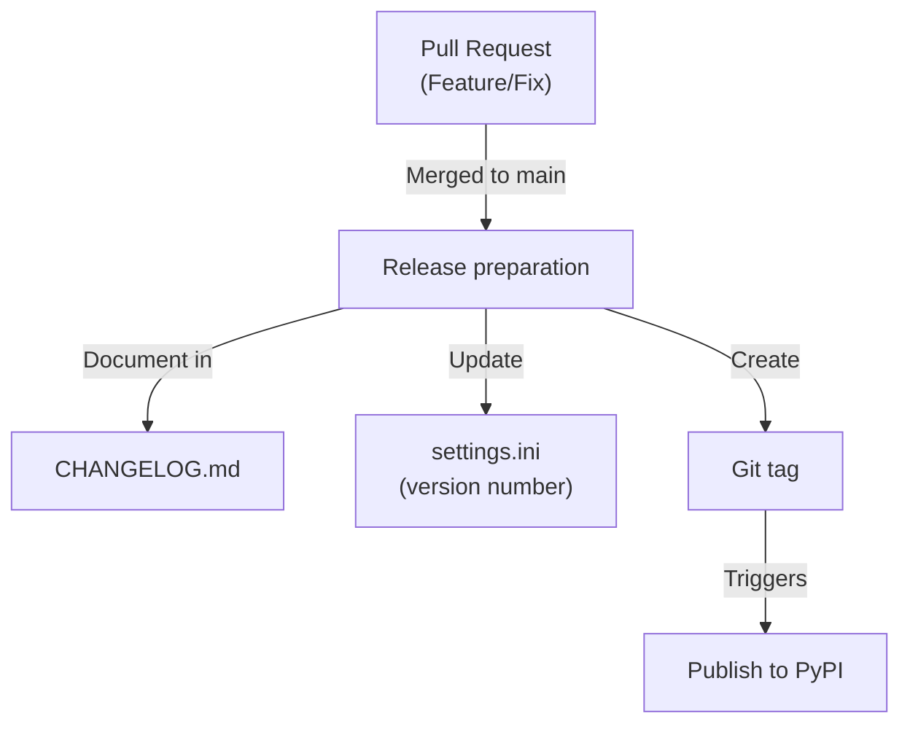
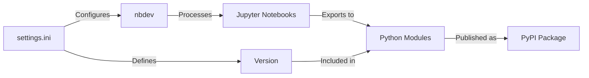

<!-- source: DeepWiki mcp.deepwiki.com · repo fastai/fastai · page 5.2 Configuration and Version Management · fetched 2026-10-21 -->

# Configuration and Version Management

<details>
<summary>Relevant source files</summary>

The following files were used as context for generating this wiki page:

- [CHANGELOG.md](CHANGELOG.md)
- [fastai/__init__.py](fastai/__init__.py)
- [settings.ini](settings.ini)

</details>


This document explains how configuration settings and version information are handled in the fastai library. It covers the centralized configuration system, version tracking mechanisms, and the release management process. For information about continuous integration and testing, see [CI/CD and Testing](#5.1).

## Overview

The fastai library uses a centralized configuration approach with `settings.ini` as the primary configuration file. This file contains essential library metadata, version information, dependencies, and development settings. Version management follows semantic versioning principles and is coordinated between `settings.ini` and `__init__.py`.



Sources: [settings.ini:1-45](), [fastai/__init__.py:1-3](), [CHANGELOG.md:1-703]()

## Configuration System

The configuration system in fastai is built around a single INI file (`settings.ini`) that serves as the central source of truth for library settings.

### Settings.ini Structure

The `settings.ini` file is organized into sections with key-value pairs. The main section is `[DEFAULT]`, which contains all configuration parameters.



Sources: [settings.ini:1-45]()

### Key Configuration Parameters

The `settings.ini` file contains several categories of configuration parameters:

1. **Library Identity**
   - `lib_name`: Name of the library (fastai)
   - `user` and `repo`: GitHub username and repository name
   - `description`: Brief description of the library
   - `keywords`: Keywords for package indexing
   - `author` and `author_email`: Author information
   - `license` and `copyright`: Legal information

2. **Versioning**
   - `version`: Current version of the library (2.8.1)
   - `branch`: Main development branch (main)
   - `status`: Development status (4 - Beta)

3. **Dependencies**
   - `min_python`: Minimum Python version required (3.10)
   - `requirements`: Core package dependencies
   - `pip_requirements`: Additional pip-specific requirements
   - `conda_requirements`: Conda-specific requirements
   - `dev_requirements`: Development dependencies

4. **Development Configuration**
   - `nbs_path`: Path to notebooks
   - `doc_path`: Path to documentation
   - `lib_path`: Path to library source

5. **Documentation and Website**
   - `doc_host`: Documentation hosting URL
   - `doc_baseurl`: Base URL for documentation
   - `git_url`: GitHub repository URL

Sources: [settings.ini:1-45]()

### Configuration Usage

The configuration from `settings.ini` is used in several ways:

1. **Package Setup**: Provides metadata for Python package configuration
2. **Documentation Generation**: Controls how docs are generated and where they're hosted
3. **Development Workflow**: Specifies paths and settings for the development process
4. **Version Exposure**: Defines the version that's exposed through the Python API

Sources: [settings.ini:1-45](), [fastai/__init__.py:1-3]()

## Version Management

Fastai uses semantic versioning (MAJOR.MINOR.PATCH) and maintains version information in multiple places to ensure consistency.

### Version Definition and Exposure



Sources: [settings.ini:6](), [fastai/__init__.py:1-3]()

### Version Numbering Scheme

Fastai follows semantic versioning with three components:

| Component | Purpose | Example |
|-----------|---------|---------|
| MAJOR | Incompatible API changes | 2.x.x |
| MINOR | New features (backwards compatible) | x.8.x |
| PATCH | Bug fixes (backwards compatible) | x.x.1 |

Breaking changes are documented in the CHANGELOG.md file with a dedicated "Breaking changes" section.

Sources: [CHANGELOG.md:5-9](), [CHANGELOG.md:92-96](), [CHANGELOG.md:194-197](), [CHANGELOG.md:400-404]()

## Release Management

### Changelog Management

The `CHANGELOG.md` file tracks all changes between versions, organized by version number in descending order (newest first). Each version section includes:

1. **Version number and header**: e.g., `## 2.8.0`
2. **Categories of changes**:
   - Breaking changes: Incompatible API changes
   - New Features: New functionality
   - Bugs Squashed: Bug fixes

Each entry includes:
- A description of the change
- Pull request/issue references
- Credit to contributors



Sources: [CHANGELOG.md:1-703]()

### Example Changelog Entry Structure

```
## 2.8.0

### Breaking changes

- Use fasttransform (#4074), thanks to @RensDimmendaal


## 2.7.19

### New Features

- Add support for PyTorch 2.6 (#4078), thanks to @warner-benjamin
```

This structured approach makes it easy to track what changed in each version and who contributed to the changes.

Sources: [CHANGELOG.md:5-16]()

## Practical Usage

### Checking Version Information

Users can check the installed fastai version in Python:

```python
import fastai
print(fastai.__version__)  # Outputs the current version, e.g., '2.8.1'
```

### Version Compatibility

The `settings.ini` file defines compatibility requirements:

- **Python Compatibility**: `min_python = 3.10`
- **PyTorch Compatibility**: `pip_requirements = torch>=1.10,<2.7`
- **Additional Dependencies**: Core requirements and their version ranges

When upgrading fastai, users should check the changelog for breaking changes that might affect their code.

Sources: [settings.ini:14-19](), [CHANGELOG.md:1-703]()

### For Developers

For developers contributing to fastai, it's important to:

1. **Update `settings.ini`** when making changes that require version bumps
2. **Document changes** in `CHANGELOG.md` under the appropriate version and category
3. **Follow the established format** for changelog entries, including PR references and contributor credits

Changes to dependencies should be reflected in the appropriate requirements section in `settings.ini`.

Sources: [settings.ini:1-45](), [CHANGELOG.md:1-703]()

## Integration with Development Workflow

Configuration and version management is tightly integrated with fastai's development workflow, which is based on nbdev.



The `put_version_in_init` setting (set to `True`) ensures that the version from `settings.ini` is automatically copied to `__init__.py` during the export process.

Sources: [settings.ini:41](), [fastai/__init__.py:1-3]()

---

