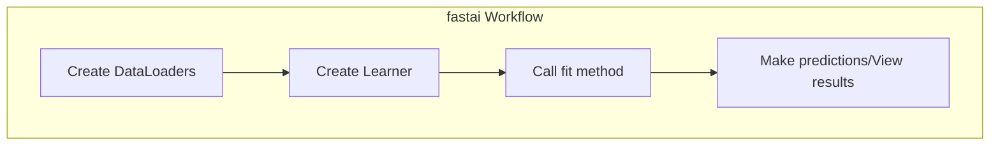
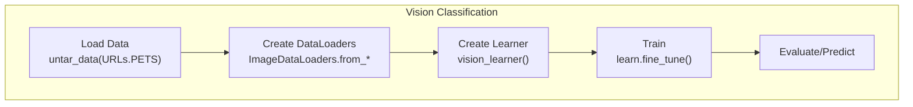
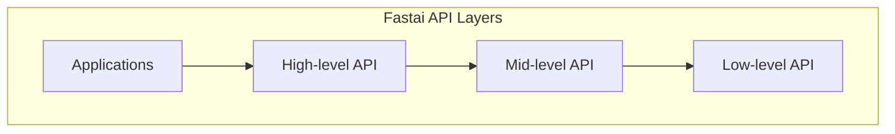
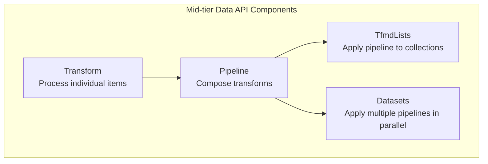
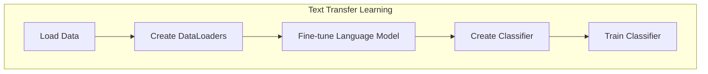
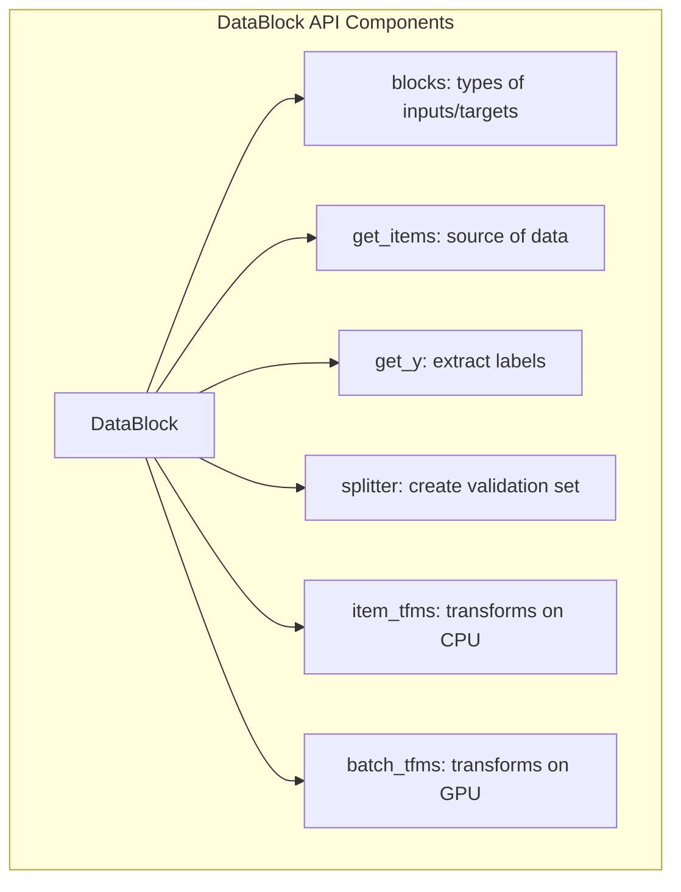
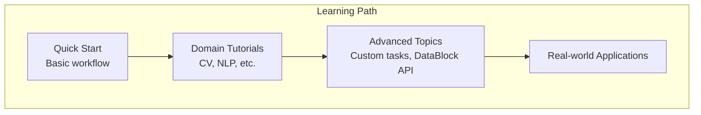

<!-- source: DeepWiki mcp.deepwiki.com · repo fastai/fastai · page 6 Tutorials and Examples · fetched 2026-10-21 -->

# Tutorials and Examples

Relevant source files

The following files were used as context for generating this wiki page:

- [nbs/10_tutorial.pets.ipynb](nbs/10_tutorial.pets.ipynb)
- [nbs/10b_tutorial.albumentations.ipynb](nbs/10b_tutorial.albumentations.ipynb)
- [nbs/22_tutorial.imagenette.ipynb](nbs/22_tutorial.imagenette.ipynb)
- [nbs/23_tutorial.vision.ipynb](nbs/23_tutorial.vision.ipynb)
- [nbs/24_tutorial.siamese.ipynb](nbs/24_tutorial.siamese.ipynb)
- [nbs/38_tutorial.text.ipynb](nbs/38_tutorial.text.ipynb)
- [nbs/39_tutorial.transformers.ipynb](nbs/39_tutorial.transformers.ipynb)
- [nbs/46_tutorial.collab.ipynb](nbs/46_tutorial.collab.ipynb)
- [nbs/50_tutorial.datablock.ipynb](nbs/50_tutorial.datablock.ipynb)
- [nbs/61_tutorial.medical_imaging.ipynb](nbs/61_tutorial.medical_imaging.ipynb)
- [nbs/quick_start.ipynb](nbs/quick_start.ipynb)

This page provides an overview of the tutorials and examples available in the fastai library, designed to help you learn how to use the library for various machine learning tasks. These examples demonstrate practical applications of fastai's API layers across different domains, from basic usage to advanced customization.

## Quick Start

The quick start tutorial provides a concise introduction to fastai's common workflow across different application areas:

1. Create appropriate `DataLoaders`
2. Create a `Learner`
3. Call a fit method
4. Make predictions or view results

This pattern is consistent across all fastai applications, making it easy to transfer knowledge between domains.

Sources: [nbs/quick_start.ipynb]()

## Computer Vision Tutorials

### Basic Classification

The vision tutorial demonstrates how to perform image classification using fastai. It uses the Oxford-IIIT Pet Dataset to show both binary classification (cats vs. dogs) and multi-class classification (37 different breeds).

The tutorial demonstrates:
- Loading and preparing image data
- Creating a vision learner with a pre-trained model
- Fine-tuning the model
- Interpreting results

Sources: [nbs/23_tutorial.vision.ipynb]()

### Training on Imagenette

The Imagenette tutorial explores fastai's layered API in computer vision, showing how to train models on the Imagenette dataset (a subset of ImageNet with 10 classes).

This tutorial demonstrates:
- Different ways to load data (using factory methods, data block API, and mid-level API)
- Creating and training models
- Understanding the layers of the fastai API

Sources: [nbs/22_tutorial.imagenette.ipynb]()

### Mid-tier Data API

The pets tutorial dives deeper into the mid-tier data API, showing how to work with:

- `Transform` for data processing
- `Pipeline` for composing transforms
- `TfmdLists` for applying a pipeline to a collection of items
- `Datasets` for applying multiple pipelines in parallel

This tutorial is valuable for understanding the data processing pipeline in fastai.

Sources: [nbs/10_tutorial.pets.ipynb]()

### Custom Tasks: Siamese Networks

The siamese tutorial shows how to implement a new task type using fastai's mid-level API. It demonstrates:

- Converting PyTorch `Dataset` to fastai `DataLoaders`
- Creating custom `Transform` objects
- Customizing `show_batch` and `show_results` behavior
- Writing a custom `DataBlock`
- Building models from pretrained networks
- Transfer learning with custom splitters

This is an excellent resource for those who need to extend fastai for new types of tasks.

Sources: [nbs/24_tutorial.siamese.ipynb]()

### Medical Imaging

The medical imaging tutorial demonstrates how to build a classifier for chest X-rays, distinguishing between images with and without pneumothorax. It shows:

- Working with DICOM medical image files
- Understanding and processing medical imaging data
- Building and evaluating medical imaging models

This tutorial is particularly useful for those interested in applying deep learning to healthcare.

Sources: [nbs/61_tutorial.medical_imaging.ipynb]()

### Custom Transforms

The custom transforms tutorial shows how to integrate external libraries like Albumentations for data augmentation. It explains:

- Creating custom `Transform` objects
- Wrapping third-party augmentation libraries
- Integrating them into the fastai pipeline

This is helpful for users who want to extend fastai's data augmentation capabilities.

Sources: [nbs/10b_tutorial.albumentations.ipynb]()

## Natural Language Processing Tutorials

### Text Transfer Learning

The text tutorial demonstrates how to apply transfer learning to NLP tasks:

- Fine-tuning a language model
- Using the fine-tuned model for text classification

It uses the IMDb dataset to build a sentiment classifier, showing both the quick approach and the more advanced ULMFit approach.

Sources: [nbs/38_tutorial.text.ipynb]()

### Using Transformers

The transformers tutorial shows how to integrate HuggingFace's transformers library with fastai:

- Importing and using pretrained transformer models
- Creating custom model architectures
- Preparing data for transformer models
- Fine-tuning transformers with fastai

This is particularly valuable for those interested in using state-of-the-art NLP models within the fastai ecosystem.

Sources: [nbs/39_tutorial.transformers.ipynb]()

## Data Block API

The data block tutorial provides a comprehensive guide to fastai's data block API:

This tutorial covers:
- Building DataBlocks from scratch
- Using the API across different applications (vision, text, tabular)
- Debugging data blocks
- Customizing the data pipeline
- Creating complex data processing workflows

The data block API is a core part of fastai, providing a consistent way to handle data across different domains.

Sources: [nbs/50_tutorial.datablock.ipynb]()

## From Tutorials to Applications

The relationship between tutorials and real-world applications in fastai:

These tutorials are designed to build on each other, starting from basic concepts and progressing to more advanced techniques. They cover a range of applications from image classification to natural language processing, making fastai accessible for various machine learning tasks.

Sources: [nbs/quick_start.ipynb](), [nbs/23_tutorial.vision.ipynb](), [nbs/38_tutorial.text.ipynb](), [nbs/50_tutorial.datablock.ipynb](), [nbs/24_tutorial.siamese.ipynb]()