# Page: Overview

# Overview

<details>
<summary>Relevant source files</summary>

The following files were used as context for generating this wiki page:

- [CHANGELOG.md](CHANGELOG.md)
- [README.md](README.md)
- [fastai/__init__.py](fastai/__init__.py)
- [nbs/index.ipynb](nbs/index.ipynb)
- [settings.ini](settings.ini)

</details>


This document provides a comprehensive introduction to the fastai library, its architecture, core components, and design philosophy. Fastai is a deep learning library that simplifies training fast and accurate neural networks using modern best practices while building on the PyTorch ecosystem.

## Purpose and Scope

The fastai library is designed with two primary goals:

1. Provide practitioners with high-level components that can quickly and easily achieve state-of-the-art results in standard deep learning domains
2. Provide researchers with low-level components that can be mixed and matched to build new approaches

Fastai achieves these goals without compromising ease of use, flexibility, or performance through a carefully layered architecture of decoupled abstractions.

For installation instructions, see [Installation and Setup](#1.2).

Sources: [settings.ini:7-8]()), [README.md:69-100]())

## Core Architecture

Fastai is built with a layered architecture where each layer builds upon the functionality provided by lower layers:

### Layered Architecture Diagram

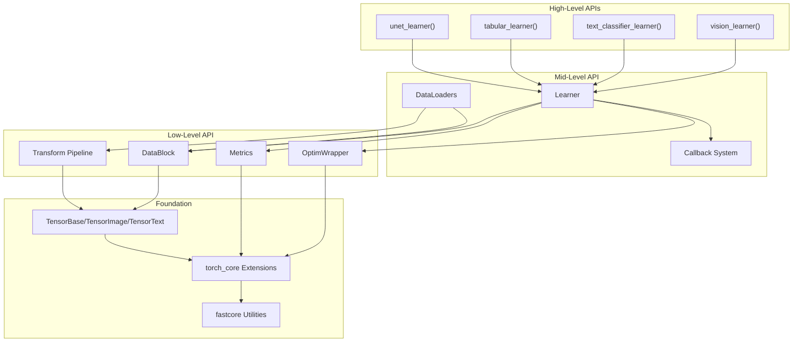

This architecture allows users to operate at different levels of abstraction:
- **High-Level APIs**: Domain-specific functions to create complete training systems with minimal code
- **Mid-Level API**: `Learner` and `DataLoaders` classes that manage training and data pipelines
- **Low-Level API**: Building blocks like `DataBlock`, transforms, and optimizers
- **Foundation**: Extensions to PyTorch and core utilities

Sources: [README.md:92-100]()), [settings.ini:16-21]())

## Data Processing Pipeline

Fastai features a flexible data pipeline that transforms raw data into training-ready batches:

### Data Pipeline Diagram

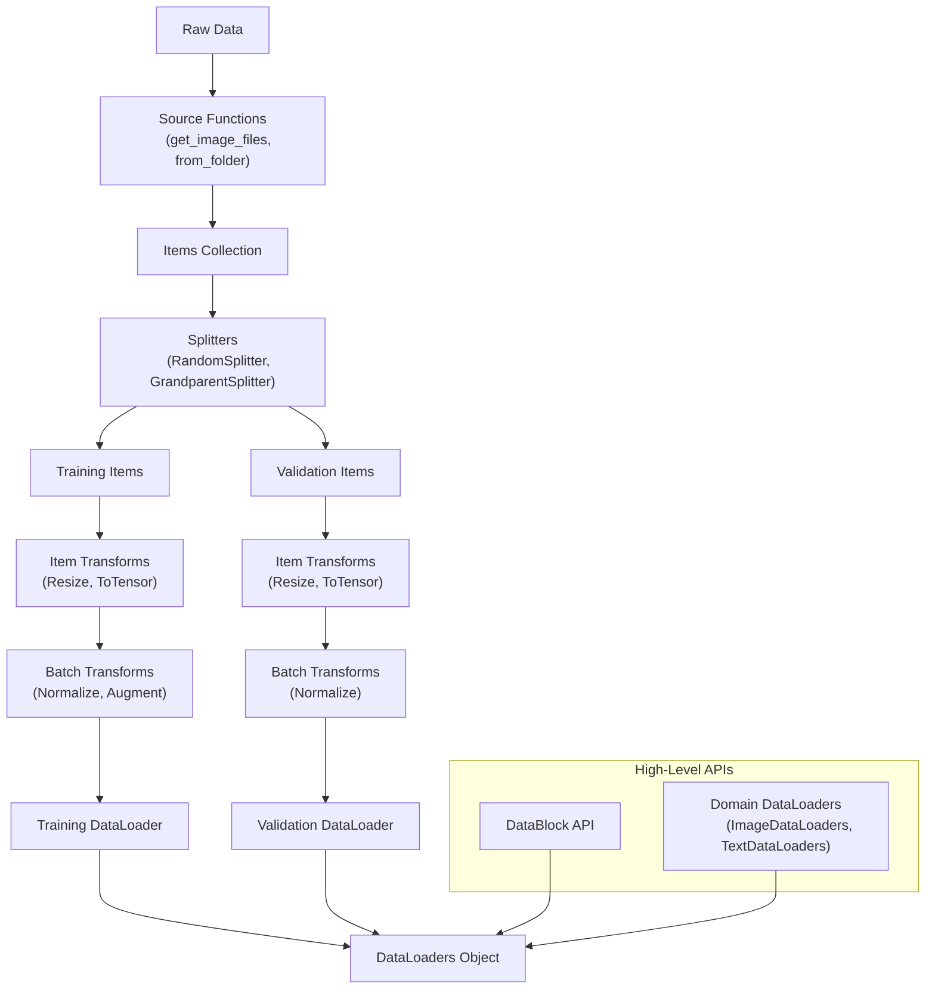

The pipeline consists of:
- **Source functions**: Extract items from files, folders, or other data sources
- **Splitters**: Divide data into training and validation sets
- **Transforms**: Process data at item level (single objects) and batch level (multiple items)
- **DataLoaders**: Efficiently load and batch data for training and validation

This system can be configured using either the flexible `DataBlock` API or more specialized domain DataLoader functions.

Sources: [README.md:92]()), [README.md:86]()), [settings.ini:17]())

## Learner and Training System

The `Learner` class is the central component that orchestrates the training process:

### Learner System Diagram

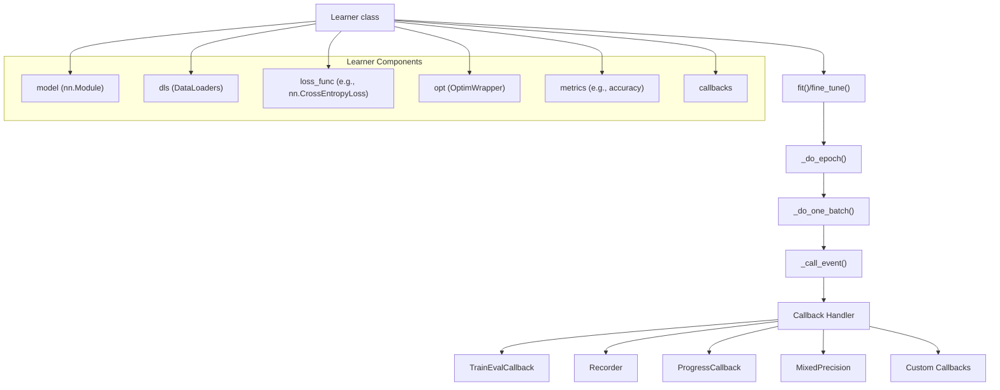

The `Learner` integrates:
- A neural network model (PyTorch `nn.Module`)
- `DataLoaders` for training and validation data
- A loss function
- An optimizer (usually wrapped with `OptimWrapper`)
- Metrics for evaluation
- Callbacks for customizing behavior

Training methods include:
- `fit()`: Train for a specified number of epochs
- `fine_tune()`: Two-phase training for transfer learning
- `fit_one_cycle()`: Uses the 1cycle policy for faster convergence

Sources: [README.md:87-88]()), [CHANGELOG.md:205-212]())

## Callback System

Fastai features a powerful two-way callback system that allows customization of every aspect of training:

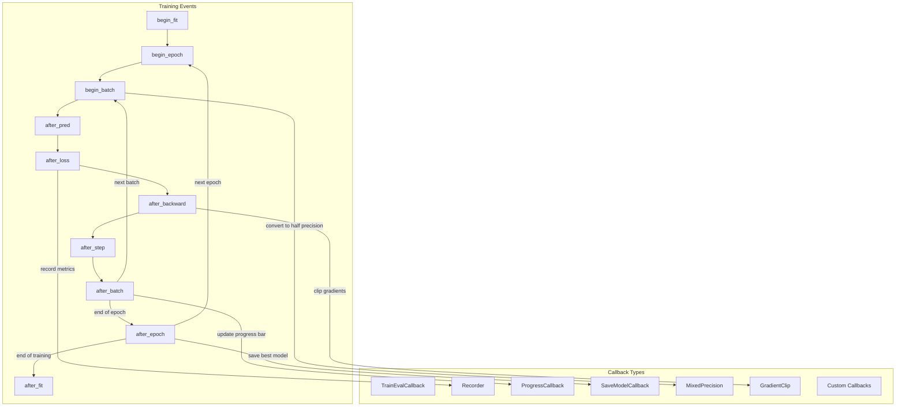

Callbacks:
- Respond to specific events in the training loop
- Can access and modify the `Learner`'s state
- Can be composed to implement complex behaviors
- Are organized by "order" for proper execution sequence

Core callbacks include:
- `TrainEvalCallback`: Manages training and validation modes
- `Recorder`: Tracks metrics and learning rates
- `ProgressCallback`: Displays training progress
- `SaveModelCallback`: Saves best models automatically
- `MixedPrecision`: Enables mixed-precision training

Sources: [README.md:89-90]()), [CHANGELOG.md:206]()), [CHANGELOG.md:467-473]())

## Domain-Specific Modules

Fastai provides specialized modules for different data types and tasks:

### Computer Vision

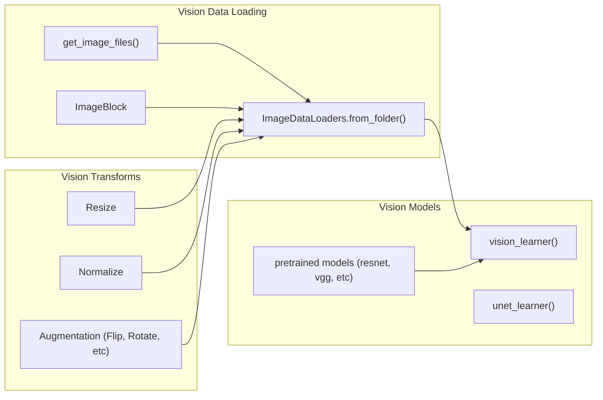

Key components:
- `vision_learner()`: Creates a learner for image classification
- `unet_learner()`: For image segmentation tasks
- Vision-specific transforms like `Resize`, `Normalize`, and various augmentations
- Pre-trained model support for transfer learning

### Natural Language Processing

Key components:
- `text_classifier_learner()`: For text classification
- `language_model_learner()`: For language modeling
- Text preprocessing and tokenization
- AWD-LSTM and transformer architectures

### Tabular Data

Key components:
- `tabular_learner()`: For structured data
- Automatic preprocessing of categorical and continuous variables
- Entity embeddings for categorical features
- Interpretation tools

Sources: [README.md:81-92]()), [CHANGELOG.md:244-246]())

## Advanced Features

Fastai includes several advanced features for optimizing training and production use:

| Feature | Description | Key Components |
|---------|-------------|----------------|
| Mixed Precision | Train with float16 to improve speed and memory usage | `to_fp16()`, `MixedPrecision` callback |
| Distributed Training | Train across multiple GPUs or machines | `accelerate`, `configure_accelerate` |
| Experiment Tracking | Monitor training with external tools | `WandbCallback`, TensorBoard integration |
| Model Export | Save and deploy trained models | `Learner.export()`, `load_learner()` |
| Interpretation | Analyze model predictions | `ClassificationInterpretation`, `SegmentationInterpretation` |

Sources: [settings.ini:21-22]()), [CHANGELOG.md:196-198]()), [CHANGELOG.md:204-212]())

## Development and Extension

Fastai is designed for easy extension:
- Create custom callbacks to modify training behavior
- Define new transforms for data preprocessing
- Add metrics or loss functions
- Implement custom models while keeping the training loop

For development workflows, fastai uses:
- Jupyter notebooks as the primary development environment
- `nbdev` for literate programming and documentation
- GitHub Actions for continuous integration and testing

Sources: [settings.ini:23-43]()), [README.md:136-144]())

---

# Page: Architecture and Design

# Architecture and Design

<details>
<summary>Relevant source files</summary>

The following files were used as context for generating this wiki page:

- [README.md](README.md)
- [fastai/callback/core.py](fastai/callback/core.py)
- [fastai/data/core.py](fastai/data/core.py)
- [fastai/learner.py](fastai/learner.py)
- [nbs/03_data.core.ipynb](nbs/03_data.core.ipynb)
- [nbs/13_callback.core.ipynb](nbs/13_callback.core.ipynb)
- [nbs/13a_learner.ipynb](nbs/13a_learner.ipynb)
- [nbs/index.ipynb](nbs/index.ipynb)

</details>


This document describes the overall architecture and design philosophy of the fastai library. It explains how the core components are organized, the design patterns used, and how these components interact to provide both high-level simplicity for practitioners and low-level flexibility for researchers.

For installation and setup instructions, see [Installation and Setup](#1.2).

## High-Level Architecture

Fastai is built with a carefully layered architecture that expresses common patterns of deep learning in terms of decoupled abstractions. This architecture enables the library to be both approachable for beginners and hackable for experts.

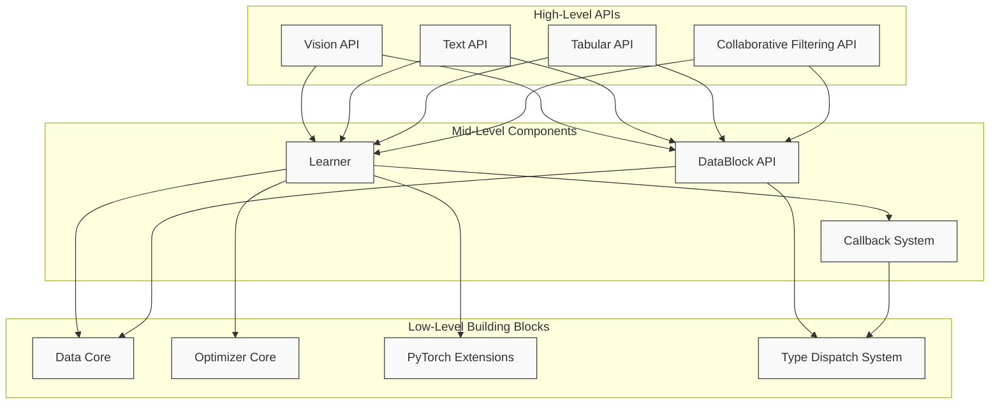

Sources: [README.md:67-109](), [nbs/index.ipynb:85-102]()

The architecture consists of three main layers:

1. **High-Level APIs**: Domain-specific APIs for vision, text, tabular, and collaborative filtering that provide a consistent interface for different applications.

2. **Mid-Level Components**: Core abstractions like Learner, DataBlock API, and the Callback System that coordinate the training process and data handling.

3. **Low-Level Building Blocks**: Fundamental functionality such as data loading, optimizers, PyTorch extensions, and the type dispatch system.

## Core Systems and Their Interactions

Fastai's core functionality is built around several key systems that work together to provide a flexible and powerful deep learning framework.

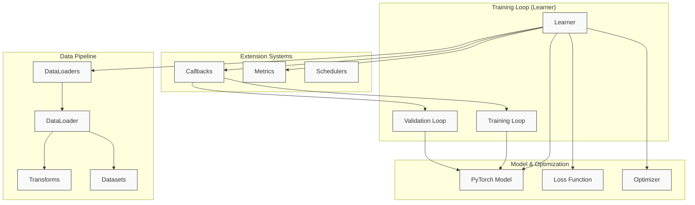

Sources: [fastai/learner.py:106-220](), [fastai/data/core.py:64-182](), [fastai/callback/core.py:47-77]()

### Learner System

The `Learner` class is the central coordination component of fastai. It brings together the model, data, loss function, and optimizer, and manages the training loop.

#### Learner Components and Responsibilities

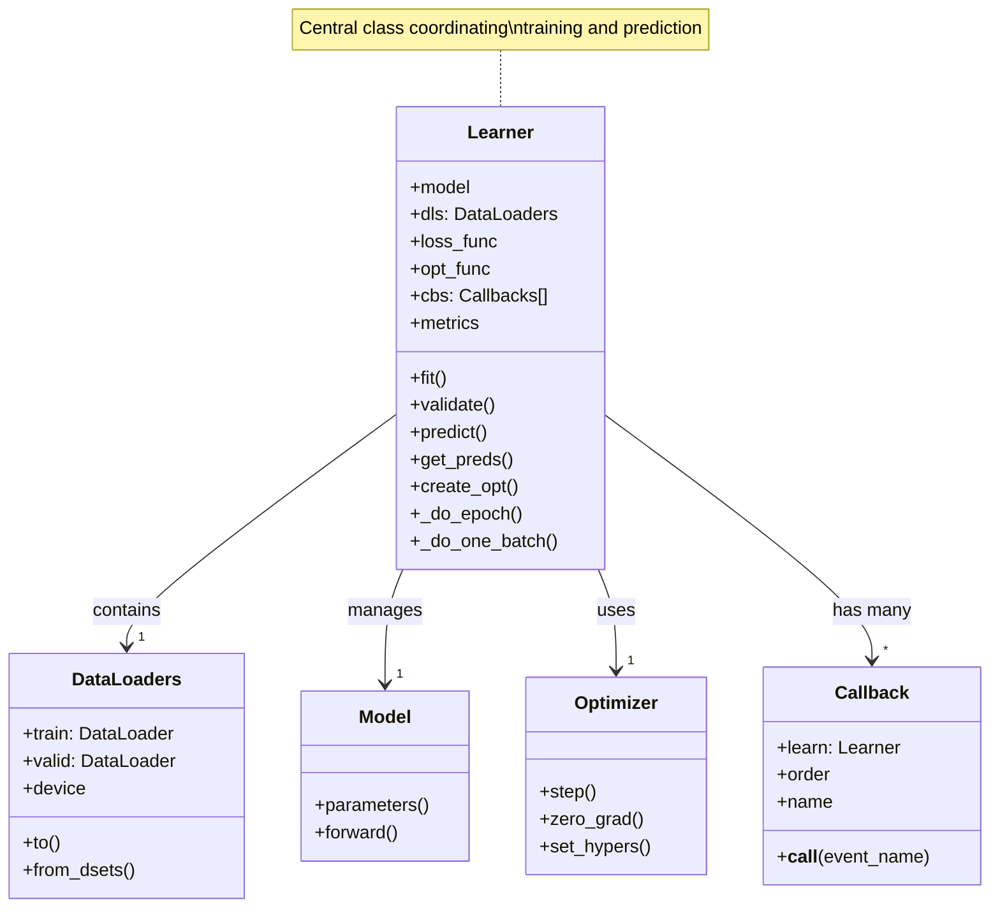

Sources: [fastai/learner.py:106-369]()

The `Learner` class implements the training loop with several key methods:

- `fit()`: Trains the model for a specified number of epochs
- `_do_epoch()`: Executes one epoch of training and validation
- `_do_one_batch()`: Processes a single batch through the model
- `validate()`: Evaluates the model on the validation set
- `get_preds()`: Gets predictions from the model

The training loop sequence is:

1. Get a batch of data
2. Pass it through the model to get predictions
3. Calculate the loss between predictions and targets
4. Compute gradients via backpropagation
5. Update model parameters with the optimizer
6. Repeat for all batches and epochs

Sources: [fastai/learner.py:210-261]()

### Callback System

Fastai employs an event-driven callback system that allows for customization of the training process without modifying the core training loop.

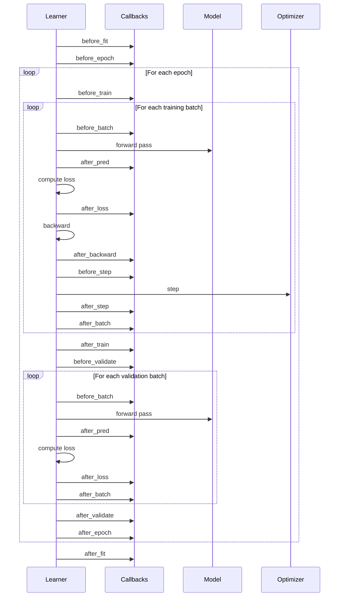

Sources: [fastai/callback/core.py:47-77](), [fastai/learner.py:210-261]()

The callback system is built around a set of predefined events that occur during the training loop. The `Callback` class provides a framework for creating custom callbacks that can hook into these events.

Key events include:
- `before_fit`, `after_fit`
- `before_epoch`, `after_epoch`
- `before_train`, `after_train`
- `before_batch`, `after_batch`
- `after_pred`, `after_loss`
- `before_backward`, `after_backward`
- `before_step`, `after_step`

Sources: [fastai/callback/core.py:86-89]()

Callbacks can be used to implement a wide range of functionality, such as:
- Learning rate scheduling
- Early stopping
- Checkpoint saving
- Metrics calculation
- Progress tracking

A core callback is the `TrainEvalCallback` which handles the basic setup of training and evaluation modes for the model.

Sources: [fastai/callback/core.py:80-108]()

### Data Processing Pipeline

The data processing system in fastai is built around a flexible pipeline for loading, transforming, and batching data.

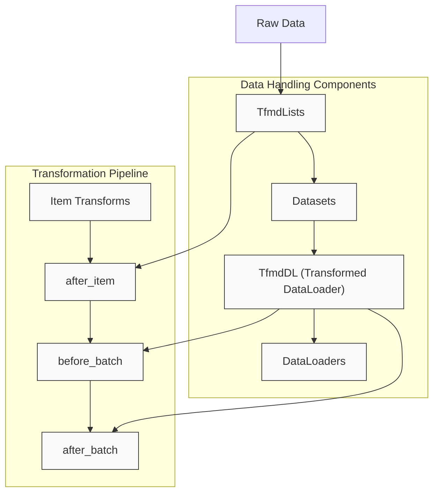

Sources: [fastai/data/core.py:64-182](), [fastai/data/core.py:195-292]()

The key components in the data processing pipeline are:

1. **TfmdLists**: A collection of items with associated transforms
2. **Datasets**: Combines multiple TfmdLists to create input-target pairs
3. **TfmdDL (Transformed DataLoader)**: Applies batch transforms and handles batching
4. **DataLoaders**: Manages training and validation DataLoaders

The transformation pipeline consists of three main stages:
- `after_item`: Transforms applied to individual items
- `before_batch`: Transforms applied before items are collated into a batch
- `after_batch`: Transforms applied to the whole batch

Sources: [fastai/data/core.py:61](), [fastai/data/core.py:64-182]()

### Component Integration

The `Learner` class integrates all these components to provide a cohesive training experience.

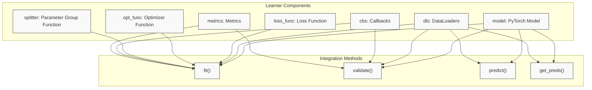

Sources: [fastai/learner.py:108-135](), [fastai/learner.py:263-336]()

## Design Patterns and Principles

Fastai employs several key design patterns and principles that enable its flexibility and power.

### 1. Callback-Driven Development

The callback system allows for extensive customization of the training process without modifying the core training loop. This is similar to middleware in web frameworks.

| Callback Type | Purpose | Examples |
|---------------|---------|----------|
| Core Callbacks | Handle basic training loop functionality | TrainEvalCallback |
| Metric Callbacks | Calculate and record model performance | Accuracy, F1Score |
| Scheduling Callbacks | Adjust hyperparameters during training | OneCycleScheduler |
| Data Callbacks | Modify data during training | MixUp, CutMix |
| Utility Callbacks | Provide additional functionality | SaveModelCallback, EarlyStoppingCallback |

Sources: [fastai/callback/core.py:47-77]()

### 2. Type Dispatch System

Fastai uses a type dispatch system that enables function behavior to be determined by the types of its arguments. This allows for specialized processing based on data types.

### 3. Functional-Style Transformations

Data transformations are treated as functional operations that can be composed and chained together.

### 4. Delegation Pattern

Fastai uses delegation extensively to avoid repeating parameter specifications. The `@delegates` decorator passes arguments from one function to another.

### 5. Progressive Disclosure

The API is designed with progressive disclosure, allowing simple use cases to be handled simply while exposing more complexity as needed.

## Exception Handling for Control Flow

Fastai uses exceptions as control flow mechanisms to skip parts of the training loop when needed:

| Exception | Purpose |
|-----------|---------|
| CancelFitException | Stop the entire training session |
| CancelEpochException | Skip to the end of the current epoch |
| CancelTrainException | Skip the rest of training for this epoch |
| CancelValidException | Skip the rest of validation for this epoch |
| CancelBatchException | Skip the rest of processing for this batch |
| CancelStepException | Skip the optimizer step |
| CancelBackwardException | Skip the backward pass |

Sources: [fastai/callback/core.py:35-44](), [fastai/learner.py:20-22]()

## Summary

The fastai library is architected with a layered design that provides both high-level simplicity and low-level flexibility. The core systems - Learner, callbacks, and data processing - work together to provide a powerful framework for deep learning while allowing extensive customization.

This architecture enables both ease of use for practitioners and hackability for researchers, making fastai suitable for a wide range of deep learning applications.

---

# Page: Installation and Setup

# Installation and Setup

<details>
<summary>Relevant source files</summary>

The following files were used as context for generating this wiki page:

- [CHANGELOG.md](CHANGELOG.md)
- [README.md](README.md)
- [fastai/__init__.py](fastai/__init__.py)
- [nbs/index.ipynb](nbs/index.ipynb)
- [settings.ini](settings.ini)

</details>


This page provides detailed instructions for installing and configuring the fastai library on different platforms. It covers various installation methods, dependency management, platform-specific considerations, and troubleshooting tips. For information about the overall architecture of fastai, see [Architecture and Design](#1.1).

## System Requirements

Before installing fastai, ensure your system meets these requirements:

- **Python**: 3.10 or higher
- **PyTorch**: 1.10 or higher (but less than 2.7)
- **Operating Systems**:
  - Linux (fully supported)
  - Windows (supported with some considerations)
  - macOS (limited support, with MPS support added in v2.7.6)

Sources: [settings.ini:14](), [settings.ini:18-19]()

## Installation Methods

There are several ways to install fastai depending on your needs. The following diagram outlines the main installation paths:

### Installation Methods Overview

```mermaid
flowchart LR
    start["Choose Installation Method"]
    
    subgraph "No Local Installation"
        cloud["Cloud Platform"]
        google["Google Colab<br>!pip install -Uqq fastai"]
    end
    
    subgraph "Local Installation"
        conda["Conda Installation<br>(Recommended)"]
        pip["Pip Installation"]
        dev["Development Setup"]
        
        pytorch["1. Install PyTorch"]
        fastai_conda["2. conda install fastai::fastai"]
        
        fastai_pip["pip install fastai"]
        
        clone["1. Clone Repository"]
        edit["2. pip install -e \"fastai[dev]\""]
    end
    
    start --> cloud
    start --> conda
    start --> pip
    start --> dev
    
    cloud --> google
    
    conda --> pytorch
    pytorch --> fastai_conda
    
    dev --> clone
    clone --> edit
```

Sources: [README.md:11-44](), [nbs/index.ipynb:35-58]()

### Using Google Colab (No Installation)

The simplest way to get started with fastai is to use Google Colab, which has GPU support and requires no local installation:

1. Go to [Google Colab](https://colab.research.google.com/)
2. Create a new notebook
3. Run: `!pip install -Uqq fastai` in a code cell
4. Set runtime to GPU: Runtime > Change runtime type > Hardware accelerator > GPU

Sources: [README.md:13-18](), [nbs/index.ipynb:42-43]()

### Conda Installation (Recommended)

The recommended method for installing fastai on your local machine:

1. Install [Miniconda](https://docs.conda.io/en/latest/miniconda.html) or [Miniforge](https://github.com/conda-forge/miniforge)
2. Install PyTorch using conda (check [PyTorch's website](https://pytorch.org/get-started/locally/) for the current command)
3. Install fastai:

```bash
conda install fastai::fastai
```

Sources: [README.md:20-32](), [nbs/index.ipynb:44-49]()

### Pip Installation

For users who prefer pip:

```bash
pip install fastai
```

Sources: [README.md:34](), [nbs/index.ipynb:51]()

### Development Installation (Editable)

For contributors or users who want the cutting-edge version:

1. Install PyTorch following the [PyTorch instructions](https://pytorch.org/get-started/locally/)
2. Clone the fastai repository:

```bash
git clone https://github.com/fastai/fastai
pip install -e "fastai[dev]"
```

Sources: [README.md:36-44](), [nbs/index.ipynb:53-58]()

## Dependencies

fastai has several dependencies that are automatically installed when you install the package:

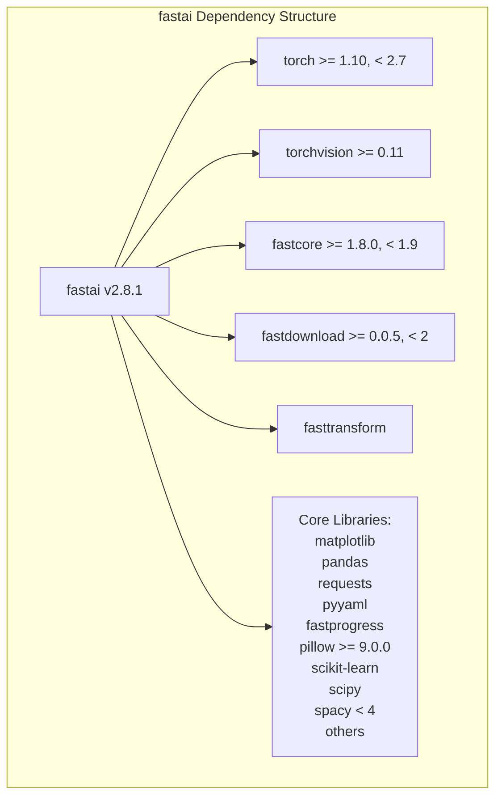

Sources: [settings.ini:17-21]()

## Platform-Specific Considerations

### Windows

fastai is supported on Windows, but with some important caveats:

- **Jupyter Notebook limitations**: Due to Python multiprocessing issues, `num_workers` is automatically set to 0 in Jupyter to prevent hanging, which makes tasks like computer vision significantly slower
- **Recommended approach**: Use Windows Subsystem for Linux (WSL) instead of native Windows
- **Alternative**: If using native Windows, run fastai from scripts rather than Jupyter notebooks

Sources: [README.md:118-132](), [nbs/index.ipynb:141-146]()

### macOS

macOS has limited official support in fastai:

- Initial Mac GPU (MPS) support was added in version 2.7.6
- Some limitations exist with PyTorch's MPS implementation
- The changelog indicates ongoing improvements for Mac support in recent versions

Sources: [CHANGELOG.md:158-161]()

## Version Compatibility

This table shows the compatibility between fastai, Python, and PyTorch versions:

| fastai Version | Python Requirement | PyTorch Compatibility |
|----------------|-------------------|------------------------|
| 2.8.x | ≥ 3.10 | 1.10 - 2.6 |
| 2.7.x | ≥ 3.10 | 1.10 - 2.5 |
| 2.6.x | ≥ 3.9 | 1.10 - 2.4 |

Sources: [settings.ini:6](), [settings.ini:14](), [settings.ini:18-19](), [CHANGELOG.md:16]()

## Verifying Installation

To verify that fastai is correctly installed:

1. Open a Python interpreter or Jupyter notebook
2. Run the following code:

```python
import fastai
print(fastai.__version__)  # Should display the version number (e.g., 2.8.1)
```

For a more comprehensive check of your entire deep learning environment:

```python
from fastai.basics import *
show_install()  # Displays versions of critical dependencies
```

Sources: [fastai/__init__.py:1-2]()

## Updating fastai

To update fastai to the latest version:

- With conda: `conda update fastai::fastai`
- With pip: `pip install -U fastai`

For Google Colab, run at the start of your notebook:

```python
!pip install -Uqq fastai  # upgrade fastai on colab
```

Sources: [nbs/index.ipynb:9-11]()

## Troubleshooting Common Installation Issues

### PyTorch Compatibility

- **Issue**: `ImportError` related to PyTorch version mismatch
- **Solution**: Ensure you have a compatible PyTorch version: `pip install "torch>=1.10,<2.7"`

### Missing Dependencies

- **Issue**: Import errors for missing packages
- **Solution**: Install all dependencies: `pip install -e "fastai[dev]"` or check the requirements in settings.ini

### CUDA/GPU Issues

- **Issue**: PyTorch cannot find your CUDA installation
- **Solution**: Install the correct PyTorch version for your CUDA version from [pytorch.org](https://pytorch.org)

### Windows-Specific Issues

- **Issue**: Slow performance or hanging in Jupyter notebooks
- **Solution**: Use WSL or run fastai from scripts instead of notebooks

Sources: [settings.ini:17-21](), [README.md:118-132]()

## Additional Installation Options

### Docker Containers

Official Docker containers for fastai are available for those who prefer containerized environments:

```bash
# Pull the latest fastai Docker image
docker pull fastdotai/fastai
```

See the [Docker containers repository](https://github.com/fastai/docker-containers#fastai) for more options.

Sources: [README.md:159-162](), [nbs/index.ipynb:197]()

## Developer Setup

If you're contributing to fastai development:

1. Clone the repository: `git clone https://github.com/fastai/fastai`
2. Install the development dependencies: `pip install -e "fastai[dev]"`
3. Run `nbdev_install_hooks` to set up git hooks for Jupyter notebooks
4. Use `nbdev_test` to run tests

This ensures proper development workflow with the nbdev system that fastai uses.

Sources: [README.md:134-157](), [nbs/index.ipynb:159-183](), [settings.ini:21]()

---

# Page: Core Systems

# Core Systems

<details>
<summary>Relevant source files</summary>

The following files were used as context for generating this wiki page:

- [fastai/callback/core.py](fastai/callback/core.py)
- [fastai/data/core.py](fastai/data/core.py)
- [fastai/learner.py](fastai/learner.py)
- [fastai/torch_core.py](fastai/torch_core.py)
- [nbs/00_torch_core.ipynb](nbs/00_torch_core.ipynb)
- [nbs/03_data.core.ipynb](nbs/03_data.core.ipynb)
- [nbs/13_callback.core.ipynb](nbs/13_callback.core.ipynb)
- [nbs/13a_learner.ipynb](nbs/13a_learner.ipynb)

</details>


This document covers the fundamental subsystems that form the foundation of the fastai library. These core systems enable the library's higher-level components and provide the essential infrastructure for building deep learning models. The core systems include data handling, training loop management, callback system for customization, and PyTorch extensions.

For information about domain-specific implementations like computer vision, NLP, or tabular data, see [Domain-Specific Modules](#3).

## Overview of Core Systems Architecture

The fastai library is built upon a set of core systems that work together to provide a flexible and powerful deep learning framework. These systems are designed to be modular, allowing users to customize and extend functionality as needed.

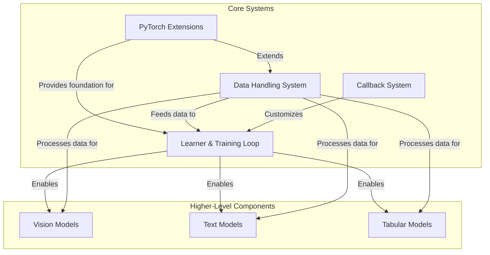

Sources: [fastai/learner.py:106-135](https://github.com/fastai/fastai/tree/master/fastai/learner.py), [fastai/data/core.py:64-183](https://github.com/fastai/fastai/tree/master/fastai/data/core.py), [fastai/callback/core.py:47-77](https://github.com/fastai/fastai/tree/master/fastai/callback/core.py), [fastai/torch_core.py:33-39](https://github.com/fastai/fastai/tree/master/fastai/torch_core.py)

## Data Handling System

The Data Handling System in fastai is responsible for loading, transforming, and batching data for model training and inference. It provides a flexible pipeline that handles various data types and transformations.

### Key Components of the Data Handling System

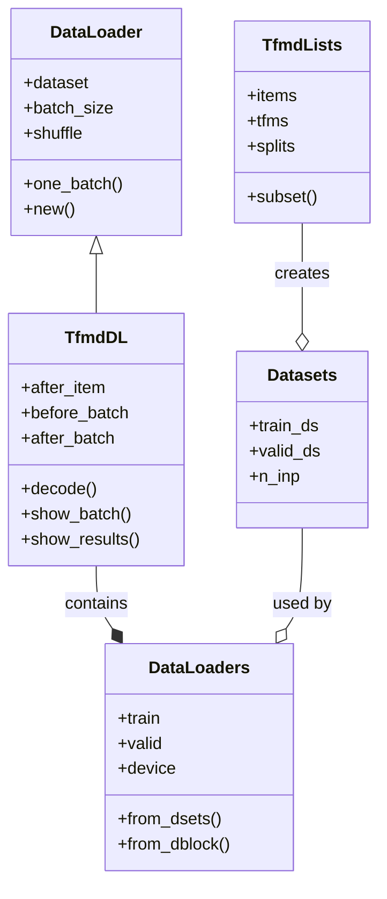

Sources: [fastai/data/core.py:64-183](https://github.com/fastai/fastai/tree/master/fastai/data/core.py), [fastai/data/core.py:195-264](https://github.com/fastai/fastai/tree/master/fastai/data/core.py), [fastai/data/core.py:294-337](https://github.com/fastai/fastai/tree/master/fastai/data/core.py)

### Data Transformation Pipeline

The data transformation pipeline is a key feature of fastai's data handling system. It allows for consistent application of transformations to data items and batches during both training and inference.

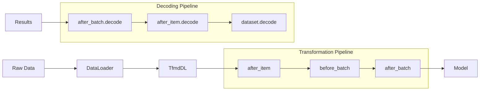

Sources: [fastai/data/core.py:119-134](https://github.com/fastai/fastai/tree/master/fastai/data/core.py)

The key classes in this system include:

1. **TfmdDL (Transformed DataLoader)**: Extends PyTorch's DataLoader with transformation capabilities. It applies three types of transforms:
   - `after_item`: Applied to individual items after they're retrieved from the dataset
   - `before_batch`: Applied to items before they're collated into a batch
   - `after_batch`: Applied to the batch after collation

2. **DataLoaders**: A container for training and validation dataloaders that manages device placement and provides a unified interface.

3. **TfmdLists**: A transform-aware list-like container that applies transformations to items and manages train/validation splits.

The transformation pipeline also includes decoding functionality that reverses transforms for visualization and interpretation of results.

## Learner and Training Loop

The Learner class is the central component of fastai's training system. It coordinates the model, data, optimizer, and callbacks to implement the training loop.

### Learner Architecture

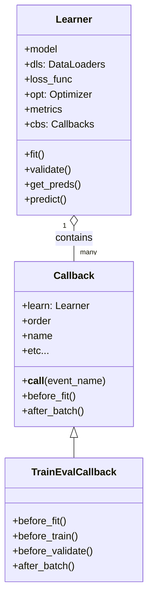

Sources: [fastai/learner.py:106-335](https://github.com/fastai/fastai/tree/master/fastai/learner.py), [fastai/callback/core.py:47-77](https://github.com/fastai/fastai/tree/master/fastai/callback/core.py), [fastai/callback/core.py:80-108](https://github.com/fastai/fastai/tree/master/fastai/callback/core.py)

### Training Loop Phases

The training loop in fastai follows a well-defined sequence of phases, with callback events triggered at specific points. This enables extensive customization of the training process.

```mermaid
flowchart TD
    FIT["Fit"] --> BF["before_fit"]
    BF --> EPOCH["Epoch Loop"]
    EPOCH --> BE["before_epoch"]
    BE --> TRAIN["Training Phase"]
    TRAIN --> BT["before_train"]
    BT --> BATCH_T["Batch Loop (Train)"]
    BATCH_T --> BB_T["before_batch"]
    BB_T --> PRED["Model Prediction"]
    PRED --> AP["after_pred"]
    AP --> LOSS["Loss Calculation"]
    LOSS --> AL["after_loss"]
    AL --> BW["before_backward"]
    BW --> ABW["after_backward"]
    ABW --> BS["before_step"]
    BS --> AS["after_step"]
    AS --> AB_T["after_batch"]
    AB_T --> BATCH_T_END["End Batch Loop"]
    BATCH_T_END --> AT["after_train"]
    
    AT --> VALID["Validation Phase"]
    VALID --> BV["before_validate"]
    BV --> BATCH_V["Batch Loop (Valid)"]
    BATCH_V --> BB_V["before_batch"]
    BB_V --> PRED_V["Model Prediction"]
    PRED_V --> AP_V["after_pred"]
    AP_V --> LOSS_V["Loss Calculation"]
    LOSS_V --> AL_V["after_loss"]
    AL_V --> AB_V["after_batch"]
    AB_V --> BATCH_V_END["End Batch Loop"]
    BATCH_V_END --> AV["after_validate"]
    
    AV --> AE["after_epoch"]
    AE --> EPOCH_END["End Epoch Loop"]
    EPOCH_END --> AF["after_fit"]
```

Sources: [fastai/learner.py:97-103](https://github.com/fastai/fastai/tree/master/fastai/learner.py), [fastai/learner.py:211-262](https://github.com/fastai/fastai/tree/master/fastai/learner.py)

The Learner class orchestrates the full training process:

1. **Initialization**: Sets up model, data, loss function, and optimizer
2. **Training Loop**: Implements the core loop through batches and epochs
3. **Validation**: Evaluates model performance on validation data
4. **Prediction**: Makes predictions with the trained model

Key methods of the Learner class include:

- `fit()`: Main method to train the model for a specified number of epochs
- `validate()`: Evaluates the model on validation data
- `get_preds()`: Gets predictions from the model on a dataset
- `predict()`: Makes a prediction on a single item

The training loop is highly customizable through the callback system, allowing users to modify any part of the process without changing the core code.

## Callback System

The Callback system is a powerful mechanism that enables customization of the training loop without modifying its core implementation. Callbacks can respond to events at various points in the training process.

### Callback Event Flow

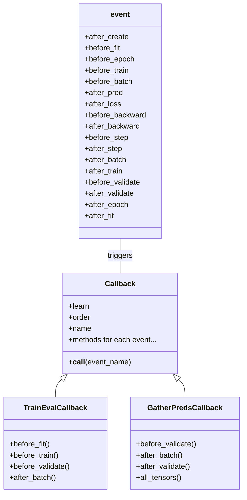

Sources: [fastai/callback/core.py:19-26](https://github.com/fastai/fastai/tree/master/fastai/callback/core.py), [fastai/callback/core.py:47-77](https://github.com/fastai/fastai/tree/master/fastai/callback/core.py), [fastai/callback/core.py:80-108](https://github.com/fastai/fastai/tree/master/fastai/callback/core.py), [fastai/callback/core.py:114-167](https://github.com/fastai/fastai/tree/master/fastai/callback/core.py)

### Exception Handling for Flow Control

The callback system uses exceptions to control the flow of training. These exceptions allow callbacks to skip portions of the training loop.

| Exception | Purpose |
|-----------|---------|
| CancelBatchException | Skip the rest of the current batch |
| CancelTrainException | Skip the rest of the training phase |
| CancelValidException | Skip the rest of the validation phase |
| CancelEpochException | Skip the rest of the current epoch |
| CancelFitException | Stop the entire training process |
| CancelBackwardException | Skip the backward pass |
| CancelStepException | Skip the optimizer step |

Sources: [fastai/callback/core.py:34-44](https://github.com/fastai/fastai/tree/master/fastai/callback/core.py), [fastai/learner.py:84-94](https://github.com/fastai/fastai/tree/master/fastai/learner.py)

The Callback base class provides the infrastructure for all callbacks:

1. **Event Method Calling**: Calls the appropriate method on a callback when an event occurs
2. **Order Control**: Callbacks have an `order` attribute to determine execution sequence
3. **Training/Validation Control**: Callbacks can run in training, validation, or both phases
4. **Access to Learner**: Callbacks have access to the learner instance and all its attributes

Common built-in callbacks include:

- **TrainEvalCallback**: Sets up training/evaluation mode and tracks progress
- **GatherPredsCallback**: Collects predictions and targets during validation

## PyTorch Extensions

Fastai extends PyTorch's functionality with additional utilities and custom tensor types. These extensions enhance the developer experience and provide specialized behavior for different data types.

### Tensor Type Hierarchy

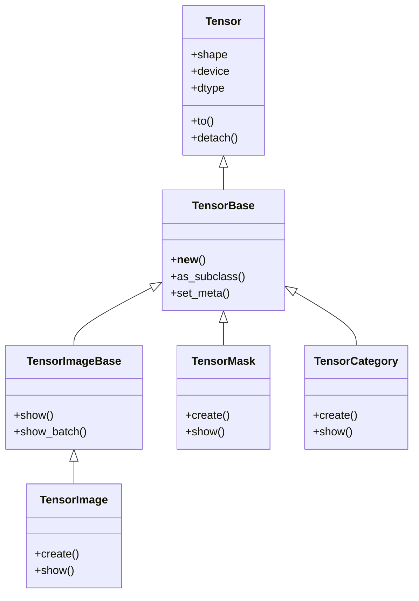

Sources: [fastai/torch_core.py:354-365](https://github.com/fastai/fastai/tree/master/fastai/torch_core.py)

### Device and Type Handling

A key part of fastai's PyTorch extensions is the improved handling of devices and tensor types:

1. **Device Management**: 
   - `default_device()`: Determines the best available device (CUDA, MPS, CPU)
   - `to_device()`: Moves tensors to the specified device
   - `to_cpu()`: Moves tensors to CPU
   - `to_detach()`: Detaches tensors from their computation graph

2. **Type Handling**:
   - `tensor()`: Enhanced version of PyTorch's tensor creation
   - `to_np()`: Converts tensors to NumPy arrays
   - Custom tensor types for domain-specific applications

Sources: [fastai/torch_core.py:259-292](https://github.com/fastai/fastai/tree/master/fastai/torch_core.py), [fastai/torch_core.py:129-158](https://github.com/fastai/fastai/tree/master/fastai/torch_core.py)

The PyTorch extensions provide a richer set of tools for:

- Displaying images and other visual data
- Converting between different tensor types
- Moving data between devices efficiently
- Working with batched data
- Handling metadata for tensors

These extensions form the foundation upon which the data handling and training systems are built, providing the necessary functionality for the higher-level components of the library.

## System Integration

Understanding how the core systems interact is essential for leveraging the full power of fastai. The following diagram illustrates the relationships between these systems during the training process:

```mermaid
sequenceDiagram
    participant DL as DataLoaders
    participant L as Learner
    participant M as Model
    participant O as Optimizer
    participant CB as Callbacks
    
    Note over L: Training begins
    L->>CB: before_fit
    
    loop For each epoch
        L->>CB: before_epoch
        L->>CB: before_train
        
        loop For each training batch
            DL->>L: Provide batch
            L->>CB: before_batch
            L->>M: Forward pass
            L->>CB: after_pred
            L->>L: Calculate loss
            L->>CB: after_loss
            L->>CB: before_backward
            L->>L: Backward pass
            L->>CB: after_backward
            L->>CB: before_step
            L->>O: Optimizer step
            L->>CB: after_step
            L->>CB: after_batch
        end
        
        L->>CB: after_train
        L->>CB: before_validate
        
        loop For each validation batch
            DL->>L: Provide batch
            L->>CB: before_batch
            L->>M: Forward pass
            L->>CB: after_pred
            L->>L: Calculate loss
            L->>CB: after_loss
            L->>CB: after_batch
        end
        
        L->>CB: after_validate
        L->>CB: after_epoch
    end
    
    L->>CB: after_fit
    Note over L: Training completes
```

Sources: [fastai/learner.py:239-261](https://github.com/fastai/fastai/tree/master/fastai/learner.py), [fastai/learner.py:211-238](https://github.com/fastai/fastai/tree/master/fastai/learner.py), [fastai/callback/core.py:56-67](https://github.com/fastai/fastai/tree/master/fastai/callback/core.py)

This integration shows how:

1. The `DataLoaders` provide data to the `Learner`
2. The `Learner` coordinates the model and optimizer operations
3. `Callbacks` are notified at each step, allowing them to monitor and modify the process
4. PyTorch extensions (implicit in the diagram) provide the tensor operations underpinning all components

Understanding these interactions enables effective customization of the training process through the callback system, data transformations, or model modifications.

## Summary

The core systems of fastai provide a flexible and powerful foundation for deep learning applications:

1. **Data Handling System**: Manages data loading, transformation, and batching with a focus on flexibility and ease of use
2. **Learner and Training Loop**: Orchestrates the training process with a well-defined structure
3. **Callback System**: Enables customization of any part of the training process
4. **PyTorch Extensions**: Extends PyTorch with additional utilities and custom tensor types

These systems are designed to work together seamlessly while allowing for extensive customization at each level. By understanding these core systems, you can leverage the full power of fastai for your deep learning projects.

For more information on specific domains like computer vision or NLP, see the [Domain-Specific Modules](#3) documentation.

---

# Page: Learner and Callbacks

# Learner and Callbacks

<details>
<summary>Relevant source files</summary>

The following files were used as context for generating this wiki page:

- [fastai/callback/core.py](fastai/callback/core.py)
- [fastai/learner.py](fastai/learner.py)
- [nbs/13_callback.core.ipynb](nbs/13_callback.core.ipynb)
- [nbs/13a_learner.ipynb](nbs/13a_learner.ipynb)

</details>


The Learner and Callbacks system forms the core of fastai's training infrastructure. This page documents how the `Learner` class coordinates model training and how the callback system provides a flexible way to customize the training process. For information about data processing pipelines, see [Data Processing Pipeline](#2.2), and for metrics implementation details, see [Metrics and Loss Functions](#2.3).

## Overview

The `Learner` class is the central coordinator that brings together a model, data, optimizer, loss function, and callbacks to handle the complete training workflow. The callback system allows customizing virtually every aspect of the training process without modifying the core training loop.

```mermaid
flowchart TB
    subgraph "Learner Components"
        model["PyTorch Model"]
        data["DataLoaders"]
        opt["Optimizer"]
        loss_func["Loss Function"]
        cbs["Callbacks"]
        metrics["Metrics"]
    end

    subgraph "Training Process"
        fit["fit()"]
        one_batch["one_batch()"]
        validate["validate()"]
        get_preds["get_preds()"]
    end

    Learner --> model
    Learner --> data
    Learner --> opt
    Learner --> loss_func
    Learner --> cbs
    Learner --> metrics
    
    Learner --> fit
    Learner --> one_batch
    Learner --> validate
    Learner --> get_preds
```

Sources: [fastai/learner.py:106-369](). [nbs/13a_learner.ipynb:332-596]()

## Learner Class

The `Learner` class manages the entire training process by coordinating the model, data, optimizer, and callbacks.

### Initialization

The Learner initializes with several key components:

```mermaid
classDiagram
    class Learner {
        +dls: DataLoaders
        +model: nn.Module
        +loss_func: Callable
        +opt_func: Optimizer|OptimWrapper
        +lr: float|slice
        +splitter: Callable
        +cbs: List[Callback]
        +metrics: List[Metric]
        +path: Path
        +model_dir: Path
        +wd: float|None
        +wd_bn_bias: bool
        +train_bn: bool
        +moms: tuple
        +__init__(dls, model, loss_func, etc)
        +fit(n_epoch, lr, etc)
        +validate(ds_idx, dl, cbs)
        +get_preds(ds_idx, dl, etc)
    }
```

Key parameters include:
- `dls`: DataLoaders containing the training and validation data
- `model`: PyTorch model to train
- `loss_func`: Loss function (defaults to the one in the dataset if available)
- `opt_func`: Optimizer function (default is Adam)
- `cbs`: Additional callbacks to customize training
- `metrics`: Metrics to track during training

Sources: [fastai/learner.py:106-135](). [nbs/13a_learner.ipynb:332-369]()

### Core Methods

The `Learner` class provides several key methods for training and evaluation:

- `fit(n_epoch, lr=None, wd=None, cbs=None)`: Main method to train for n_epoch epochs
- `validate(ds_idx=1, dl=None)`: Validate on a specific dataset or dataloader
- `get_preds(ds_idx=1, dl=None, with_input=False, ...)`: Get model predictions
- `one_batch(i, b)`: Process a single batch (internal method)

Sources: [fastai/learner.py:239-243](). [fastai/learner.py:263-272](). [fastai/learner.py:284-287](). [fastai/learner.py:289-325]()

## The Callback System

The callback system is the primary mechanism for customizing the training process in fastai.

### Callback Class

The `Callback` base class provides the foundation for all callbacks:

```mermaid
classDiagram
    class Callback {
        +order: int
        +learn: Learner
        +run: bool
        +run_train: bool
        +run_valid: bool
        +name: str
        +__call__(event_name)
        +before_fit()
        +after_batch()
        +etc...
    }
```

Sources: [fastai/callback/core.py:47-77](). [nbs/13_callback.core.ipynb:190-220]()

### Event System

Callbacks respond to events that occur during the training process. The events follow a specific sequence during training:

```mermaid
flowchart TB
    subgraph "Training Loop Events"
        direction TB
        bf["before_fit"]
        be["before_epoch"]
        bt["before_train"]
        bb["before_batch"]
        ap["after_pred"]
        al["after_loss"]
        bwd["before_backward"]
        awd["after_backward"]
        bs["before_step"]
        as["after_step"]
        aba["after_batch"]
        at["after_train"]
        bv["before_validate"]
        av["after_validate"]
        ae["after_epoch"]
        af["after_fit"]
    end

    bf --> be --> bt --> bb --> ap --> al
    al --> bwd --> awd --> bs --> as --> aba
    aba --> bt
    aba --> at --> bv --> av --> ae --> af
```

The event names are defined as attributes of the `event` class to provide tab completion and typo-proofing.

Sources: [fastai/callback/core.py:20-26](). [nbs/13_callback.core.ipynb:86-92]()

### Flow Control with Exceptions

The callback system uses exceptions to control the flow of the training loop:

| Exception | Purpose |
| --- | --- |
| `CancelBatchException` | Skip rest of current batch |
| `CancelTrainException` | Skip rest of training phase |
| `CancelValidException` | Skip rest of validation phase |
| `CancelEpochException` | Skip rest of current epoch |
| `CancelFitException` | Interrupt entire training process |
| `CancelBackwardException` | Skip backward pass |
| `CancelStepException` | Skip optimizer step |

Sources: [fastai/callback/core.py:35-44](). [nbs/13_callback.core.ipynb:171-180]()

## Training Loop Mechanics

The training loop is a hierarchical structure of method calls that emit events at defined points.

```mermaid
flowchart TD
    fit["fit()"] --> do_fit["_do_fit()"]
    do_fit --> do_epoch["_do_epoch()"]
    do_epoch --> do_train["_do_epoch_train()"]
    do_epoch --> do_validate["_do_epoch_validate()"]
    do_train --> all_batches1["all_batches()"]
    do_validate --> all_batches2["all_batches()"]
    all_batches1 --> one_batch1["one_batch()"]
    all_batches2 --> one_batch2["one_batch()"]
    one_batch1 --> do_one_batch1["_do_one_batch()"]
    one_batch2 --> do_one_batch2["_do_one_batch()"]
    do_one_batch1 --> do_grad_opt["_do_grad_opt()"]
    do_grad_opt --> _backward["_backward()"]
    do_grad_opt --> _step["_step()"]
```

At each level, events are emitted that can be intercepted by callbacks:

1. `fit()` triggers `before_fit` and `after_fit` events
2. `_do_epoch()` triggers `before_epoch` and `after_epoch` events
3. `_do_epoch_train()` triggers `before_train` and `after_train` events
4. `_do_epoch_validate()` triggers `before_validate` and `after_validate` events
5. `one_batch()` triggers `before_batch` and `after_batch` events
6. Within each batch, additional events like `after_pred`, `after_loss`, `before_backward`, etc. are triggered

Sources: [fastai/learner.py:258-272](). [fastai/learner.py:239-256](). [fastai/learner.py:214-231]()

## Core Callbacks

### TrainEvalCallback

The `TrainEvalCallback` is a foundational callback that:
- Tracks training iterations
- Sets model to training/evaluation mode
- Places model on the correct device
- Maintains counters and state variables

```mermaid
classDiagram
    class TrainEvalCallback {
        +order: -10
        +run_valid: False
        +after_create()
        +before_fit()
        +after_batch()
        +before_train()
        +before_validate()
    }
    Callback <|-- TrainEvalCallback
```

This callback is automatically added to every `Learner` at initialization.

Sources: [fastai/callback/core.py:80-108](). [nbs/13_callback.core.ipynb:479-507]()

### Recorder

The `Recorder` callback logs training statistics including:
- Learning rates
- Losses
- Metric values
- Training time

It also provides methods to plot learning curves and manages the final training records.

Sources: [fastai/learner.py:548-615](). [nbs/13a_learner.ipynb:548-599]()

### GatherPredsCallback

The `GatherPredsCallback` collects model predictions and targets during validation. It's used internally by `get_preds()` to:
- Gather inputs, predictions, targets, and losses
- Optionally save predictions to disk
- Concatenate results into tensors

Sources: [fastai/callback/core.py:114-167](). [nbs/13_callback.core.ipynb:829-882]()

## Callback Management

The `Learner` class provides several methods to manage callbacks:

- `add_cb(cb)`: Add a single callback
- `add_cbs(cbs)`: Add multiple callbacks
- `remove_cb(cb)`: Remove a single callback
- `remove_cbs(cbs)`: Remove multiple callbacks
- `added_cbs(cbs)`: Context manager to temporarily add callbacks
- `removed_cbs(cbs)`: Context manager to temporarily remove callbacks

```mermaid
flowchart LR
    add_cb["add_cb()"] --> Learner
    add_cbs["add_cbs()"] --> Learner
    Learner --> remove_cb["remove_cb()"]
    Learner --> remove_cbs["remove_cbs()"]
    Learner --> added_cbs["added_cbs() <context>"]
    Learner --> removed_cbs["removed_cbs() <context>"]
```

Sources: [fastai/learner.py:143-177](). [nbs/13a_learner.ipynb:144-178]()

## Metrics System

Metrics in fastai are integrated with the callback system through the `Metric` base class:

```mermaid
classDiagram
    class Metric {
        +reset()
        +accumulate(learn)
        +value
        +name
    }
    
    class AvgMetric {
        +func: Callable
        +total: float
        +count: int
        +reset()
        +accumulate(learn)
        +value
        +name
    }
    
    class AvgLoss {
        +total: float
        +count: int
        +reset()
        +accumulate(learn)
        +value
        +name
    }
    
    Metric <|-- AvgMetric
    Metric <|-- AvgLoss
```

Metrics are calculated during validation (and optionally during training) and logged by the `Recorder` callback.

Metrics can be:
- Functions that are wrapped in `AvgMetric`
- Instances of custom metric classes that inherit from `Metric`

Sources: [fastai/learner.py:472-487](). [fastai/learner.py:490-501](). [fastai/learner.py:504-514]()

## Saving and Loading Models

The `Learner` class provides methods to save and load models:

- `save(file)`: Save model and optimizer state
- `load(file, device=None)`: Load model and optimizer state
- `export(fname='export.pkl')`: Export model without data for inference

Sources: [fastai/learner.py:191-199](). [fastai/learner.py:215-232](). [fastai/learner.py:432-447]()

## Creating Custom Callbacks

To create a custom callback, you can either:

1. Subclass `Callback` and implement desired event methods:

```python
class MyCallback(Callback):
    def before_fit(self):
        # Do something before training
        pass
    
    def after_batch(self):
        # Do something after each batch
        pass
```

2. Use the constructor with event functions:

```python
def my_before_fit(self):
    # Do something before training
    pass

cb = Callback(before_fit=my_before_fit)
```

Callbacks can access `Learner` attributes through the `self.learn` reference or directly (for reading).

Sources: [fastai/callback/core.py:47-77](). [nbs/13_callback.core.ipynb:190-220]()

## Attributes Available to Callbacks

When writing callbacks, you have access to various `Learner` attributes:

| Attribute | Description |
| --- | --- |
| `model` | The PyTorch model |
| `dls` | DataLoaders object |
| `dl` | Current DataLoader |
| `loss_func` | Loss function |
| `opt` | Current optimizer |
| `xb`/`x` | Current input batch |
| `yb`/`y` | Current target batch |
| `pred` | Current predictions |
| `loss` | Current loss value |
| `n_epoch` | Total epochs |
| `epoch` | Current epoch index |
| `n_iter` | Iterations in current dataloader |
| `iter` | Current iteration index |
| `training` | Whether in training mode |
| `pct_train` | Training progress percentage |

Sources: [nbs/13_callback.core.ipynb:574-601]()

## Training Loop Visualization

The `Learner` provides a method to visualize the training loop and the callbacks triggered at each point:

```python
learn.show_training_loop()
```

This displays each event in the training loop and lists the callbacks that respond to each event.

Sources: [fastai/learner.py:344-349](). [nbs/13a_learner.ipynb:575-577]()

---

# Page: Data Processing Pipeline

# Data Processing Pipeline

<details>
<summary>Relevant source files</summary>

The following files were used as context for generating this wiki page:

- [fastai/data/core.py](fastai/data/core.py)
- [nbs/03_data.core.ipynb](nbs/03_data.core.ipynb)
- [nbs/05_data.transforms.ipynb](nbs/05_data.transforms.ipynb)

</details>


The fastai Data Processing Pipeline is a flexible system for loading, transforming, and batching data for machine learning models. It handles diverse data types while maintaining a consistent interface, enabling users to efficiently prepare data for training and inference. This page explains how data flows through the pipeline and the key components that make this possible.

For information about domain-specific data modules (vision, text, tabular), see related sections under [Domain-Specific Modules](#3).

## Pipeline Architecture Overview

The data processing pipeline in fastai follows a systematic flow from raw data to model-ready batches:

```mermaid
flowchart TD
    raw_data[Raw Data] --> source_funcs["Source Functions<br>(get_files, from_folder, etc.)"]
    source_funcs --> items[Items Collection]
    
    items --> split["Splitters<br>(RandomSplitter, GrandparentSplitter, etc.)"]
    split --> train_items[Training Items]
    split --> valid_items[Validation Items]
    
    subgraph "Data Transformation Pipeline"
        train_items --> item_tfms["Item Transforms<br>(Resize, Flip, etc.)"]
        item_tfms --> batch_tfms["Batch Transforms<br>(Normalize, Augment, etc.)"]
        batch_tfms --> train_dl[Training DataLoader]
        
        valid_items --> valid_item_tfms["Item Transforms<br>(Resize only)"]
        valid_item_tfms --> valid_batch_tfms["Batch Transforms<br>(Normalize only)"]
        valid_batch_tfms --> valid_dl[Validation DataLoader]
    end
    
    train_dl --> data_loaders[DataLoaders]
    valid_dl --> data_loaders
    
    subgraph "High-Level APIs"
        DataBlock["DataBlock API"]
        domain_dls["Domain DataLoaders<br>(ImageDataLoaders, TextDataLoaders)"]
    end
    
    DataBlock --> data_loaders
    domain_dls --> data_loaders
    
    data_loaders --> learner[Learner]
```

Sources: [nbs/03_data.core.ipynb](), [nbs/05_data.transforms.ipynb]()

## Key Components

The pipeline is built on these core classes that work together to process data:

```mermaid
classDiagram
    class DataLoader {
        +dataset
        +bs
        +shuffle
        +one_batch()
    }
    
    class TfmdDL {
        +dataset
        +bs
        +after_item
        +before_batch
        +after_batch
        +decode()
        +show_batch()
    }
    
    class DataLoaders {
        +train
        +valid
        +train_ds
        +valid_ds
        +device
        +from_dsets()
    }
    
    class FilteredBase {
        +dataloaders()
        +splits
        +subset()
    }
    
    class TfmdLists {
        +items
        +tfms
        +splits
        +setup()
        +decode()
        +show()
    }
    
    class Datasets {
        +tls
        +n_inp
        +splits
        +decode()
        +show()
    }
    
    DataLoader <|-- TfmdDL : extends
    FilteredBase <|-- TfmdLists : inherits
    FilteredBase <|-- Datasets : inherits
    TfmdLists ..> DataLoaders : creates
    Datasets ..> DataLoaders : creates
    TfmdDL ..> DataLoaders : wrapped by
```

Sources: [fastai/data/core.py:64-182](), [fastai/data/core.py:196-292]()

### TfmdDL (Transformed DataLoader)

The `TfmdDL` class extends PyTorch's DataLoader with transformation capabilities. It forms the foundation of the data pipeline by handling data loading and applying transformations.

Key features:
- Applies transforms at three key points:
  - `after_item`: Transforms applied to individual items
  - `before_batch`: Transforms applied to batches before device transfer
  - `after_batch`: Transforms applied after moving data to device
- Provides methods for decoding and visualizing batches
- Handles device management

```python
class TfmdDL(DataLoader):
    def __init__(self, dataset, bs=64, shuffle=False, num_workers=None, 
                 verbose=False, do_setup=True, **kwargs)
```

Sources: [fastai/data/core.py:64-182]()

### DataLoaders

The `DataLoaders` class wraps multiple DataLoaders (typically train and validation) and provides a unified interface for working with them.

Key features:
- Properties for accessing train/valid loaders (`train`, `valid`)
- Properties for accessing the underlying datasets (`train_ds`, `valid_ds`)
- Methods for moving data to different devices (`cuda`, `cpu`)
- Factory methods for creating from datasets (`from_dsets`) or DataBlock (`from_dblock`)

```python
class DataLoaders(GetAttr):
    def __init__(self, *loaders, path='.', device=None)
```

Sources: [fastai/data/core.py:196-292]()

### TfmdLists

The `TfmdLists` class combines a list of items with a Pipeline of transformations, forming the basis for dataset creation.

Key features:
- Applies transformations to items when they're accessed
- Handles dataset splits for train/validation 
- Provides methods for decoding (`decode`) and displaying items (`show`)
- Setup method to initialize transformations

```python
class TfmdLists(FilteredBase, L, GetAttr):
    def __init__(self, items, tfms, use_list=None, do_setup=True, 
                 split_idx=None, train_setup=True, splits=None, 
                 types=None, verbose=False, dl_type=None)
```

Sources: [fastai/data/core.py:340-413]()

### Datasets

The `Datasets` class manages multiple `TfmdLists`, each with a different transformation pipeline, typically one for inputs and one for targets.

Key features:
- Creates tuples (inputs, targets) for each item
- Provides methods for decoding and displaying items
- Handles dataset splits for train/validation
- Specifies which elements of the tuple are inputs vs targets

```python
class Datasets(FilteredBase):
    def __init__(self, items=None, tfms=None, tls=None, n_inp=None, 
                 dl_type=None, **kwargs)
```

Sources: [fastai/data/core.py:437-497]()

## Transformation System

Transformations are applied at different stages of the pipeline:

### Item vs Batch Transforms

| Transform Type | Applied To | Timing | Examples |
|----------------|------------|--------|----------|
| Item Transforms | Individual items | Before batching | Opening images, tokenizing text |
| before_batch | Batches | After collation, before device | Padding sequences |
| after_batch | Batches | After moving to device | Normalization, augmentation |

Sources: [fastai/data/core.py:61](), [nbs/05_data.transforms.ipynb]()

### Transform Pipeline Flow

The pipeline manages the application of transforms in the correct order:

1. **Raw items** → **Item transforms** → **Transformed items**
   - Example: Image file path → Open image → Resize → Tensor

2. **Individual items** → **Batching** → **Batch**
   - Example: Tensors → Collate → Batch tensor

3. **Batch** → **before_batch transforms** → **Device transfer** → **after_batch transforms** → **Final batch**
   - Example: Batch → Pad → Move to GPU → Normalize → Ready for model

Sources: [fastai/data/core.py:76-82](), [fastai/data/core.py:119-128]()

## Data Loading Process

The data loading process in fastai follows these steps:

1. **Source Collection**: Gather raw data items using functions like `get_files`, `from_folder`, etc.

2. **Splitting**: Divide data into train and validation sets using splitters like `RandomSplitter`, `GrandparentSplitter`, etc.

3. **Item Transformations**: Apply transforms to individual items before batching
   - Create `TfmdLists` or `Datasets` with the appropriate transforms

4. **DataLoader Creation**: Create `TfmdDL` with batch transforms
   - Specify transforms to apply before and after device transfer

5. **DataLoaders Wrapper**: Combine train and validation DataLoaders
   - Create `DataLoaders` to manage them together

Here's a comparison of transforms applied to training versus validation data:

| Stage | Training Data | Validation Data |
|-------|--------------|-----------------|
| Item Transforms | Full transforms (e.g., resize, augment) | Minimal transforms (e.g., resize only) |
| Batch Transforms | Normalization | Normalization |
| DataLoader | Shuffled | Not shuffled |
| Batch Size | Standard batch size | Sometimes larger batch size |

Sources: [nbs/05_data.transforms.ipynb:47-195](), [fastai/data/core.py:308-335]()

## Usage Examples

### Basic Pipeline Construction

Here's a basic example showing how to construct the data pipeline from scratch:

```python
# 1. Get source items
path = untar_data(URLs.MNIST_TINY)
items = get_image_files(path)

# 2. Split into train/validation
splitter = RandomSplitter(valid_pct=0.2)
splits = splitter(items)

# 3. Define transformations
item_tfms = [PILImage.create, Resize(28)]
batch_tfms = [Normalize.from_stats(*imagenet_stats)]

# 4. Create Datasets with item transforms
dsets = Datasets(items, [item_tfms, [parent_label, Categorize()]], 
                 splits=splits)

# 5. Create DataLoaders with batch transforms
dls = dsets.dataloaders(bs=64, after_batch=batch_tfms)
```

### Using DataBlock API

The DataBlock API provides a higher-level interface to the pipeline:

```python
# Define the pipeline components
data = DataBlock(
    blocks=(ImageBlock, CategoryBlock),
    get_items=get_image_files,
    splitter=RandomSplitter(valid_pct=0.2),
    get_y=parent_label,
    item_tfms=Resize(28),
    batch_tfms=Normalize.from_stats(*imagenet_stats)
)

# Create DataLoaders in one step
dls = data.dataloaders(path, bs=64)
```

Sources: [nbs/05_data.transforms.ipynb:1418-1507]()

## Common Transformation Types

fastai provides various types of transformations for different data types:

### General Transforms

- **ToTensor**: Converts items to appropriate tensor class
- **IntToFloatTensor**: Transforms image tensors to float, dividing by 255

### Categorical Data

- **Categorize**: Transforms category strings to category IDs
- **MultiCategorize**: Handles multi-category data
- **OneHotEncode**: Performs one-hot encoding on targets

### Numeric Data

- **RegressionSetup**: Prepares data for regression tasks
- **Normalize**: Normalizes tensor data based on mean and standard deviation

Sources: [nbs/05_data.transforms.ipynb:1060-1180](), [nbs/05_data.transforms.ipynb:1574-1645]()

## Visualizing and Debugging the Pipeline

fastai provides several utilities for visualizing and debugging the data pipeline:

### Batch Visualization

```python
# Show a batch of data
dls.show_batch()

# Show the results of a model on a batch
learner.show_results()
```

### Item Inspection

```python
# Show a single item from a dataset
show_at(dsets, idx)

# Decode and examine a transformed item
decoded_item = decode_at(dsets, idx)
```

Sources: [fastai/data/core.py:15-55](), [fastai/data/core.py:427-434]()

## Conclusion

The fastai Data Processing Pipeline provides a flexible system for preparing data for machine learning models. By understanding the key components and how they interact, you can efficiently build pipelines for various data types and tasks.

The power of this system lies in its ability to handle diverse data types through a consistent interface while enabling customization at each stage of the pipeline.

Sources: [nbs/03_data.core.ipynb:55-69]()

---

# Page: Metrics and Loss Functions

# Metrics and Loss Functions

<details>
<summary>Relevant source files</summary>

The following files were used as context for generating this wiki page:

- [fastai/_modidx.py](fastai/_modidx.py)
- [fastai/data/transforms.py](fastai/data/transforms.py)
- [fastai/imports.py](fastai/imports.py)
- [fastai/metrics.py](fastai/metrics.py)
- [fastai/tabular/core.py](fastai/tabular/core.py)
- [nbs/13b_metrics.ipynb](nbs/13b_metrics.ipynb)

</details>


This document describes the metrics and loss functions available in fastai for evaluating and training deep learning models. Metrics measure model performance, while loss functions guide the optimization process during training. For information on the training and validation process, see [Learner and Callbacks](#2.1).

## Core Metrics System Architecture

The metrics system in fastai is built around the `AccumMetric` class, which accumulates predictions and targets across batches to compute metrics at the end of each epoch.

```mermaid
flowchart TD
    subgraph "Core Components"
        AccumMetric["AccumMetric"] --> Metric["Metric base class"]
        skm_to_fastai["skm_to_fastai converter"] --> AccumMetric
        optim_metric["optim_metric function"] --> AccumMetric
    end
    
    subgraph "Types of Metrics"
        Metric --> Classification["Classification Metrics"]
        Metric --> Regression["Regression Metrics"]
        Metric --> Segmentation["Segmentation Metrics"]
        Metric --> NLP["NLP Metrics"]
    end
    
    subgraph "Usage Flow"
        Learner["Learner"] --> Recorder["Recorder"]
        Recorder --> Metric
        Metric --> ValueProperty["value property"]
    end
```

Sources: [fastai/metrics.py:30-79](), [nbs/13b_metrics.ipynb:98-148]()

### AccumMetric Class

The `AccumMetric` class is the foundation of most metrics in fastai:

```mermaid
classDiagram
    class AccumMetric {
        +func: callable
        +dim_argmax: int
        +activation: ActivationType
        +thresh: float
        +flatten: bool
        +name: str
        +reset()
        +accumulate(learn)
        +accum_values(preds, targs)
        +__call__(preds, targs)
        +value: property
    }
    
    class ActivationType {
        <<enum>>
        No
        Sigmoid
        Softmax
        BinarySoftmax
    }
    
    AccumMetric --> ActivationType
```

The key aspects of `AccumMetric`:

- Stores predictions and targets on CPU and applies `func` at the end of validation
- Supports different activation types (None, Sigmoid, Softmax, BinarySoftmax)
- Can apply transformations like argmax and thresholding to predictions
- Flattens tensors appropriately for metric computation

Sources: [fastai/metrics.py:30-79](), [nbs/13b_metrics.ipynb:98-148]()

### Scikit-learn Integration

Fastai provides seamless integration with scikit-learn metrics via the `skm_to_fastai` function:

```python
def skm_to_fastai(func, is_class=True, thresh=None, axis=-1, activation=None, **kwargs):
    "Convert `func` from sklearn.metrics to a fastai metric"
    dim_argmax = axis if is_class and thresh is None else None
    if activation is None:
        activation = ActivationType.Sigmoid if (is_class and thresh is not None) else ActivationType.No
    return AccumMetric(func, dim_argmax=dim_argmax, activation=activation, thresh=thresh,
                       to_np=True, invert_arg=True, **kwargs)
```

Sources: [fastai/metrics.py:82-88](), [nbs/13b_metrics.ipynb:263-269]()

## Classification Metrics

Fastai provides metrics for both single-label and multi-label classification problems.

### Single-label Classification Metrics

Single-label classification metrics work with outputs where each example belongs to exactly one class:

| Metric | Description | Source |
|--------|-------------|--------|
| `accuracy` | Percentage of correct predictions | [metrics.py:106-109]() |
| `error_rate` | 1 - accuracy | [metrics.py:112-114]() |
| `top_k_accuracy` | Whether true class is in top k predictions | [metrics.py:117-121]() |
| `F1Score` | Harmonic mean of precision and recall | [metrics.py:148-151]() |
| `Precision` | True positives / (True positives + False positives) | [metrics.py:172-175]() |
| `Recall` | True positives / (True positives + False negatives) | [metrics.py:178-181]() |
| `RocAuc` | Area under ROC curve | [metrics.py:184-188]() |
| `RocAucBinary` | ROC AUC for binary classification | [metrics.py:191-194]() |
| `MatthewsCorrCoef` | Correlation coefficient between predicted and actual classes | [metrics.py:197-199]() |

Sources: [fastai/metrics.py:106-199](), [nbs/13b_metrics.ipynb:363-732]()

### Multi-label Classification Metrics

Multi-label metrics are for problems where each example can belong to multiple classes simultaneously:

| Metric | Description | Parameters |
|--------|-------------|------------|
| `accuracy_multi` | Accuracy for multi-label problems | thresh=0.5, sigmoid=True |
| `F1ScoreMulti` | F1 score for multi-label problems | thresh=0.5, sigmoid=True, average='macro' |
| `PrecisionMulti` | Precision for multi-label problems | thresh=0.5, sigmoid=True, average='macro' |
| `RecallMulti` | Recall for multi-label problems | thresh=0.5, sigmoid=True, average='macro' |
| `RocAucMulti` | ROC AUC for multi-label problems | sigmoid=True, average='macro' |

All multi-label metrics include `thresh` and `sigmoid` parameters:
- `thresh`: Threshold for converting probabilities to binary predictions (default: 0.5)
- `sigmoid`: Whether to apply sigmoid activation to model outputs (default: True)

Sources: [fastai/metrics.py:202-275](), [nbs/13b_metrics.ipynb:747-997]()

## Regression Metrics

Regression metrics measure the performance of models that predict continuous values:

| Metric | Description | Formula |
|--------|-------------|---------|
| `mse` | Mean Squared Error | Mean((pred - target)²) |
| `rmse` | Root Mean Squared Error | √MSE |
| `mae` | Mean Absolute Error | Mean(|pred - target|) |
| `msle` | Mean Squared Logarithmic Error | MSE(log(1+pred), log(1+target)) |
| `exp_rmspe` | Root Mean Square Percentage Error on exponential | √Mean(((exp(target) - exp(pred))/exp(target))²) |
| `R2Score` | Coefficient of determination | 1 - SSres/SStot |
| `ExplainedVariance` | Explained variance regression score | 1 - Var(y - ŷ)/Var(y) |
| `PearsonCorrCoef` | Pearson correlation coefficient | cov(X,Y)/(σX·σY) |
| `SpearmanCorrCoef` | Spearman rank correlation | Pearson correlation of ranks |

Sources: [fastai/metrics.py:278-329](), [nbs/13b_metrics.ipynb:978-1111]()

## Special Purpose Metrics

### Segmentation Metrics

For image segmentation tasks:

| Metric | Description |
|--------|-------------|
| `foreground_acc` | Accuracy ignoring background class |
| `Dice` | Dice coefficient (2 * intersection / union) for binary segmentation |
| `DiceMulti` | Averaged Dice score across multiple classes |
| `JaccardCoeff` | Jaccard coefficient (IoU) for binary segmentation |
| `JaccardCoeffMulti` | Mean IoU across multiple classes |

Sources: [fastai/metrics.py:332-392](), [nbs/13b_metrics.ipynb:1121-1386]()

### NLP Metrics

For natural language processing tasks:

| Metric | Description |
|--------|-------------|
| `CorpusBLEUMetric` | BLEU score for machine translation evaluation |
| `Perplexity` | Exponential of the cross-entropy loss, for language models |

Sources: [fastai/metrics.py:395-454](), [nbs/13b_metrics.ipynb:1241-1453]()

## Loss Functions

Fastai extends PyTorch's loss functions with added functionality. Here are some key loss functions:

```mermaid
flowchart LR
    subgraph "Loss Functions"
        direction TB
        PyTorch["PyTorch Loss Functions"] --> Fastai["Fastai Extended Loss Functions"]
        Fastai --> Classification["Classification Losses"]
        Fastai --> Regression["Regression Losses"]
        
        Classification --> CrossEntropyLossFlat["CrossEntropyLossFlat"]
        Classification --> BCEWithLogitsLossFlat["BCEWithLogitsLossFlat"]
        
        Regression --> MSELossFlat["MSELossFlat"]
    end
    
    subgraph "Usage in Models"
        direction TB
        Learner["Learner Class"] --> loss_func["loss_func parameter"]
        
        subgraph "Metrics Usage"
            Categorize["Categorize Transform"] --> ClassLoss["loss_func = CrossEntropyLossFlat()"]
            MultiCategorize["MultiCategorize Transform"] --> MultilabelLoss["loss_func = BCEWithLogitsLossFlat()"]
            RegressionSetup["RegressionSetup Transform"] --> RegLoss["loss_func = MSELossFlat()"]
        end
        
        loss_func --> ClassLoss
        loss_func --> MultilabelLoss
        loss_func --> RegLoss
    end
```

### Classification Loss Functions

- `CrossEntropyLossFlat`: Cross-entropy loss with flattening for single-label classification
- `BCEWithLogitsLossFlat`: Binary cross-entropy with logits for multi-label classification

### Regression Loss Functions

- `MSELossFlat`: Mean squared error loss with flattening for regression tasks

Sources: [fastai/data/transforms.py:250-254, 273-274, 323-324](), [nbs/05_data.transforms.ipynb:251-278]()

## Custom Metrics

### LossMetric and LossMetrics

Fastai provides `LossMetric` and `LossMetrics` for creating metrics from loss function attributes:

```python
class LossMetric(AvgMetric):
    "Create a metric from `loss_func.attr` named `nm`"
    def __init__(self, attr, nm=None): store_attr('attr,nm')
    def accumulate(self, learn):
        bs = find_bs(learn.yb)
        self.total += learn.to_detach(getattr(learn.loss_func, self.attr, 0))*bs
        self.count += bs
```

```python
def LossMetrics(attrs, nms=None):
    "List of `LossMetric` for each of `attrs` and `nms`"
    if isinstance(attrs, str): attrs = attrs.split(',')
    nms = attrs if nms is None else nms.split(',') if isinstance(nms, str) else nms
    return [LossMetric(a, n) for a,n in zip(attrs,nms)]
```

Sources: [fastai/metrics.py:457-473](), [nbs/13b_metrics.ipynb:1456-1473]()

### Creating Custom Metrics

Custom metrics can be created by:

1. Defining a function that takes predictions and targets
2. Wrapping the function with `AccumMetric`
3. Optional: defining the `reset`, `accumulate`, and `value` methods if more complex behavior is needed

Example:

```python
def custom_metric(preds, targs):
    # Calculate your metric here
    return result

my_metric = AccumMetric(custom_metric)
```

For metrics that cannot be expressed as simple functions, you can subclass `Metric` directly:

```python
class CustomMetric(Metric):
    def reset(self): 
        # Initialize accumulators
    
    def accumulate(self, learn):
        # Process batch results
    
    @property
    def value(self):
        # Calculate final metric value
```

Sources: [fastai/metrics.py:30-79, 339-392](), [nbs/13b_metrics.ipynb:98-148]()

## Integration with Training

Metrics in fastai are automatically computed during training and validation phases:

```mermaid
sequenceDiagram
    participant L as Learner
    participant R as Recorder
    participant M as Metrics
    
    L->>L: fit(epochs)
    loop Each epoch
        L->>L: one_epoch(train=True)
        loop Each batch
            L->>L: Process batch
        end
        L->>L: one_epoch(train=False)
        loop Each batch
            L->>L: Process batch
            L->>M: accumulate(learn)
        end
        L->>R: after_epoch()
        R->>M: value property
        M-->>R: computed metrics
        R->>R: record metrics
    end
```

Metrics are passed to the `Learner` constructor and stored in `learn.metrics`. During validation, each metric's `accumulate` method is called for each batch, and the `value` property is accessed at the end of the epoch.

Sources: [fastai/metrics.py:30-79](), [nbs/13b_metrics.ipynb:98-148]()

---

# Page: PyTorch Extensions

# PyTorch Extensions

<details>
<summary>Relevant source files</summary>

The following files were used as context for generating this wiki page:

- [fastai/torch_core.py](fastai/torch_core.py)
- [nbs/00_torch_core.ipynb](nbs/00_torch_core.ipynb)

</details>


## Introduction

The PyTorch Extensions module in fastai extends PyTorch's base functionality by providing custom tensor types, utility functions, and enhanced capabilities for working with deep learning models. This page documents these extensions, which serve as a foundation for other fastai systems.

For information about data processing, see [Data Processing Pipeline](#2.2), and for the Learner system that builds on these extensions, see [Learner and Callbacks](#2.1).

Sources: [fastai/torch_core.py:1-5]()

## Custom Tensor Types Hierarchy

Fastai extends PyTorch's tensor system with custom tensor types that add specialized functionality while maintaining compatibility with PyTorch's ecosystem. These custom types provide domain-specific behavior, metadata preservation, and enhanced visualization capabilities.

### The Tensor Type System

```mermaid
classDiagram
    class "torch.Tensor" {
        Base PyTorch tensor
    }
    class "TensorBase" {
        __new__(cls, x, **kwargs)
        _before_cast(cls, x)
        __torch_function__(cls, func, types, args, kwargs)
        set_meta(self, x, as_copy)
    }
    class "TensorImageBase" {
        _show_args
        show(self, ctx, **kwargs)
    }
    class "TensorImage" {
        Image tensor representation
    }
    class "TensorImageBW" {
        Black and white image tensor
        _show_args: cmap='Greys'
    }
    class "TensorMask" {
        Image mask tensor
        _show_args
    }
    class "TensorFlowField" {
        Flow field representation
    }
    class "TensorCategory" {
        Category representation
    }
    class "TensorMultiCategory" {
        Multi-category representation
    }
    
    "torch.Tensor" <|-- "TensorBase"
    "TensorBase" <|-- "TensorImageBase"
    "TensorBase" <|-- "TensorCategory"
    "TensorBase" <|-- "TensorFlowField"
    "TensorImageBase" <|-- "TensorImage"
    "TensorImage" <|-- "TensorImageBW"
    "TensorImageBase" <|-- "TensorMask"
    "TensorCategory" <|-- "TensorMultiCategory"
```

The `TensorBase` class is the foundation of fastai's custom tensor types, adding critical functionality:

1. **Metadata Preservation**: Preserves metadata across tensor operations via the `set_meta` method
2. **Custom Serialization**: Ensures proper pickling/unpickling of tensor subclasses
3. **Type-based Dispatch**: Handles specialized behavior based on tensor types

Domain-specific tensor types add functionality for working with particular data types:
- `TensorImage`, `TensorImageBW`: For RGB and grayscale images
- `TensorMask`: For segmentation masks
- `TensorFlowField`: For optical flow or coordinate fields
- `TensorCategory`/`TensorMultiCategory`: For categorical data

Sources: [fastai/torch_core.py:354-426](), [fastai/torch_core.py:429-467]()

### Array Base Classes

Similarly, fastai provides NumPy array extensions that mirror the tensor hierarchy:

```mermaid
classDiagram
    class "numpy.ndarray" {
        Base NumPy array
    }
    class "ArrayBase" {
        _before_cast(cls, x)
    }
    class "ArrayImageBase" {
        _show_args
        show(self, ctx, **kwargs)
    }
    class "ArrayImage" {
        Image array representation
    }
    class "ArrayImageBW" {
        Black and white image array
        _show_args: cmap='Greys'
    }
    class "ArrayMask" {
        Image mask array
        _show_args
    }
    
    "numpy.ndarray" <|-- "ArrayBase"
    "ArrayBase" <|-- "ArrayImageBase"
    "ArrayImageBase" <|-- "ArrayImage"
    "ArrayImage" <|-- "ArrayImageBW"
    "ArrayImageBase" <|-- "ArrayMask"
```

These array classes provide consistent functionality between NumPy arrays and PyTorch tensors, particularly for visualization.

Sources: [fastai/torch_core.py:101-127]()

## Tensor Creation and Conversion

Fastai provides enhanced tensor creation and conversion utilities that handle common edge cases and add convenience features.

### The Enhanced `tensor` Function

The `tensor` function extends PyTorch's tensor creation capabilities:

```mermaid
flowchart TD
    input["Input Data"] --> check{"Type Check"}
    check -->|"Tensor"| return_tensor["Return as is"]
    check -->|"tuple/list/Number"| torch_tensor["torch.tensor()"]
    check -->|"ndarray"| array2tensor["_array2tensor()"]
    check -->|"pandas Series/DataFrame"| values["Convert .values"]
    check -->|"Other"| array_convert["Convert to array then tensor"]
    
    array2tensor --> handle_dtypes["Handle dtype conversions"]
    values --> final["Final tensor"]
    torch_tensor --> float_check["Convert float64 to float32"]
    array_convert --> float_check
    handle_dtypes --> float_check
    float_check --> final
```

Key features of fastai's `tensor` function:
- Handles various input types: lists, tuples, NumPy arrays, pandas objects
- Auto-converts float64 to float32 (PyTorch default)
- Fixes platform-specific integer type issues
- Supports direct pinning to memory
- Handles requires_grad setting

Sources: [fastai/torch_core.py:134-158]()

### Tensor Conversion Functions

Fastai provides a rich set of conversion utilities:
- `to_device(b, device)`: Move tensors to specified device
- `to_cpu(b)`: Move tensors to CPU
- `to_np(x)`: Convert tensors to NumPy arrays
- `to_half(b)`: Convert to half precision (float16)
- `to_float(b)`: Convert to full precision (float32)
- `to_detach(b, cpu, gather)`: Detach tensors from computation graph
- `to_concat(xs, dim)`: Concatenate tensors, handling edge cases

These functions recursively traverse complex nested structures (lists, tuples, dictionaries) and apply the conversion to all contained tensors.

Sources: [fastai/torch_core.py:239-309]()

## Device Management

Fastai simplifies working with different device types (CPU, CUDA, MPS) through a unified interface.

### Device Detection and Configuration

```mermaid
flowchart TD
    default_device["default_device(use)"] --> check_use{"Check use parameter"}
    check_use -->|"use=-1"| use_default["Use defaults.use_cuda"]
    check_use -->|"specified"| set_default["Set defaults.use_cuda"]
    
    use_default --> check_null{"Is defaults.use_cuda null?"}
    check_null -->|"Yes"| check_available{"CUDA or MPS available?"}
    check_null -->|"No"| use_defaults["Use defaults.use_cuda value"]
    
    check_available -->|"Yes"| set_true["Set use=True"]
    check_available -->|"No"| keep_null["Keep use=None"]
    
    set_true --> decide_device{"Decide device"}
    use_defaults --> decide_device
    keep_null --> decide_device
    set_default --> decide_device
    
    decide_device -->|"use=True & CUDA available"| cuda["Return CUDA device"]
    decide_device -->|"use=True & MPS available"| mps["Return MPS device"]
    decide_device -->|"use=False or None available"| cpu["Return CPU device"]
    
    setup_cuda["setup_cuda()"] --> check_cuda{"CUDA available?"}
    check_cuda -->|"Yes"| check_device{"Current device = 0?"}
    check_cuda -->|"No"| end["End"]
    
    check_device -->|"Yes"| env_var{"DEFAULT_GPU env var?"}
    check_device -->|"No"| end
    
    env_var -->|"Yes"| set_gpu["Set device to DEFAULT_GPU"]
    env_var -->|"No"| set_zero["Use device 0"]
    set_gpu --> set_benchmark["Set cudnn.benchmark"]
    set_zero --> set_benchmark
```

The device management system provides:
- Automatic detection of available CUDA and MPS (Apple Metal) devices
- Environment variable control (`DEFAULT_GPU`)
- Simple API for moving tensors between devices
- Transparent handling of nested data structures

Sources: [fastai/torch_core.py:33-39](), [fastai/torch_core.py:263-292]()

## Random State Management

Fastai provides utilities for managing random states, essential for reproducibility:

- `set_seed(s, reproducible)`: Set random seed for PyTorch, NumPy, and Python's random
- `get_random_states()`: Capture current states of all random number generators
- `set_random_states()`: Restore previously captured random states
- `no_random(seed, reproducible)`: Context manager for temporary seed setting

The `no_random` context manager is particularly useful for ensuring reproducibility in specific code blocks without affecting the rest of the program.

Sources: [fastai/torch_core.py:161-203]()

## Visualization Utilities

Fastai extends PyTorch with powerful visualization tools for tensors, especially for image data.

### Image Display Functions

```mermaid
flowchart TD
    show_image["show_image(im, ax, title, ...)"] --> handle_tensor{"Is PyTorch tensor?"}
    handle_tensor -->|"Yes"| prepare_tensor["Convert to CPU and handle channel order"]
    handle_tensor -->|"No"| check_numpy{"Is numpy array?"}
    
    check_numpy -->|"No"| convert_array["Convert to array"]
    check_numpy -->|"Yes"| handle_channels{"Handle channels"}
    prepare_tensor --> handle_channels
    convert_array --> handle_channels
    
    handle_channels --> setup_ax{"ax provided?"}
    setup_ax -->|"No"| create_subplot["Create subplot with figsize"]
    setup_ax -->|"Yes"| use_ax["Use provided ax"]
    
    create_subplot --> display["Display image with imshow"]
    use_ax --> display
    display --> set_title{"Title provided?"}
    set_title -->|"Yes"| add_title["Set axis title"]
    set_title -->|"No"| turn_off_axis["Turn off axis"]
    add_title --> turn_off_axis
    
    show_images["show_images(ims, nrows, ncols, titles, ...)"] --> calc_cols{"Calculate columns"}
    calc_cols --> create_titles{"Titles provided?"}
    create_titles -->|"No"| default_titles["Create empty titles"]
    create_titles -->|"Yes"| use_titles["Use provided titles"]
    
    default_titles --> create_subplots["Create subplots grid"]
    use_titles --> create_subplots
    create_subplots --> loop["For each (image, title, ax)"]
    loop --> call_show_image["Call show_image"]
```

Key visualization functions:
- `show_image(im, ax, title, ...)`: Display a single tensor or array as an image
- `show_images(ims, nrows, ncols, titles, ...)`: Display multiple images in a grid
- `show_titled_image(o, ...)`: Display an image with a title
- `show_image_batch(b, show, items, cols, ...)`: Display a batch of images

Custom tensor types like `TensorImage` and `TensorMask` have built-in `show()` methods that use these functions with appropriate display parameters.

Sources: [fastai/torch_core.py:60-98](), [fastai/torch_core.py:429-447]()

## Model Utilities

Fastai extends PyTorch's model functionality with utilities for initialization, parameter access, and custom modules.

### Enhanced Module Class

The `Module` class extends PyTorch's `nn.Module` with automatic initialization:

```python
class Module(nn.Module, metaclass=PrePostInitMeta):
    "Same as `nn.Module`, but no need for subclasses to call `super().__init__`"
    def __pre_init__(self, *args, **kwargs): super().__init__()
    def __init__(self): pass
```

This simplifies module creation by eliminating the need for subclasses to call `super().__init__()`.

### Parameter and Initialization Utilities

Functions for working with model parameters:
- `params(m)`: Get all parameters of a model
- `trainable_params(m)`: Get only trainable parameters
- `norm_bias_params(m, with_bias)`: Get normalization and bias parameters
- `get_model(model)`: Retrieve model from wrappers like `DistributedDataParallel`

Initialization utilities:
- `init_default(m, func)`: Initialize weights with a function and set bias to 0
- `cond_init(m, func)`: Apply initialization if not a normalization layer
- `apply_init(m, func)`: Apply initialization recursively to all layers
- `apply_leaf(m, f)`: Apply a function to all leaf modules

Sources: [fastai/torch_core.py:648-651](), [fastai/torch_core.py:658-843]()

## JIT Scripting Support

Fastai provides decorators that simplify working with PyTorch's JIT compiler:

- `script_use_ctx(f)`: Create JIT script for backward functions
- `script_save_ctx(static, *argidx)`: Save tensors for backward pass
- `script_fwd(*argidx)`: Decorator for forward functions
- `script_bwd(f)`: Decorator for backward functions
- `grad_module(cls)`: Convert a class to an autograd function

These utilities make it easier to create custom autograd functions with JIT scripting.

Sources: [fastai/torch_core.py:846-881]()

## Version Compatibility

Fastai manages PyTorch version differences with utilities:

- `ismin_torch(min_version)`: Check if PyTorch version is >= min_version
- `notmax_torch(max_version)`: Check if PyTorch version is < max_version

The module also includes version-specific patches, like the formatting fix for PyTorch 1.13:

```python
if ismin_torch('1.13') and notmax_torch('1.14'):
    # Apply formatting patch for tensor subclasses
```

These utilities ensure fastai works across different PyTorch versions despite API changes.

Sources: [fastai/torch_core.py:883-905]()

## Conclusion

The PyTorch Extensions module in fastai provides a rich set of utilities and custom types that enhance PyTorch's functionality. These extensions form the foundation for other fastai systems, enabling more concise code, better type handling, and specialized domain-specific behaviors for computer vision, NLP, and other applications.

---

# Page: Domain-Specific Modules

# Domain-Specific Modules

<details>
<summary>Relevant source files</summary>

The following files were used as context for generating this wiki page:

- [fastai/text/data.py](fastai/text/data.py)
- [fastai/vision/data.py](fastai/vision/data.py)
- [nbs/08_vision.data.ipynb](nbs/08_vision.data.ipynb)
- [nbs/30_text.core.ipynb](nbs/30_text.core.ipynb)
- [nbs/31_text.data.ipynb](nbs/31_text.data.ipynb)
- [nbs/40_tabular.core.ipynb](nbs/40_tabular.core.ipynb)

</details>


This page describes the specialized modules in the fastai library designed for specific data domains: Computer Vision, Natural Language Processing (NLP), and Tabular Data. These modules build upon the core systems described in [Core Systems](#2) to provide high-level, domain-specific functionality that simplifies working with different types of data.

## Overview of Domain-Specific Architecture

The fastai library implements domain specialization through a layered approach where each domain (Vision, Text, Tabular) builds upon the same core infrastructure but provides customized components for data loading, preprocessing, and modeling.

```mermaid
graph TD
    subgraph "Core Infrastructure"
        core_data["Data Core<br>(DataLoaders, DataBlock)"]
        core_learner["Learner System"]
        core_transforms["Transform System"]
    end

    subgraph "Domain-Specific Modules"
        vision["Vision Module"]
        text["Text/NLP Module"]
        tabular["Tabular Module"]
    end

    core_data --> vision
    core_data --> text
    core_data --> tabular
    
    core_learner --> vision
    core_learner --> text
    core_learner --> tabular
    
    core_transforms --> vision
    core_transforms --> text
    core_transforms --> tabular

    subgraph "Domain-Specific Components"
        vision_blocks["Vision Blocks<br>(ImageBlock, MaskBlock, etc.)"]
        vision_loaders["Vision DataLoaders<br>(ImageDataLoaders)"]
        
        text_blocks["Text Blocks<br>(TextBlock)"]
        text_loaders["Text DataLoaders<br>(TextDataLoaders)"]
        
        tabular_core["Tabular Core<br>(preprocessing functions)"]
        tabular_class["Tabular Class"]
    end

    vision --> vision_blocks
    vision --> vision_loaders
    
    text --> text_blocks
    text --> text_loaders
    
    tabular --> tabular_core
    tabular --> tabular_class
```

Sources: [fastai/vision/data.py:16-106](), [fastai/text/data.py:15-247](), [nbs/40_tabular.core.ipynb:56-1112]()

## Computer Vision Module

The vision module provides specialized components for working with image data, including image classification, segmentation, object detection, and other computer vision tasks.

### Data Types and Blocks

Vision-specific tensor types and transformation blocks form the foundation of the vision module:

```mermaid
graph LR
    subgraph "Vision Data Types"
        PILBase["PILBase"]
        PILImage["PILImage"] --> PILBase
        PILMask["PILMask"] --> PILBase
        TensorImage["TensorImage"]
        TensorMask["TensorMask"]
        TensorPoint["TensorPoint"]
        TensorBBox["TensorBBox"]
    end

    subgraph "Vision Blocks"
        ImageBlock["ImageBlock"] -->|"uses"| PILImage
        MaskBlock["MaskBlock"] -->|"uses"| PILMask
        PointBlock["PointBlock"] -->|"uses"| TensorPoint
        BBoxBlock["BBoxBlock"] -->|"uses"| TensorBBox
        BBoxLblBlock["BBoxLblBlock"]
    end
```

Sources: [fastai/vision/data.py:82-106]()

The vision module defines several specialized `TransformBlock` classes for different image-related data types:

- `ImageBlock`: For image data, converting to `PILImage` and then to tensors
- `MaskBlock`: For segmentation masks with optional code mapping
- `PointBlock`: For point coordinates within an image
- `BBoxBlock`: For bounding box coordinates
- `BBoxLblBlock`: For labeled bounding boxes with optional vocabulary

These blocks handle the type conversions and transformations needed for each specific vision task.

### Vision DataLoaders

The `ImageDataLoaders` class is the primary interface for loading and preparing image data:

```mermaid
classDiagram
    DataLoaders <|-- ImageDataLoaders
    DataLoaders <|-- SegmentationDataLoaders
    
    class DataLoaders {
        +from_dblock()
    }
    
    class ImageDataLoaders {
        +from_folder()
        +from_path_func()
        +from_name_func()
        +from_path_re()
        +from_name_re()
        +from_df()
        +from_csv()
        +from_lists()
    }
    
    class SegmentationDataLoaders {
        +from_label_func()
    }
```

Sources: [fastai/vision/data.py:109-204](), [fastai/vision/data.py:207-220]()

`ImageDataLoaders` provides numerous factory methods to create dataloaders from different data sources:

- `from_folder`: Creates dataloaders from an "imagenet-style" folder structure with class subfolders
- `from_df`: Creates dataloaders from a DataFrame with file paths and labels
- `from_csv`: Creates dataloaders from a CSV file with file paths and labels
- `from_lists`: Creates dataloaders from explicit lists of filenames and labels
- `from_path_func`, `from_name_func`, `from_path_re`, `from_name_re`: Create dataloaders using custom functions or regex to extract labels

For segmentation tasks, `SegmentationDataLoaders` provides similar functionality but customized for image masks.

### Vision-Specific Functions

The vision module includes numerous helper functions for working with image data:

- `get_grid`: Creates a grid of matplotlib axes for displaying batches of images
- `clip_remove_empty`: For removing empty bounding boxes
- `bb_pad`: For padding batches of bounding boxes to consistent sizes
- `show_batch`: Type-dispatched functions for displaying batches of images and their labels

Sources: [fastai/vision/data.py:17-79]()

## Text/NLP Module

The text module provides specialized components for working with text data, including text classification, language modeling, and other NLP tasks.

### Text Processing and Tokenization

Text data processing begins with tokenization and numericalization:

```mermaid
graph TD
    subgraph "Text Preprocessing"
        raw_text["Raw Text"]
        tokenized["Tokenized Text"]
        numericalized["Numericalized Text<br>(TensorText)"]
        
        raw_text -->|"Tokenizer"| tokenized
        tokenized -->|"Numericalize"| numericalized
    end
    
    subgraph "Tokenization Components"
        proc_rules["Processing Rules<br>(fix_html, replace_rep, etc.)"]
        BaseTokenizer["BaseTokenizer"]
        SpacyTokenizer["SpacyTokenizer"]
        TokenizeWithRules["TokenizeWithRules"]
        
        proc_rules -->|"applied by"| TokenizeWithRules
        BaseTokenizer -->|"used by"| TokenizeWithRules
        SpacyTokenizer -->|"used by"| TokenizeWithRules
    end
```

Sources: [nbs/30_text.core.ipynb:77-401](), [nbs/30_text.core.ipynb:502-521](), [nbs/31_text.data.ipynb:37-54]()

The text module offers several tokenization options:

- `BaseTokenizer`: A simple tokenizer that splits text on spaces
- `SpacyTokenizer` (alias `WordTokenizer`): Uses spaCy for more advanced tokenization
- `TokenizeWithRules`: Applies preprocessing rules before tokenization and post-processing rules after

Text processing rules include:
- `fix_html`: Cleans up HTML artifacts
- `replace_rep`: Replaces character repetitions
- `replace_wrep`: Replaces word repetitions
- `replace_all_caps`: Handles ALL CAPS text
- `replace_maj`: Handles Capitalized text
- `spec_add_spaces`: Adds spaces around special characters
- `rm_useless_spaces`: Removes extra spaces

After tokenization, the `Numericalize` transform converts tokens to numeric indices using a vocabulary.

### Text Data Types and DataLoaders

```mermaid
classDiagram
    TensorBase <|-- TensorText
    TensorText <|-- LMTensorText
    
    TfmdDL <|-- LMDataLoader
    TfmdDL <|-- SortedDL
    
    DataLoaders <|-- TextDataLoaders
    
    class TensorText {
        "Tensor representing text"
    }
    
    class LMTensorText {
        "Tensor for language modeling"
    }
    
    class LMDataLoader {
        -seq_len
        -items
        -chunks
        +make_chunks()
        +create_item()
    }
    
    class SortedDL {
        -sort_func
        +get_idxs()
        +shuffle_fn()
    }
    
    class TextDataLoaders {
        +from_folder()
        +from_df()
        +from_csv()
    }
```

Sources: [fastai/text/data.py:30-111](), [fastai/text/data.py:185-221](), [fastai/text/data.py:248-288]()

Key text-specific components include:

- `TensorText` and `LMTensorText`: Specialized tensor types for text data
- `TextBlock`: A `TransformBlock` specifically for text data
- `LMDataLoader`: A custom `DataLoader` for language modeling that handles text sequences
- `SortedDL`: A `DataLoader` that sorts items by length for efficiency
- `TextDataLoaders`: High-level class with factory methods for creating text dataloaders

The text module also includes several padding utilities that are crucial for handling variable-length text sequences:

- `Pad_Input`: Adds padding to make all sequences the same length
- `pad_chunk` and `Pad_Chunk`: Padding functions that work with sequence chunks

### Factory Methods for Text Data

`TextDataLoaders` provides factory methods similar to `ImageDataLoaders`:

- `from_folder`: Creates dataloaders from a folder of text files
- `from_df`: Creates dataloaders from a DataFrame
- `from_csv`: Creates dataloaders from a CSV file

Sources: [fastai/text/data.py:248-288]()

## Tabular Module

The tabular module provides specialized components for working with structured tabular data, such as spreadsheets and database tables.

### Tabular Data Preprocessing

```mermaid
graph TD
    subgraph "Tabular Preprocessing"
        raw_df["Raw DataFrame"]
        processed_df["Processed DataFrame"]
        
        subgraph "Date Processing"
            make_date["make_date"]
            add_datepart["add_datepart"]
            add_elapsed_times["add_elapsed_times"]
        end
        
        subgraph "Feature Engineering"
            cont_cat_split["cont_cat_split<br>(Separate continuous & categorical)"]
        end
        
        subgraph "Memory Optimization"
            df_shrink_dtypes["df_shrink_dtypes"]
            df_shrink["df_shrink"]
        end
        
        raw_df --> make_date
        make_date --> add_datepart
        add_datepart --> processed_df
        raw_df --> add_elapsed_times
        add_elapsed_times --> processed_df
        
        raw_df --> cont_cat_split
        cont_cat_split --> processed_df
        
        processed_df --> df_shrink_dtypes
        df_shrink_dtypes --> df_shrink
    end
```

Sources: [nbs/40_tabular.core.ipynb:77-119](), [nbs/40_tabular.core.ipynb:402-449](), [nbs/40_tabular.core.ipynb:557-857]()

The tabular module offers several functions for preprocessing tabular data:

- Date-related features:
  - `make_date`: Ensures a column is the correct date type
  - `add_datepart`: Extracts features from date columns (year, month, day, etc.)
  - `add_elapsed_times`: Calculates time-based features between events

- Feature categorization:
  - `cont_cat_split`: Separates continuous and categorical variables

- Memory optimization:
  - `df_shrink_dtypes`: Identifies smaller data types that can hold the same data
  - `df_shrink`: Reduces memory usage by applying smaller data types

### Tabular Class

The `Tabular` class is the foundation of tabular data handling in fastai:

```mermaid
classDiagram
    CollBase <|-- Tabular
    GetAttr <|-- Tabular
    FilteredBase <|-- Tabular
    
    class Tabular {
        +cat_names
        +cont_names
        +y_names
        +items
        +procs
        +splits
    }
```

Sources: [nbs/40_tabular.core.ipynb:1094-1112]()

The `Tabular` class wraps a DataFrame and provides additional functionality:
- Awareness of which columns are categorical, continuous, or target variables
- Handling of preprocessing transforms through the `procs` attribute
- Integration with the fastai data block API
- Support for data splits (training/validation)

## Integration and Cross-Domain Application

Domain-specific modules in fastai are designed to be interoperable with the core systems, creating a consistent experience across domains.

```mermaid
graph TD
    subgraph "Data Block API"
        DataBlock["DataBlock"]
        TransformBlock["TransformBlock"]
    end
    
    subgraph "Domain-Specific Blocks"
        ImageBlock["ImageBlock"]
        TextBlock["TextBlock"]
        Tabular["Tabular"]
    end
    
    subgraph "Data Loaders"
        ImageDataLoaders["ImageDataLoaders"]
        TextDataLoaders["TextDataLoaders"]
    end
    
    subgraph "Learner System"
        Learner["Learner"]
        vision_models["Vision Models"]
        text_models["Text Models"]
        tabular_models["Tabular Models"]
    end
    
    TransformBlock --> ImageBlock
    TransformBlock --> TextBlock
    
    DataBlock -->|"used by"| ImageDataLoaders
    DataBlock -->|"used by"| TextDataLoaders
    
    ImageBlock -->|"provides"| ImageDataLoaders
    TextBlock -->|"provides"| TextDataLoaders
    Tabular -->|"provides data for"| Learner
    
    ImageDataLoaders -->|"data for"| Learner
    TextDataLoaders -->|"data for"| Learner
    
    Learner -->|"specialized for"| vision_models
    Learner -->|"specialized for"| text_models
    Learner -->|"specialized for"| tabular_models
```

Sources: [fastai/vision/data.py:82-106](), [fastai/text/data.py:223-245](), [nbs/40_tabular.core.ipynb:1094-1112]()

Despite different data types and preprocessing needs, all domain-specific modules follow a similar pattern:

1. **Type-specific Tensor Subclasses**: Each domain defines tensor subclasses for its data types (e.g., `TensorImage`, `TensorText`)

2. **Domain-Specific Blocks**: Each domain provides `TransformBlock` subclasses that handle the appropriate data transformations

3. **Factory Methods**: Each domain offers high-level factory methods for common data loading patterns

4. **Display Functions**: Each domain implements type-dispatched `show_batch` methods for displaying its data

This consistency allows users to apply the same workflow patterns across different domains while still benefiting from domain-specific optimizations.

## Summary

The domain-specific modules in fastai extend the core functionality with specialized components for different data types:

| Domain | Key Classes | Primary Use Cases |
|--------|-------------|------------------|
| **Vision** | `ImageDataLoaders`, `ImageBlock`, `MaskBlock` | Image classification, segmentation, object detection |
| **Text/NLP** | `TextDataLoaders`, `TextBlock`, `Tokenizer` | Text classification, language modeling |
| **Tabular** | `Tabular`, preprocessing functions | Structured data analysis, tabular prediction |

These modules build upon the common core infrastructure while providing domain-specific optimizations, allowing users to work effectively with different types of data within a consistent framework.

---

# Page: Computer Vision

# Computer Vision

<details>
<summary>Relevant source files</summary>

The following files were used as context for generating this wiki page:

- [fastai/vision/augment.py](fastai/vision/augment.py)
- [fastai/vision/data.py](fastai/vision/data.py)
- [fastai/vision/learner.py](fastai/vision/learner.py)
- [nbs/08_vision.data.ipynb](nbs/08_vision.data.ipynb)
- [nbs/09_vision.augment.ipynb](nbs/09_vision.augment.ipynb)
- [nbs/21_vision.learner.ipynb](nbs/21_vision.learner.ipynb)

</details>


The Computer Vision module in fastai provides a comprehensive set of tools and high-level APIs for building computer vision models with minimal code. This module handles tasks like image classification, segmentation, object detection, and more, with built-in support for data loading, augmentation, transfer learning, and model visualization.

## Overview and Architecture

The Computer Vision module is built on top of fastai's core functionality and PyTorch, providing specialized components for vision-specific tasks. 

```mermaid
graph TD
    subgraph "Computer Vision Architecture"
        visionData["vision.data<br>Image data loading"]
        visionAugment["vision.augment<br>Image transformations"]
        visionLearner["vision.learner<br>Pre-trained models"]
        visionCore["vision.core<br>Image types & utilities"]
        visionModels["vision.models<br>Model architectures"]
        
        visionCore --> visionData
        visionCore --> visionAugment
        visionData --> visionLearner
        visionAugment --> visionLearner
        visionModels --> visionLearner
    end
    
    subgraph "Core Systems"
        dataCore["data.core<br>Data handling"]
        learner["learner.py<br>Training loop"]
        callbacks["callback<br>Customization hooks"]
    end
    
    dataCore --> visionData
    learner --> visionLearner
    callbacks --> visionLearner

    subgraph "Applications"
        classification["Image<br>Classification"]
        segmentation["Image<br>Segmentation"]
        objectDetection["Object<br>Detection"]
    end
    
    visionLearner --> classification
    visionLearner --> segmentation
    visionLearner --> objectDetection
```

Sources: [fastai/vision/data.py](fastai/vision/data.py), [fastai/vision/augment.py](fastai/vision/augment.py), [fastai/vision/learner.py](fastai/vision/learner.py)

## Data Loading and Preprocessing

Data loading in Computer Vision is handled primarily through `ImageDataLoaders`, which provides multiple factory methods to create data loaders from various sources.

### ImageDataLoaders

`ImageDataLoaders` includes factory methods for:

| Method | Description | Primary Use Case |
|--------|-------------|------------------|
| `from_folder` | Creates dataloaders from folder structure | Image classification with folder-per-class |
| `from_df` | Creates dataloaders from a DataFrame | Custom metadata in DataFrame format |
| `from_csv` | Creates dataloaders from a CSV file | Tabular data with image paths |
| `from_path_func` | Creates dataloaders using custom label function | Custom labeling logic |
| `from_name_func` | Creates dataloaders using filename parsing | Labels encoded in filenames |
| `from_path_re` | Creates dataloaders using regex on paths | Pattern-based labeling from paths |
| `from_name_re` | Creates dataloaders using regex on filenames | Pattern-based labeling from filenames |
| `from_lists` | Creates dataloaders from separate lists | Pre-processed data in separate lists |

Example usage pattern:
```python
dls = ImageDataLoaders.from_folder(path, 
                                  valid_pct=0.2,
                                  item_tfms=Resize(224),
                                  batch_tfms=aug_transforms())
```

Sources: [fastai/vision/data.py:109-204](fastai/vision/data.py:109-204)

### Transform Blocks

The library provides specialized transform blocks for different types of vision data:

```mermaid
graph LR
    subgraph "Transform Blocks"
        ImageBlock["ImageBlock<br>Basic images"]
        MaskBlock["MaskBlock<br>Segmentation masks"]
        PointBlock["PointBlock<br>Image points"]
        BBoxBlock["BBoxBlock<br>Bounding boxes"]
        BBoxLblBlock["BBoxLblBlock<br>Labeled boxes"]
    end
    
    subgraph "Data Inputs"
        Images["Image Files"]
        Masks["Mask Images"]
        Points["Point Annotations"]
        Boxes["Bounding Boxes"]
        Labels["Class Labels"]
    end
    
    Images --> ImageBlock
    Masks --> MaskBlock
    Points --> PointBlock
    Boxes --> BBoxBlock
    Boxes --> BBoxLblBlock
    Labels --> BBoxLblBlock
    
    subgraph "Application DataBlocks"
        ClassificationBlock["Classification<br>DataBlock"]
        SegmentationBlock["Segmentation<br>DataBlock"]
        ObjectDetectionBlock["Object Detection<br>DataBlock"]
    end
    
    ImageBlock --> ClassificationBlock
    ImageBlock --> SegmentationBlock
    MaskBlock --> SegmentationBlock
    ImageBlock --> ObjectDetectionBlock
    BBoxBlock --> ObjectDetectionBlock
    BBoxLblBlock --> ObjectDetectionBlock
```

Sources: [fastai/vision/data.py:82-106](fastai/vision/data.py:82-106)

## Data Augmentation

The Computer Vision module offers a comprehensive set of data augmentation transformations to improve model generalization. These are divided into item transforms (applied to individual items) and batch transforms (applied to batches).

### Key Augmentation Transforms

- Geometric transformations
  - `FlipItem`/`Flip`: Horizontal flipping
  - `DihedralItem`/`Dihedral`: Rotation and reflection
  - `Resize`, `RandomCrop`, `RandomResizedCrop`: Size transformations
  - `Rotate`, `Zoom`, `Warp`: More complex geometric transformations

- Color transformations
  - `Brightness`: Adjusts image brightness
  - `Contrast`: Modifies image contrast
  - `Saturation`: Changes color saturation
  - `Hue`: Shifts the colors in the image

- Advanced techniques
  - `RandomErasing`: Randomly erases rectangular regions (cutout technique)
  - `Affine transformations`: Various matrix-based transformations

The `aug_transforms()` function provides a convenient way to create a standard augmentation pipeline:

```python
batch_tfms = aug_transforms(mult=1.0, do_flip=True, flip_vert=False, max_rotate=10.0,
                           max_zoom=1.1, max_lighting=0.2, max_warp=0.2, p_affine=0.75,
                           p_lighting=0.75, xtra_tfms=None)
```

Sources: [fastai/vision/augment.py:25-51](fastai/vision/augment.py:25-51), [fastai/vision/augment.py:115-198](fastai/vision/augment.py:115-198), [fastai/vision/augment.py:243-347](fastai/vision/augment.py:243-347)

## Model Building and Transfer Learning

The Computer Vision module makes it easy to create models for different vision tasks, with built-in support for transfer learning.

### Vision Learner

The `vision_learner` function is the main entry point for creating a learner for computer vision tasks. It handles:

1. Creating a model with a suitable architecture
2. Applying appropriate normalization based on the pretrained model
3. Setting up transfer learning with proper layer splitting
4. Freezing pretrained layers for initial training

```python
learn = vision_learner(dls, resnet34, metrics=accuracy)
```

Sources: [fastai/vision/learner.py:219-246](fastai/vision/learner.py:219-246)

### Model Architecture Components

```mermaid
flowchart TD
    subgraph "Model Creation"
        vision_learner["vision_learner()"]
        create_vision_model["create_vision_model()"]
        create_body["create_body()"]
        add_head["add_head()"]
        create_head["create_head()"]
    end
    
    vision_learner --> create_vision_model
    create_vision_model --> create_body
    create_vision_model --> add_head
    add_head --> create_head
    
    subgraph "Pre-trained Models"
        resnet["ResNet Models"]
        xresnet["XResNet Models"]
        densenet["DenseNet Models"]
        vgg["VGG Models"]
        timm["TIMM Models<br>(External)"]
    end
    
    resnet --> create_body
    xresnet --> create_body
    densenet --> create_body
    vgg --> create_body
    timm --> create_timm_model["create_timm_model()"]
    create_timm_model --> TimmBody["TimmBody"]
    TimmBody --> add_head
    
    subgraph "Head Components"
        AdaptiveConcatPool2d["AdaptiveConcatPool2d"]
        Flatten["Flatten"]
        BatchNorm["BatchNorm"]
        Dropout["Dropout"]
        Linear["Linear Layers"]
        Activation["Activation Functions"]
    end
    
    create_head --> AdaptiveConcatPool2d
    create_head --> Flatten
    create_head --> BatchNorm
    create_head --> Dropout
    create_head --> Linear
    create_head --> Activation
```

Sources: [fastai/vision/learner.py:90-177](fastai/vision/learner.py:90-177), [fastai/vision/learner.py:180-198](fastai/vision/learner.py:180-198)

### Special-Purpose Learners

For specific tasks, fastai provides specialized learner creation functions:

1. `unet_learner`: For image segmentation tasks
   ```python
   learn = unet_learner(dls, resnet34, metrics=dice)
   ```

2. External model integration through `timm` library:
   ```python
   learn = vision_learner(dls, "efficientnet_b0", metrics=accuracy)
   ```

Sources: [fastai/vision/learner.py:265-292](fastai/vision/learner.py:265-292)

## Training and Fine-tuning

The training process in fastai's Computer Vision module leverages fastai's core training capabilities with vision-specific enhancements.

### Transfer Learning Workflow

A typical transfer learning workflow with fastai's vision module:

1. Create a learner with a pretrained model
2. Fine-tune in stages:
   - Train the head with frozen body (`learn.fine_tune(1)`)
   - Gradually unfreeze and train more layers (`learn.unfreeze()`)
   - Use discriminative learning rates to update different parts of the model at different rates

```python
learn = vision_learner(dls, resnet34, metrics=accuracy)
learn.fine_tune(1)  # Fine-tunes in two steps: first head, then full model
```

### Result Visualization

The module provides specialized functions to visualize predictions:

1. `show_results`: Displays model predictions alongside ground truth
2. `plot_top_losses`: Visualizes samples with the highest loss values

Both functions dispatch to task-specific implementations based on the type of data:
- Classification (image → category)
- Segmentation (image → mask)
- Object detection (image → bounding boxes)

Sources: [fastai/vision/learner.py:307-374](fastai/vision/learner.py:307-374)

## Specialized Vision Tasks

The Computer Vision module provides specialized components for different vision tasks.

### Image Classification

The most basic and common task, handled with standard `vision_learner`:

```python
dls = ImageDataLoaders.from_folder(path, valid_pct=0.2, 
                                  item_tfms=Resize(224),
                                  batch_tfms=aug_transforms())
learn = vision_learner(dls, resnet34, metrics=accuracy)
learn.fine_tune(1)
```

### Image Segmentation

For pixel-wise classification, handled with `unet_learner`:

```python
dls = SegmentationDataLoaders.from_label_func(path, files, label_func, 
                                             codes=codes, 
                                             bs=8)
learn = unet_learner(dls, resnet34, metrics=dice)
learn.fine_tune(1)
```

### Object Detection

Uses `BBoxBlock` and `BBoxLblBlock` for bounding box tasks:

```python
dls = DataBlock(
    blocks=(ImageBlock, BBoxBlock, BBoxLblBlock),
    get_items=get_image_files,
    get_y=get_annotations,
    splitter=RandomSplitter(),
    batch_tfms=Normalize.from_stats(*imagenet_stats)
).dataloaders(path, bs=16)

learn = vision_learner(dls, resnet34, metrics=detection_metrics)
```

Sources: [fastai/vision/data.py:94-95](fastai/vision/data.py:94-95), [fastai/vision/data.py:101-106](fastai/vision/data.py:101-106)

## Data Flow Pipeline

The overall data flow in the Computer Vision module can be visualized as:

```mermaid
flowchart LR
    subgraph "Data Sources"
        Files["Image Files"]
        FolderStructure["Folder Structure"]
        CSV["CSV/DataFrame"]
        Annotations["Annotations"]
    end
    
    subgraph "Data Loading"
        ImageDataLoaders["ImageDataLoaders"]
        DataBlock["DataBlock API"]
    end
    
    FolderStructure --> ImageDataLoaders
    CSV --> ImageDataLoaders
    Files --> DataBlock
    Annotations --> DataBlock
    
    subgraph "Data Processing"
        ItemTransforms["Item Transforms<br>(Resize, etc.)"]
        BatchTransforms["Batch Transforms<br>(Augmentation)"]
    end
    
    ImageDataLoaders --> ItemTransforms
    DataBlock --> ItemTransforms
    ItemTransforms --> BatchTransforms
    
    subgraph "Model"
        Body["Model Body<br>(Feature Extraction)"]
        Head["Model Head<br>(Task-specific)"]
    end
    
    BatchTransforms --> Body
    Body --> Head
    
    subgraph "Training"
        Learner["Learner"]
        Callbacks["Callbacks"]
        LossFunction["Loss Function"]
        Metrics["Metrics"]
    end
    
    Head --> Learner
    Callbacks --> Learner
    LossFunction --> Learner
    Metrics --> Learner
    
    subgraph "Output"
        Predictions["Predictions"]
        Visualization["Visualization"]
    end
    
    Learner --> Predictions
    Predictions --> Visualization
```

Sources: [fastai/vision/data.py](fastai/vision/data.py), [fastai/vision/augment.py](fastai/vision/augment.py), [fastai/vision/learner.py](fastai/vision/learner.py)

## Key Design Patterns

The Computer Vision module employs several key design patterns that make it flexible and powerful:

1. **Factory Methods**: Numerous factory methods like `from_folder`, `from_csv`, etc., to create data loaders from different sources.

2. **Type Dispatching**: The module uses type dispatching to select appropriate behavior based on data types, especially for visualization and transformation functions.

3. **Method Chaining**: Many methods return objects that can be further configured, enabling clean method chaining.

4. **Transform Composition**: Transforms can be composed together to create complex data processing pipelines.

5. **Transfer Learning**: The module leverages pretrained models with appropriate splitting for efficient fine-tuning.

## Best Practices for Using the Vision Module

1. **Data Preparation**:
   - Ensure consistent image formats and organization
   - Use appropriate factory methods based on your data structure
   - Validate your data by viewing batches with `show_batch()`

2. **Model Selection**:
   - Start with proven architectures like ResNet34 before trying more complex models
   - Use smaller image sizes initially for faster iteration
   - Scale up image size and model complexity as needed

3. **Training Strategy**:
   - Begin with `learn.fine_tune()` for transfer learning
   - Try different learning rates with `learn.lr_find()`
   - Use appropriate metrics for your task
   - Monitor training with callbacks like `SaveModelCallback`

4. **Augmentation Tuning**:
   - Start with default augmentations from `aug_transforms()`
   - Customize based on your specific data characteristics
   - Visually inspect augmentations with `show_batch()`

The fastai Computer Vision module provides a powerful, high-level interface for building various vision applications while still allowing advanced customization when needed.

---

# Page: Vision Data Loading

# Vision Data Loading

<details>
<summary>Relevant source files</summary>

The following files were used as context for generating this wiki page:

- [fastai/vision/data.py](fastai/vision/data.py)
- [nbs/08_vision.data.ipynb](nbs/08_vision.data.ipynb)

</details>


This document explains the vision data loading components of the fastai library, focusing on how to load and prepare image data for computer vision tasks. It covers the specialized blocks for vision data, data loading factory methods, and utility functions that simplify working with image datasets.

For information about image augmentation techniques, see [Image Augmentation](#3.1.2). For details on vision models and transfer learning, see [Vision Models and Transfer Learning](#3.1.3).

## Overview of Vision Data Loading

The fastai vision data loading system provides a streamlined way to load image data from various sources (files, folders, dataframes) and prepare it for model training. It builds upon the core `DataBlock` API (see [Data Processing Pipeline](#2.2)) to provide vision-specific functionality.

```mermaid
flowchart TD
    subgraph "Data Sources"
        files["Image Files"]
        folders["Folder Structure"]
        dataframes["DataFrames/CSV"]
        lists["Python Lists"]
    end

    subgraph "Vision Block Components"
        ImageBlock["ImageBlock"]
        MaskBlock["MaskBlock"]
        PointBlock["PointBlock"]
        BBoxBlock["BBoxBlock"]
        BBoxLblBlock["BBoxLblBlock"]
    end

    subgraph "Factory Methods"
        from_folder["from_folder()"]
        from_path_func["from_path_func()"]
        from_df["from_df()"]
        from_csv["from_csv()"]
        from_lists["from_lists()"]
    end

    subgraph "Output"
        dls["DataLoaders"]
    end

    files --> from_path_func
    folders --> from_folder
    dataframes --> from_df
    lists --> from_lists
    
    from_folder --> ImageDataLoaders
    from_path_func --> ImageDataLoaders
    from_df --> ImageDataLoaders
    from_csv --> ImageDataLoaders
    from_lists --> ImageDataLoaders
    
    ImageDataLoaders --> dls
    SegmentationDataLoaders --> dls
    
    ImageBlock --> ImageDataLoaders
    MaskBlock --> SegmentationDataLoaders
    PointBlock --> "Custom DataBlock"
    BBoxBlock --> "Custom DataBlock"
    BBoxLblBlock --> "Custom DataBlock"
```

Sources: [fastai/vision/data.py:1-221]()

## Vision-Specific TransformBlocks

The fastai library provides specialized TransformBlocks for different types of vision data. These blocks define how raw data should be loaded and transformed into tensors suitable for model training.

```mermaid
classDiagram
    class TransformBlock {
        +type_tfms
        +item_tfms
        +batch_tfms
    }
    
    class ImageBlock {
        +type_tfms: PILImage.create
        +batch_tfms: IntToFloatTensor
    }
    
    class MaskBlock {
        +type_tfms: PILMask.create
        +item_tfms: AddMaskCodes
        +batch_tfms: IntToFloatTensor
    }
    
    class PointBlock {
        +type_tfms: TensorPoint.create
        +item_tfms: PointScaler
    }
    
    class BBoxBlock {
        +type_tfms: TensorBBox.create
        +item_tfms: PointScaler
        +dls_kwargs: before_batch: bb_pad
    }
    
    class BBoxLblBlock {
        +type_tfms: MultiCategorize
        +item_tfms: BBoxLabeler
    }
    
    TransformBlock <|-- ImageBlock
    TransformBlock <|-- MaskBlock
    TransformBlock <|-- PointBlock
    TransformBlock <|-- BBoxBlock
    TransformBlock <|-- BBoxLblBlock
```

Sources: [fastai/vision/data.py:82-106]()

### Available Vision Blocks

1. **ImageBlock**: Loads and transforms images
   ```python
   ImageBlock(cls=PILImage)  # cls can be PILImage or PILImageBW
   ```

2. **MaskBlock**: For segmentation masks
   ```python
   MaskBlock(codes=None)  # codes are vocabulary labels for segmentation classes
   ```

3. **PointBlock**: For keypoints in images
   ```python
   PointBlock  # No parameters needed
   ```

4. **BBoxBlock**: For bounding boxes in images
   ```python
   BBoxBlock  # No parameters needed
   ```

5. **BBoxLblBlock**: For labeled bounding boxes
   ```python
   BBoxLblBlock(vocab=None, add_na=True)  # vocab defines class labels
   ```

Sources: [fastai/vision/data.py:82-106]()

## ImageDataLoaders

`ImageDataLoaders` is a class that provides factory methods to simplify creating DataLoaders for computer vision tasks. It extends the base `DataLoaders` class with vision-specific functionality.

```mermaid
flowchart TD
    subgraph "ImageDataLoaders Factory Methods"
        from_folder["from_folder(path, train, valid, ...)"]
        from_path_func["from_path_func(path, fnames, label_func, ...)"]
        from_name_func["from_name_func(path, fnames, label_func, ...)"]
        from_path_re["from_path_re(path, fnames, pat, ...)"] 
        from_name_re["from_name_re(path, fnames, pat, ...)"]
        from_df["from_df(df, path, fn_col, label_col, ...)"]
        from_csv["from_csv(path, csv_fname, ...)"]
        from_lists["from_lists(path, fnames, labels, ...)"]
    end
    
    subgraph "Input Data Structure Patterns"
        folder_struct["Folder Structure\n/train/class1/*.jpg\n/train/class2/*.jpg\n/valid/class1/*.jpg\n..."]
        file_list["File List + Labeling Function"]
        regex_pattern["File List + Regex Pattern"]
        dataframe["DataFrame with Filename and Label Columns"]
        csv_file["CSV File with Filename and Label Columns"]
        separate_lists["Separate Lists for Filenames and Labels"]
    end
    
    folder_struct --> from_folder
    file_list --> from_path_func
    file_list --> from_name_func
    regex_pattern --> from_path_re
    regex_pattern --> from_name_re
    dataframe --> from_df
    csv_file --> from_csv
    separate_lists --> from_lists
    
    from_folder --> DataLoaders
    from_path_func --> DataLoaders
    from_name_func --> DataLoaders
    from_path_re --> DataLoaders
    from_name_re --> DataLoaders
    from_df --> DataLoaders
    from_csv --> DataLoaders
    from_lists --> DataLoaders
```

Sources: [fastai/vision/data.py:109-204]()

### Common Factory Methods

#### 1. from_folder

Creates DataLoaders from an ImageNet-style folder structure, where images are organized in folders by class.

```python
ImageDataLoaders.from_folder(
    path,                 # Root path containing the image folders
    train='train',        # Name of the training folder
    valid='valid',        # Name of the validation folder
    valid_pct=None,       # If provided, creates a random split instead of using separate folders
    seed=None,            # Random seed for reproducibility
    vocab=None,           # List of class names to include (uses all if None)
    item_tfms=None,       # Transforms applied to individual items
    batch_tfms=None,      # Transforms applied to batches
    img_cls=PILImage,     # Image class (PILImage or PILImageBW)
    **kwargs              # Additional arguments for DataLoaders
)
```

Sources: [fastai/vision/data.py:112-124]()

#### 2. from_path_func

Creates DataLoaders from a list of image filenames with a custom labeling function.

```python
ImageDataLoaders.from_path_func(
    path,                 # Root path
    fnames,               # List of image filenames
    label_func,           # Function that takes a path and returns a label
    valid_pct=0.2,        # Percentage to use for validation
    seed=None,            # Random seed
    item_tfms=None,       # Item transforms
    batch_tfms=None,      # Batch transforms
    img_cls=PILImage,     # Image class
    **kwargs              # Additional arguments
)
```

Sources: [fastai/vision/data.py:127-136]()

#### 3. from_df

Creates DataLoaders from a DataFrame containing filenames and labels.

```python
ImageDataLoaders.from_df(
    df,                   # DataFrame
    path='.',             # Root path
    valid_pct=0.2,        # Validation percentage
    seed=None,            # Random seed
    fn_col=0,             # Column with filenames (index or name)
    folder=None,          # Optional subfolder to prepend to filenames
    suff='',              # Optional suffix to append to filenames
    label_col=1,          # Column with labels (index or name)
    label_delim=None,     # Delimiter for multi-label tasks
    y_block=None,         # Block for labels (auto-detected if None)
    valid_col=None,       # Column indicating validation set
    item_tfms=None,       # Item transforms
    batch_tfms=None,      # Batch transforms
    img_cls=PILImage,     # Image class
    **kwargs              # Additional arguments
)
```

Sources: [fastai/vision/data.py:164-179]()

#### 4. from_csv

Creates DataLoaders from a CSV file containing filenames and labels.

```python
ImageDataLoaders.from_csv(
    path,                 # Root path
    csv_fname='labels.csv', # CSV filename
    header='infer',       # Header row information
    delimiter=None,       # CSV delimiter
    **kwargs              # Additional arguments (passed to from_df)
)
```

Sources: [fastai/vision/data.py:181-185]()

## SegmentationDataLoaders

`SegmentationDataLoaders` is specialized for image segmentation tasks, where each input image has a corresponding mask image.

```python
SegmentationDataLoaders.from_label_func(
    path,                 # Root path
    fnames,               # List of image filenames
    label_func,           # Function that maps an image filename to its mask filename
    valid_pct=0.2,        # Validation percentage
    seed=None,            # Random seed
    codes=None,           # List of class labels for the segmentation task
    item_tfms=None,       # Item transforms
    batch_tfms=None,      # Batch transforms
    img_cls=PILImage,     # Image class
    **kwargs              # Additional arguments
)
```

Sources: [fastai/vision/data.py:207-220]()

## Helper Functions for Vision Data

The vision data module includes several utility functions to help with data loading and visualization:

1. **get_grid**: Creates a grid of axes for displaying images
   ```python
   get_grid(n, nrows=None, ncols=None, figsize=None, double=False)
   ```

2. **clip_remove_empty**: Clips bounding boxes to image boundaries and removes empty ones
   ```python
   clip_remove_empty(bbox, label)
   ```

3. **bb_pad**: Pads batches of bounding boxes to the same size
   ```python
   bb_pad(samples, pad_idx=0)
   ```

4. **show_batch**: Displays a batch of images, with specialized versions for different data types
   ```python
   show_batch(x, y, samples, ctxs=None, max_n=10, **kwargs)
   ```

Sources: [fastai/vision/data.py:17-79]()

## Common Data Loading Patterns

The following table shows which factory method to use based on your data organization:

| Data Organization | Recommended Factory Method |
|-------------------|----------------------------|
| Images in class folders (train/valid split) | `from_folder` |
| List of image paths with custom labeling logic | `from_path_func` |
| List of image paths with labels derived from filename | `from_name_func` |
| List of image paths with regex pattern for labels | `from_path_re` or `from_name_re` |
| DataFrame with image paths and labels | `from_df` |
| CSV file with image paths and labels | `from_csv` |
| Separate lists of paths and labels | `from_lists` |
| Segmentation task (images + mask images) | `SegmentationDataLoaders.from_label_func` |

## Data Loading Pipeline

```mermaid
flowchart TD
    subgraph "1. Data Source"
        files["Image Files"]
        folders["Folders"]
        df["DataFrames/CSV"]
    end
    
    subgraph "2. Factory Method"
        factory["ImageDataLoaders Factory Method"]
    end
    
    subgraph "3. Internal Components"
        data_block["DataBlock"]
        image_block["ImageBlock"]
        category_block["CategoryBlock or other y_block"]
        splitter["Splitter (Random, GrandParent, etc)"]
        item_tfms["Item Transforms"]
        batch_tfms["Batch Transforms"]
    end
    
    subgraph "4. Result"
        dataloaders["DataLoaders"]
        train_dl["Training DataLoader"]
        valid_dl["Validation DataLoader"]
    end
    
    files --> factory
    folders --> factory
    df --> factory
    
    factory --> data_block
    
    data_block --> image_block
    data_block --> category_block
    data_block --> splitter
    data_block --> item_tfms
    data_block --> batch_tfms
    
    data_block --> dataloaders
    dataloaders --> train_dl
    dataloaders --> valid_dl
```

Sources: [fastai/vision/data.py:109-204](), [fastai/vision/data.py:207-220]()

## Example Usage

Here's a simple example of how to use `ImageDataLoaders` to load a dataset with an ImageNet-style folder structure:

```python
from fastai.vision.all import *

# Load dataset from folder structure
path = 'path/to/dataset'
dls = ImageDataLoaders.from_folder(
    path,
    valid_pct=0.2,
    seed=42,
    item_tfms=Resize(224),
    batch_tfms=aug_transforms()
)

# Create a learner
learn = vision_learner(dls, resnet34, metrics=error_rate)

# Train the model
learn.fine_tune(5)
```

For more complex data loading scenarios, you can use the appropriate factory method based on your data organization, as shown in the Common Data Loading Patterns table above.

Sources: [fastai/vision/data.py:109-124]()

---

# Page: Image Augmentation

# Image Augmentation

<details>
<summary>Relevant source files</summary>

The following files were used as context for generating this wiki page:

- [fastai/vision/augment.py](fastai/vision/augment.py)
- [nbs/09_vision.augment.ipynb](nbs/09_vision.augment.ipynb)

</details>


This page documents fastai's image augmentation capabilities, which are fundamental tools for improving computer vision model performance through data variation. Image augmentation creates modified versions of training images through various transformations, helping models generalize better to unseen data. This document covers the augmentation components in the vision module of the fastai library.

For information on loading image data, see [Vision Data Loading](#3.1.1). For information on vision models and transfer learning, see [Vision Models and Transfer Learning](#3.1.3).

## 1. Overview and Key Concepts

The image augmentation system in fastai provides a comprehensive set of transformations that can be applied to images during training. These transformations can be broadly categorized into:

1. **Spatial Transformations**: Modify the geometry of images (flips, rotations, zooms, etc.)
2. **Color/Lighting Transformations**: Adjust color properties (brightness, contrast, saturation, hue)
3. **Cropping & Resizing Transformations**: Modify image dimensions and aspect ratios
4. **Random Erasing**: Randomly mask out portions of images

Augmentations can be applied individually or combined into pipelines, and fastai provides utilities to easily create common augmentation strategies.

```mermaid
flowchart TD
    subgraph "Image Augmentation System"
        direction LR
        Input["Input Image"] --> SpatialTfms["Spatial Transforms"]
        SpatialTfms --> ColorTfms["Color/Lighting Transforms"]
        ColorTfms --> CropResize["Crop & Resize Transforms"]
        CropResize --> Erasing["Random Erasing"]
        Erasing --> Output["Augmented Image"]
    end
```

Sources: [fastai/vision/augment.py:12-18]()

## 2. Core Transform Classes

The image augmentation system is built on a hierarchy of transform classes that encapsulate different types of augmentations and their behavior.

```mermaid
classDiagram
    DisplayedTransform <|-- RandTransform
    DisplayedTransform <|-- CropPad
    RandTransform <|-- AffineCoordTfm
    RandTransform <|-- SpaceTfm
    RandTransform <|-- RandomCrop
    RandTransform <|-- RandomResizedCrop
    SpaceTfm <|-- LightingTfm
    SpaceTfm <|-- HSVTfm
    AffineCoordTfm <|-- Flip
    AffineCoordTfm <|-- Rotate
    AffineCoordTfm <|-- Zoom
    AffineCoordTfm <|-- Warp
    LightingTfm <|-- Brightness
    LightingTfm <|-- Contrast
    LightingTfm <|-- Saturation
    HSVTfm <|-- Hue
    
    class RandTransform {
        +float p
        +bool do
        +before_call()
        +__call__()
    }
    class AffineCoordTfm {
        +list aff_fs
        +list coord_fs
        +_get_affine_mat()
        +compose()
    }
    class SpaceTfm {
        +list fs
        +space_fn
        +compose()
    }
```

### 2.1 Base Transform Classes

- **RandTransform**: Base class for all random transformations that can be conditionally applied based on a probability `p`.
- **AffineCoordTfm**: Base class for affine and coordinate transformations, handling matrix transformations.
- **SpaceTfm**: Base class for transformations that operate in different color spaces.
- **LightingTfm**: Specialized class for transformations in logit space (brightness, contrast).

Sources: [fastai/vision/augment.py:25-51](), [fastai/vision/augment.py:457-506](), [fastai/vision/augment.py:913-949]()

## 3. Spatial Transformations

Spatial transformations modify the geometry of images by applying various affine and perspective transformations.

### 3.1 Key Spatial Transforms

| Transform | Description | Parameters | 
|-----------|-------------|------------|
| `Flip` | Horizontal flipping | `p`: probability of flipping |
| `Dihedral` | 8 possible flip/rotation combinations | `p`: probability of applying transform |
| `Rotate` | Random rotation | `max_deg`: maximum rotation angle, `p`: probability |
| `Zoom` | Random zoom | `min_zoom`: minimum zoom factor, `max_zoom`: maximum zoom factor, `p`: probability |
| `Warp` | Perspective warping | `magnitude`: strength of warping, `p`: probability |

Sources: [fastai/vision/augment.py:621-635](), [fastai/vision/augment.py:689-702](), [fastai/vision/augment.py:744-757](), [fastai/vision/augment.py:799-815](), [fastai/vision/augment.py:891-906]()

### 3.2 Implementation Details

Spatial transformations in fastai are implemented using affine matrices and grid sampling. The process works as follows:

```mermaid
flowchart TD
    Input["Input Image"] --> MatrixGen["Generate Transformation Matrix"]
    MatrixGen --> GridSample["Apply Grid Sampling"]
    GridSample --> Output["Transformed Image"]
    
    subgraph "Matrix Generation"
        direction TB
        flip_mat["flip_mat()"]
        rotate_mat["rotate_mat()"]
        zoom_mat["zoom_mat()"]
        dihedral_mat["dihedral_mat()"]
    end
    
    subgraph "Coordinate Transform"
        direction TB
        affine_coord["affine_coord()"]
        affine_grid["affine_grid()"]
    end
    
    MatrixGen --> Matrix["Affine Matrices"]
    Matrix --> affine_coord
    affine_coord --> affine_grid
    affine_grid --> GridSample
```

Affine transformations are defined as 3×3 matrices, but for application to images, only the top 2×3 portion is used. These matrices capture operations like rotation, scaling, translation, and flipping. For more complex transformations like perspective warping, additional coordinate transformations are applied.

Sources: [fastai/vision/augment.py:349-352](), [fastai/vision/augment.py:568-576](), [fastai/vision/augment.py:579-583](), [fastai/vision/augment.py:586-596](), [fastai/vision/augment.py:656-671](), [fastai/vision/augment.py:715-727](), [fastai/vision/augment.py:760-783]()

## 4. Crop and Resize Transforms

Cropping and resizing are fundamental operations for preparing images for neural networks, which typically require fixed-size inputs.

### 4.1 Key Crop and Resize Transforms

| Transform | Description | Key Parameters |
|-----------|-------------|----------------|
| `CropPad` | Center crop or pad | `size`: target size |
| `RandomCrop` | Random cropping | `size`: target size |
| `Resize` | Resize with various methods | `size`: target size, `method`: resize method |
| `RandomResizedCrop` | Random crop with resize | `size`: target size, `min_scale`: minimum scale, `ratio`: aspect ratio range |
| `RatioResize` | Resize preserving aspect ratio | `max_sz`: maximum dimension |

Sources: [fastai/vision/augment.py:180-195](), [fastai/vision/augment.py:199-226](), [fastai/vision/augment.py:244-278](), [fastai/vision/augment.py:282-328](), [fastai/vision/augment.py:331-346]()

### 4.2 Resize Methods

Fastai provides three primary resize methods:
- **Squish**: Directly resize to the target dimensions, potentially changing aspect ratio
- **Crop**: Resize to maintain aspect ratio then crop to target size
- **Pad**: Resize to maintain aspect ratio then pad to target size

```mermaid
flowchart LR
    subgraph "ResizeMethod" 
        Squish["Squish: Directly resize\n(may distort image)"]
        Crop["Crop: Resize + crop\n(preserves aspect ratio)"]
        Pad["Pad: Resize + pad\n(preserves aspect ratio)"]
    end
    
    Input["Original Image"] --> Method["Choose Method"]
    Method --> Squish
    Method --> Crop
    Method --> Pad
    
    Squish --> Output["Resized Image"]
    Crop --> Output
    Pad --> Output
```

Sources: [fastai/vision/augment.py:236-240](), [fastai/vision/augment.py:244-278]()

## 5. Color and Lighting Transformations

Color transformations adjust the appearance of images by modifying color properties. These transformations operate in different color spaces for more natural results.

### 5.1 Key Color Transforms

| Transform | Description | Parameters | Color Space |
|-----------|-------------|------------|-------------|
| `Brightness` | Adjust image brightness | `max_lighting`: maximum adjustment, `p`: probability | Logit |
| `Contrast` | Adjust image contrast | `max_lighting`: maximum adjustment, `p`: probability | Logit |
| `Saturation` | Adjust color saturation | `max_lighting`: maximum adjustment, `p`: probability | Logit |
| `Hue` | Adjust color hue | `max_hue`: maximum adjustment, `p`: probability | HSV |

Sources: [fastai/vision/augment.py:973-982](), [fastai/vision/augment.py:1007-1016](), [fastai/vision/augment.py:1051-1061](), [fastai/vision/augment.py:1152-1161]()

### 5.2 Color Spaces

Fastai implements color transformations in different color spaces for more effective and natural-looking results:

```mermaid
flowchart TD
    Input["Original Image\n(RGB Space)"] --> Space{"Choose Color Space"}
    
    Space --> LogitSpace["Logit Space\nBrightness, Contrast"]
    Space --> HSVSpace["HSV Space\nSaturation, Hue"]
    
    LogitSpace --> Transform1["Apply Transform"]
    HSVSpace --> Transform2["Apply Transform"]
    
    Transform1 --> ConvertBack1["Convert back to RGB"]
    Transform2 --> ConvertBack2["Convert back to RGB"]
    
    ConvertBack1 --> Output["Transformed Image"]
    ConvertBack2 --> Output
```

The library handles color space conversions automatically, with specialized functions for RGB to HSV conversion (`rgb2hsv`) and HSV to RGB conversion (`hsv2rgb`).

Sources: [fastai/vision/augment.py:910-911](), [fastai/vision/augment.py:1064-1089](), [fastai/vision/augment.py:1092-1113](), [fastai/vision/augment.py:1117-1123]()

## 6. Random Erasing

Random erasing (also known as cutout) is a technique that randomly masks out rectangular regions of an image, forcing the model to learn from the remaining regions. This helps improve robustness to occlusions.

```mermaid
flowchart LR
    Input["Input Image"] --> SelectRegion["Select Random Region(s)"]
    SelectRegion --> ReplaceWithNoise["Replace with Gaussian Noise"]
    ReplaceWithNoise --> Output["Augmented Image"]
```

The `RandomErasing` transform allows specifying parameters like:
- `p`: Probability of applying erasing
- `sl`, `sh`: Minimum and maximum proportion of erased area
- `min_aspect`: Minimum aspect ratio of erased area
- `max_count`: Maximum number of erasing blocks per image

Sources: [fastai/vision/augment.py:1164-1171](), [fastai/vision/augment.py:1190-1214]()

## 7. Creating Augmentation Pipelines

Fastai provides utilities to easily create and optimize augmentation pipelines.

### 7.1 The `aug_transforms` Function

The `aug_transforms` function creates a standard set of augmentations with sensible defaults:

```python
tfms = aug_transforms(
    mult=1.0,           # Multiplier for transformation magnitudes
    do_flip=True,       # Apply random flips
    flip_vert=False,    # Apply vertical flips
    max_rotate=10.,     # Maximum rotation degrees
    min_zoom=1.,        # Minimum zoom factor
    max_zoom=1.1,       # Maximum zoom factor
    max_lighting=0.2,   # Maximum lighting adjustment
    max_warp=0.2,       # Maximum warp magnitude
    p_affine=0.75,      # Probability of affine transforms
    p_lighting=0.75     # Probability of lighting transforms
)
```

This function returns an optimized pipeline of transforms that can be directly used with fastai's data block API.

Sources: [fastai/vision/augment.py:1237-1267]()

### 7.2 Optimizing Transform Pipelines

The `setup_aug_tfms` function optimizes transform pipelines by combining compatible transforms to reduce computational overhead:

```mermaid
flowchart TD
    Transforms["List of Transforms"] --> Categorize["Categorize Transforms"]
    
    Categorize --> AffineGroup["Group Affine Transforms"]
    Categorize --> LightingGroup["Group Lighting Transforms"]
    Categorize --> OtherGroup["Other Transforms"]
    
    AffineGroup --> ComposeAffine["Compose into Single\nAffine Transform"]
    LightingGroup --> ComposeLighting["Compose into Single\nLighting Transform"]
    
    ComposeAffine --> CombinedList["Optimized Transform List"]
    ComposeLighting --> CombinedList
    OtherGroup --> CombinedList
```

This optimization ensures that multiple affine transformations are combined into a single matrix operation, and multiple lighting transformations are applied in a single pass, improving performance.

Sources: [fastai/vision/augment.py:1217-1234]()

## 8. Performance Optimizations

Fastai implements several optimizations to make image augmentation efficient:

1. **Matrix Composition**: Multiple affine transformations are combined into a single matrix operation.
2. **GPU-Optimized Transforms**: `RandomResizedCropGPU` provides a GPU-optimized implementation for better performance.
3. **Batch Processing**: Many transforms support batch-wise processing with the `batch` parameter, applying identical transformations to all images in a batch.
4. **Interpolation Control**: Fine-grained control over interpolation modes (`mode`) allows balancing quality and speed.

These optimizations ensure that augmentation doesn't become a bottleneck during training.

Sources: [fastai/vision/augment.py:508-549](), [fastai/vision/augment.py:1225-1234]()

## 9. Integration with Data Pipeline

Image augmentations integrate with fastai's data pipeline through item and batch transforms. In a typical workflow:

1. **Item transforms** (like `Resize`) are applied to individual items during data loading
2. **Batch transforms** (like most augmentations) are applied to batches of images just before feeding to the model

To use augmentations with a DataBlock:

```python
data = DataBlock(
    blocks=(ImageBlock, CategoryBlock),
    get_items=get_image_files,
    splitter=RandomSplitter(),
    get_y=parent_label,
    item_tfms=Resize(224),
    batch_tfms=aug_transforms()
)
```

This separation allows computationally intensive augmentations to be performed efficiently on GPU in batches.

Sources: [fastai/vision/augment.py:1237-1267]()

## Summary

Fastai's image augmentation system provides a comprehensive set of transformations for improving computer vision model performance. With a flexible architecture based on composable transforms, it supports everything from basic flips and rotations to advanced color space manipulations and random erasing. The system is optimized for performance while maintaining a user-friendly API that makes it easy to incorporate state-of-the-art augmentation strategies into your training pipeline.

---

# Page: Vision Models and Transfer Learning

# Vision Models and Transfer Learning

<details>
<summary>Relevant source files</summary>

The following files were used as context for generating this wiki page:

- [fastai/layers.py](fastai/layers.py)
- [fastai/vision/learner.py](fastai/vision/learner.py)
- [nbs/01_layers.ipynb](nbs/01_layers.ipynb)
- [nbs/11_vision.models.xresnet.ipynb](nbs/11_vision.models.xresnet.ipynb)
- [nbs/21_vision.learner.ipynb](nbs/21_vision.learner.ipynb)

</details>


This document explains how fastai implements vision models and transfer learning, covering the architecture, components, and key functions that enable effective transfer learning for computer vision tasks. This includes how models are structured, modified, and trained with pretrained weights.

For information on vision data loading, see [Vision Data Loading](#3.1.1), and for image augmentation techniques, see [Image Augmentation](#3.1.2).

## Core Architecture

The vision model architecture in fastai follows a modular body-head design that facilitates transfer learning:

```mermaid
flowchart TD
    subgraph "Vision Model Architecture"
        input["Input Images"] --> body["body<br>(Feature Extraction)"]
        body --> features["Extracted Features"]
        features --> head["head<br>(Task-Specific Layers)"]
        head --> output["Output<br>(Classes, Bounding Boxes, etc.)"]
    end

    subgraph "Transfer Learning Process"
        direction LR
        pretrained["Pretrained Model<br>(e.g., ResNet)"] --> cut["cut_model()"]
        cut --> model_body["Model Body"]
        model_body --> combined["Complete Model"]
        custom_head["Custom Head<br>(create_head())"] --> combined
        combined --> learner["Learner"]
    end
```

The architecture separates feature extraction (body) from task-specific layers (head), allowing you to reuse pretrained knowledge while adapting models to new tasks.

Sources:
- [fastai/vision/learner.py:74-87](fastai/vision/learner.py:74-87)
- [fastai/vision/learner.py:154-162](fastai/vision/learner.py:154-162)

## Creating Model Bodies

The `create_body` function cuts a pretrained model to create a feature extraction body:

```mermaid
flowchart TD
    create_body["create_body(model, n_in, pretrained, cut)"] --> update["_update_first_layer()<br>Handle input channels"]
    update --> determine["Determine cut point<br>(if not specified)"]
    determine --> cut["cut_model()<br>Cut at specified point"]
    cut --> return["Return body"]
```

The function handles:
1. Updating the first layer if needed (e.g., for grayscale images)
2. Determining where to cut the model (typically at a pooling layer)
3. Cutting the model to retain only the feature extraction part

For each model architecture, fastai maintains metadata with recommended cut points:

| Architecture | Default Cut | Split Function |
|--------------|-------------|---------------|
| ResNet       | -2          | _resnet_split |
| XResNet      | -4          | _xresnet_split |
| DenseNet     | -1          | _densenet_split |
| VGG          | -2          | _vgg_split |
| SqueezeNet   | -1          | _squeezenet_split |
| AlexNet      | -2          | _alexnet_split |

Sources:
- [fastai/vision/learner.py:81-87](fastai/vision/learner.py:81-87)
- [fastai/vision/learner.py:127-151](fastai/vision/learner.py:127-151)

## Creating Model Heads

The `create_head` function builds a custom head for specific tasks:

```mermaid
flowchart TD
    create_head["create_head(nf, n_out, ...)"] --> configure["Configure parameters<br>feat_size, lin_ftrs, ps, etc."]
    configure --> layers["Create layers"]
    layers --> pool{"pool?"}
    pool -->|Yes| add_pool["Add pooling layer<br>(concat_pool or avg_pool)"]
    pool -->|No| skip_pool["Skip pooling"]
    add_pool --> flatten["Add Flatten()"]
    skip_pool --> lin{"lin_first?"}
    flatten --> lin
    lin -->|Yes| lin_first["Add LinearBlock first<br>then BatchNorm + Dropout"]
    lin -->|No| bn_first["Add BatchNorm + Dropout<br>then LinearBlock"]
    lin_first --> final_layers["Add final layers<br>(bn_final, y_range)"]
    bn_first --> final_layers
    final_layers --> return["Return Sequential model"]
```

The head typically includes:
- Pooling layer (AdaptiveConcatPool2d or AdaptiveAvgPool2d)
- Flattening operation
- Linear layers with batch normalization and dropout
- Optional output activation (e.g., SigmoidRange for regression)

Sources:
- [fastai/vision/learner.py:90-109](fastai/vision/learner.py:90-109)
- [fastai/layers.py:177-185](fastai/layers.py:177-185)

## Adding Heads to Bodies

The `add_head` function combines a body and head into a complete model:

```python
def add_head(body, nf, n_out, init=nn.init.kaiming_normal_, head=None, concat_pool=True, pool=True,
             lin_ftrs=None, ps=0.5, first_bn=True, bn_final=False, lin_first=False, y_range=None):
    "Add a head to a vision body"
    if head is None:
        head = create_head(nf, n_out, concat_pool=concat_pool, pool=pool,
                         lin_ftrs=lin_ftrs, ps=ps, first_bn=first_bn, bn_final=bn_final, 
                         lin_first=lin_first, y_range=y_range)
    model = nn.Sequential(body, head)
    if init is not None: apply_init(model[1], init)
    return model
```

This function:
1. Creates a head if one is not provided
2. Combines the body and head into a Sequential model
3. Initializes the head with the specified initialization function

Sources:
- [fastai/vision/learner.py:154-162](fastai/vision/learner.py:154-162)

## Creating Vision Models

The `create_vision_model` function brings everything together to create a complete vision model:

```mermaid
flowchart TD
    create_vision_model["create_vision_model(arch, n_out, ...)"] --> meta["Get model metadata"]
    meta --> load["Load model with pretrained weights"]
    load --> create_body["Create body using create_body()"]
    create_body --> features["Calculate number of features"]
    features --> add_head["Add head using add_head()"]
    add_head --> return["Return complete model"]
```

Key parameters:
- `arch`: Model architecture (e.g., `models.resnet34`)
- `n_out`: Number of output classes or values
- `pretrained`: Whether to use pretrained weights
- `cut`: Where to cut the model (defaults to architecture metadata)
- `n_in`: Number of input channels
- Various head customization options

Sources:
- [fastai/vision/learner.py:165-178](fastai/vision/learner.py:165-178)

## The vision_learner Function

The `vision_learner` function is the primary entry point for creating vision models:

```mermaid
flowchart TD
    vision_learner["vision_learner(dls, arch, ...)"] --> n_out["Determine output size"]
    n_out --> is_str{"isinstance(arch, str)?"}
    is_str -->|Yes| timm["Create timm model"]
    is_str -->|No| vision["Create vision model"]
    timm --> normalize_timm["Add timm normalization"]
    vision --> normalize_vision["Add vision normalization"]
    normalize_timm --> learner["Create Learner"]
    normalize_vision --> learner
    learner --> freeze{"pretrained?"}
    freeze -->|Yes| freeze_model["learn.freeze()"]
    freeze -->|No| skip_freeze["Skip freezing"]
    freeze_model --> store["Store attributes"]
    skip_freeze --> store
    store --> return["Return Learner"]
```

Key features:
- Creates models from either torchvision or timm architectures
- Automatically determines output size from data
- Adds appropriate normalization statistics
- Creates a Learner with proper splitting for transfer learning
- Freezes the model if using pretrained weights

Sources:
- [fastai/vision/learner.py:218-246](fastai/vision/learner.py:218-246)

## Support for timm Models

fastai supports models from the `timm` library using `create_timm_model`:

```python
def create_timm_model(arch, n_out, cut=None, pretrained=True, n_in=3, init=nn.init.kaiming_normal_,
                     custom_head=None, concat_pool=True, pool=True, lin_ftrs=None, ps=0.5,
                     first_bn=True, bn_final=False, lin_first=False, y_range=None, **kwargs):
    "Create custom architecture using `arch`, `n_in` and `n_out` from the `timm` library"
    model = timm.create_model(arch, pretrained=pretrained, num_classes=0, in_chans=n_in, **kwargs)
    body = TimmBody(model, pretrained, None, n_in)
    nf = body.model.num_features
    res = add_head(body, nf, n_out, init=init, head=custom_head, concat_pool=concat_pool, 
                  pool=body.needs_pool, lin_ftrs=lin_ftrs, ps=ps, first_bn=first_bn, 
                  bn_final=bn_final, lin_first=lin_first, y_range=y_range)
    return res, model.default_cfg
```

The `TimmBody` class wraps timm models to work with fastai:

```python
class TimmBody(nn.Module):
    def __init__(self, model, pretrained:bool=True, cut=None, n_in:int=3):
        super().__init__()
        self.needs_pool = model.default_cfg.get('pool_size', None) is not None
        self.model = model if cut is None else cut_model(model, cut)
    
    def forward(self,x): return self.model.forward_features(x) if self.needs_pool else self.model(x)
```

Sources:
- [fastai/vision/learner.py:181-198](fastai/vision/learner.py:181-198)

## XResNet Models

fastai includes XResNet models, which are improved ResNet variants:

```mermaid
flowchart TD
    XResNet["XResNet Class"] --> stem["Stem Layers<br>(Initial Convolutions)"]
    stem --> blocks["ResBlocks<br>(Feature Extraction)"]
    blocks --> pooling["AdaptiveAvgPool<br>(Feature Aggregation)"]
    pooling --> flatten["Flatten"]
    flatten --> dropout["Dropout"]
    dropout --> linear["Linear<br>(Classification)"]
    
    subgraph "ResBlock Structure"
        direction TB
        conv1["Conv Layer"] --> act1["Activation"]
        act1 --> norm1["BatchNorm"]
        norm1 --> conv2["Conv Layer"]
        conv2 --> se["SE Module<br>(optional)"]
        se --> shortcut["Add Shortcut"]
    end
```

XResNet models implement improvements from "Bag of Tricks for Image Classification":
- Improved stem design
- ResNet-D style shortcut connections
- Optional SE (Squeeze-and-Excitation) blocks

The library includes multiple variants:
- Basic XResNet: `xresnet18`, `xresnet34`, `xresnet50`, etc.
- SE-enhanced (Squeeze-Excitation): `xse_resnet34`, etc.
- ResNeXt variants: `xresnext50`, etc.

Sources:
- [nbs/11_vision.models.xresnet.ipynb:74-107](nbs/11_vision.models.xresnet.ipynb:74-107)
- [nbs/11_vision.models.xresnet.ipynb:117-134](nbs/11_vision.models.xresnet.ipynb:117-134)

## Special Features

### Handling Different Input Channels

fastai can adapt pretrained models for inputs with different numbers of channels:

```mermaid
flowchart TD
    _update_first_layer["_update_first_layer(model, n_in, pretrained)"] --> check_n_in{"n_in == 3?"}
    check_n_in -->|Yes| no_change["No changes needed"]
    check_n_in -->|No| get_layer["Get first conv layer"]
    get_layer --> create_new["Create new conv layer with n_in channels"]
    create_new --> is_pretrained{"pretrained?"}
    is_pretrained -->|Yes| transfer["Transfer weights intelligently"]
    is_pretrained -->|No| random["Use random weights"]
    transfer --> replace["Replace original layer"]
    random --> replace
```

Weight transfer strategies:
- For 1 channel: Sum of RGB weights
- For 2 channels: First 2 channel weights * 1.5
- For 4+ channels: Copy first 3 channel weights, zero the rest

Sources:
- [fastai/vision/learner.py:44-71](fastai/vision/learner.py:44-71)

### Transfer Learning Splitters

fastai uses "splitters" to divide models into parameter groups for different learning rates:

```mermaid
flowchart TD
    model["Model"] --> splitter["Splitter Function<br>(e.g., _resnet_split)"]
    splitter --> groups["Parameter Groups"]
    groups --> diff_lr["Different Learning Rates<br>Discriminative Learning Rates"]
    
    subgraph "Parameter Groups"
        early["Early Layers<br>Low LR"] --> middle["Middle Layers<br>Medium LR"]
        middle --> late["Head Layers<br>High LR"]  
    end
```

Architecture-specific splitters ensure optimal transfer learning:

```python
def _xresnet_split(m): return L(m[0][:3], m[0][3:], m[1:]).map(params)
def _resnet_split(m): return L(m[0][:6], m[0][6:], m[1:]).map(params)
def _squeezenet_split(m): return L(m[0][0][:5], m[0][0][5:], m[1:]).map(params)
def _densenet_split(m): return L(m[0][0][:7], m[0][0][7:], m[1:]).map(params)
def _vgg_split(m): return L(m[0][0][:22], m[0][0][22:], m[1:]).map(params)
def _alexnet_split(m): return L(m[0][0][:6], m[0][0][6:], m[1:]).map(params)
```

Sources:
- [fastai/vision/learner.py:120-126](fastai/vision/learner.py:120-126)
- [fastai/vision/learner.py:240](fastai/vision/learner.py:240)

## Practical Usage

### Creating a Basic Vision Learner

```python
# Create a learner with a ResNet34 backbone
learn = vision_learner(
    dls,                   # DataLoaders object
    models.resnet34,       # Model architecture
    metrics=error_rate     # Evaluation metrics
)

# Train with transfer learning
learn.fit_one_cycle(4)     # Train head only (body frozen)
learn.unfreeze()           # Unfreeze all layers
learn.fit_one_cycle(4, max_lr=slice(1e-5, 1e-4))  # Fine-tune entire model
```

### Creating a Customized Vision Learner

```python
# Create a learner with customized architecture
learn = vision_learner(
    dls,
    models.resnet50,
    metrics=error_rate,
    n_in=1,               # Single channel input (grayscale)
    lin_ftrs=[512, 256],  # Custom head architecture
    ps=0.5,               # Dropout probability
    y_range=(0, 1),       # Output range for regression
    pretrained=True       # Use pretrained weights
)
```

### Using timm Models

```python
# Create a learner with a timm model
learn = vision_learner(
    dls,
    'efficientnet_b0',    # String name activates timm model
    metrics=error_rate
)
```

Sources:
- [fastai/vision/learner.py:218-246](fastai/vision/learner.py:218-246)

## Conclusion

fastai's vision models and transfer learning provide a powerful framework for computer vision tasks. The modular body-head architecture, combined with intelligent handling of pretrained weights and customization options, makes it easy to leverage transfer learning while adapting models to specific tasks.

Key takeaways:
1. The body-head architecture enables flexible transfer learning
2. Pretrained models are easily customized for different tasks
3. Input channels can be adjusted intelligently
4. Multiple model architectures are supported from both torchvision and timm
5. Architecture-specific splitters optimize transfer learning

This foundation allows developers to quickly develop effective computer vision models with minimal code while maintaining flexibility for advanced customizations.

---

# Page: Natural Language Processing

# Natural Language Processing

<details>
<summary>Relevant source files</summary>

The following files were used as context for generating this wiki page:

- [fastai/text/data.py](fastai/text/data.py)
- [nbs/30_text.core.ipynb](nbs/30_text.core.ipynb)
- [nbs/31_text.data.ipynb](nbs/31_text.data.ipynb)
- [nbs/35_tutorial.wikitext.ipynb](nbs/35_tutorial.wikitext.ipynb)

</details>


The Natural Language Processing (NLP) module in fastai provides a comprehensive toolkit for working with text data. It includes components for text preprocessing, tokenization, numericalization, and data loading for both language modeling and text classification tasks.

This document explores the core NLP capabilities in fastai, focusing on the data processing pipeline and available APIs. For information about specific NLP models and training workflows, see [Domain-Specific Modules](#3).

## Core Components and Architecture

The fastai NLP system consists of several interrelated components that form a processing pipeline for text data:

```mermaid
flowchart TD
    subgraph "Text Processing Pipeline"
        rawText["Raw Text"] --> preprocessing["Text Preprocessing"]
        preprocessing --> tokenization["Tokenization"]
        tokenization --> numericalization["Numericalization"]
        numericalization --> dataloader["DataLoader Creation"]
    end

    subgraph "Key Components"
        tokenizers["Tokenizers
        - BaseTokenizer
        - SpacyTokenizer
        - SentencePieceTokenizer"]
        
        transforms["Transforms
        - Numericalize
        - Pad_Input
        - Pad_Chunk"]
        
        loaders["DataLoaders
        - LMDataLoader
        - SortedDL
        - TextDataLoaders"]
        
        blocks["Building Blocks
        - TextBlock"]
    end
    
    preprocessing -.-> transforms
    tokenization -.-> tokenizers
    numericalization -.-> transforms
    dataloader -.-> loaders
```

Sources: [fastai/text/core.py](), [fastai/text/data.py]()

### Key Classes and Their Relationships

```mermaid
classDiagram
    class Transform {
        +encodes()
        +decodes()
    }
    
    class TensorBase {
    }
    
    class TensorText {
    }
    
    class LMTensorText {
    }
    
    class Numericalize {
        +vocab
        +min_freq
        +max_vocab
        +special_toks
        +o2i
        +encodes()
        +decodes()
    }
    
    class Tokenizer {
        +tok
        +rules
        +counter
        +lengths
        +from_df()
        +from_folder()
        +encodes()
        +decodes()
    }
    
    class TfmdDL {
        +dataset
    }
    
    class LMDataLoader {
        +seq_len
        +chunks
        +create_item()
    }
    
    class SortedDL {
        +sort_func
        +res
    }
    
    class TransformBlock {
    }
    
    class TextBlock {
        +from_df()
        +from_folder()
    }
    
    class TextDataLoaders {
        +from_folder()
        +from_df()
        +from_csv()
    }
    
    Transform <|-- Numericalize
    Transform <|-- Tokenizer
    TensorBase <|-- TensorText
    TensorText <|-- LMTensorText
    TfmdDL <|-- LMDataLoader
    TfmdDL <|-- SortedDL
    TransformBlock <|-- TextBlock
```

Sources: [fastai/text/data.py:30-53](), [fastai/text/data.py:73-110](), [fastai/text/data.py:223-245]()

## Text Processing and Tokenization

### Special Tokens and Processing Rules

fastai defines several special tokens for text processing:

| Token    | Description                            |
|----------|----------------------------------------|
| `UNK`    | Unknown token                          |
| `PAD`    | Padding token                          |
| `BOS`    | Beginning of sequence                  |
| `EOS`    | End of sequence                        |
| `FLD`    | Field separator                        |
| `TK_REP` | Token for character repetitions        |
| `TK_WREP`| Token for word repetitions             |
| `TK_UP`  | Token for words in ALL CAPS            |
| `TK_MAJ` | Token for Capitalized words            |

The library provides standard text processing rules:

```python
defaults.text_proc_rules = [fix_html, replace_rep, replace_wrep, spec_add_spaces, 
                           rm_useless_spaces, replace_all_caps, replace_maj, lowercase]
```

These rules handle common text normalization tasks:
- Cleaning HTML artifacts
- Replacing repetitive characters and words
- Normalizing capitalization
- Adding spaces around special characters

Sources: [fastai/text/core.py:85-87](), [fastai/text/core.py:408-412]()

### Tokenization Options

fastai offers multiple tokenization approaches:

1. **BaseTokenizer**: Simple tokenizer that splits on spaces
   ```python
   tok = BaseTokenizer()
   tokens = tok(["This is a text"])  # [["This", "is", "a", "text"]]
   ```

2. **SpacyTokenizer** (alias `WordTokenizer`): Uses spaCy for linguistically-aware tokenization
   ```python
   tok = SpacyTokenizer()
   tokens = tok(["This isn't easy."])  # [["This", "is", "n't", "easy", "."]]
   ```

3. **SentencePieceTokenizer**: Uses SentencePiece library for subword tokenization

The `TokenizeWithRules` class combines preprocessing rules with tokenization:

```python
tfm = TokenizeWithRules(SpacyTokenizer(), rules=[replace_all_caps])
tokens = tfm(["THIS is text"])  # [[TK_UP, "this", "is", "text"]]
```

For large datasets, parallel tokenization is supported:
```python
tokens = parallel_tokenize(texts, tok=SpacyTokenizer(), n_workers=4)
```

Sources: [fastai/text/core.py:434-440](), [fastai/text/core.py:461-473](), [fastai/text/core.py:500-512](), [fastai/text/core.py:577-583]()

## Numericalization

After tokenization, tokens need to be converted to numeric indices for neural networks. The `Numericalize` transform handles this:

```mermaid
flowchart LR
    subgraph "Numericalization Process"
        tokens["Tokens: ['this', 'is', 'text']"] --> vocab["Vocabulary Lookup"] 
        vocab --> indices["Indices: [45, 12, 78]"] --> tensor["TensorText"]
    end
```

The `make_vocab` function creates a vocabulary from token frequencies:

```python
vocab = make_vocab(counter, min_freq=3, max_vocab=60000)
```

Key features:
- Filters tokens by minimum frequency
- Limits vocabulary size
- Ensures special tokens are included
- Pads vocabulary size to a multiple of 8 for performance

The `Numericalize` transform uses this vocabulary to convert tokens to indices:

```python
num = Numericalize(vocab=vocab)
ids = num(['this', 'is', 'text'])  # TensorText([45, 12, 78])
```

This transform is reversible, allowing conversion back to tokens:
```python
tokens = num.decode(ids)  # ['this', 'is', 'text']
```

Sources: [fastai/text/data.py:19-27](), [fastai/text/data.py:37-53]()

## Data Loading for NLP Tasks

fastai provides specialized DataLoaders for text processing tasks:

### Language Modeling with LMDataLoader

The `LMDataLoader` is designed specifically for language modeling:

```mermaid
flowchart TB
    subgraph "LMDataLoader Process"
        direction LR
        texts["Multiple Texts"] --> concat["Concatenated Token Stream"]
        concat --> chunks["Chunks(items, lens)"]
        
        subgraph "Batch Creation"
            direction TB
            input["Input: tokens[i:i+seq_len]"] --> target["Target: tokens[i+1:i+seq_len+1]"]
        end
        
        chunks --> input
    end
```

Key features:
- Concatenates all texts into a continuous stream
- Divides the stream into batches of sequence length `seq_len`
- Creates inputs and targets shifted by one position
- Uses `LMTensorText` type to identify language modeling data

```python
# Create LMDataLoader with sequence length 72
dl = LMDataLoader(tokenized_texts, bs=64, seq_len=72)

# First batch: (inputs, targets)
x, y = first(dl)
```

Sources: [fastai/text/data.py:73-110]()

### Text Classification with SortedDL

For text classification and other non-language-modeling tasks, the `SortedDL` optimizes processing:

```mermaid
flowchart TB
    subgraph "SortedDL Process"
        texts["Variable-length Texts"] --> sort["Sort by Length"]
        sort --> batch["Group Similar Lengths"]
        batch --> pad["Pad to Uniform Length"]
    end
```

Key features:
- Sorts texts by length for efficient processing
- Minimizes padding by grouping similar lengths
- Provides efficient shuffling while preserving batching benefits
- Uses padding transforms to create uniform-length batches

```python
# Create SortedDL with padding
dl = SortedDL(tokenized_texts, bs=32, before_batch=partial(pad_input, pad_idx=0))
```

The library provides two main padding approaches:
1. `Pad_Input`: Basic padding to match the longest sequence in a batch
2. `Pad_Chunk`: More sophisticated padding for recurrent models, adding padding in chunks of size `seq_len`

Sources: [fastai/text/data.py:184-220](), [fastai/text/data.py:127-147](), [fastai/text/data.py:167-181]()

## High-Level API

fastai provides high-level APIs for easy creation of text datasets:

### TextBlock

The `TextBlock` class integrates text processing into the DataBlock API:

```python
# Text classification with DataBlock API
blocks = (TextBlock.from_df('text', seq_len=72), CategoryBlock)
dblock = DataBlock(blocks=blocks, get_x=ColReader('text'), get_y=ColReader('label'))
```

Key features:
- Encapsulates the entire text processing pipeline
- Supports different tokenizer options
- Configures appropriate DataLoader based on task type
- Handles backward text processing for bidirectional models

Factory methods simplify creation:
- `TextBlock.from_df()`: Create from DataFrame columns
- `TextBlock.from_folder()`: Create from text files in folders

Sources: [fastai/text/data.py:223-245]()

### TextDataLoaders

For the highest level of abstraction, `TextDataLoaders` provides factory methods for common tasks:

```python
# Language modeling
dls = TextDataLoaders.from_folder(path, is_lm=True, seq_len=72)

# Classification from DataFrame
dls = TextDataLoaders.from_df(df, text_col='text', label_col='label')

# Classification from CSV file
dls = TextDataLoaders.from_csv(path, 'labels.csv')
```

This class automatically configures the appropriate blocks, tokenization, and data loading based on the task type.

Sources: [fastai/text/data.py:248-288]()

## Example Workflows

### Language Modeling Example

```mermaid
flowchart LR
    subgraph "Language Modeling Workflow"
        data["Load Text Data"] --> dls["Create TextDataLoaders
        (is_lm=True)"]
        dls --> learn["Create Learner"]
        learn --> train["Train Model"]
    end
```

Example from Wikitext tutorial:
```python
path = untar_data(URLs.WIKITEXT_TINY)
dls = TextDataLoaders.from_folder(path, is_lm=True, seq_len=72, bs=64)
learn = text_classifier_learner(dls, AWD_LSTM, drop_mult=0.5)
learn.fit_one_cycle(1, 1e-2)
```

Sources: [nbs/35_tutorial.wikitext.ipynb:186-201](), [nbs/35_tutorial.wikitext.ipynb:262-285]()

### Text Classification Example

```mermaid
flowchart LR
    subgraph "Text Classification Workflow"
        data["Load Labeled Data"] --> dls["Create TextDataLoaders
        (is_lm=False)"]
        dls --> learn["Create Learner"]
        learn --> train["Train Model"]
    end
```

Example with IMDB dataset:
```python
path = untar_data(URLs.IMDB_SAMPLE)
df = pd.read_csv(path/'texts.csv')

imdb_clas = DataBlock(
    blocks=(TextBlock.from_df('text', seq_len=72), CategoryBlock),
    get_x=ColReader('text'), 
    get_y=ColReader('label'), 
    splitter=ColSplitter()
)

dls = imdb_clas.dataloaders(df, bs=64)
```

Sources: [nbs/31_text.data.ipynb:1082-1088]()

## Advanced Features

### Semantic Tensor Types

fastai uses semantic types to distinguish text representations:
- `TensorText`: Base type for text tensors
- `LMTensorText`: Specialized type for language modeling

```python
# Created during numericalization
text_tensor = TensorText(tensor([45, 12, 78]))

# Created by LMDataLoader
x, y = first(lm_dl)  # x is LMTensorText
```

Sources: [fastai/text/data.py:30-34]()

### Reversible Transforms

All text transforms in fastai are reversible:
- `encodes()`: Forward transformation (e.g., tokens → indices)
- `decodes()`: Reverse transformation (e.g., indices → tokens)

This enables inspection and debugging at any stage of the pipeline.

### Special Features

- **Backward text processing** using `reverse_text`: Process text in reverse order for bidirectional models
- **Token repetition handling**: Special tokens compress repetitive patterns
- **Capitalization normalization**: Preserve capitalization information while normalizing text
- **Parallel processing**: Process large datasets efficiently with multi-worker tokenization

Sources: [fastai/text/data.py:16](), [fastai/text/core.py:577-583]()

---

This overview covers the core NLP capabilities in fastai. The architecture follows fastai's layered API design, providing both low-level components for customization and high-level APIs for common workflows.

---

# Page: Text Data Processing

# Text Data Processing

<details>
<summary>Relevant source files</summary>

The following files were used as context for generating this wiki page:

- [fastai/text/data.py](fastai/text/data.py)
- [nbs/30_text.core.ipynb](nbs/30_text.core.ipynb)
- [nbs/31_text.data.ipynb](nbs/31_text.data.ipynb)

</details>


This document explains how fastai processes text data for natural language processing (NLP) tasks. It covers the complete pipeline from raw text preprocessing to creating model-ready tensors, including tokenization, numericalization, and data loading mechanisms. For information about language modeling and text classification models, see [Natural Language Processing](#3.2).

## Overview of Text Data Processing

Text data processing in fastai follows a structured pipeline that transforms raw text into numerical representations suitable for deep learning models. This process involves several key steps:

```mermaid
flowchart LR
    raw["Raw Text"] --> preprocess["Text Preprocessing"]
    preprocess --> tokenize["Tokenization"]
    tokenize --> numericaliz["Numericalization"]
    numericaliz --> batch["Batching & Padding"]
    batch --> model["Model-Ready Tensors"]
```

Sources: [fastai/text/data.py:1-289](), [nbs/30_text.core.ipynb:49-412]()

## Text Preprocessing and Special Tokens

### Special Tokens

Fastai uses several special tokens that serve specific purposes in text processing:

```python
UNK, PAD, BOS, EOS, FLD, TK_REP, TK_WREP, TK_UP, TK_MAJ = "xxunk xxpad xxbos xxeos xxfld xxrep xxwrep xxup xxmaj".split()
```

- `UNK` - Unknown token for words not in the vocabulary
- `PAD` - Padding token for uniform sequence length
- `BOS` - Beginning of sequence marker
- `EOS` - End of sequence marker
- `FLD` - Field separator for multi-field texts
- `TK_REP` - Token for repeated characters
- `TK_WREP` - Token for repeated words
- `TK_UP` - Token marking uppercase text
- `TK_MAJ` - Token marking capitalized text

Sources: [nbs/30_text.core.ipynb:85-98]()

### Preprocessing Rules

The library includes several preprocessing functions applied to texts before tokenization:

- `fix_html` - Cleans HTML entities and special characters
- `replace_rep` - Replaces character repetitions with tokens
- `replace_wrep` - Replaces word repetitions with tokens
- `spec_add_spaces` - Adds spaces around special characters
- `rm_useless_spaces` - Removes redundant spaces
- `replace_all_caps` - Handles ALL CAPS text
- `replace_maj` - Handles Capitalized text
- `lowercase` - Converts text to lowercase

These rules are stored in `defaults.text_proc_rules` and applied automatically during tokenization.

Sources: [nbs/30_text.core.ipynb:106-413]()

## Tokenization

Tokenization is the process of splitting text into individual tokens (words, subwords, or characters). Fastai provides several tokenization options:

### Tokenizer Types

```mermaid
classDiagram
    class Transform {
        +encodes()
        +decodes()
    }
    
    class Tokenizer {
        +__init__(tok, rules, counter, lengths, mode, sep)
        +from_df(text_cols)
        +from_folder(path)
        +setups(dsets)
        +encodes(o)
        +decodes(o)
        +get_lengths(items)
    }
    
    class BaseTokenizer {
        +__init__(split_char)
        +__call__(items)
    }
    
    class SpacyTokenizer {
        +__init__(lang, special_toks, buf_sz)
        +__call__(items)
    }
    
    class SentencePieceTokenizer {
        +__init__(lang, special_toks, sp_model)
        +train(raw_text_path)
        +setup(items, rules)
        +__call__(items)
    }
    
    class TokenizeWithRules {
        +__init__(tok, rules, post_rules)
        +__call__(batch)
    }
    
    Transform <|-- Tokenizer
    Tokenizer ..> BaseTokenizer: uses
    Tokenizer ..> SpacyTokenizer: uses
    Tokenizer ..> SentencePieceTokenizer: uses
    TokenizeWithRules --> BaseTokenizer: wraps
    TokenizeWithRules --> SpacyTokenizer: wraps
    TokenizeWithRules --> SentencePieceTokenizer: wraps
    
    note for SpacyTokenizer "Also aliased as WordTokenizer"
    note for SentencePieceTokenizer "Also aliased as SubwordTokenizer"
```

Sources: [nbs/30_text.core.ipynb:428-441](), [nbs/30_text.core.ipynb:460-484](), [nbs/30_text.core.ipynb:1302-1369](), [nbs/30_text.core.ipynb:502-513](), [nbs/30_text.core.ipynb:1154-1211]()

#### Base Tokenizer

The simplest tokenizer that splits text on spaces:

```python
class BaseTokenizer():
    "Basic tokenizer that just splits on spaces"
    def __init__(self, split_char=' ', **kwargs): self.split_char=split_char
    def __call__(self, items): return (t.split(self.split_char) for t in items)
```

Sources: [nbs/30_text.core.ipynb:435-440]()

#### SpacyTokenizer (WordTokenizer)

Uses spaCy for more sophisticated word-level tokenization:

```python
class SpacyTokenizer():
    "Spacy tokenizer for `lang`"
    def __init__(self, lang='en', special_toks=None, buf_sz=5000):
        # Implementation details...
    def __call__(self, items):
        return (L(doc).attrgot('text') for doc in self.pipe(map(str,items), batch_size=self.buf_sz))
```

Sources: [nbs/30_text.core.ipynb:460-483]()

#### SentencePieceTokenizer (SubwordTokenizer)

Uses SentencePiece for subword tokenization, which is particularly useful for languages without clear word boundaries or for handling out-of-vocabulary words:

```python
class SentencePieceTokenizer():
    "SentencePiece tokenizer for `lang`"
    def __init__(self, lang='en', special_toks=None, sp_model=None, vocab_sz=None, max_vocab_sz=30000,
                 model_type='unigram', char_coverage=None, cache_dir='tmp'):
        # Implementation details...
```

Sources: [nbs/30_text.core.ipynb:1302-1357]()

#### TokenizeWithRules

A wrapper that applies preprocessing rules before tokenization:

```python
class TokenizeWithRules:
    "A wrapper around `tok` which applies `rules`, then tokenizes, then applies `post_rules`"
    def __init__(self, tok, rules=None, post_rules=None):
        # Implementation details...
    def __call__(self, batch):
        return (L(o).map(self.post_f) for o in self.tok(maps(*self.rules, batch)))
```

Sources: [nbs/30_text.core.ipynb:502-512]()

### Tokenization Functions

Fastai provides several functions for tokenizing different data sources:

- `tokenize1` - Tokenize a single text
- `parallel_tokenize` - Tokenize a list of texts in parallel
- `tokenize_folder` - Tokenize text files in a folder
- `tokenize_files` - Tokenize specific text files
- `tokenize_df` - Tokenize texts in a DataFrame
- `tokenize_csv` - Tokenize texts in a CSV file

Sources: [nbs/30_text.core.ipynb:553-884]()

## Numericalization

After tokenization, tokens need to be converted to integers for use in neural networks.

### Vocabulary Building

The `make_vocab` function creates a vocabulary from token counts:

```python
def make_vocab(count, min_freq=3, max_vocab=60000, special_toks=None):
    "Create a vocab of `max_vocab` size from `Counter` `count` with items present more than `min_freq`"
    vocab = [o for o,c in count.most_common(max_vocab) if c >= min_freq]
    special_toks = ifnone(special_toks, defaults.text_spec_tok)
    for o in reversed(special_toks): #Make sure all special tokens are in the vocab
        if o in vocab: vocab.remove(o)
        vocab.insert(0, o)
    vocab = vocab[:max_vocab]
    return vocab + [f'xxfake' for i in range(0, 8-len(vocab)%8)]
```

The vocabulary:
- Contains special tokens (UNK, PAD, BOS, etc.) at the beginning
- Includes the most common tokens that appear at least `min_freq` times
- Is padded to a multiple of 8 (for performance optimization on GPUs)

Sources: [nbs/31_text.data.ipynb:106-115]()

### Numericalize Transform

The `Numericalize` transform converts tokens to integers using the vocabulary:

```python
class Numericalize(Transform):
    "Reversible transform of tokenized texts to numericalized ids"
    def __init__(self, vocab=None, min_freq=3, max_vocab=60000, special_toks=None):
        store_attr('vocab,min_freq,max_vocab,special_toks')
        self.o2i = None if vocab is None else defaultdict(int, {v:k for k,v in enumerate(vocab)})

    def setups(self, dsets):
        # Build vocabulary if not provided
        if dsets is None: return
        if self.vocab is None:
            count = dsets.counter if getattr(dsets, 'counter', None) is not None else Counter(p for o in dsets for p in o)
            if self.special_toks is None and hasattr(dsets, 'special_toks'):
                self.special_toks = dsets.special_toks
            self.vocab = make_vocab(count, min_freq=self.min_freq, max_vocab=self.max_vocab, special_toks=self.special_toks)
            self.o2i = defaultdict(int, {v:k for k,v in enumerate(self.vocab) if v != 'xxfake'})

    def encodes(self, o): return TensorText(tensor([self.o2i[o_] for o_ in o]))
    def decodes(self, o): return L(self.vocab[o_] for o_ in o)
```

This transform can create a vocabulary from data if none is provided, and it returns a `TensorText` object which is a semantic type for tensors representing text.

Sources: [nbs/31_text.data.ipynb:167-184]()

## Data Loading for Text Models

Fastai provides specialized data loaders for text-based tasks:

### Types of Text Data Loaders

```mermaid
flowchart TD
    TfmdDL["TfmdDL"] --> LMDataLoader["LMDataLoader"]
    TfmdDL --> SortedDL["SortedDL"]
    
    subgraph "Language Modeling"
        LMDataLoader -- "Used by" --> TextBlock_LM["TextBlock(is_lm=True)"]
        TextBlock_LM -- "Creates" --> TextDataLoaders_LM["TextDataLoaders(is_lm=True)"]
    end
    
    subgraph "Text Classification"
        SortedDL -- "Used by" --> TextBlock_CLS["TextBlock(is_lm=False)"]
        TextBlock_CLS -- "Creates" --> TextDataLoaders_CLS["TextDataLoaders(is_lm=False)"]
        Pad_Input["Pad_Input"] -- "Creates batches for" --> SortedDL
        Pad_Chunk["Pad_Chunk"] -- "Creates batches for" --> SortedDL
    end
    
    LMDataLoader -- "Returns" --> LMTensorText["LMTensorText"]
    SortedDL -- "Returns" --> TensorText["TensorText"]
```

Sources: [nbs/31_text.data.ipynb:301-387](), [nbs/31_text.data.ipynb:184-220](), [nbs/31_text.data.ipynb:128-147](), [nbs/31_text.data.ipynb:166-181]()

### Language Modeling DataLoader

For language modeling (predicting the next word), `LMDataLoader` is used:

```python
@delegates()
class LMDataLoader(TfmdDL):
    "A `DataLoader` suitable for language modeling"
    def __init__(self, dataset, lens=None, cache=2, bs=64, seq_len=72, num_workers=0, **kwargs):
        # Implementation details...
```

This data loader:
- Concatenates all texts into one continuous stream
- Splits this stream into `bs` (batch size) contiguous sequences
- Creates batches of sequences with length `seq_len`
- Returns inputs as `txt[:-1]` and targets as `txt[1:]` for next-token prediction

Sources: [nbs/31_text.data.ipynb:349-386]()

### Text Classification DataLoader

For text classification, `SortedDL` is used with padding strategies:

```python
@delegates(TfmdDL)
class SortedDL(TfmdDL):
    "A `DataLoader` that goes throught the item in the order given by `sort_func`"
    def __init__(self, dataset, sort_func=None, res=None, **kwargs):
        # Implementation details...
```

This data loader:
- Sorts texts by length for efficient batching
- When shuffling, it approximately maintains length sorting within mini-batches
- Requires padding to handle variable-length texts

Sources: [nbs/31_text.data.ipynb:184-220]()

### Padding Mechanisms

Fastai provides several options for padding variable-length texts:

1. **Pad_Input**: Basic padding for classification tasks
   ```python
   class Pad_Input(ItemTransform):
       def encodes(self, samples, pad_idx=1, pad_fields=0, pad_first=False, backwards=False):
           # Implementation details...
   ```

2. **pad_chunk** and **Pad_Chunk**: More sophisticated padding that works with sequence models
   ```python
   def pad_chunk(x, pad_idx=1, pad_first=True, seq_len=72, pad_len=10):
       "Pad `x` by adding padding by chunks of size `seq_len`"
       # Implementation details...
   ```

Sources: [nbs/31_text.data.ipynb:127-147](), [nbs/31_text.data.ipynb:149-156](), [nbs/31_text.data.ipynb:166-181]()

## High-Level APIs

### TextBlock API

The `TextBlock` class integrates text processing with fastai's DataBlock API:

```python
class TextBlock(TransformBlock):
    "A `TransformBlock` for texts"
    @delegates(Numericalize.__init__)
    def __init__(self, tok_tfm, vocab=None, is_lm=False, seq_len=72, backwards=False, **kwargs):
        type_tfms = [tok_tfm, Numericalize(vocab, **kwargs)]
        if backwards: type_tfms += [reverse_text]
        return super().__init__(type_tfms=type_tfms,
                                dl_type=LMDataLoader if is_lm else SortedDL,
                                dls_kwargs={'seq_len': seq_len} if is_lm else {'before_batch': Pad_Chunk(seq_len=seq_len)})
```

`TextBlock` offers:
- Factory methods for creating from DataFrames or folders
- Automatic selection of appropriate data loader based on the task
- Integration with other blocks for classification tasks

Sources: [nbs/31_text.data.ipynb:222-245]()

### TextDataLoaders

`TextDataLoaders` provides high-level factory methods for creating text data loaders:

```python
class TextDataLoaders(DataLoaders):
    "Basic wrapper around several `DataLoader`s with factory methods for NLP problems"
    
    @classmethod
    @delegates(DataLoaders.from_dblock)
    def from_folder(cls, path, train='train', valid='valid', valid_pct=None, seed=None, vocab=None, text_vocab=None, is_lm=False,
                    tok_tfm=None, seq_len=72, splitter=None, backwards=False, **kwargs):
        # Implementation details...
        
    @classmethod
    @delegates(DataLoaders.from_dblock)
    def from_df(cls, df, path='.', valid_pct=0.2, seed=None, text_col=0, label_col=1, label_delim=None, y_block=None,
                text_vocab=None, is_lm=False, valid_col=None, tok_tfm=None, tok_text_col="text", seq_len=72, backwards=False, **kwargs):
        # Implementation details...
        
    @classmethod
    def from_csv(cls, path, csv_fname='labels.csv', header='infer', delimiter=None, quoting=csv.QUOTE_MINIMAL, **kwargs):
        # Implementation details...
```

These methods provide one-line solutions for creating data loaders from:
- Folders with text files
- DataFrames with text columns
- CSV files with text data

Sources: [nbs/31_text.data.ipynb:247-288]()

## Complete Text Processing Flow

The following diagram illustrates the complete flow of text data through the fastai library:

```mermaid
flowchart TD
    subgraph "Input Sources"
        text_files["Text Files"]
        dataframe["DataFrame"]
        csv_file["CSV File"]
    end
    
    subgraph "Text Processing Pipeline"
        preprocessing["Preprocessing Rules"]
        tokenizer["Tokenizer Classes"]
        numericalize["Numericalize"]
        
        text_files --> preprocessing
        dataframe --> preprocessing 
        csv_file --> preprocessing
        
        preprocessing --> tokenizer
        tokenizer --> tokens["Tokens"]
        tokens --> numericalize
        numericalize --> tensor_text["TensorText/LMTensorText"]
    end
    
    subgraph "DataLoaders"
        lm_dl["LMDataLoader (Language Modeling)"]
        sorted_dl["SortedDL (Classification)"]
        
        tensor_text --> lm_dl
        tensor_text --> sorted_dl
        
        pad_input["Padding Mechanisms"] --> sorted_dl
    end
    
    subgraph "High-Level API"
        text_block["TextBlock"]
        text_dataloaders["TextDataLoaders"]
        
        text_block --> text_dataloaders
        lm_dl --> text_dataloaders
        sorted_dl --> text_dataloaders
    end
    
    subgraph "Model Input"
        text_dataloaders --> model["Ready for Model Training"]
    end
```

Sources: [nbs/31_text.data.ipynb:1-1500](), [nbs/30_text.core.ipynb:1-1509]()

## Usage Examples

### Creating DataLoaders from a DataFrame

```python
# For classification
dls = TextDataLoaders.from_df(df, 
                             text_col='text',       # Column containing the text
                             label_col='label',     # Column containing the labels
                             valid_pct=0.2,         # Percentage of data for validation
                             seq_len=72,            # Maximum sequence length
                             bs=64)                 # Batch size

# For language modeling
dls = TextDataLoaders.from_df(df,
                             text_col='text',
                             is_lm=True,           # Set to True for language modeling
                             seq_len=72,
                             bs=64)
```

### Creating DataLoaders from a Folder

```python
# For classification (assumes folder structure path/train/label/file.txt)
dls = TextDataLoaders.from_folder(path,
                                 train='train',     # Training folder name
                                 valid='valid',     # Validation folder name
                                 bs=64)

# For language modeling
dls = TextDataLoaders.from_folder(path,
                                 is_lm=True,
                                 bs=64)
```

### Using TextBlock with DataBlock API

```python
# For classification
dls = DataBlock(
    blocks=(TextBlock.from_df('text', seq_len=72), CategoryBlock),
    get_x=ColReader('text'),
    get_y=ColReader('label'),
    splitter=RandomSplitter(valid_pct=0.2)
).dataloaders(df, bs=64)

# For language modeling
dls = DataBlock(
    blocks=TextBlock.from_df('text', seq_len=72, is_lm=True),
    get_items=ColReader('text'),
    splitter=RandomSplitter(valid_pct=0.2)
).dataloaders(df, bs=64)
```

Sources: [nbs/31_text.data.ipynb:1083-1089](), [nbs/31_text.data.ipynb:1394-1398]()

---

# Page: Tabular Data

# Tabular Data

<details>
<summary>Relevant source files</summary>

The following files were used as context for generating this wiki page:

- [nbs/40_tabular.core.ipynb](nbs/40_tabular.core.ipynb)

</details>


This page documents fastai's capabilities for handling structured tabular data (data in rows and columns like spreadsheets and SQL tables). The fastai tabular module provides specialized tools for preprocessing, transforming, and loading tabular data for machine learning tasks such as classification and regression.

For text data handling, see [Natural Language Processing](#3.2). For image data, see [Computer Vision](#3.1).

## Overview

Tabular data presents unique challenges including handling categorical variables, missing values, and preprocessing both numerical and text-based features. The fastai tabular module provides a streamlined pipeline to address these challenges, built around the central `TabularPandas` class.

```mermaid
flowchart TD
    subgraph "Tabular Data Processing Pipeline"
        raw_df["Raw DataFrame"] --> feature_split["Split Features"]
        feature_split --> |"Categorical Features"| cat_proc["Categorify"]
        feature_split --> |"Continuous Features"| cont_proc["FillMissing + Normalize"]
        
        cat_proc --> tab["TabularPandas"]
        cont_proc --> tab
        
        tab --> dl["TabDataLoader"]
        dl --> learner["Learner"]
    end
```

Sources: [nbs/40_tabular.core.ipynb:1094-1146](). [nbs/40_tabular.core.ipynb:1173-1177]().

## Core Components

### TabularPandas

The `TabularPandas` class is the central component of fastai's tabular data processing system. It wraps a pandas DataFrame and adds knowledge about which columns are categorical, continuous, or targets.

```mermaid
classDiagram
    class TabularPandas {
        +DataFrame items
        +List cat_names
        +List cont_names
        +List y_names
        +Pipeline procs
        +device
        +setup()
        +process()
        +decode()
        +show()
        +dataloaders()
    }
    
    class Tabular {
        +DataFrame items
        +subset()
        +copy()
        +decode()
        +y()
        +targ()
        +cats
        +conts
    }
    
    class CollBase {
        +__getitem__()
        +__len__()
    }
    
    Tabular --|> CollBase: inherits
    TabularPandas --|> Tabular: inherits
```

Key parameters of `TabularPandas`:

| Parameter | Description |
|-----------|-------------|
| `df` | The pandas DataFrame containing the data |
| `procs` | List of preprocessing transforms to apply |
| `cat_names` | List of categorical column names |
| `cont_names` | List of continuous column names |
| `y_names` | Name(s) of target column(s) |
| `y_block` | Block specifying type of target (regression, classification) |
| `splits` | Optional indices for train/validation split |
| `inplace` | If True, modify the dataframe directly (more memory efficient) |
| `reduce_memory` | If True, optimize memory usage of the dataframe |

Sources: [nbs/40_tabular.core.ipynb:1094-1146](). [nbs/40_tabular.core.ipynb:1173-1177]().

### Preprocessing Transforms

fastai provides specialized transforms for tabular data:

```mermaid
flowchart TD
    subgraph "Preprocessing Transforms"
        categorify["Categorify\n- Converts categorical variables\n- Stores mappings for decoding"]
        fillmissing["FillMissing\n- Handles missing values\n- Creates indicator features"]
        normalize["Normalize\n- Standardizes continuous variables\n- Stores means and standard deviations"]
    end
    
    df["DataFrame"] --> tp["TabularPandas"]
    categorify --> |"Applied to"| tp
    fillmissing --> |"Applied to"| tp
    normalize --> |"Applied to"| tp
```

1. **Categorify** (lines 1303-1311): Transforms categorical variables into numeric codes suitable for neural networks, tracking mappings for later decoding.

2. **FillMissing** (lines 1690-1710): Fills missing values using strategies like median, mode, or constant values, and optionally creates indicator columns showing which values were missing.

3. **Normalize** (lines 1583-1597): Standardizes continuous variables by subtracting the mean and dividing by the standard deviation, storing these values for later decoding.

Sources: [nbs/40_tabular.core.ipynb:1303-1311](). [nbs/40_tabular.core.ipynb:1690-1710](). [nbs/40_tabular.core.ipynb:1583-1597]().

### Feature Engineering Utilities

fastai provides helper functions for creating features from raw data:

1. **add_datepart** (lines 105-119): Extracts date components (year, month, day, etc.) from date columns, creating multiple features from a single date.

2. **add_elapsed_times** (lines 423-448): Calculates time elapsed between events, useful for time-series analysis.

3. **cont_cat_split** (lines 558-568): Automatically identifies continuous and categorical columns based on data types and cardinality.

Sources: [nbs/40_tabular.core.ipynb:105-119](). [nbs/40_tabular.core.ipynb:423-448](). [nbs/40_tabular.core.ipynb:558-568]().

### Memory Optimization

Two key functions help optimize memory usage:

1. **df_shrink_dtypes** (lines 707-733): Identifies smaller data types that can hold the data, reducing memory usage.

2. **df_shrink** (lines 852-855): Applies the optimized data types identified by `df_shrink_dtypes`.

Sources: [nbs/40_tabular.core.ipynb:707-733](). [nbs/40_tabular.core.ipynb:852-855]().

## Data Processing Pipeline

The typical workflow for tabular data in fastai follows these steps:

```mermaid
flowchart TD
    subgraph "Data Processing Pipeline"
        raw_df["Raw DataFrame"] --> feature_eng["Feature Engineering\n(add_datepart, etc.)"]
        feature_eng --> reduce_mem["Memory Optimization\n(df_shrink)"]
        reduce_mem --> split["Split Features\n(cont_cat_split)"]
        
        split --> |"Categorical"| cat["Categorify"]
        split --> |"Continuous"| fill["FillMissing"]
        fill --> norm["Normalize"]
        
        cat --> tab_pandas["TabularPandas"]
        norm --> tab_pandas
        
        tab_pandas --> dataloader["TabDataLoader"]
        dataloader --> train["Model Training"]
    end
```

1. **Feature Engineering**: Create meaningful features from raw data (e.g., extract date components).
2. **Memory Optimization**: Reduce memory usage with `df_shrink`.
3. **Feature Splitting**: Identify categorical and continuous columns with `cont_cat_split`.
4. **Preprocessing**: Apply `Categorify`, `FillMissing`, and `Normalize`.
5. **Create TabularPandas**: Wrap data with `TabularPandas`.
6. **Create DataLoaders**: Use `TabDataLoader` to prepare data for training.

Sources: [nbs/40_tabular.core.ipynb:1936-1946](). [nbs/40_tabular.core.ipynb:1935-1946]().

## Handling Different Target Types

fastai supports several types of target variables for tabular data:

### Classification

For binary or multi-class classification, fastai uses `CategoryBlock` for categorical targets:

```python
to = TabularPandas(df, procs, cat_names, cont_names, y_names="target", y_block=CategoryBlock())
```

Sources: [nbs/40_tabular.core.ipynb:1109-1111]().

### Regression

For regression tasks, fastai uses `RegressionBlock`:

```python
to = TabularPandas(df, procs, cat_names, cont_names, y_names="value", y_block=RegressionBlock())
```

Sources: [nbs/40_tabular.core.ipynb:1111-1112]().

### Multi-label Classification

For multi-label targets (where each observation can have multiple labels), fastai provides two options:

1. **One-hot encoded targets**: Use `MultiCategoryBlock(encoded=True)`.
2. **Space-separated text labels**: Use `MultiCategoryBlock()`.

Sources: [nbs/40_tabular.core.ipynb:3976-3986](). [nbs/40_tabular.core.ipynb:3426-3437]().

## Data Loading

fastai provides specialized data loaders for tabular data:

```mermaid
classDiagram
    class TabDataLoader {
        +dataset
        +batch_size
        +shuffle
        +create_item()
        +create_batch()
    }
    
    class TfmdDL {
        +dataset
        +batch_tfms
    }
    
    class TabWeightedDL {
        +wgts
        +get_idxs()
    }
    
    TfmdDL <|-- TabDataLoader: inherits
    TabDataLoader <|-- TabWeightedDL: inherits
```

1. **TabDataLoader** (lines 1935-1946): A data loader specialized for tabular data.
2. **TabWeightedDL** (lines 1956-1970): An extension that supports weighted sampling, useful for imbalanced datasets.

The `TabularPandas.dataloaders()` method creates these data loaders automatically, making it easy to prepare data for training.

Sources: [nbs/40_tabular.core.ipynb:1935-1946](). [nbs/40_tabular.core.ipynb:1956-1970]().

## Example Usage

Here's a typical workflow for using tabular data in fastai:

1. **Data Preparation**:
```python
cat_names = ['workclass', 'education', 'marital-status', 'occupation', 'relationship', 'race']
cont_names = ['age', 'fnlwgt', 'education-num']
procs = [Categorify, FillMissing, Normalize]
```

2. **Create TabularPandas**:
```python
to = TabularPandas(df, procs, cat_names, cont_names, 
                  y_names="salary", splits=splits)
```

3. **Create DataLoaders**:
```python
dls = to.dataloaders(bs=64)
```

4. **Train Model**:
```python
learn = tabular_learner(dls, metrics=accuracy)
learn.fit_one_cycle(5)
```

5. **Inference**:
```python
# Process new data
to_test = to.new(df_test)
to_test.process()
# Create dataloader
test_dl = dls.valid.new(to_test)
# Get predictions
preds = learn.get_preds(dl=test_dl)
```

Sources: [nbs/40_tabular.core.ipynb:2162-2174](). [nbs/40_tabular.core.ipynb:2764-2766]().

## Additional Features

### Decoding

The `decode` method converts processed data back to its original form:
```python
decoded_data = to.decode()
```

This is useful for interpreting model inputs and outputs after preprocessing.

Sources: [nbs/40_tabular.core.ipynb:1126-1127]().

### Memory Efficiency

The `inplace` parameter in `TabularPandas` allows modifying the dataframe in-place:
```python
to = TabularPandas(df, procs, cat_names, cont_names, inplace=True)
```

Use `pd.options.mode.chained_assignment = None` to avoid pandas warnings when using `inplace=True` with splits.

Sources: [nbs/40_tabular.core.ipynb:1098-1101]().

## Integration with fastai Training

The tabular module integrates seamlessly with fastai's training system:

```mermaid
flowchart TD
    subgraph "Tabular Training Pipeline"
        df["DataFrame"] --> tp["TabularPandas"]
        tp --> dls["DataLoaders"]
        dls --> learner["tabular_learner()"]
        learner --> training["fit_one_cycle()"]
        training --> inference["get_preds()"]
    end
```

The `tabular_learner` function creates a Learner specialized for tabular data, automatically configuring appropriate model architectures based on the data characteristics.

Sources: [nbs/40_tabular.core.ipynb:1094-1146](). [nbs/40_tabular.core.ipynb:1935-1946]().

## Summary

fastai's tabular module provides a comprehensive system for processing tabular data. The central `TabularPandas` class, combined with preprocessing transforms like `Categorify`, `FillMissing`, and `Normalize`, makes it easy to prepare tabular data for machine learning. The system handles various challenges such as categorical variables, missing values, and different target types, while integrating seamlessly with fastai's training infrastructure.

---

# Page: Advanced Features

# Advanced Features

<details>
<summary>Relevant source files</summary>

The following files were used as context for generating this wiki page:

- [fastai/_nbdev.py](fastai/_nbdev.py)
- [fastai/callback/fp16.py](fastai/callback/fp16.py)
- [fastai/callback/tensorboard.py](fastai/callback/tensorboard.py)
- [fastai/callback/training.py](fastai/callback/training.py)
- [fastai/callback/wandb.py](fastai/callback/wandb.py)
- [fastai/distributed.py](fastai/distributed.py)
- [nbs/18_callback.fp16.ipynb](nbs/18_callback.fp16.ipynb)
- [nbs/18a_callback.training.ipynb](nbs/18a_callback.training.ipynb)
- [nbs/20a_distributed.ipynb](nbs/20a_distributed.ipynb)
- [nbs/20b_tutorial.distributed.ipynb](nbs/20b_tutorial.distributed.ipynb)
- [nbs/70_callback.wandb.ipynb](nbs/70_callback.wandb.ipynb)
- [nbs/examples/app_examples.ipynb](nbs/examples/app_examples.ipynb)

</details>


This page covers the advanced features in the fastai library that enable efficient training and tracking of deep learning models. These features include distributed training across multiple GPUs, mixed precision training for faster computation, and integrations with experiment tracking platforms.

For general information about the core library architecture, see [Architecture and Design](#1.1).

## Overview of Advanced Features

The fastai library provides several advanced features designed to optimize the training process and help track experiments. These features extend the base functionality of the library to address specific needs such as training on multiple GPUs, reducing memory usage, and tracking experiment results.

```mermaid
graph TD
    A["Learner"] --> B["Distributed Training"]
    A --> C["Mixed Precision Training"]
    A --> D["Experiment Tracking"]
    
    B --> B1["DistributedTrainer"]
    B --> B2["DistributedDL"]
    B --> B3["distrib_ctx Context Manager"]
    
    C --> C1["MixedPrecision (FP16/BF16)"]
    C --> C2["to_fp16()/to_bf16() Methods"]
    
    D --> D1["Weights & Biases<br>Integration"]
    D --> D2["TensorBoard<br>Integration"]
    
    B1 --> B4["Accelerate Library"]
    C1 --> C3["PyTorch AMP"]
    
    class A,B,C,D bold
```

Sources: 
- [fastai/distributed.py]()
- [fastai/callback/fp16.py]()
- [fastai/callback/wandb.py]()
- [fastai/callback/tensorboard.py]()

## Distributed Training

Distributed training allows you to leverage multiple GPUs (either on a single machine or across multiple machines) to train models faster. The fastai library provides a simplified interface to PyTorch's distributed training capabilities through integration with the Accelerate library.

### Key Components of Distributed Training

```mermaid
flowchart TB
    subgraph "Setup & Configuration"
        A["setup_distrib()"]
        B["distrib_ctx()"]
        C["rank0_first()"]
    end

    subgraph "Training Components"
        D["DistributedTrainer Callback"]
        E["DistributedDL Data Loader"]
        F["to_distributed() Method"]
    end

    subgraph "Underlying Components"
        G["Accelerator"]
        H["DistributedDataParallel"]
        I["SyncBatchNorm"]
    end

    B --> D
    D --> E
    D --> H
    D --> I
    G --> D
    F --> D
    A --> B
    
    class B,D,E bold
```

Sources:
- [fastai/distributed.py:188-214]()
- [fastai/distributed.py:141-164]()
- [fastai/distributed.py:80-135]()

### Using Distributed Training

The simplest way to use distributed training is with the `distrib_ctx` context manager:

```mermaid
sequenceDiagram
    participant User
    participant Learner
    participant Accelerate
    participant GPU

    User->>Learner: with learn.distrib_ctx():
    Learner->>Accelerate: Initialize Accelerator
    Accelerate->>Learner: Configure distributed environment
    Learner->>Learner: to_distributed()
    Learner->>User: Return configured learner
    User->>Learner: learn.fit()
    Learner->>GPU: Train with distributed setup
    Learner->>User: Training completes
    Learner->>Learner: detach_distributed()
```

Sources:
- [fastai/distributed.py:188-214]()
- [nbs/20a_distributed.ipynb:33-67]()
- [nbs/20a_distributed.ipynb:71-84]()

### Three Steps for Distributed Training

To use distributed training, follow these steps:

1. Add `with learn.distrib_ctx():` before your `learn.fit` call
2. Configure Accelerate by either running `accelerate config` from the command line or using `write_basic_config()` from the `accelerate.utils` module
3. Run your training script with `accelerate launch scriptname.py ...args...`

If you're downloading or preparing data/models, wrap that code with `rank0_first`:

```python
path = rank0_first(untar_data, URLs.IMAGEWOOF_320)
```

This ensures the data preparation happens once on the master process before other processes run it.

Sources:
- [nbs/20a_distributed.ipynb:44-84]()
- [fastai/distributed.py:217-225]()

### Using the Notebook Launcher

For Jupyter notebook users, Accelerate provides a `notebook_launcher` that enables distributed training in notebooks:

1. Configure Accelerate
2. Move your training code into a function
3. Pass this function to `notebook_launcher` with the desired number of processes

Sources:
- [nbs/20a_distributed.ipynb:631-662]()

## Mixed Precision Training

Mixed precision training uses a combination of single-precision (FP32) and half-precision (FP16 or BF16) floating point types to reduce memory usage and speed up training, especially on modern GPUs with tensor cores.

### How Mixed Precision Works

```mermaid
flowchart LR
    subgraph "Mixed Precision Workflow"
        direction TB
        A["Forward Pass<br>(FP16/BF16)"] --> B["Loss Computation<br>(FP32)"]
        B --> C["Backward Pass<br>(FP16/BF16)"]
        C --> D["Optimizer Update<br>(FP32)"]
    end

    subgraph "MixedPrecision Callback"
        direction TB
        E["before_batch()"] --> F["after_pred()"]
        F --> G["after_loss()"]
        G --> H["before_backward()"]
        H --> I["before_step()"]
        I --> J["after_step()"]
    end

    A --- E
    B --- F
    C --- G
    C --- H
    D --- I
    D --- J
```

Sources:
- [fastai/callback/fp16.py:25-69]()
- [nbs/18_callback.fp16.ipynb:85-222]()

### Types of Mixed Precision

The fastai library supports two types of mixed precision:

1. **FP16 Mixed Precision**: Uses 16-bit floating point for most operations. Requires gradient scaling to prevent underflow.
2. **BF16 Mixed Precision**: Uses bfloat16 format which has the same exponent as FP32 but reduced mantissa. Doesn't require gradient scaling but needs Ampere or newer NVIDIA GPUs.

```mermaid
graph TD
    subgraph "Mixed Precision Options"
        A["MixedPrecision Callback"]
        A --> B["FP16 Mode<br>(Half Precision)"]
        A --> C["BF16 Mode<br>(Brain Float)"]
    end
    
    B --> D["Gradient Scaling<br>Required"]
    C --> E["Same Range as FP32<br>No Scaling Required"]
    
    F["to_fp16() Method"] --> B
    G["to_bf16() Method"] --> C
    H["to_fp32() Method"] --> I["Disable Mixed Precision"]
    
    class A,B,C bold
```

Sources:
- [fastai/callback/fp16.py:18-22]()
- [fastai/callback/fp16.py:25-69]()
- [nbs/18_callback.fp16.ipynb:188-202]()

### Using Mixed Precision

To enable mixed precision training, simply call one of the following methods on your learner:

- `learn.to_fp16()` - For FP16 mixed precision
- `learn.to_bf16()` - For BF16 mixed precision (requires hardware support)
- `learn.to_fp32()` - To return to full precision training

Sources:
- [fastai/callback/fp16.py:72-76]()
- [fastai/callback/fp16.py:77-81]()
- [fastai/callback/fp16.py:84-87]()

## Experiment Tracking

Experiment tracking allows you to log metrics, hyperparameters, model architectures, and prediction samples during training. The fastai library integrates with two popular experiment tracking platforms: Weights & Biases and TensorBoard.

### Weights & Biases Integration

```mermaid
flowchart TD
    subgraph "WandbCallback Components"
        A["WandbCallback"] --> B["Log Metrics"]
        A --> C["Log Model"]
        A --> D["Log Dataset"]
        A --> E["Log Predictions"]
    end
    
    subgraph "Prediction Visualization"
        F["wandb_process() Methods"] --> G["Images"]
        F --> H["Text"]
        F --> I["Tabular Data"]
        F --> J["Segmentation Masks"]
    end
    
    A --> F
    K["wandb.init()"] --> A
    
    class A,B,C,D,E bold
```

Sources:
- [fastai/callback/wandb.py:21-160]()
- [nbs/70_callback.wandb.ipynb:98-239]()
- [nbs/70_callback.wandb.ipynb:261-276]()

#### Using Weights & Biases

To use Weights & Biases with fastai:

1. Install the wandb package: `pip install wandb`
2. Create a free account and run `wandb login` in your terminal
3. Initialize wandb in your notebook or script with `wandb.init()`
4. Add the `WandbCallback` to your learner

```python
from fastai.callback.wandb import *
wandb.init()
learn = learner(..., cbs=WandbCallback())
```

The callback can log metrics, model architecture, gradients, predictions, and more.

Sources:
- [nbs/70_callback.wandb.ipynb:71-80]()
- [nbs/70_callback.wandb.ipynb:656-676]()

### TensorBoard Integration

```mermaid
flowchart TD
    subgraph "TensorBoard Components"
        A["TensorBoardCallback"] --> B["Log Metrics"]
        A --> C["Model Architecture"]
        A --> D["Prediction Samples"]
        
        E["TensorBoardProjectorCallback"] --> F["Visualize Embeddings"]
        
        G["tensorboard_log() Methods"] --> H["Process Different Data Types"]
    end
    
    A --> G
    I["SummaryWriter"] --> A
    I --> E
    
    class A,E bold
```

Sources:
- [fastai/callback/tensorboard.py:20-46]()
- [fastai/callback/tensorboard.py:48-82]()
- [fastai/callback/tensorboard.py:85-97]()

#### Using TensorBoard

To use TensorBoard with fastai:

1. Install TensorBoard: `pip install tensorboard`
2. Add the `TensorBoardCallback` to your learner

```python
from fastai.callback.tensorboard import *
learn = learner(..., cbs=TensorBoardCallback())
```

This will log metrics, model architecture, and prediction samples to TensorBoard. You can also use the `TensorBoardProjectorCallback` to visualize embeddings.

Sources:
- [fastai/callback/tensorboard.py:48-82]()
- [fastai/callback/tensorboard.py:85-97]()

## Additional Training Callbacks

The fastai library includes several other callbacks that can enhance training:

| Callback | Purpose |
|----------|---------|
| `GradientAccumulation` | Accumulates gradients over multiple batches before updating weights, allowing for effectively larger batch sizes |
| `GradientClip` | Clips gradient norms to prevent explosive gradients during training |
| `ShortEpochCallback` | Runs a small percentage of an epoch, useful for debugging |
| `BnFreeze` | Freezes BatchNorm layers during training |

Sources:
- [fastai/callback/training.py:24-35]()
- [fastai/callback/training.py:38-42]()
- [fastai/callback/training.py:15-21]()
- [fastai/callback/training.py:55-59]()

### Gradient Accumulation

Gradient accumulation is particularly useful when you want to use a larger effective batch size than your GPU memory allows. It works by accumulating gradients over multiple mini-batches before performing a weight update.

```mermaid
sequenceDiagram
    participant Learner
    participant GradientAccumulation
    participant Optimizer

    loop N Accumulation Steps
        Learner->>GradientAccumulation: Process batch
        GradientAccumulation->>Learner: Scale loss_grad
        Note over GradientAccumulation: Accumulate batch size
        alt Not enough samples accumulated
            GradientAccumulation->>Learner: Raise CancelBatchException
            Note over Learner: Skip optimizer step
        else Accumulated enough samples
            GradientAccumulation->>Optimizer: Perform update
            GradientAccumulation->>GradientAccumulation: Reset count
        end
    end
```

Sources:
- [fastai/callback/training.py:24-35]()
- [nbs/18a_callback.training.ipynb:209-230]()

## Integration Between Advanced Features

The advanced features in fastai are designed to work together seamlessly:

```mermaid
graph TD
    subgraph "Training Pipeline with Advanced Features"
        A["Learner"] --> B["Mixed Precision<br>to_fp16()/to_bf16()"]
        B --> C["Experiment Tracking<br>WandbCallback/TensorBoardCallback"]
        C --> D["Distributed Training<br>distrib_ctx()"]
        D --> E["Training<br>fit()/fine_tune()"]
    end
    
    subgraph "Callback Order"
        F["TrainEvalCallback<br>(order=0)"]
        G["MixedPrecision<br>(order=10)"]
        H["WandbCallback<br>(order=Recorder.order+1)"]
        I["DistributedTrainer<br>(order=11)"]
        F --> G --> H --> I
    end
    
    A --- F
    B --- G
    C --- H
    D --- I
```

Sources:
- [fastai/callback/fp16.py:25-26]()
- [fastai/callback/wandb.py:21-23]()
- [fastai/distributed.py:141-143]()

### Example Combined Usage

Here's how you might combine these advanced features in a training workflow:

1. Start with a basic learner
2. Add mixed precision for faster training
3. Add experiment tracking to log results
4. Enable distributed training for multi-GPU setup
5. Run the training

```python
# Import required modules
from fastai.vision.all import *
from fastai.callback.wandb import *
import wandb

# Initialize wandb
wandb.init()

# Create learner with mixed precision and WandB
learn = vision_learner(dls, resnet34, metrics=error_rate)
learn = learn.to_fp16()
learn.add_cb(WandbCallback())

# Train with distributed context
with learn.distrib_ctx():
    learn.fine_tune(1)
```

Sources:
- [nbs/examples/app_examples.ipynb:127-130]()
- [nbs/20a_distributed.ipynb:644-662]()

## Performance Considerations

When using these advanced features, keep the following considerations in mind:

1. **Mixed Precision Training**:
   - FP16 works on most modern NVIDIA GPUs
   - BF16 requires Ampere or newer architecture
   - Mixed precision generally gives a 2-3x speedup

2. **Distributed Training**:
   - Single-machine multi-GPU training provides near-linear scaling with good implementation
   - Multi-machine training requires proper network setup
   - DataParallel (single machine) has more overhead than DistributedDataParallel

3. **Experiment Tracking**:
   - Logging too many items can slow down training
   - Consider logging predictions only periodically rather than every epoch

Sources:
- [nbs/18_callback.fp16.ipynb:85-165]()
- [nbs/20a_distributed.ipynb:44-63]()
- [nbs/70_callback.wandb.ipynb:292-304]()

## Conclusion

The advanced features in fastai provide powerful tools to optimize your deep learning workflows. By leveraging distributed training, mixed precision, and experiment tracking, you can train larger models faster and keep better track of your experiments.

These features integrate seamlessly with the core fastai API, maintaining the library's focus on simplicity while providing access to powerful capabilities when needed.

---

# Page: Distributed Training

# Distributed Training

<details>
<summary>Relevant source files</summary>

The following files were used as context for generating this wiki page:

- [fastai/_nbdev.py](fastai/_nbdev.py)
- [fastai/distributed.py](fastai/distributed.py)
- [nbs/20a_distributed.ipynb](nbs/20a_distributed.ipynb)
- [nbs/20b_tutorial.distributed.ipynb](nbs/20b_tutorial.distributed.ipynb)

</details>


This document explains how to use fastai's distributed training capabilities to leverage multiple GPUs and machines for faster model training. Distributed training in fastai is built on top of PyTorch's distributed training functionality and Hugging Face's Accelerate library, providing a simplified interface for users to scale their training processes.

## Overview

Fastai provides two main approaches for multi-GPU training:

1. **Data Parallel Training** - Simpler approach where a model is replicated across GPUs, but with limitations
2. **Distributed Data Parallel Training** - More efficient approach that leverages PyTorch's DistributedDataParallel

For most users, the distributed approach is recommended as it provides better performance and resource utilization.

```mermaid
flowchart TD
    subgraph "Multi-GPU Training Approaches"
        direction TB
        A["Single Process<br>Data Parallel"] -->|"Simple but<br>less efficient"| C["DataParallel"]
        B["Multi-Process<br>Distributed"] -->|"More efficient<br>recommended"| D["DistributedDataParallel<br>via Accelerate"]
    end

    subgraph "Typical Usage"
        direction TB
        E["Configuration<br>(accelerate config)"] --> F["Context Manager<br>(learn.distrib_ctx())"]
        F --> G["Training<br>(learn.fit/fine_tune)"]
    end
```

Sources: [fastai/distributed.py:25-54](), [fastai/distributed.py:141-164]()

## Quick Start Guide

To use distributed training with fastai, follow these three simple steps:

1. Install Accelerate: `pip install accelerate`
2. Configure Accelerate (either method):
   - Run `accelerate config` from command line
   - Or add this to your script:
     ```python
     from accelerate.utils import write_basic_config
     write_basic_config()
     ```
3. Wrap your training code with the distributed context manager:
   ```python
   with learn.distrib_ctx():
       learn.fit_one_cycle(5)
   ```

Then run your script with:
```
accelerate launch your_script.py
```

When loading or processing data that should only happen once (e.g., downloading datasets), use the `rank0_first` function:

```python
from fastai.distributed import rank0_first
path = rank0_first(untar_data, URLs.IMAGEWOOF_320)
```

Sources: [fastai/distributed.py:188-214](), [fastai/distributed.py:217-225]()

## Architecture and Components

The distributed training system in fastai consists of several key components that work together to enable efficient multi-GPU and multi-node training.

```mermaid
classDiagram
    class Learner {
        +to_parallel()
        +detach_parallel()
        +parallel_ctx()
        +to_distributed()
        +detach_distributed()
        +distrib_ctx()
    }
    
    class ParallelTrainer {
        +before_fit()
        +after_fit()
    }
    
    class DistributedTrainer {
        +before_fit()
        +_wrap_dl()
        +_backward()
        +before_train()
        +before_validate()
        +after_fit()
    }
    
    class DistributedDL {
        +_broadcast()
        +get_idxs()
        +before_iter()
        +after_batch()
        +to_detach()
    }
    
    class Accelerator {
        +prepare()
        +backward()
    }
    
    class DataParallel
    class DistributedDataParallel
    
    Learner --> ParallelTrainer: adds
    Learner --> DistributedTrainer: adds
    ParallelTrainer --> DataParallel: wraps model
    DistributedTrainer --> DistributedDataParallel: wraps model
    DistributedTrainer --> DistributedDL: wraps dataloaders
    DistributedTrainer --> Accelerator: uses
```

Sources: [fastai/distributed.py:25-30](), [fastai/distributed.py:80-135](), [fastai/distributed.py:141-164]()

### Context Managers

Fastai provides two context managers to simplify the setup and cleanup of distributed training:

1. **`parallel_ctx`** - For simple data parallel training using `DataParallel`
2. **`distrib_ctx`** - For distributed data parallel training using `DistributedDataParallel` and Accelerate

The `distrib_ctx` context manager is the recommended approach and handles:
- Checking for Accelerate installation
- Setting up the distributed environment
- Adapting the learner for distributed training
- Cleaning up after training

Sources: [fastai/distributed.py:47-54](), [fastai/distributed.py:188-214]()

### Data Flow in Distributed Training

The following diagram illustrates how data flows through the system during distributed training:

```mermaid
flowchart TD
    subgraph "Data Processing Pipeline"
        direction LR
        A["Raw Dataset"] --> B["TfmdDL"]
        B --> C["DistributedDL"]
        C --> D["Batches Split<br>by Worker Rank"]
    end

    subgraph "Training Process (per rank)"
        direction TB
        D --> E["Model Forward Pass"]
        E --> F["Loss Calculation"]
        F --> G["Accelerator.backward()"]
        G --> H["Parameter Updates"]
        H --> I["Gradient Synchronization<br>between Workers"]
    end

    subgraph "Learner Coordination"
        J["Rank 0<br>(Master Process)"] --> K["Training Results<br>& Metrics"]
        L["Other Ranks"] -.-> J
    end
```

Sources: [fastai/distributed.py:80-135](), [fastai/distributed.py:141-164]()

## ParallelTrainer vs DistributedTrainer

Fastai offers two different trainers for multi-GPU scenarios:

| Feature | ParallelTrainer | DistributedTrainer |
|---------|----------------|-------------------|
| Implementation | Uses PyTorch's `DataParallel` | Uses PyTorch's `DistributedDataParallel` with Accelerate |
| Process model | Single process, multiple GPUs | Multiple processes, one GPU per process |
| Data loading | Single process bottleneck | Distributed data loading (more efficient) |
| Communication | Through Python GIL | Through NCCL backend (more efficient) |
| Batch norm | Not synchronized between GPUs | Can be synchronized with `sync_bn=True` |
| Setup | Simple `learn.to_parallel()` | Requires Accelerate configuration |
| Performance | Lower efficiency, especially with many GPUs | Higher efficiency, scales better |
| Recommended for | Quick experiments with 2-3 GPUs | Production training with many GPUs |

Sources: [fastai/distributed.py:25-30](), [fastai/distributed.py:141-164]()

## The DistributedDL Class

The `DistributedDL` class is a specialized data loader that handles the distribution of batches across workers in a distributed training setup.

Key features:
- Splits batches evenly across workers based on rank
- Handles broadcasting of indices from rank 0 to other ranks
- Ensures even division of work by padding the dataset if necessary
- Manages gathering and detaching of results

```mermaid
flowchart TD
    A["Dataset"] --> B["get_idxs()"]
    B --> C["_broadcast()"]
    C --> D["Split by Rank"]
    D --> E["Create Batches"]
    E --> F["Training Loop"]
    F --> G["to_detach()"]
```

Sources: [fastai/distributed.py:80-135]()

## Using Distributed Training in a Script

Here's the typical flow for setting up distributed training in a Python script:

1. Install Accelerate: `pip install accelerate`
2. Configure Accelerate using `accelerate config` or `write_basic_config()`
3. Wrap data loading code with `rank0_first` to avoid conflicts
4. Use `distrib_ctx` to wrap your training code
5. Run with `accelerate launch your_script.py`

Example script structure:
```python
from fastai.vision.all import *
from fastai.distributed import *

# Data operations that should happen once
path = rank0_first(untar_data, URLs.PETS)
    
# Regular fastai code
dls = ImageDataLoaders.from_folder(path, valid_pct=0.2)
learn = vision_learner(dls, resnet34, metrics=error_rate)

# Wrap training in distributed context
with learn.distrib_ctx():
    learn.fit_one_cycle(5)
```

Sources: [fastai/distributed.py:188-214](), [fastai/distributed.py:217-225]()

## Using Distributed Training in a Notebook

Fastai also supports distributed training directly from Jupyter notebooks using Accelerate's `notebook_launcher`. This allows you to train across multiple GPUs without leaving your notebook environment.

Steps to use notebook-based distributed training:
1. Import the required modules:
   ```python
   from fastai.vision.all import *
   from fastai.distributed import *
   from accelerate import notebook_launcher
   from accelerate.utils import write_basic_config
   ```

2. Configure Accelerate (only once per session):
   ```python
   write_basic_config()
   ```

3. Define a training function:
   ```python
   def train():
       # Your normal fastai code
       dls = ImageDataLoaders.from_folder(path, valid_pct=0.2)
       learn = vision_learner(dls, resnet34, metrics=error_rate)
       
       # Add the distributed context manager with in_notebook=True
       with learn.distrib_ctx(in_notebook=True):
           learn.fit_one_cycle(5)
   ```

4. Launch the training function using notebook_launcher:
   ```python
   notebook_launcher(train, num_processes=2)  # Use 2 GPUs
   ```

Sources: [nbs/20b_tutorial.distributed.ipynb:156-194](), [nbs/20b_tutorial.distributed.ipynb:282]()

## The rank0_first Function

When using distributed training, certain operations should only be performed once (e.g., downloading datasets, initializing resources). The `rank0_first` function ensures these operations are performed on the rank 0 process first, and then on other ranks in parallel.

```python
def rank0_first(func, *args, **kwargs):
    """Execute `func` in the Rank-0 process first, then in other ranks in parallel."""
    if args or kwargs: func = partial(func, *args, **kwargs)
    dummy_l = Learner(DataLoaders(device='cpu'), nn.Linear(1,1), loss_func=lambda: 0)
    with dummy_l.distrib_ctx():
        if not rank_distrib(): res = func()
        distrib_barrier()
        if rank_distrib(): res = func()
    return res
```

This is particularly useful for:
- Downloading datasets with `untar_data`
- Creating directories
- Initializing shared resources
- Loading pretrained models

Sources: [fastai/distributed.py:217-225]()

## Synchronizing Batch Normalization

When training with multiple GPUs, batch normalization statistics can become inconsistent across devices. The `DistributedTrainer` supports synchronized batch normalization to address this issue.

To enable synchronized batch normalization:
```python
with learn.distrib_ctx(sync_bn=True):
    learn.fit_one_cycle(5)
```

This replaces all batch normalization layers with `nn.SyncBatchNorm` which synchronizes statistics across all processes.

Sources: [fastai/distributed.py:146-147](), [fastai/distributed.py:152-154]()

## Conclusion

Distributed training in fastai provides a straightforward way to leverage multiple GPUs and machines for faster model training. By using the `distrib_ctx` context manager and `rank0_first` for data operations, you can easily adapt your existing fastai code to run in a distributed environment with minimal changes.

For most use cases, the recommended approach is to:
1. Configure Accelerate
2. Use `rank0_first` for data operations
3. Wrap your training code with `learn.distrib_ctx()`
4. Run your script with `accelerate launch`

For notebook workflows, use Accelerate's `notebook_launcher` to launch training directly from your Jupyter notebook.

---

# Page: Mixed Precision Training

# Mixed Precision Training

<details>
<summary>Relevant source files</summary>

The following files were used as context for generating this wiki page:

- [fastai/callback/fp16.py](fastai/callback/fp16.py)
- [fastai/callback/training.py](fastai/callback/training.py)
- [nbs/18_callback.fp16.ipynb](nbs/18_callback.fp16.ipynb)
- [nbs/18a_callback.training.ipynb](nbs/18a_callback.training.ipynb)
- [nbs/examples/app_examples.ipynb](nbs/examples/app_examples.ipynb)

</details>


Mixed Precision Training is a technique that uses both 16-bit and 32-bit floating-point representations during model training to reduce memory usage and increase training speed. In fastai, this is implemented as a callback that integrates with PyTorch's Automatic Mixed Precision (AMP) system. This document covers how mixed precision training works, the implementation details in fastai, and how to use it effectively in your training workflows.

For information about distributed training across multiple GPUs, see [Distributed Training](#4.1).

## Why Use Mixed Precision Training?

Mixed precision training offers several benefits:

1. **Reduced Memory Usage**: Using 16-bit floats (FP16 or BF16) for certain operations can cut memory requirements by up to 50% compared to 32-bit floats (FP32).
2. **Faster Training**: Modern GPUs (especially NVIDIA's Volta, Turing, and Ampere architectures) have specialized hardware for accelerating 16-bit operations.
3. **Larger Batch Sizes**: The memory savings allow for larger batch sizes, which can improve training efficiency.

Sources: [nbs/18_callback.fp16.ipynb:85-97]()

## Understanding Precision Formats

### FP16 (Half Precision)

FP16 uses 16 bits to represent a floating-point number:
- 1 sign bit
- 5 exponent bits
- 10 fraction bits

This format has a smaller range (roughly 2e-14 to 2e15) and lower precision than FP32.

```mermaid
flowchart LR
    subgraph "FP16 Format (16 bits)"
        S["Sign Bit (1)"] --- E["Exponent (5)"] --- F["Fraction (10)"]
    end
```

Sources: [nbs/18_callback.fp16.ipynb:110-114]()

### BF16 (Brain Floating Point)

BF16 is another 16-bit format developed by Google Brain:
- 1 sign bit
- 8 exponent bits (same as FP32)
- 7 fraction bits

It has the same range as FP32 but with less precision, which simplifies mixed precision implementation.

```mermaid
flowchart LR
    subgraph "BF16 Format (16 bits)"
        S["Sign Bit (1)"] --- E["Exponent (8)"] --- F["Fraction (7)"]
    end
```

Sources: [nbs/18_callback.fp16.ipynb:188-201]()

## Challenges with Half Precision

Training directly in FP16 introduces three main challenges:

1. **Weight Update Imprecision**: When weights and gradients differ by orders of magnitude, updates can be lost due to precision limitations (e.g., 1 + 0.0001 = 1 in FP16).

2. **Gradient Underflow**: Gradients can become too small to be represented in FP16 and get replaced by zero.

3. **Activation/Loss Overflow**: Values can exceed the representable range in FP16, leading to NaN or infinity values.

Sources: [nbs/18_callback.fp16.ipynb:103-123]()

## Mixed Precision Training Approach

To address these challenges, mixed precision training uses a combination of FP16 and FP32 operations:

```mermaid
flowchart TD
    subgraph "Mixed Precision Training Flow"
        direction TB
        A["Input Data (FP32)"] --> B["Convert to FP16"]
        B --> C["Forward Pass (FP16)"]
        C --> D["Convert Output to FP32"]
        D --> E["Loss Calculation (FP32)"]
        E --> F["Scale Loss"]
        F --> G["Backward Pass (FP16)"]
        G --> H["Copy Gradients to FP32"]
        H --> I["Unscale Gradients"]
        I --> J["Optimizer Step (FP32)"]
        J --> K["Copy Weights to FP16 Model"]
    end
```

The key steps are:
1. Forward pass in FP16 for speed
2. Loss calculation in FP32 for stability
3. Gradient scaling to prevent underflow
4. Weight updates in FP32 for precision
5. Keep BatchNorm layers in FP32 for stability

Sources: [nbs/18_callback.fp16.ipynb:129-165]()

### Dynamic Loss Scaling

To address gradient underflow without manual tuning, fastai implements dynamic loss scaling:

1. Start with a high loss scale (e.g., 2^24)
2. If gradients overflow, reduce the scale by a factor (typically 2)
3. If training proceeds without overflow for a set number of iterations, increase the scale

This automatically finds the optimal loss scale for your model.

Sources: [nbs/18_callback.fp16.ipynb:171-182]()

## Implementation in fastai

### MixedPrecision Callback

The mixed precision functionality is primarily implemented through the `MixedPrecision` callback, which integrates with PyTorch's AMP system:

```mermaid
classDiagram
    class Callback {
        +before_fit()
        +before_batch()
        +after_pred()
        +after_loss()
        +before_backward()
        +before_step()
        +after_step()
        +after_fit()
    }
    
    class MixedPrecision {
        +order: 10
        +amp_mode: AMPMode
        -autocast
        -scaler: GradScaler
        -scales: L()
        +before_fit()
        +before_batch()
        +after_pred()
        +after_loss()
        +before_backward()
        +before_step()
        +after_step()
        +after_fit()
    }
    
    class AMPMode {
        <<enumeration>>
        FP16: 'fp16'
        BF16: 'bf16'
    }
    
    Callback <|-- MixedPrecision
    MixedPrecision -- AMPMode
```

The `MixedPrecision` callback:
- Handles both FP16 and BF16 training modes via the `AMPMode` enum
- Uses PyTorch's `autocast` context manager to automatically cast operations to the appropriate precision
- Uses `GradScaler` to handle loss scaling for FP16 (not needed for BF16)
- Integrates with the fastai callback system at every stage of training

Sources: [fastai/callback/fp16.py:24-69]()

### Training Flow with Mixed Precision

The callback hooks into different stages of the training loop:

1. **before_fit**: Initialize `autocast` context and `GradScaler`
2. **before_batch**: Enter the `autocast` context for mixed precision operations
3. **after_pred**: Convert predictions back to FP32
4. **after_loss**: Exit the `autocast` context
5. **before_backward**: Scale the gradients to prevent underflow
6. **before_step**: Check for gradient overflow and update optimizer
7. **after_step**: Update the scaler based on whether gradients overflowed
8. **after_fit**: Clean up resources

Sources: [fastai/callback/fp16.py:36-69]()

### Extension Methods for Learner

For convenience, fastai adds extension methods to the `Learner` class:

```python
# Convert a learner to use FP16 mixed precision
learner.to_fp16()

# Convert a learner to use BF16 mixed precision
learner.to_bf16()

# Return to standard FP32 training
learner.to_fp32()
```

Sources: [fastai/callback/fp16.py:72-88]()

## Using Mixed Precision in fastai

### Basic Usage

To enable mixed precision training in fastai, simply call one of the extension methods on your learner:

```python
# Create a standard learner
learn = vision_learner(dls, 'resnet34')

# Enable FP16 mixed precision (most common)
learn = learn.to_fp16()

# Train as usual
learn.fit_one_cycle(10, 1e-3)
```

### BF16 vs FP16

Choose between FP16 and BF16 based on your hardware and needs:

| Format | Hardware Requirements | Benefits | Use When |
|--------|-------------------------|----------|----------|
| FP16   | NVIDIA Pascal+ GPUs     | Widest hardware support | Default choice for most NVIDIA GPUs |
| BF16   | NVIDIA Ampere+ or specialized hardware | No need for loss scaling, better numerical stability | Training very deep models or working with large dynamic ranges |

BF16 is particularly useful for avoiding overflow issues in certain models but requires newer hardware.

Sources: [nbs/18_callback.fp16.ipynb:188-201](), [fastai/callback/fp16.py:79-82]()

## Integration with Other Training Callbacks

Mixed precision training works with other fastai callbacks, but order matters for some:

```mermaid
flowchart TD
    subgraph "Callback Execution Order"
        direction TB
        GA["GradientAccumulation<br>order = MixedPrecision.order-4"] --> 
        MP["MixedPrecision<br>order = 10"] -->
        GC["GradientClip<br>order = MixedPrecision.order+1"]
    end
```

Key interactions include:

1. **GradientAccumulation**: Must run before `MixedPrecision` to properly accumulate gradients
2. **GradientClip**: Should run after `MixedPrecision` to clip the unscaled gradients

Example with multiple callbacks:

```python
learn = vision_learner(dls, 'resnet34')
learn = learn.to_fp16()
learn.fit_one_cycle(10, 1e-3, cbs=[
    GradientAccumulation(n_acc=4),  # Accumulate over 4 batches
    GradientClip(max_norm=1.0)      # Clip gradients to norm 1.0
])
```

Sources: [fastai/callback/training.py:24-42]()

## Legacy Implementation: NonNativeMixedPrecision

Fastai also includes a legacy implementation that manually handles the mixed precision process, useful for educational purposes or very specific use cases:

```mermaid
flowchart TD
    subgraph "NonNativeMixedPrecision Training Flow"
        direction TB
        A["Model in FP16<br>(via ModelToHalf)"] --> B["Convert Inputs to FP16"]
        B --> C["Forward Pass (FP16)"]
        C --> D["Convert Output to FP32"]
        D --> E["Compute Loss (FP32)"]
        E --> F["Scale Loss"]
        F --> G["Backward Pass"]
        G --> H["Check for Gradient Overflow"]
        H -- "No Overflow" --> I["Copy Gradients to FP32 Masters"]
        H -- "Overflow" --> J["Skip Update<br>Reduce Loss Scale"]
        I --> K["Unscale Gradients"]
        K --> L["Update FP32 Master Weights"]
        L --> M["Copy Updated Weights to FP16 Model"]
    end
```

The main components are:
- `NonNativeMixedPrecision`: Manages the detailed mixed precision workflow
- `ModelToHalf`: Converts the model to FP16 at the start of training
- Manual management of FP32 master copies of parameters

This implementation is more complex but shows the inner workings of mixed precision training.

Sources: [fastai/callback/fp16.py:166-239]()

## Troubleshooting Mixed Precision

Common issues with mixed precision training include:

1. **Training Divergence**: May indicate loss scaling issues or model architecture incompatibilities
   - Solution: Try a lower learning rate or use BF16 if hardware supports it

2. **Slower Performance**: Not all operations benefit from mixed precision
   - Solution: Profile your model to identify bottlenecks

3. **NaN Losses**: May indicate numerical overflow issues
   - Solution: Use gradient clipping or switch to BF16

4. **GPU Compatibility**: Not all GPUs support mixed precision equally
   - Solution: Check hardware requirements (FP16 works on Pascal+ GPUs, BF16 on Ampere+)

Sources: [nbs/18_callback.fp16.ipynb:91-97](), [fastai/callback/fp16.py:37-39]()

## Conclusion

Mixed precision training is a powerful technique for accelerating deep learning while reducing memory usage. Fastai's implementation makes it accessible with a simple API call while handling the complex details automatically. For most users, simply calling `learn.to_fp16()` is all that's needed to realize these benefits.

Always consider the numerical stability needs of your specific model when choosing between FP16, BF16, or standard FP32 training.

---

# Page: Experiment Tracking

# Experiment Tracking

<details>
<summary>Relevant source files</summary>

The following files were used as context for generating this wiki page:

- [fastai/callback/tensorboard.py](fastai/callback/tensorboard.py)
- [fastai/callback/wandb.py](fastai/callback/wandb.py)
- [nbs/70_callback.wandb.ipynb](nbs/70_callback.wandb.ipynb)

</details>


## Purpose and Overview

This page documents fastai's experiment tracking capabilities - a system that enables monitoring, visualizing, and comparing training metrics, hyperparameters, model predictions, and artifacts. The experiment tracking functionality is implemented as callbacks that integrate with external visualization tools, primarily Weights & Biases (W&B) and TensorBoard.

Experiment tracking in fastai allows you to:
- Log metrics, losses, and hyperparameters during training
- Visualize model predictions on sample data
- Track datasets and model artifacts
- Analyze and compare multiple experiments
- Share results with collaborators

## Architecture and Integration

Experiment tracking in fastai is implemented through the callback system, with specialized callbacks for each supported platform.

```mermaid
graph TD
    subgraph "fastai Training Loop"
        learner["Learner"]
        fit["fit/fine_tune"]
        cb_system["Callback System"]
    end

    subgraph "Experiment Tracking Callbacks"
        wandb_cb["WandbCallback"]
        tb_cb["TensorBoardCallback"]
        tb_proj["TensorBoardProjectorCallback"]
    end
    
    subgraph "External Services"
        wandb["Weights & Biases Cloud"]
        tb["TensorBoard UI"]
    end
    
    learner --> fit
    fit --> cb_system
    cb_system --> wandb_cb
    cb_system --> tb_cb
    cb_system --> tb_proj
    
    wandb_cb --> wandb
    tb_cb --> tb
    tb_proj --> tb
    
    class learner,cb_system,wandb_cb,tb_cb important
```

Sources: [fastai/callback/wandb.py:21-160](), [fastai/callback/tensorboard.py:20-83]()

The experiment tracking callbacks hook into different phases of the training loop through the callback event system:

```mermaid
sequenceDiagram
    participant Learner
    participant ExpTrackingCallback
    participant ExternalService
    
    Learner->>ExpTrackingCallback: before_fit()
    ExpTrackingCallback->>ExternalService: initialize tracking
    ExpTrackingCallback->>ExternalService: log model architecture
    
    loop Each Batch
        Learner->>ExpTrackingCallback: before_batch()
        Learner->>ExpTrackingCallback: after_batch()
        ExpTrackingCallback->>ExternalService: log training loss
        ExpTrackingCallback->>ExternalService: log hyperparameters
    end
    
    loop Each Epoch
        Learner->>ExpTrackingCallback: after_epoch()
        ExpTrackingCallback->>ExternalService: log validation metrics
        ExpTrackingCallback->>ExternalService: log predictions (optional)
    end
    
    Learner->>ExpTrackingCallback: after_fit()
    ExpTrackingCallback->>ExternalService: log final model
    ExpTrackingCallback->>ExternalService: finalize tracking
```

Sources: [fastai/callback/wandb.py:52-159](), [fastai/callback/tensorboard.py:54-82]()

## Weights & Biases Integration

Weights & Biases (W&B) is a popular experiment tracking tool that provides a comprehensive platform for tracking, visualizing, and comparing machine learning experiments.

### Setup and Configuration

To use W&B with fastai:

1. Install the W&B package: `pip install wandb`
2. Create a W&B account and login: `wandb login`
3. Initialize W&B before training: `wandb.init()`
4. Add the `WandbCallback` to your learner or fit call

```python
from fastai.callback.wandb import *
import wandb

# Initialize wandb
wandb.init(project="my_project")

# Add callback to learner
learn = vision_learner(dls, resnet34, cbs=WandbCallback())

# Or add it during training
learn.fit_one_cycle(10, cbs=WandbCallback())
```

### WandbCallback Features

The `WandbCallback` provides extensive logging capabilities:

| Feature | Description | Parameter |
|---------|-------------|-----------|
| Model architecture | Log model topology, optionally with gradients and weights | `log` |
| Metrics & losses | Log training and validation metrics | (automatic) |
| Hyperparameters | Log learning rates, weight decay, momentum, etc. | (automatic) |
| Predictions | Log model predictions on sample data | `log_preds` |
| Model checkpoints | Save model as W&B artifacts | `log_model` |
| Datasets | Save datasets as W&B artifacts | `log_dataset` |

Sources: [fastai/callback/wandb.py:21-160]()

### Prediction Visualization

The `WandbCallback` can automatically visualize model predictions for different data types:

```mermaid
graph TD
    subgraph "Prediction Visualization"
        WandbCallback["WandbCallback"]
        
        subgraph "Data Type Handlers"
            wandb_process_img["wandb_process<br>for TensorImage"]
            wandb_process_cat["wandb_process<br>for TensorCategory"]
            wandb_process_mask["wandb_process<br>for TensorMask"] 
            wandb_process_text["wandb_process<br>for TensorText"]
            wandb_process_tab["wandb_process<br>for Tabular"]
        end
        
        WandbCallback --> |"dispatch by type"| wandb_process_img
        WandbCallback --> |"dispatch by type"| wandb_process_cat
        WandbCallback --> |"dispatch by type"| wandb_process_mask
        WandbCallback --> |"dispatch by type"| wandb_process_text
        WandbCallback --> |"dispatch by type"| wandb_process_tab
    end
```

Sources: [fastai/callback/wandb.py:261-321]()

### Manual Artifact Logging

In addition to automatic logging through the callback, you can manually log datasets and models using dedicated functions:

```python
# Log a dataset
log_dataset(path='path/to/dataset', name='my_dataset')

# Log a model
log_model(path='path/to/model.pth', name='my_model')
```

Sources: [fastai/callback/wandb.py:227-258]()

## TensorBoard Integration

TensorBoard is a visualization toolkit that comes with TensorFlow but can be used with PyTorch models through the `torch.utils.tensorboard` package.

### Setup and Configuration

To use TensorBoard with fastai:

1. Install the required packages: `pip install tensorboard`
2. Add the `TensorBoardCallback` to your learner or fit call

```python
from fastai.callback.tensorboard import *

# Add callback to learner
learn = vision_learner(dls, resnet34, cbs=TensorBoardCallback())

# Or add it during training
learn.fit_one_cycle(10, cbs=TensorBoardCallback())
```

### TensorBoardCallback Features

The `TensorBoardCallback` provides several logging capabilities:

| Feature | Description | Parameter |
|---------|-------------|-----------|
| Model architecture | Log model computational graph | `trace_model` |
| Metrics & losses | Log training and validation metrics | (automatic) |
| Hyperparameters | Log learning rates, weight decay, momentum, etc. | (automatic) |
| Predictions | Log model predictions on sample data | `log_preds` |
| Embeddings | Visualize feature embeddings with projector | `projector` |

Sources: [fastai/callback/tensorboard.py:48-82]()

### Embedding Visualization

The TensorBoard Projector is a powerful tool for visualizing high-dimensional embeddings. fastai provides two ways to use it:

1. Through the `TensorBoardCallback` with `projector=True`
2. Through the `TensorBoardProjectorCallback` for dedicated embedding export
3. Using the `projector_word_embeddings` function for language models

```mermaid
graph TD
    subgraph "TensorBoard Embedding Visualization"
        subgraph "Callbacks"
            TensorBoardCallback["TensorBoardCallback<br>with projector=True"]
            TensorBoardProjectorCallback["TensorBoardProjectorCallback"]
        end
        
        projector_word_embeddings["projector_word_embeddings()"]
        
        _setup_projector["_setup_projector()"]
        _add_projector_features["_add_projector_features()"]
        _write_projector_embedding["_write_projector_embedding()"]
        
        TensorBoardCallback --> _setup_projector
        TensorBoardProjectorCallback --> _setup_projector
        
        _setup_projector --> _add_projector_features
        _add_projector_features --> _write_projector_embedding
        
        projector_word_embeddings --> |"direct export"| SummaryWriter
    end
    
    SummaryWriter["SummaryWriter<br>add_embedding()"]
    
    _write_projector_embedding --> SummaryWriter
```

Sources: [fastai/callback/tensorboard.py:85-148]()

## Callback Implementation Details

Both experiment tracking callbacks extend the fastai callback system and hook into specific events in the training loop to capture and log data at the appropriate times.

```mermaid
classDiagram
    class Callback {
        +before_fit()
        +after_fit()
        +before_epoch()
        +after_epoch()
        +before_batch()
        +after_batch()
        +before_validate()
        +after_validate()
    }
    
    class WandbCallback {
        +init(log, log_preds, log_model, etc)
        +before_fit()
        +after_fit()
        +before_batch()
        +after_batch()
        +after_epoch()
        +log_predictions()
    }
    
    class TensorBoardBaseCallback {
        +after_pred()
        +after_validate()
        +after_fit()
        +_setup_projector()
        +_setup_writer()
    }
    
    class TensorBoardCallback {
        +init(log_dir, trace_model, log_preds, etc)
        +before_fit()
        +after_batch()
        +after_epoch()
        +before_validate()
    }
    
    class TensorBoardProjectorCallback {
        +init(log_dir, layer)
        +before_fit()
        +before_validate()
    }
    
    Callback <|-- WandbCallback
    Callback <|-- TensorBoardBaseCallback
    TensorBoardBaseCallback <|-- TensorBoardCallback
    TensorBoardBaseCallback <|-- TensorBoardProjectorCallback
```

Sources: [fastai/callback/wandb.py:21-160](), [fastai/callback/tensorboard.py:20-97]()

## Usage Examples

### Weights & Biases Example

```python
import wandb
from fastai.vision.all import *
from fastai.callback.wandb import *

# Initialize wandb
wandb.init(project="my_project", name="experiment1")

# Create learner with WandbCallback
learn = vision_learner(
    dls, 
    resnet34, 
    metrics=accuracy,
    cbs=WandbCallback(
        log="all",               # Log model topology, gradients, and weights
        log_preds=True,          # Log predictions
        log_preds_every_epoch=True,  # Log predictions every epoch
        log_model=True,          # Save model as artifact
        log_dataset=True,        # Save dataset as artifact
    )
)

# Train model
learn.fit_one_cycle(10)

# Close wandb
wandb.finish()
```

### TensorBoard Example

```python
from fastai.vision.all import *
from fastai.callback.tensorboard import *

# Create learner with TensorBoardCallback
learn = vision_learner(
    dls, 
    resnet34, 
    metrics=accuracy,
    cbs=TensorBoardCallback(
        trace_model=True,    # Log model graph
        log_preds=True,      # Log predictions
        projector=True,      # Use TensorBoard Projector
    )
)

# Train model
learn.fit_one_cycle(10)
```

### Word Embeddings Visualization

```python
from fastai.text.all import *
from fastai.callback.tensorboard import *

# Create language model learner
learn = text_classifier_learner(dls, AWD_LSTM)

# Train model
learn.fit_one_cycle(3)

# Export word embeddings for visualization
projector_word_embeddings(
    learn=learn,
    log_dir="./logs/word_embeddings",
    limit=1000  # Only export first 1000 words
)
```

## Comparison of Tracking Options

| Feature | Weights & Biases | TensorBoard |
|---------|-----------------|-------------|
| Setup | Requires account, API key | No account needed |
| Hosting | Cloud-based | Local only (file system) |
| Team collaboration | Built-in | Manual file sharing |
| UI | Modern web interface | Local web server |
| Model artifacts | Yes | No |
| Dataset artifacts | Yes | No |
| Hyperparameter tuning | Yes (Sweeps) | No |
| Learning curve comparison | Yes | Yes |
| Embedding visualization | Tables | Projector |
| Report generation | Yes | No |

## Summary

fastai's experiment tracking system provides seamless integration with both Weights & Biases and TensorBoard, allowing users to monitor and visualize their model training process. The callback-based approach makes it easy to add experiment tracking to any fastai training workflow with minimal code changes.

The choice between W&B and TensorBoard depends on specific requirements:
- For team collaboration, cloud storage, and comprehensive experiment management, Weights & Biases is recommended
- For local development and simpler visualization needs, TensorBoard may be sufficient

Both options provide valuable insights into the training process and help with experiment comparison, hyperparameter tuning, and result sharing.

---

# Page: Development and Contribution

# Development and Contribution

<details>
<summary>Relevant source files</summary>

The following files were used as context for generating this wiki page:

- [.github/workflows/docs.yml](.github/workflows/docs.yml)
- [.github/workflows/main.yml](.github/workflows/main.yml)
- [CHANGELOG.md](CHANGELOG.md)
- [fastai/__init__.py](fastai/__init__.py)
- [nbs/examples/.gitignore](nbs/examples/.gitignore)
- [nbs/examples/migrating_catalyst.py](nbs/examples/migrating_catalyst.py)
- [nbs/examples/migrating_ignite.py](nbs/examples/migrating_ignite.py)
- [nbs/examples/migrating_lightning.py](nbs/examples/migrating_lightning.py)
- [settings.ini](settings.ini)

</details>


This document provides information for developers who want to contribute to the fastai library. It explains the development environment, workflow, contribution process, and CI/CD infrastructure used in the fastai project. For specific information about continuous integration and testing, see [CI/CD and Testing](#5.1). For details on configuration management, see [Configuration and Version Management](#5.2).

## Development Philosophy

The fastai library follows a "notebook-first" development approach using the nbdev tool. Code, documentation, and tests are all developed within Jupyter notebooks, which are then exported to Python modules. This ensures that documentation and code are kept in sync, and that examples are tested as part of the development process.

### Notebook-First Development Workflow

```mermaid
flowchart TD
    subgraph "Development Process"
        notebook["Jupyter Notebooks\n(nbs/ directory)"]
        python["Python Modules\n(fastai/ directory)"]
        tests["Tests\n(run via nbdev_test)"]
        docs["Documentation\n(_docs/ directory)"]
        
        notebook -->|"nbdev_export"| python
        notebook -->|"nbdev_test"| tests
        notebook -->|"nbdev_build_docs"| docs
    end
    
    subgraph "Version Control"
        settings["settings.ini\n(version and config)"]
        init["__init__.py\n(version)"]
        git["Git Repository"]
        pr["Pull Request"]
        
        settings -->|"synchronizes"| init
        git -->|"clone"| notebook
        notebook -->|"commit"| git
        git -->|"create"| pr
    end
    
    subgraph "CI/CD"
        actions["GitHub Actions"]
        deploy["Documentation Site\n(docs.fast.ai)"]
        
        pr -->|"triggers"| actions
        actions -->|"test-nbdev-sync"| notebook
        actions -->|"test-notebooks"| tests
        actions -->|"deploy"| deploy
    end
```

Sources: [settings.ini:23-44](), [.github/workflows/main.yml:18-70](), [.github/workflows/docs.yml:11-22]()

## Setting Up the Development Environment

### Prerequisites

To contribute to fastai, you need:

- Python 3.10 or higher
- Git
- Jupyter notebook environment
- nbdev

### Installation for Development

1. Clone the repository:
   ```bash
   git clone https://github.com/fastai/fastai.git
   cd fastai
   ```

2. Install the development version with dependencies:
   ```bash
   pip install -e ".[dev]"
   ```

### Development Dependencies

The development requirements include:

| Category | Packages |
|----------|----------|
| **ML Frameworks** | pytorch-ignite, transformers, lightning, catalyst |
| **Visualization** | tensorboard, wandb, comet_ml |
| **Image Processing** | albumentations, opencv-python, kornia |
| **Medical Imaging** | pydicom |
| **Web Tools** | flask, flask_compress |
| **Performance** | accelerate, ninja |
| **Model Support** | timm, captum |

Sources: [settings.ini:15-21]()

## Development Workflow

### Writing Code in Notebooks

All code in fastai is developed within Jupyter notebooks located in the `nbs/` directory. These notebooks contain:

- Code implementations
- Documentation and examples
- Tests
- Additional explanatory material

### Exporting Code to Python Modules

After developing in notebooks, code is exported to Python modules in the `fastai/` directory using nbdev:

```bash
nbdev_export
```

### Testing Your Changes

Run tests using nbdev's test command:

```bash
nbdev_test
```

For testing specific notebooks, you can use pattern matching:

```bash
nbdev_test --file_re "01_.*"
```

### Building Documentation

Documentation is generated from the notebooks:

```bash
nbdev_build_docs
```

Sources: [settings.ini:23-29](), [.github/workflows/main.yml:69-70]()

## Continuous Integration

fastai uses GitHub Actions for continuous integration. The CI pipeline is triggered on pull requests and commits to the main branch.

### CI/CD Pipeline Structure

```mermaid
flowchart TD
    push["Code Push/PR"]
    
    subgraph "GitHub Actions Workflow"
        nbdev_sync["test-nbdev-sync\n(Check notebooks and code in sync)"]
        
        subgraph "test-notebooks"
            matrix["Matrix Strategy\nPython: 3.10, 3.11, 3.12\nNotebook batches: [0-2], [3-5], [6-9]"]
            setup["Setup Python Environment"]
            install["Install Dependencies"]
            download["Download Test Data"]
            test["Run nbdev_test"]
        end
        
        subgraph "docs-deployment"
            quarto["Quarto RSynce"]
            dreamhost["Deploy to docs.fast.ai"]
        end
    end
    
    push --> nbdev_sync
    push --> matrix
    matrix --> setup
    setup --> install
    install --> download
    download --> test
    
    push -->|"on main branch"| quarto
    quarto --> dreamhost
```

The CI process:

1. Checks that notebooks and Python modules are in sync
2. Tests notebooks with different Python versions (3.10, 3.11, 3.12)
3. Tests are split across notebook batches for parallel execution
4. Deploys documentation when changes are merged to the main branch

Sources: [.github/workflows/main.yml:19-70](), [.github/workflows/docs.yml:12-22]()

## Contributing to fastai

### Contribution Process

1. **Fork the Repository**: Create your own fork of the fastai repository
2. **Set Up Development Environment**: Install dependencies as described above
3. **Create a Branch**: Create a branch for your changes
4. **Make Changes**: Edit notebooks in the `nbs/` directory
5. **Run Tests**: Ensure tests pass with `nbdev_test`
6. **Export Code**: Run `nbdev_export` to update Python modules
7. **Create Pull Request**: Submit your changes for review

### Code Style and Guidelines

- Follow the existing code style in the notebooks
- Include documentation for new features
- Add tests for new functionality
- Update the CHANGELOG.md for significant changes

### Versioning Conventions

fastai uses semantic versioning (MAJOR.MINOR.PATCH):

- Version is specified in `settings.ini` and `fastai/__init__.py`
- Breaking changes increment the MAJOR or MINOR version
- Bug fixes increment the PATCH version
- Breaking changes are clearly marked in the CHANGELOG.md

Sources: [settings.ini:6](), [fastai/__init__.py:1](), [CHANGELOG.md:1-30]()

## Configuration System

fastai uses a central `settings.ini` file for all configuration aspects of the project:

| Section | Configuration |
|---------|---------------|
| Library Info | Name, version, author, description |
| Dependencies | Requirements, min Python version |
| Development | Dev requirements, test flags |
| Paths | Notebooks, docs, library paths |
| Build Settings | Documentation settings, nbdev options |

The configuration is used by:
- Setup tools for package building
- nbdev for notebook processing
- CI/CD for testing and deployment

Sources: [settings.ini:1-45]()

## Integration with Other Frameworks

fastai is designed to work well with other ML frameworks. The `DataLoader` class is a drop-in replacement for PyTorch's DataLoader, making it easy to integrate with:

- PyTorch Lightning
- Catalyst
- PyTorch Ignite

Examples of integration can be found in the `nbs/examples/` directory.

Sources: [nbs/examples/migrating_catalyst.py:1-36](), [nbs/examples/migrating_lightning.py:1-44](), [nbs/examples/migrating_ignite.py:1-93]()

## Debugging and Troubleshooting

### Common Issues

1. **Notebook-Code Sync Issues**: If CI fails with nbdev sync errors, run `nbdev_export` locally
2. **Test Failures**: Run the specific failing test locally with `nbdev_test --file_re "pattern"`
3. **Import Errors**: Ensure all dependencies are installed with `pip install -e ".[dev]"`

### Getting Help

If you encounter issues while contributing to fastai:
- Check existing GitHub issues
- Join the fastai forums for community support
- Refer to the documentation for more detailed guidance

## Release Process

The release process for fastai:

1. Update version in `settings.ini` and `fastai/__init__.py`
2. Update `CHANGELOG.md` with release notes
3. Tag the commit with the version number
4. Build and upload the package to PyPI
5. Deploy updated documentation

Sources: [settings.ini:6](), [fastai/__init__.py:1](), [CHANGELOG.md:5-10]()

## Conclusion

Contributing to fastai follows a notebook-first development approach using nbdev. By understanding the workflow and setup described in this document, you can effectively contribute to the library. Remember to follow the existing patterns and code style, write tests for your changes, and keep documentation up to date.

---

# Page: CI/CD and Testing

# CI/CD and Testing

<details>
<summary>Relevant source files</summary>

The following files were used as context for generating this wiki page:

- [.github/workflows/docs.yml](.github/workflows/docs.yml)
- [.github/workflows/main.yml](.github/workflows/main.yml)
- [nbs/examples/.gitignore](nbs/examples/.gitignore)
- [nbs/examples/migrating_catalyst.py](nbs/examples/migrating_catalyst.py)
- [nbs/examples/migrating_ignite.py](nbs/examples/migrating_ignite.py)
- [nbs/examples/migrating_lightning.py](nbs/examples/migrating_lightning.py)

</details>


This page documents the Continuous Integration, Continuous Deployment (CI/CD), and testing infrastructure for the fastai library. It covers the automated testing systems, test organization, and deployment processes used to maintain code quality and reliability. For information about how to contribute to the codebase, see [Development and Contribution](#5).

## Overview

The fastai library uses GitHub Actions for both continuous integration and continuous deployment. The CI/CD infrastructure serves several key purposes:

1. Ensuring code quality and preventing regressions
2. Validating notebook-to-code synchronization via nbdev
3. Testing across multiple Python versions (3.10, 3.11, 3.12)
4. Automated documentation deployment

```mermaid
flowchart TD
    subgraph "fastai CI/CD Process"
        PR["Pull Request/Push"]
        CI["GitHub Actions CI"]
        Tests["Notebook Tests"]
        Sync["nbdev Sync Check"]
        Docs["Documentation Build"]
        Deploy["Doc Deployment"]
    end

    PR --> CI
    CI --> Sync
    Sync --> Tests
    PR --> Docs
    Docs --> Deploy

    subgraph "Testing Matrix"
        PY310["Python 3.10"]
        PY311["Python 3.11"]
        PY312["Python 3.12"]
        NB1["Notebooks 0-2"]
        NB2["Notebooks 3-5"]
        NB3["Notebooks 6-9"]
    end

    Tests --> PY310
    Tests --> PY311
    Tests --> PY312
    PY310 --> NB1
    PY310 --> NB2
    PY310 --> NB3
    PY311 --> NB1
    PY311 --> NB2
    PY311 --> NB3
    PY312 --> NB1
    PY312 --> NB2
    PY312 --> NB3
```

Sources: [.github/workflows/main.yml:1-71](), [.github/workflows/docs.yml:1-23]()

## Continuous Integration System

### Main CI Workflow

The main CI workflow is defined in the GitHub Actions configuration and is triggered by:
- Pull requests
- Pushes to the main branch
- Manual triggers from the Actions tab

```mermaid
flowchart LR
    subgraph "main.yml Workflow"
        direction TB
        Trigger["GitHub Triggers<br>(PR, Push, Manual)"]
        
        subgraph "Job: test-nbdev-sync"
            NbdevCI["nbdev-ci Action"]
        end
        
        subgraph "Job: test-notebooks"
            Checkout["Checkout Code"]
            SetupPython["Setup Python Environment"]
            InstallDeps["Install Dependencies"]
            CacheCheck["Check Data Cache"]
            Download["Download Test Data"]
            TestNB["Run nbdev_test"]
        end
    end
    
    Trigger --> NbdevCI
    NbdevCI --> Checkout
    Checkout --> SetupPython
    SetupPython --> InstallDeps
    InstallDeps --> CacheCheck
    CacheCheck --> Download
    Download --> TestNB
```

Sources: [.github/workflows/main.yml:1-71]()

### Workflow Components

#### 1. nbdev Synchronization Check

The `test-nbdev-sync` job ensures that the Python modules are in sync with their source notebooks. This is critical for fastai, which uses a notebook-first development approach with nbdev.

```
test-nbdev-sync:
  runs-on: ubuntu-latest
  steps:
    - uses: fastai/workflows/nbdev-ci@master
      with:
        skip_test: true
```

Sources: [.github/workflows/main.yml:19-24]()

#### 2. Notebook Testing

The notebook testing job runs after the nbdev synchronization check and:
- Runs on multiple Python versions (3.10, 3.11, 3.12)
- Splits tests into batches to improve parallelization
- Caches test data to avoid re-downloading for each run

The testing process involves setting up the Python environment, installing dependencies, ensuring test data is available, and running the tests on notebook files.

| Test Matrix Parameter | Values |
|-----------------------|--------|
| Python versions | 3.10, 3.11, 3.12 |
| Notebook decimal groups | [0-2], [3-5], [6-9] |
| Notebook unit groups | [0-2], [3-5], [6-9] |

Sources: [.github/workflows/main.yml:26-70]()

## Documentation Deployment

The documentation deployment workflow is triggered on pushes to the master branch or manually. It uses Quarto for documentation generation and rsync to deploy to the docs.fast.ai website.

```mermaid
flowchart TD
    subgraph "Documentation Deployment Process"
        Trigger["Push to Master / Manual Trigger"]
        Job["Deploy to GitHub Pages Job"]
        Quarto["Quarto-rsync Action"]
        Server["DreamHost Server<br>(docs.fast.ai)"]
    end
    
    Trigger --> Job
    Job --> Quarto
    Quarto --> Server
```

Sources: [.github/workflows/docs.yml:1-23]()

## Testing Approach

### Notebook-Based Testing

Fastai employs a notebook-first development approach where:
1. Development is primarily done in Jupyter notebooks (`nbs/` directory)
2. Python code is exported from notebooks using nbdev
3. Tests are written within the notebooks themselves
4. The CI system executes these notebooks to validate functionality

### Test Data Management

The CI system uses a caching mechanism to optimize test data management:
1. Test data is cached using GitHub Actions' cache feature
2. If no cache is available, data is downloaded using a script
3. Downloaded data is extracted to the `.fastai/data` directory

```mermaid
flowchart LR
    subgraph "Test Data Management"
        Start["Start Testing"]
        CheckCache["Check Cache<br>~/.fastai/data"]
        CacheHit{"Cache Hit?"}
        Download["Download Test Data"]
        Extract["Extract to<br>~/.fastai/data"]
        UseCache["Use Cached Data"]
        RunTests["Run Tests"]
    end
    
    Start --> CheckCache
    CheckCache --> CacheHit
    CacheHit -->|No| Download
    Download --> Extract
    Extract --> RunTests
    CacheHit -->|Yes| UseCache
    UseCache --> RunTests
```

Sources: [.github/workflows/main.yml:54-68]()

### Test Parallelization

To improve testing efficiency, the workflow uses a matrix strategy to run tests in parallel:
1. Tests are run with multiple Python versions simultaneously
2. Within each Python version, notebook tests are split into groups based on their numbering
3. Each group runs in a separate job, allowing parallel execution

The test command used is `nbdev_test` with specific file patterns to target particular notebook groups:

```
nbdev_test --flags '' --n_workers 3 --pause 1.0 --file_re "${{matrix.nb_dec}}${{matrix.nb_unit}}.*"
```

Sources: [.github/workflows/main.yml:33-36](), [.github/workflows/main.yml:69-70]()

## Framework Compatibility Testing

Fastai maintains compatibility with other popular deep learning frameworks. Example integrations with frameworks like Catalyst, PyTorch Lightning, and Ignite are included in the `nbs/examples/` directory to demonstrate and test interoperability.

| Framework | Integration Example |
|-----------|---------------------|
| Catalyst | migrating_catalyst.py |
| PyTorch Lightning | migrating_lightning.py |
| Ignite | migrating_ignite.py |

These examples primarily demonstrate the drop-in replacement capabilities of fastai's DataLoader with other frameworks.

Sources: [nbs/examples/migrating_catalyst.py:1-37](), [nbs/examples/migrating_lightning.py:1-45](), [nbs/examples/migrating_ignite.py:1-94]()

## Best Practices for Contributors

When contributing to fastai, developers should be mindful of the testing infrastructure:

1. **Notebook-First Development**: Write code and tests in notebooks following nbdev conventions
2. **Run Tests Locally**: Use `nbdev_test` to validate changes before submitting PRs
3. **Check nbdev Sync**: Ensure notebooks and exported code are in sync with `nbdev_export`
4. **Test Data Consideration**: Be mindful of test data requirements and minimize dependencies on large datasets
5. **Python Version Compatibility**: Ensure code works with all supported Python versions (3.10, 3.11, 3.12)

```mermaid
flowchart LR
    subgraph "Contribution Workflow"
        Dev["Develop in Notebooks"]
        Export["nbdev_export"]
        TestLocal["nbdev_test Locally"]
        PR["Create Pull Request"]
        CI["CI Runs Automatically"]
        Review["Code Review"]
        Merge["Merge to Main"]
        Deploy["Automated Deployment"]
    end
    
    Dev --> Export
    Export --> TestLocal
    TestLocal --> PR
    PR --> CI
    CI --> Review
    Review --> Merge
    Merge --> Deploy
```

Sources: [.github/workflows/main.yml:1-71](), [.github/workflows/docs.yml:1-23]()

## Summary

The fastai CI/CD and testing system leverages GitHub Actions, nbdev, and a matrix-based testing approach to ensure code quality across multiple Python versions. The notebook-first development approach is central to both the development and testing process, with automatic synchronization checks ensuring consistency between notebooks and exported code. Automated documentation deployment completes the CI/CD pipeline, ensuring that documentation stays current with code changes.

---

# Page: Configuration and Version Management

# Configuration and Version Management

<details>
<summary>Relevant source files</summary>

The following files were used as context for generating this wiki page:

- [CHANGELOG.md](CHANGELOG.md)
- [fastai/__init__.py](fastai/__init__.py)
- [settings.ini](settings.ini)

</details>


This document explains how configuration settings and version information are handled in the fastai library. It covers the centralized configuration system, version tracking mechanisms, and the release management process. For information about continuous integration and testing, see [CI/CD and Testing](#5.1).

## Overview

The fastai library uses a centralized configuration approach with `settings.ini` as the primary configuration file. This file contains essential library metadata, version information, dependencies, and development settings. Version management follows semantic versioning principles and is coordinated between `settings.ini` and `__init__.py`.

```mermaid
flowchart TD
    subgraph "Configuration & Version Management"
        settings["settings.ini<br>(Primary configuration file)"]
        init["__init__.py<br>(Version exposure)"]
        changelog["CHANGELOG.md<br>(Version history)"]
    end
    
    settings -->|"defines version"| init
    settings -->|"documents changes"| changelog
    
    subgraph "Dependency Management"
        req["Requirements<br>(Python packages)"]
        conda["Conda requirements"]
        dev_req["Development requirements"]
    end
    
    settings -->|"specifies"| req
    settings -->|"specifies"| conda
    settings -->|"specifies"| dev_req
    
    subgraph "Build & Documentation"
        setup["Setup processes"]
        docs["Documentation generation"]
    end
    
    settings -->|"configures"| setup
    settings -->|"configures"| docs
```

Sources: [settings.ini:1-45](), [fastai/__init__.py:1-3](), [CHANGELOG.md:1-703]()

## Configuration System

The configuration system in fastai is built around a single INI file (`settings.ini`) that serves as the central source of truth for library settings.

### Settings.ini Structure

The `settings.ini` file is organized into sections with key-value pairs. The main section is `[DEFAULT]`, which contains all configuration parameters.

```mermaid
classDiagram
    class SettingsINI {
        lib_name: fastai
        user: fastai
        repo: fastai
        branch: main
        version: 2.8.1
        description: String
        keywords: String
        author: String
        author_email: String
        license: apache2
        copyright: fast.ai
        status: 4
        min_python: 3.10
        requirements: String
        pip_requirements: String
        conda_requirements: String
        dev_requirements: String
        console_scripts: String
        ...
    }
```

Sources: [settings.ini:1-45]()

### Key Configuration Parameters

The `settings.ini` file contains several categories of configuration parameters:

1. **Library Identity**
   - `lib_name`: Name of the library (fastai)
   - `user` and `repo`: GitHub username and repository name
   - `description`: Brief description of the library
   - `keywords`: Keywords for package indexing
   - `author` and `author_email`: Author information
   - `license` and `copyright`: Legal information

2. **Versioning**
   - `version`: Current version of the library (2.8.1)
   - `branch`: Main development branch (main)
   - `status`: Development status (4 - Beta)

3. **Dependencies**
   - `min_python`: Minimum Python version required (3.10)
   - `requirements`: Core package dependencies
   - `pip_requirements`: Additional pip-specific requirements
   - `conda_requirements`: Conda-specific requirements
   - `dev_requirements`: Development dependencies

4. **Development Configuration**
   - `nbs_path`: Path to notebooks
   - `doc_path`: Path to documentation
   - `lib_path`: Path to library source

5. **Documentation and Website**
   - `doc_host`: Documentation hosting URL
   - `doc_baseurl`: Base URL for documentation
   - `git_url`: GitHub repository URL

Sources: [settings.ini:1-45]()

### Configuration Usage

The configuration from `settings.ini` is used in several ways:

1. **Package Setup**: Provides metadata for Python package configuration
2. **Documentation Generation**: Controls how docs are generated and where they're hosted
3. **Development Workflow**: Specifies paths and settings for the development process
4. **Version Exposure**: Defines the version that's exposed through the Python API

Sources: [settings.ini:1-45](), [fastai/__init__.py:1-3]()

## Version Management

Fastai uses semantic versioning (MAJOR.MINOR.PATCH) and maintains version information in multiple places to ensure consistency.

### Version Definition and Exposure

```mermaid
flowchart LR
    settings["settings.ini<br>version = 2.8.1"] -->|"copied during build"| init["__init__.py<br>__version__ = '2.8.1'"]
    init -->|"imported by"| api["Python API<br>(fastai.__version__)"]
    settings -->|"referenced by"| build["Build process"]
    settings -->|"referenced by"| docs["Documentation"]
```

Sources: [settings.ini:6](), [fastai/__init__.py:1-3]()

### Version Numbering Scheme

Fastai follows semantic versioning with three components:

| Component | Purpose | Example |
|-----------|---------|---------|
| MAJOR | Incompatible API changes | 2.x.x |
| MINOR | New features (backwards compatible) | x.8.x |
| PATCH | Bug fixes (backwards compatible) | x.x.1 |

Breaking changes are documented in the CHANGELOG.md file with a dedicated "Breaking changes" section.

Sources: [CHANGELOG.md:5-9](), [CHANGELOG.md:92-96](), [CHANGELOG.md:194-197](), [CHANGELOG.md:400-404]()

## Release Management

### Changelog Management

The `CHANGELOG.md` file tracks all changes between versions, organized by version number in descending order (newest first). Each version section includes:

1. **Version number and header**: e.g., `## 2.8.0`
2. **Categories of changes**:
   - Breaking changes: Incompatible API changes
   - New Features: New functionality
   - Bugs Squashed: Bug fixes

Each entry includes:
- A description of the change
- Pull request/issue references
- Credit to contributors

```mermaid
flowchart TD
    PR["Pull Request<br>(Feature/Fix)"] -->|"Merged to main"| Release["Release preparation"]
    Release -->|"Document in"| Changelog["CHANGELOG.md"]
    Release -->|"Update"| Version["settings.ini<br>(version number)"]
    Release -->|"Create"| Tag["Git tag"]
    Tag -->|"Triggers"| Publish["Publish to PyPI"]
```

Sources: [CHANGELOG.md:1-703]()

### Example Changelog Entry Structure

```
## 2.8.0

### Breaking changes

- Use fasttransform (#4074), thanks to @RensDimmendaal


## 2.7.19

### New Features

- Add support for PyTorch 2.6 (#4078), thanks to @warner-benjamin
```

This structured approach makes it easy to track what changed in each version and who contributed to the changes.

Sources: [CHANGELOG.md:5-16]()

## Practical Usage

### Checking Version Information

Users can check the installed fastai version in Python:

```python
import fastai
print(fastai.__version__)  # Outputs the current version, e.g., '2.8.1'
```

### Version Compatibility

The `settings.ini` file defines compatibility requirements:

- **Python Compatibility**: `min_python = 3.10`
- **PyTorch Compatibility**: `pip_requirements = torch>=1.10,<2.7`
- **Additional Dependencies**: Core requirements and their version ranges

When upgrading fastai, users should check the changelog for breaking changes that might affect their code.

Sources: [settings.ini:14-19](), [CHANGELOG.md:1-703]()

### For Developers

For developers contributing to fastai, it's important to:

1. **Update `settings.ini`** when making changes that require version bumps
2. **Document changes** in `CHANGELOG.md` under the appropriate version and category
3. **Follow the established format** for changelog entries, including PR references and contributor credits

Changes to dependencies should be reflected in the appropriate requirements section in `settings.ini`.

Sources: [settings.ini:1-45](), [CHANGELOG.md:1-703]()

## Integration with Development Workflow

Configuration and version management is tightly integrated with fastai's development workflow, which is based on nbdev.

```mermaid
flowchart LR
    settings["settings.ini"] -->|"Configures"| nbdev["nbdev"]
    nbdev -->|"Processes"| notebooks["Jupyter Notebooks"]
    notebooks -->|"Exports to"| python["Python Modules"]
    settings -->|"Defines"| version["Version"]
    version -->|"Included in"| python
    python -->|"Published as"| package["PyPI Package"]
```

The `put_version_in_init` setting (set to `True`) ensures that the version from `settings.ini` is automatically copied to `__init__.py` during the export process.

Sources: [settings.ini:41](), [fastai/__init__.py:1-3]()

---

# Page: Tutorials and Examples

# Tutorials and Examples

<details>
<summary>Relevant source files</summary>

The following files were used as context for generating this wiki page:

- [nbs/10_tutorial.pets.ipynb](nbs/10_tutorial.pets.ipynb)
- [nbs/10b_tutorial.albumentations.ipynb](nbs/10b_tutorial.albumentations.ipynb)
- [nbs/22_tutorial.imagenette.ipynb](nbs/22_tutorial.imagenette.ipynb)
- [nbs/23_tutorial.vision.ipynb](nbs/23_tutorial.vision.ipynb)
- [nbs/24_tutorial.siamese.ipynb](nbs/24_tutorial.siamese.ipynb)
- [nbs/38_tutorial.text.ipynb](nbs/38_tutorial.text.ipynb)
- [nbs/39_tutorial.transformers.ipynb](nbs/39_tutorial.transformers.ipynb)
- [nbs/46_tutorial.collab.ipynb](nbs/46_tutorial.collab.ipynb)
- [nbs/50_tutorial.datablock.ipynb](nbs/50_tutorial.datablock.ipynb)
- [nbs/61_tutorial.medical_imaging.ipynb](nbs/61_tutorial.medical_imaging.ipynb)
- [nbs/quick_start.ipynb](nbs/quick_start.ipynb)

</details>


This page provides an overview of the tutorials and examples available in the fastai library, designed to help you learn how to use the library for various machine learning tasks. These examples demonstrate practical applications of fastai's API layers across different domains, from basic usage to advanced customization.

## Quick Start

The quick start tutorial provides a concise introduction to fastai's common workflow across different application areas:

1. Create appropriate `DataLoaders`
2. Create a `Learner`
3. Call a fit method
4. Make predictions or view results

This pattern is consistent across all fastai applications, making it easy to transfer knowledge between domains.

```mermaid
graph TD
    subgraph "fastai Workflow"
        A["Create DataLoaders"] --> B["Create Learner"]
        B --> C["Call fit method"]
        C --> D["Make predictions/View results"]
    end
```

Sources: [nbs/quick_start.ipynb]()

## Computer Vision Tutorials

### Basic Classification

The vision tutorial demonstrates how to perform image classification using fastai. It uses the Oxford-IIIT Pet Dataset to show both binary classification (cats vs. dogs) and multi-class classification (37 different breeds).

```mermaid
graph TD
    subgraph "Vision Classification"
        A["Load Data<br>untar_data(URLs.PETS)"] --> B["Create DataLoaders<br>ImageDataLoaders.from_*"]
        B --> C["Create Learner<br>vision_learner()"]
        C --> D["Train<br>learn.fine_tune()"]
        D --> E["Evaluate/Predict"]
    end
```

The tutorial demonstrates:
- Loading and preparing image data
- Creating a vision learner with a pre-trained model
- Fine-tuning the model
- Interpreting results

Sources: [nbs/23_tutorial.vision.ipynb]()

### Training on Imagenette

The Imagenette tutorial explores fastai's layered API in computer vision, showing how to train models on the Imagenette dataset (a subset of ImageNet with 10 classes).

```mermaid
graph TD
    subgraph "Fastai API Layers"
        A["Applications"] --> B["High-level API"]
        B --> C["Mid-level API"]
        C --> D["Low-level API"]
    end
```

This tutorial demonstrates:
- Different ways to load data (using factory methods, data block API, and mid-level API)
- Creating and training models
- Understanding the layers of the fastai API

Sources: [nbs/22_tutorial.imagenette.ipynb]()

### Mid-tier Data API

The pets tutorial dives deeper into the mid-tier data API, showing how to work with:

- `Transform` for data processing
- `Pipeline` for composing transforms
- `TfmdLists` for applying a pipeline to a collection of items
- `Datasets` for applying multiple pipelines in parallel

This tutorial is valuable for understanding the data processing pipeline in fastai.

```mermaid
flowchart TD
    subgraph "Mid-tier Data API Components"
        A["Transform<br>Process individual items"] --> B["Pipeline<br>Compose transforms"]
        B --> C["TfmdLists<br>Apply pipeline to collections"]
        B --> D["Datasets<br>Apply multiple pipelines in parallel"]
    end
```

Sources: [nbs/10_tutorial.pets.ipynb]()

### Custom Tasks: Siamese Networks

The siamese tutorial shows how to implement a new task type using fastai's mid-level API. It demonstrates:

- Converting PyTorch `Dataset` to fastai `DataLoaders`
- Creating custom `Transform` objects
- Customizing `show_batch` and `show_results` behavior
- Writing a custom `DataBlock`
- Building models from pretrained networks
- Transfer learning with custom splitters

This is an excellent resource for those who need to extend fastai for new types of tasks.

Sources: [nbs/24_tutorial.siamese.ipynb]()

### Medical Imaging

The medical imaging tutorial demonstrates how to build a classifier for chest X-rays, distinguishing between images with and without pneumothorax. It shows:

- Working with DICOM medical image files
- Understanding and processing medical imaging data
- Building and evaluating medical imaging models

This tutorial is particularly useful for those interested in applying deep learning to healthcare.

Sources: [nbs/61_tutorial.medical_imaging.ipynb]()

### Custom Transforms

The custom transforms tutorial shows how to integrate external libraries like Albumentations for data augmentation. It explains:

- Creating custom `Transform` objects
- Wrapping third-party augmentation libraries
- Integrating them into the fastai pipeline

This is helpful for users who want to extend fastai's data augmentation capabilities.

Sources: [nbs/10b_tutorial.albumentations.ipynb]()

## Natural Language Processing Tutorials

### Text Transfer Learning

The text tutorial demonstrates how to apply transfer learning to NLP tasks:

- Fine-tuning a language model
- Using the fine-tuned model for text classification

It uses the IMDb dataset to build a sentiment classifier, showing both the quick approach and the more advanced ULMFit approach.

```mermaid
graph TD
    subgraph "Text Transfer Learning"
        A["Load Data"] --> B["Create DataLoaders"]
        B --> C["Fine-tune Language Model"]
        C --> D["Create Classifier"]
        D --> E["Train Classifier"]
    end
```

Sources: [nbs/38_tutorial.text.ipynb]()

### Using Transformers

The transformers tutorial shows how to integrate HuggingFace's transformers library with fastai:

- Importing and using pretrained transformer models
- Creating custom model architectures
- Preparing data for transformer models
- Fine-tuning transformers with fastai

This is particularly valuable for those interested in using state-of-the-art NLP models within the fastai ecosystem.

Sources: [nbs/39_tutorial.transformers.ipynb]()

## Data Block API

The data block tutorial provides a comprehensive guide to fastai's data block API:

```mermaid
graph TD
    subgraph "DataBlock API Components"
        A["DataBlock"] --> B["blocks: types of inputs/targets"]
        A --> C["get_items: source of data"]
        A --> D["get_y: extract labels"]
        A --> E["splitter: create validation set"]
        A --> F["item_tfms: transforms on CPU"]
        A --> G["batch_tfms: transforms on GPU"]
    end
```

This tutorial covers:
- Building DataBlocks from scratch
- Using the API across different applications (vision, text, tabular)
- Debugging data blocks
- Customizing the data pipeline
- Creating complex data processing workflows

The data block API is a core part of fastai, providing a consistent way to handle data across different domains.

Sources: [nbs/50_tutorial.datablock.ipynb]()

## From Tutorials to Applications

The relationship between tutorials and real-world applications in fastai:

```mermaid
graph TD
    subgraph "Learning Path"
        A["Quick Start<br>Basic workflow"] --> B["Domain Tutorials<br>CV, NLP, etc."]
        B --> C["Advanced Topics<br>Custom tasks, DataBlock API"]
        C --> D["Real-world Applications"]
    end
```

These tutorials are designed to build on each other, starting from basic concepts and progressing to more advanced techniques. They cover a range of applications from image classification to natural language processing, making fastai accessible for various machine learning tasks.

Sources: [nbs/quick_start.ipynb](), [nbs/23_tutorial.vision.ipynb](), [nbs/38_tutorial.text.ipynb](), [nbs/50_tutorial.datablock.ipynb](), [nbs/24_tutorial.siamese.ipynb]()