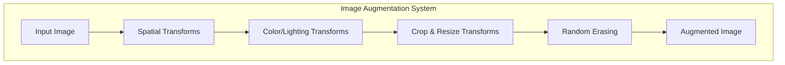
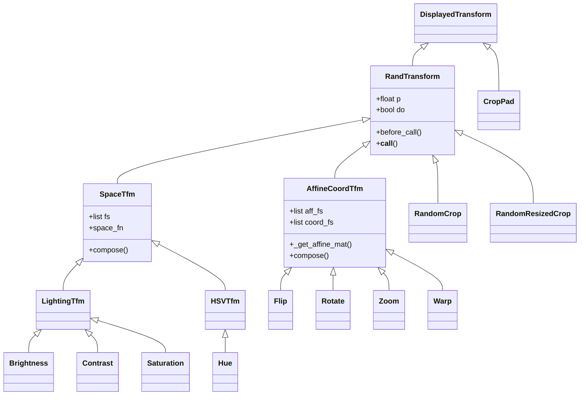
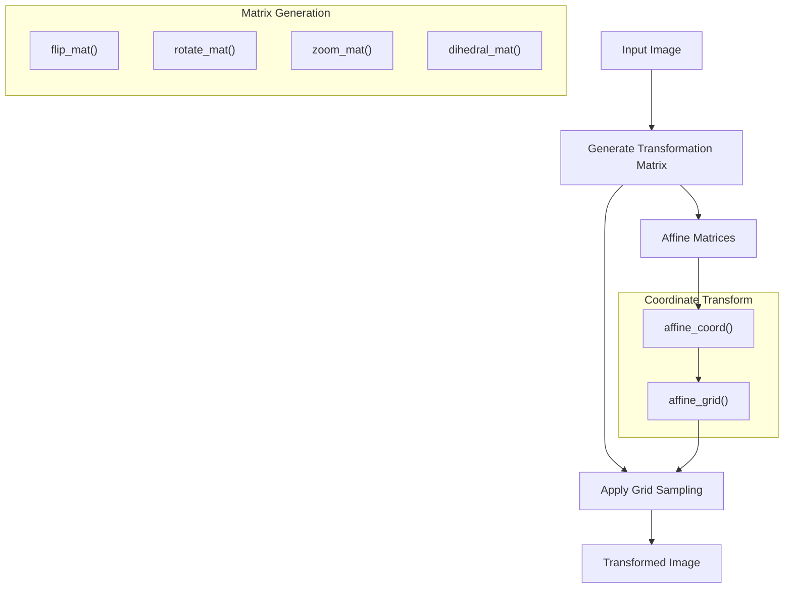
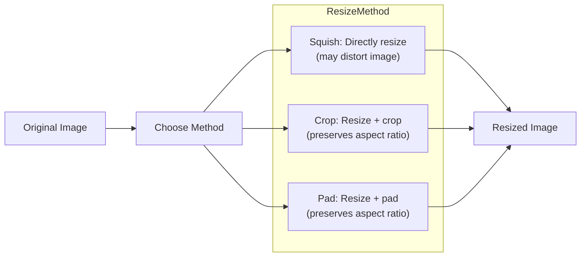
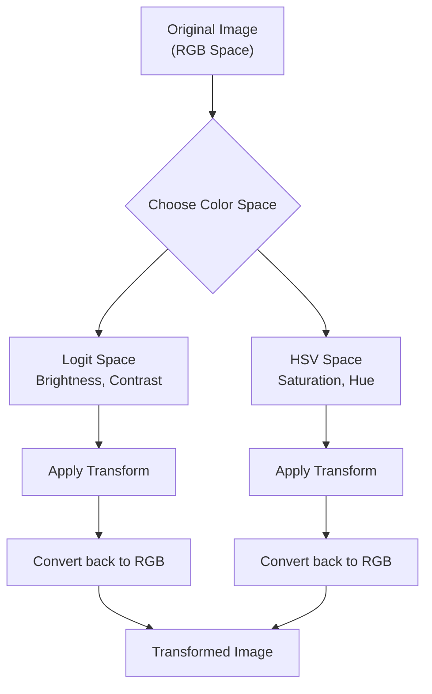
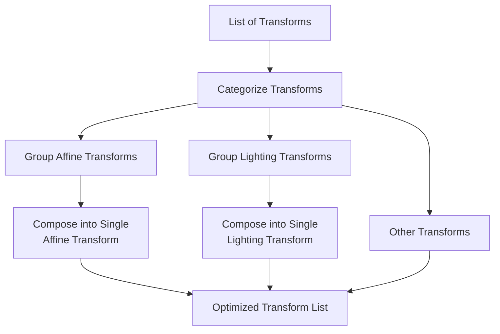

<!-- source: DeepWiki mcp.deepwiki.com · repo fastai/fastai · extra page Image Augmentation · fetched 2026-10-21 -->

# Image Augmentation

<details>
<summary>Relevant source files</summary>

The following files were used as context for generating this wiki page:

- [fastai/vision/augment.py](fastai/vision/augment.py)
- [nbs/09_vision.augment.ipynb](nbs/09_vision.augment.ipynb)

</details>


This page documents fastai's image augmentation capabilities, which are fundamental tools for improving computer vision model performance through data variation. Image augmentation creates modified versions of training images through various transformations, helping models generalize better to unseen data. This document covers the augmentation components in the vision module of the fastai library.

For information on loading image data, see [Vision Data Loading](#3.1.1). For information on vision models and transfer learning, see [Vision Models and Transfer Learning](#3.1.3).

## 1. Overview and Key Concepts

The image augmentation system in fastai provides a comprehensive set of transformations that can be applied to images during training. These transformations can be broadly categorized into:

1. **Spatial Transformations**: Modify the geometry of images (flips, rotations, zooms, etc.)
2. **Color/Lighting Transformations**: Adjust color properties (brightness, contrast, saturation, hue)
3. **Cropping & Resizing Transformations**: Modify image dimensions and aspect ratios
4. **Random Erasing**: Randomly mask out portions of images

Augmentations can be applied individually or combined into pipelines, and fastai provides utilities to easily create common augmentation strategies.



Sources: [fastai/vision/augment.py:12-18]()

## 2. Core Transform Classes

The image augmentation system is built on a hierarchy of transform classes that encapsulate different types of augmentations and their behavior.



### 2.1 Base Transform Classes

- **RandTransform**: Base class for all random transformations that can be conditionally applied based on a probability `p`.
- **AffineCoordTfm**: Base class for affine and coordinate transformations, handling matrix transformations.
- **SpaceTfm**: Base class for transformations that operate in different color spaces.
- **LightingTfm**: Specialized class for transformations in logit space (brightness, contrast).

Sources: [fastai/vision/augment.py:25-51](), [fastai/vision/augment.py:457-506](), [fastai/vision/augment.py:913-949]()

## 3. Spatial Transformations

Spatial transformations modify the geometry of images by applying various affine and perspective transformations.

### 3.1 Key Spatial Transforms

| Transform | Description | Parameters | 
|-----------|-------------|------------|
| `Flip` | Horizontal flipping | `p`: probability of flipping |
| `Dihedral` | 8 possible flip/rotation combinations | `p`: probability of applying transform |
| `Rotate` | Random rotation | `max_deg`: maximum rotation angle, `p`: probability |
| `Zoom` | Random zoom | `min_zoom`: minimum zoom factor, `max_zoom`: maximum zoom factor, `p`: probability |
| `Warp` | Perspective warping | `magnitude`: strength of warping, `p`: probability |

Sources: [fastai/vision/augment.py:621-635](), [fastai/vision/augment.py:689-702](), [fastai/vision/augment.py:744-757](), [fastai/vision/augment.py:799-815](), [fastai/vision/augment.py:891-906]()

### 3.2 Implementation Details

Spatial transformations in fastai are implemented using affine matrices and grid sampling. The process works as follows:



Affine transformations are defined as 3×3 matrices, but for application to images, only the top 2×3 portion is used. These matrices capture operations like rotation, scaling, translation, and flipping. For more complex transformations like perspective warping, additional coordinate transformations are applied.

Sources: [fastai/vision/augment.py:349-352](), [fastai/vision/augment.py:568-576](), [fastai/vision/augment.py:579-583](), [fastai/vision/augment.py:586-596](), [fastai/vision/augment.py:656-671](), [fastai/vision/augment.py:715-727](), [fastai/vision/augment.py:760-783]()

## 4. Crop and Resize Transforms

Cropping and resizing are fundamental operations for preparing images for neural networks, which typically require fixed-size inputs.

### 4.1 Key Crop and Resize Transforms

| Transform | Description | Key Parameters |
|-----------|-------------|----------------|
| `CropPad` | Center crop or pad | `size`: target size |
| `RandomCrop` | Random cropping | `size`: target size |
| `Resize` | Resize with various methods | `size`: target size, `method`: resize method |
| `RandomResizedCrop` | Random crop with resize | `size`: target size, `min_scale`: minimum scale, `ratio`: aspect ratio range |
| `RatioResize` | Resize preserving aspect ratio | `max_sz`: maximum dimension |

Sources: [fastai/vision/augment.py:180-195](), [fastai/vision/augment.py:199-226](), [fastai/vision/augment.py:244-278](), [fastai/vision/augment.py:282-328](), [fastai/vision/augment.py:331-346]()

### 4.2 Resize Methods

Fastai provides three primary resize methods:
- **Squish**: Directly resize to the target dimensions, potentially changing aspect ratio
- **Crop**: Resize to maintain aspect ratio then crop to target size
- **Pad**: Resize to maintain aspect ratio then pad to target size



Sources: [fastai/vision/augment.py:236-240](), [fastai/vision/augment.py:244-278]()

## 5. Color and Lighting Transformations

Color transformations adjust the appearance of images by modifying color properties. These transformations operate in different color spaces for more natural results.

### 5.1 Key Color Transforms

| Transform | Description | Parameters | Color Space |
|-----------|-------------|------------|-------------|
| `Brightness` | Adjust image brightness | `max_lighting`: maximum adjustment, `p`: probability | Logit |
| `Contrast` | Adjust image contrast | `max_lighting`: maximum adjustment, `p`: probability | Logit |
| `Saturation` | Adjust color saturation | `max_lighting`: maximum adjustment, `p`: probability | Logit |
| `Hue` | Adjust color hue | `max_hue`: maximum adjustment, `p`: probability | HSV |

Sources: [fastai/vision/augment.py:973-982](), [fastai/vision/augment.py:1007-1016](), [fastai/vision/augment.py:1051-1061](), [fastai/vision/augment.py:1152-1161]()

### 5.2 Color Spaces

Fastai implements color transformations in different color spaces for more effective and natural-looking results:



The library handles color space conversions automatically, with specialized functions for RGB to HSV conversion (`rgb2hsv`) and HSV to RGB conversion (`hsv2rgb`).

Sources: [fastai/vision/augment.py:910-911](), [fastai/vision/augment.py:1064-1089](), [fastai/vision/augment.py:1092-1113](), [fastai/vision/augment.py:1117-1123]()

## 6. Random Erasing

Random erasing (also known as cutout) is a technique that randomly masks out rectangular regions of an image, forcing the model to learn from the remaining regions. This helps improve robustness to occlusions.


The `RandomErasing` transform allows specifying parameters like:
- `p`: Probability of applying erasing
- `sl`, `sh`: Minimum and maximum proportion of erased area
- `min_aspect`: Minimum aspect ratio of erased area
- `max_count`: Maximum number of erasing blocks per image

Sources: [fastai/vision/augment.py:1164-1171](), [fastai/vision/augment.py:1190-1214]()

## 7. Creating Augmentation Pipelines

Fastai provides utilities to easily create and optimize augmentation pipelines.

### 7.1 The `aug_transforms` Function

The `aug_transforms` function creates a standard set of augmentations with sensible defaults:

```python
tfms = aug_transforms(
    mult=1.0,           # Multiplier for transformation magnitudes
    do_flip=True,       # Apply random flips
    flip_vert=False,    # Apply vertical flips
    max_rotate=10.,     # Maximum rotation degrees
    min_zoom=1.,        # Minimum zoom factor
    max_zoom=1.1,       # Maximum zoom factor
    max_lighting=0.2,   # Maximum lighting adjustment
    max_warp=0.2,       # Maximum warp magnitude
    p_affine=0.75,      # Probability of affine transforms
    p_lighting=0.75     # Probability of lighting transforms
)
```

This function returns an optimized pipeline of transforms that can be directly used with fastai's data block API.

Sources: [fastai/vision/augment.py:1237-1267]()

### 7.2 Optimizing Transform Pipelines

The `setup_aug_tfms` function optimizes transform pipelines by combining compatible transforms to reduce computational overhead:



This optimization ensures that multiple affine transformations are combined into a single matrix operation, and multiple lighting transformations are applied in a single pass, improving performance.

Sources: [fastai/vision/augment.py:1217-1234]()

## 8. Performance Optimizations

Fastai implements several optimizations to make image augmentation efficient:

1. **Matrix Composition**: Multiple affine transformations are combined into a single matrix operation.
2. **GPU-Optimized Transforms**: `RandomResizedCropGPU` provides a GPU-optimized implementation for better performance.
3. **Batch Processing**: Many transforms support batch-wise processing with the `batch` parameter, applying identical transformations to all images in a batch.
4. **Interpolation Control**: Fine-grained control over interpolation modes (`mode`) allows balancing quality and speed.

These optimizations ensure that augmentation doesn't become a bottleneck during training.

Sources: [fastai/vision/augment.py:508-549](), [fastai/vision/augment.py:1225-1234]()

## 9. Integration with Data Pipeline

Image augmentations integrate with fastai's data pipeline through item and batch transforms. In a typical workflow:

1. **Item transforms** (like `Resize`) are applied to individual items during data loading
2. **Batch transforms** (like most augmentations) are applied to batches of images just before feeding to the model

To use augmentations with a DataBlock:

```python
data = DataBlock(
    blocks=(ImageBlock, CategoryBlock),
    get_items=get_image_files,
    splitter=RandomSplitter(),
    get_y=parent_label,
    item_tfms=Resize(224),
    batch_tfms=aug_transforms()
)
```

This separation allows computationally intensive augmentations to be performed efficiently on GPU in batches.

Sources: [fastai/vision/augment.py:1237-1267]()

## Summary

Fastai's image augmentation system provides a comprehensive set of transformations for improving computer vision model performance. With a flexible architecture based on composable transforms, it supports everything from basic flips and rotations to advanced color space manipulations and random erasing. The system is optimized for performance while maintaining a user-friendly API that makes it easy to incorporate state-of-the-art augmentation strategies into your training pipeline.

---

