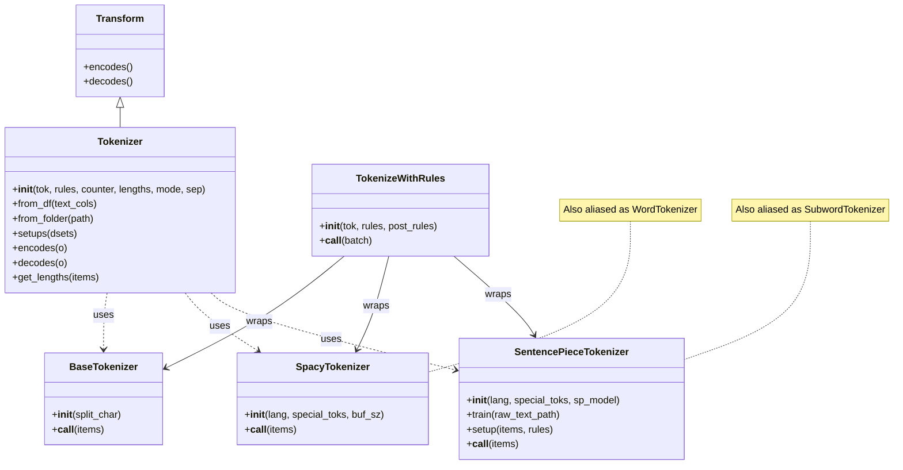
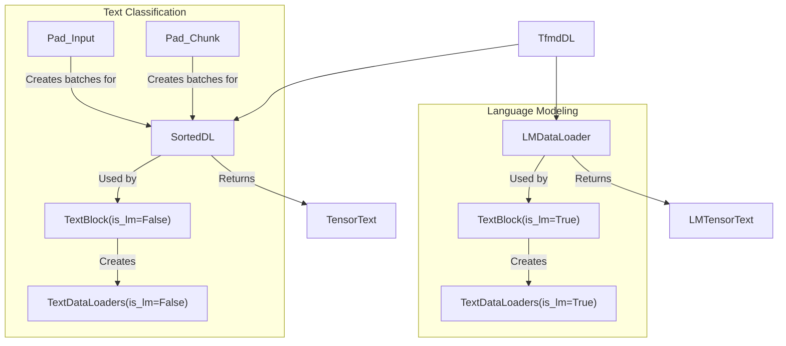
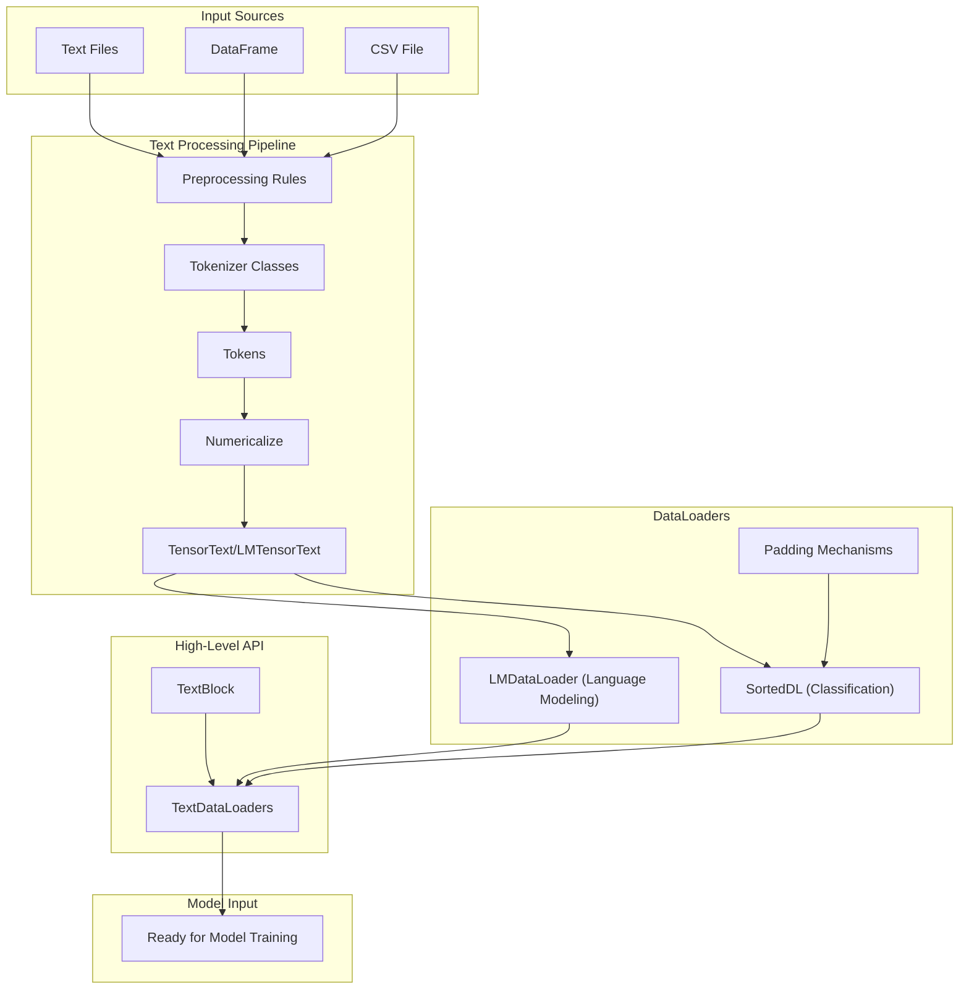

<!-- source: DeepWiki mcp.deepwiki.com · repo fastai/fastai · extra page Text Data Processing · fetched 2026-10-21 -->

# Text Data Processing

<details>
<summary>Relevant source files</summary>

The following files were used as context for generating this wiki page:

- [fastai/text/data.py](fastai/text/data.py)
- [nbs/30_text.core.ipynb](nbs/30_text.core.ipynb)
- [nbs/31_text.data.ipynb](nbs/31_text.data.ipynb)

</details>


This document explains how fastai processes text data for natural language processing (NLP) tasks. It covers the complete pipeline from raw text preprocessing to creating model-ready tensors, including tokenization, numericalization, and data loading mechanisms. For information about language modeling and text classification models, see [Natural Language Processing](#3.2).

## Overview of Text Data Processing

Text data processing in fastai follows a structured pipeline that transforms raw text into numerical representations suitable for deep learning models. This process involves several key steps:


Sources: [fastai/text/data.py:1-289](), [nbs/30_text.core.ipynb:49-412]()

## Text Preprocessing and Special Tokens

### Special Tokens

Fastai uses several special tokens that serve specific purposes in text processing:

```python
UNK, PAD, BOS, EOS, FLD, TK_REP, TK_WREP, TK_UP, TK_MAJ = "xxunk xxpad xxbos xxeos xxfld xxrep xxwrep xxup xxmaj".split()
```

- `UNK` - Unknown token for words not in the vocabulary
- `PAD` - Padding token for uniform sequence length
- `BOS` - Beginning of sequence marker
- `EOS` - End of sequence marker
- `FLD` - Field separator for multi-field texts
- `TK_REP` - Token for repeated characters
- `TK_WREP` - Token for repeated words
- `TK_UP` - Token marking uppercase text
- `TK_MAJ` - Token marking capitalized text

Sources: [nbs/30_text.core.ipynb:85-98]()

### Preprocessing Rules

The library includes several preprocessing functions applied to texts before tokenization:

- `fix_html` - Cleans HTML entities and special characters
- `replace_rep` - Replaces character repetitions with tokens
- `replace_wrep` - Replaces word repetitions with tokens
- `spec_add_spaces` - Adds spaces around special characters
- `rm_useless_spaces` - Removes redundant spaces
- `replace_all_caps` - Handles ALL CAPS text
- `replace_maj` - Handles Capitalized text
- `lowercase` - Converts text to lowercase

These rules are stored in `defaults.text_proc_rules` and applied automatically during tokenization.

Sources: [nbs/30_text.core.ipynb:106-413]()

## Tokenization

Tokenization is the process of splitting text into individual tokens (words, subwords, or characters). Fastai provides several tokenization options:

### Tokenizer Types



Sources: [nbs/30_text.core.ipynb:428-441](), [nbs/30_text.core.ipynb:460-484](), [nbs/30_text.core.ipynb:1302-1369](), [nbs/30_text.core.ipynb:502-513](), [nbs/30_text.core.ipynb:1154-1211]()

#### Base Tokenizer

The simplest tokenizer that splits text on spaces:

```python
class BaseTokenizer():
    "Basic tokenizer that just splits on spaces"
    def __init__(self, split_char=' ', **kwargs): self.split_char=split_char
    def __call__(self, items): return (t.split(self.split_char) for t in items)
```

Sources: [nbs/30_text.core.ipynb:435-440]()

#### SpacyTokenizer (WordTokenizer)

Uses spaCy for more sophisticated word-level tokenization:

```python
class SpacyTokenizer():
    "Spacy tokenizer for `lang`"
    def __init__(self, lang='en', special_toks=None, buf_sz=5000):
        # Implementation details...
    def __call__(self, items):
        return (L(doc).attrgot('text') for doc in self.pipe(map(str,items), batch_size=self.buf_sz))
```

Sources: [nbs/30_text.core.ipynb:460-483]()

#### SentencePieceTokenizer (SubwordTokenizer)

Uses SentencePiece for subword tokenization, which is particularly useful for languages without clear word boundaries or for handling out-of-vocabulary words:

```python
class SentencePieceTokenizer():
    "SentencePiece tokenizer for `lang`"
    def __init__(self, lang='en', special_toks=None, sp_model=None, vocab_sz=None, max_vocab_sz=30000,
                 model_type='unigram', char_coverage=None, cache_dir='tmp'):
        # Implementation details...
```

Sources: [nbs/30_text.core.ipynb:1302-1357]()

#### TokenizeWithRules

A wrapper that applies preprocessing rules before tokenization:

```python
class TokenizeWithRules:
    "A wrapper around `tok` which applies `rules`, then tokenizes, then applies `post_rules`"
    def __init__(self, tok, rules=None, post_rules=None):
        # Implementation details...
    def __call__(self, batch):
        return (L(o).map(self.post_f) for o in self.tok(maps(*self.rules, batch)))
```

Sources: [nbs/30_text.core.ipynb:502-512]()

### Tokenization Functions

Fastai provides several functions for tokenizing different data sources:

- `tokenize1` - Tokenize a single text
- `parallel_tokenize` - Tokenize a list of texts in parallel
- `tokenize_folder` - Tokenize text files in a folder
- `tokenize_files` - Tokenize specific text files
- `tokenize_df` - Tokenize texts in a DataFrame
- `tokenize_csv` - Tokenize texts in a CSV file

Sources: [nbs/30_text.core.ipynb:553-884]()

## Numericalization

After tokenization, tokens need to be converted to integers for use in neural networks.

### Vocabulary Building

The `make_vocab` function creates a vocabulary from token counts:

```python
def make_vocab(count, min_freq=3, max_vocab=60000, special_toks=None):
    "Create a vocab of `max_vocab` size from `Counter` `count` with items present more than `min_freq`"
    vocab = [o for o,c in count.most_common(max_vocab) if c >= min_freq]
    special_toks = ifnone(special_toks, defaults.text_spec_tok)
    for o in reversed(special_toks): #Make sure all special tokens are in the vocab
        if o in vocab: vocab.remove(o)
        vocab.insert(0, o)
    vocab = vocab[:max_vocab]
    return vocab + [f'xxfake' for i in range(0, 8-len(vocab)%8)]
```

The vocabulary:
- Contains special tokens (UNK, PAD, BOS, etc.) at the beginning
- Includes the most common tokens that appear at least `min_freq` times
- Is padded to a multiple of 8 (for performance optimization on GPUs)

Sources: [nbs/31_text.data.ipynb:106-115]()

### Numericalize Transform

The `Numericalize` transform converts tokens to integers using the vocabulary:

```python
class Numericalize(Transform):
    "Reversible transform of tokenized texts to numericalized ids"
    def __init__(self, vocab=None, min_freq=3, max_vocab=60000, special_toks=None):
        store_attr('vocab,min_freq,max_vocab,special_toks')
        self.o2i = None if vocab is None else defaultdict(int, {v:k for k,v in enumerate(vocab)})

    def setups(self, dsets):
        # Build vocabulary if not provided
        if dsets is None: return
        if self.vocab is None:
            count = dsets.counter if getattr(dsets, 'counter', None) is not None else Counter(p for o in dsets for p in o)
            if self.special_toks is None and hasattr(dsets, 'special_toks'):
                self.special_toks = dsets.special_toks
            self.vocab = make_vocab(count, min_freq=self.min_freq, max_vocab=self.max_vocab, special_toks=self.special_toks)
            self.o2i = defaultdict(int, {v:k for k,v in enumerate(self.vocab) if v != 'xxfake'})

    def encodes(self, o): return TensorText(tensor([self.o2i[o_] for o_ in o]))
    def decodes(self, o): return L(self.vocab[o_] for o_ in o)
```

This transform can create a vocabulary from data if none is provided, and it returns a `TensorText` object which is a semantic type for tensors representing text.

Sources: [nbs/31_text.data.ipynb:167-184]()

## Data Loading for Text Models

Fastai provides specialized data loaders for text-based tasks:

### Types of Text Data Loaders



Sources: [nbs/31_text.data.ipynb:301-387](), [nbs/31_text.data.ipynb:184-220](), [nbs/31_text.data.ipynb:128-147](), [nbs/31_text.data.ipynb:166-181]()

### Language Modeling DataLoader

For language modeling (predicting the next word), `LMDataLoader` is used:

```python
@delegates()
class LMDataLoader(TfmdDL):
    "A `DataLoader` suitable for language modeling"
    def __init__(self, dataset, lens=None, cache=2, bs=64, seq_len=72, num_workers=0, **kwargs):
        # Implementation details...
```

This data loader:
- Concatenates all texts into one continuous stream
- Splits this stream into `bs` (batch size) contiguous sequences
- Creates batches of sequences with length `seq_len`
- Returns inputs as `txt[:-1]` and targets as `txt[1:]` for next-token prediction

Sources: [nbs/31_text.data.ipynb:349-386]()

### Text Classification DataLoader

For text classification, `SortedDL` is used with padding strategies:

```python
@delegates(TfmdDL)
class SortedDL(TfmdDL):
    "A `DataLoader` that goes throught the item in the order given by `sort_func`"
    def __init__(self, dataset, sort_func=None, res=None, **kwargs):
        # Implementation details...
```

This data loader:
- Sorts texts by length for efficient batching
- When shuffling, it approximately maintains length sorting within mini-batches
- Requires padding to handle variable-length texts

Sources: [nbs/31_text.data.ipynb:184-220]()

### Padding Mechanisms

Fastai provides several options for padding variable-length texts:

1. **Pad_Input**: Basic padding for classification tasks
   ```python
   class Pad_Input(ItemTransform):
       def encodes(self, samples, pad_idx=1, pad_fields=0, pad_first=False, backwards=False):
           # Implementation details...
   ```

2. **pad_chunk** and **Pad_Chunk**: More sophisticated padding that works with sequence models
   ```python
   def pad_chunk(x, pad_idx=1, pad_first=True, seq_len=72, pad_len=10):
       "Pad `x` by adding padding by chunks of size `seq_len`"
       # Implementation details...
   ```

Sources: [nbs/31_text.data.ipynb:127-147](), [nbs/31_text.data.ipynb:149-156](), [nbs/31_text.data.ipynb:166-181]()

## High-Level APIs

### TextBlock API

The `TextBlock` class integrates text processing with fastai's DataBlock API:

```python
class TextBlock(TransformBlock):
    "A `TransformBlock` for texts"
    @delegates(Numericalize.__init__)
    def __init__(self, tok_tfm, vocab=None, is_lm=False, seq_len=72, backwards=False, **kwargs):
        type_tfms = [tok_tfm, Numericalize(vocab, **kwargs)]
        if backwards: type_tfms += [reverse_text]
        return super().__init__(type_tfms=type_tfms,
                                dl_type=LMDataLoader if is_lm else SortedDL,
                                dls_kwargs={'seq_len': seq_len} if is_lm else {'before_batch': Pad_Chunk(seq_len=seq_len)})
```

`TextBlock` offers:
- Factory methods for creating from DataFrames or folders
- Automatic selection of appropriate data loader based on the task
- Integration with other blocks for classification tasks

Sources: [nbs/31_text.data.ipynb:222-245]()

### TextDataLoaders

`TextDataLoaders` provides high-level factory methods for creating text data loaders:

```python
class TextDataLoaders(DataLoaders):
    "Basic wrapper around several `DataLoader`s with factory methods for NLP problems"
    
    @classmethod
    @delegates(DataLoaders.from_dblock)
    def from_folder(cls, path, train='train', valid='valid', valid_pct=None, seed=None, vocab=None, text_vocab=None, is_lm=False,
                    tok_tfm=None, seq_len=72, splitter=None, backwards=False, **kwargs):
        # Implementation details...
        
    @classmethod
    @delegates(DataLoaders.from_dblock)
    def from_df(cls, df, path='.', valid_pct=0.2, seed=None, text_col=0, label_col=1, label_delim=None, y_block=None,
                text_vocab=None, is_lm=False, valid_col=None, tok_tfm=None, tok_text_col="text", seq_len=72, backwards=False, **kwargs):
        # Implementation details...
        
    @classmethod
    def from_csv(cls, path, csv_fname='labels.csv', header='infer', delimiter=None, quoting=csv.QUOTE_MINIMAL, **kwargs):
        # Implementation details...
```

These methods provide one-line solutions for creating data loaders from:
- Folders with text files
- DataFrames with text columns
- CSV files with text data

Sources: [nbs/31_text.data.ipynb:247-288]()

## Complete Text Processing Flow

The following diagram illustrates the complete flow of text data through the fastai library:



Sources: [nbs/31_text.data.ipynb:1-1500](), [nbs/30_text.core.ipynb:1-1509]()

## Usage Examples

### Creating DataLoaders from a DataFrame

```python
# For classification
dls = TextDataLoaders.from_df(df, 
                             text_col='text',       # Column containing the text
                             label_col='label',     # Column containing the labels
                             valid_pct=0.2,         # Percentage of data for validation
                             seq_len=72,            # Maximum sequence length
                             bs=64)                 # Batch size

# For language modeling
dls = TextDataLoaders.from_df(df,
                             text_col='text',
                             is_lm=True,           # Set to True for language modeling
                             seq_len=72,
                             bs=64)
```

### Creating DataLoaders from a Folder

```python
# For classification (assumes folder structure path/train/label/file.txt)
dls = TextDataLoaders.from_folder(path,
                                 train='train',     # Training folder name
                                 valid='valid',     # Validation folder name
                                 bs=64)

# For language modeling
dls = TextDataLoaders.from_folder(path,
                                 is_lm=True,
                                 bs=64)
```

### Using TextBlock with DataBlock API

```python
# For classification
dls = DataBlock(
    blocks=(TextBlock.from_df('text', seq_len=72), CategoryBlock),
    get_x=ColReader('text'),
    get_y=ColReader('label'),
    splitter=RandomSplitter(valid_pct=0.2)
).dataloaders(df, bs=64)

# For language modeling
dls = DataBlock(
    blocks=TextBlock.from_df('text', seq_len=72, is_lm=True),
    get_items=ColReader('text'),
    splitter=RandomSplitter(valid_pct=0.2)
).dataloaders(df, bs=64)
```

Sources: [nbs/31_text.data.ipynb:1083-1089](), [nbs/31_text.data.ipynb:1394-1398]()

---

