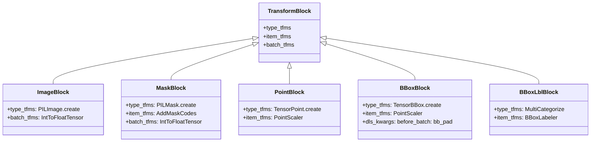
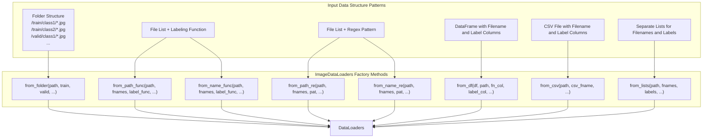
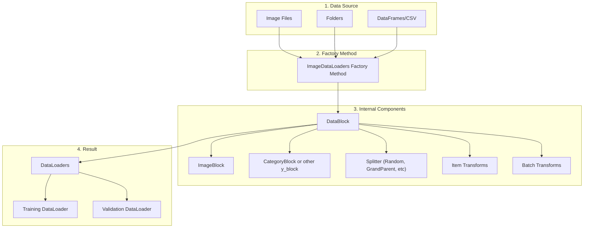

<!-- source: DeepWiki mcp.deepwiki.com · repo fastai/fastai · extra page Vision Data Loading · fetched 2026-10-21 -->

# Vision Data Loading

<details>
<summary>Relevant source files</summary>

The following files were used as context for generating this wiki page:

- [fastai/vision/data.py](fastai/vision/data.py)
- [nbs/08_vision.data.ipynb](nbs/08_vision.data.ipynb)

</details>


This document explains the vision data loading components of the fastai library, focusing on how to load and prepare image data for computer vision tasks. It covers the specialized blocks for vision data, data loading factory methods, and utility functions that simplify working with image datasets.

For information about image augmentation techniques, see [Image Augmentation](#3.1.2). For details on vision models and transfer learning, see [Vision Models and Transfer Learning](#3.1.3).

## Overview of Vision Data Loading

The fastai vision data loading system provides a streamlined way to load image data from various sources (files, folders, dataframes) and prepare it for model training. It builds upon the core `DataBlock` API (see [Data Processing Pipeline](#2.2)) to provide vision-specific functionality.

```mermaid
flowchart TD
    subgraph "Data Sources"
        files["Image Files"]
        folders["Folder Structure"]
        dataframes["DataFrames/CSV"]
        lists["Python Lists"]
    end

    subgraph "Vision Block Components"
        ImageBlock["ImageBlock"]
        MaskBlock["MaskBlock"]
        PointBlock["PointBlock"]
        BBoxBlock["BBoxBlock"]
        BBoxLblBlock["BBoxLblBlock"]
    end

    subgraph "Factory Methods"
        from_folder["from_folder()"]
        from_path_func["from_path_func()"]
        from_df["from_df()"]
        from_csv["from_csv()"]
        from_lists["from_lists()"]
    end

    subgraph "Output"
        dls["DataLoaders"]
    end

    files --> from_path_func
    folders --> from_folder
    dataframes --> from_df
    lists --> from_lists
    
    from_folder --> ImageDataLoaders
    from_path_func --> ImageDataLoaders
    from_df --> ImageDataLoaders
    from_csv --> ImageDataLoaders
    from_lists --> ImageDataLoaders
    
    ImageDataLoaders --> dls
    SegmentationDataLoaders --> dls
    
    ImageBlock --> ImageDataLoaders
    MaskBlock --> SegmentationDataLoaders
    PointBlock --> "Custom DataBlock"
    BBoxBlock --> "Custom DataBlock"
    BBoxLblBlock --> "Custom DataBlock"
```

Sources: [fastai/vision/data.py:1-221]()

## Vision-Specific TransformBlocks

The fastai library provides specialized TransformBlocks for different types of vision data. These blocks define how raw data should be loaded and transformed into tensors suitable for model training.



Sources: [fastai/vision/data.py:82-106]()

### Available Vision Blocks

1. **ImageBlock**: Loads and transforms images
   ```python
   ImageBlock(cls=PILImage)  # cls can be PILImage or PILImageBW
   ```

2. **MaskBlock**: For segmentation masks
   ```python
   MaskBlock(codes=None)  # codes are vocabulary labels for segmentation classes
   ```

3. **PointBlock**: For keypoints in images
   ```python
   PointBlock  # No parameters needed
   ```

4. **BBoxBlock**: For bounding boxes in images
   ```python
   BBoxBlock  # No parameters needed
   ```

5. **BBoxLblBlock**: For labeled bounding boxes
   ```python
   BBoxLblBlock(vocab=None, add_na=True)  # vocab defines class labels
   ```

Sources: [fastai/vision/data.py:82-106]()

## ImageDataLoaders

`ImageDataLoaders` is a class that provides factory methods to simplify creating DataLoaders for computer vision tasks. It extends the base `DataLoaders` class with vision-specific functionality.



Sources: [fastai/vision/data.py:109-204]()

### Common Factory Methods

#### 1. from_folder

Creates DataLoaders from an ImageNet-style folder structure, where images are organized in folders by class.

```python
ImageDataLoaders.from_folder(
    path,                 # Root path containing the image folders
    train='train',        # Name of the training folder
    valid='valid',        # Name of the validation folder
    valid_pct=None,       # If provided, creates a random split instead of using separate folders
    seed=None,            # Random seed for reproducibility
    vocab=None,           # List of class names to include (uses all if None)
    item_tfms=None,       # Transforms applied to individual items
    batch_tfms=None,      # Transforms applied to batches
    img_cls=PILImage,     # Image class (PILImage or PILImageBW)
    **kwargs              # Additional arguments for DataLoaders
)
```

Sources: [fastai/vision/data.py:112-124]()

#### 2. from_path_func

Creates DataLoaders from a list of image filenames with a custom labeling function.

```python
ImageDataLoaders.from_path_func(
    path,                 # Root path
    fnames,               # List of image filenames
    label_func,           # Function that takes a path and returns a label
    valid_pct=0.2,        # Percentage to use for validation
    seed=None,            # Random seed
    item_tfms=None,       # Item transforms
    batch_tfms=None,      # Batch transforms
    img_cls=PILImage,     # Image class
    **kwargs              # Additional arguments
)
```

Sources: [fastai/vision/data.py:127-136]()

#### 3. from_df

Creates DataLoaders from a DataFrame containing filenames and labels.

```python
ImageDataLoaders.from_df(
    df,                   # DataFrame
    path='.',             # Root path
    valid_pct=0.2,        # Validation percentage
    seed=None,            # Random seed
    fn_col=0,             # Column with filenames (index or name)
    folder=None,          # Optional subfolder to prepend to filenames
    suff='',              # Optional suffix to append to filenames
    label_col=1,          # Column with labels (index or name)
    label_delim=None,     # Delimiter for multi-label tasks
    y_block=None,         # Block for labels (auto-detected if None)
    valid_col=None,       # Column indicating validation set
    item_tfms=None,       # Item transforms
    batch_tfms=None,      # Batch transforms
    img_cls=PILImage,     # Image class
    **kwargs              # Additional arguments
)
```

Sources: [fastai/vision/data.py:164-179]()

#### 4. from_csv

Creates DataLoaders from a CSV file containing filenames and labels.

```python
ImageDataLoaders.from_csv(
    path,                 # Root path
    csv_fname='labels.csv', # CSV filename
    header='infer',       # Header row information
    delimiter=None,       # CSV delimiter
    **kwargs              # Additional arguments (passed to from_df)
)
```

Sources: [fastai/vision/data.py:181-185]()

## SegmentationDataLoaders

`SegmentationDataLoaders` is specialized for image segmentation tasks, where each input image has a corresponding mask image.

```python
SegmentationDataLoaders.from_label_func(
    path,                 # Root path
    fnames,               # List of image filenames
    label_func,           # Function that maps an image filename to its mask filename
    valid_pct=0.2,        # Validation percentage
    seed=None,            # Random seed
    codes=None,           # List of class labels for the segmentation task
    item_tfms=None,       # Item transforms
    batch_tfms=None,      # Batch transforms
    img_cls=PILImage,     # Image class
    **kwargs              # Additional arguments
)
```

Sources: [fastai/vision/data.py:207-220]()

## Helper Functions for Vision Data

The vision data module includes several utility functions to help with data loading and visualization:

1. **get_grid**: Creates a grid of axes for displaying images
   ```python
   get_grid(n, nrows=None, ncols=None, figsize=None, double=False)
   ```

2. **clip_remove_empty**: Clips bounding boxes to image boundaries and removes empty ones
   ```python
   clip_remove_empty(bbox, label)
   ```

3. **bb_pad**: Pads batches of bounding boxes to the same size
   ```python
   bb_pad(samples, pad_idx=0)
   ```

4. **show_batch**: Displays a batch of images, with specialized versions for different data types
   ```python
   show_batch(x, y, samples, ctxs=None, max_n=10, **kwargs)
   ```

Sources: [fastai/vision/data.py:17-79]()

## Common Data Loading Patterns

The following table shows which factory method to use based on your data organization:

| Data Organization | Recommended Factory Method |
|-------------------|----------------------------|
| Images in class folders (train/valid split) | `from_folder` |
| List of image paths with custom labeling logic | `from_path_func` |
| List of image paths with labels derived from filename | `from_name_func` |
| List of image paths with regex pattern for labels | `from_path_re` or `from_name_re` |
| DataFrame with image paths and labels | `from_df` |
| CSV file with image paths and labels | `from_csv` |
| Separate lists of paths and labels | `from_lists` |
| Segmentation task (images + mask images) | `SegmentationDataLoaders.from_label_func` |

## Data Loading Pipeline



Sources: [fastai/vision/data.py:109-204](), [fastai/vision/data.py:207-220]()

## Example Usage

Here's a simple example of how to use `ImageDataLoaders` to load a dataset with an ImageNet-style folder structure:

```python
from fastai.vision.all import *

# Load dataset from folder structure
path = 'path/to/dataset'
dls = ImageDataLoaders.from_folder(
    path,
    valid_pct=0.2,
    seed=42,
    item_tfms=Resize(224),
    batch_tfms=aug_transforms()
)

# Create a learner
learn = vision_learner(dls, resnet34, metrics=error_rate)

# Train the model
learn.fine_tune(5)
```

For more complex data loading scenarios, you can use the appropriate factory method based on your data organization, as shown in the Common Data Loading Patterns table above.

Sources: [fastai/vision/data.py:109-124]()

---

