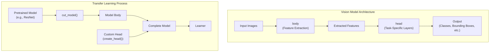
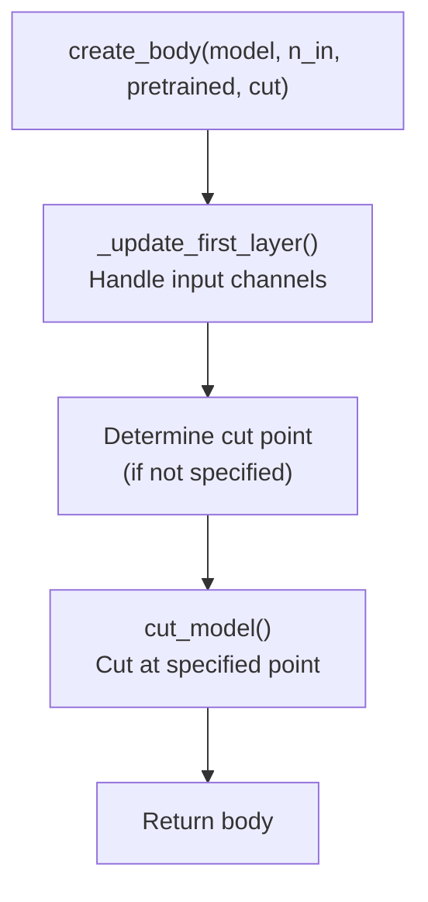
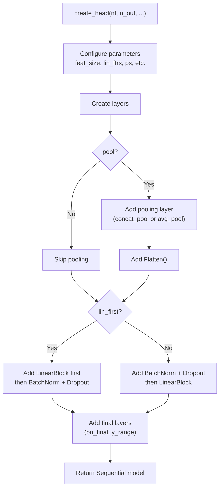
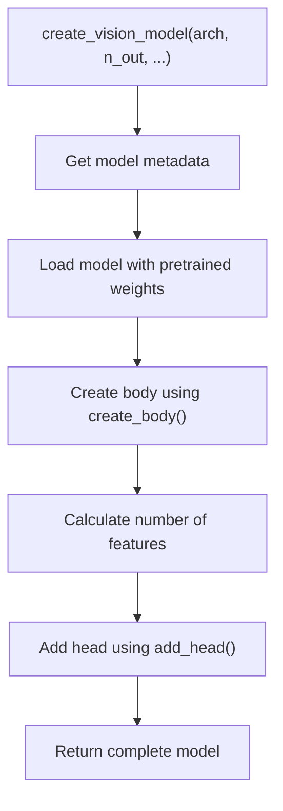
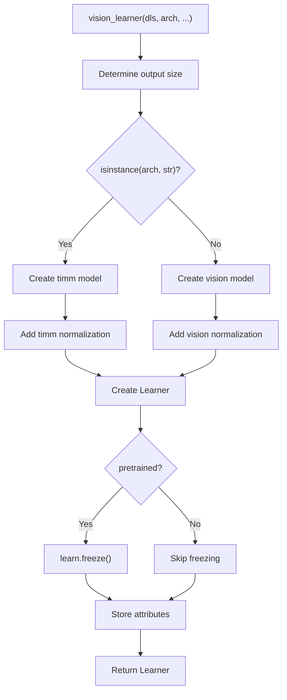
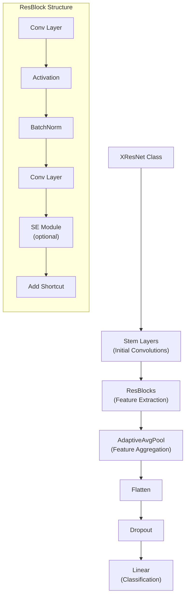
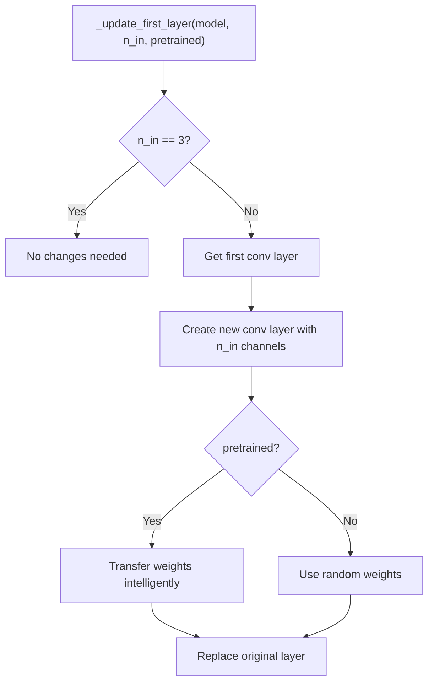
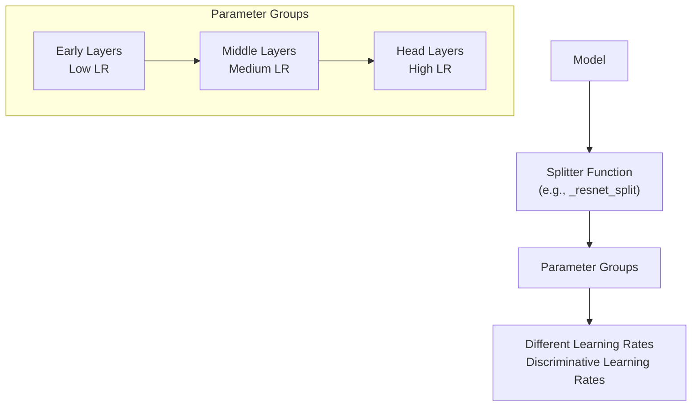

<!-- source: DeepWiki mcp.deepwiki.com · repo fastai/fastai · extra page Vision Models and Transfer Learning · fetched 2026-10-21 -->

# Vision Models and Transfer Learning

<details>
<summary>Relevant source files</summary>

The following files were used as context for generating this wiki page:

- [fastai/layers.py](fastai/layers.py)
- [fastai/vision/learner.py](fastai/vision/learner.py)
- [nbs/01_layers.ipynb](nbs/01_layers.ipynb)
- [nbs/11_vision.models.xresnet.ipynb](nbs/11_vision.models.xresnet.ipynb)
- [nbs/21_vision.learner.ipynb](nbs/21_vision.learner.ipynb)

</details>


This document explains how fastai implements vision models and transfer learning, covering the architecture, components, and key functions that enable effective transfer learning for computer vision tasks. This includes how models are structured, modified, and trained with pretrained weights.

For information on vision data loading, see [Vision Data Loading](#3.1.1), and for image augmentation techniques, see [Image Augmentation](#3.1.2).

## Core Architecture

The vision model architecture in fastai follows a modular body-head design that facilitates transfer learning:



The architecture separates feature extraction (body) from task-specific layers (head), allowing you to reuse pretrained knowledge while adapting models to new tasks.

Sources:
- [fastai/vision/learner.py:74-87](fastai/vision/learner.py:74-87)
- [fastai/vision/learner.py:154-162](fastai/vision/learner.py:154-162)

## Creating Model Bodies

The `create_body` function cuts a pretrained model to create a feature extraction body:



The function handles:
1. Updating the first layer if needed (e.g., for grayscale images)
2. Determining where to cut the model (typically at a pooling layer)
3. Cutting the model to retain only the feature extraction part

For each model architecture, fastai maintains metadata with recommended cut points:

| Architecture | Default Cut | Split Function |
|--------------|-------------|---------------|
| ResNet       | -2          | _resnet_split |
| XResNet      | -4          | _xresnet_split |
| DenseNet     | -1          | _densenet_split |
| VGG          | -2          | _vgg_split |
| SqueezeNet   | -1          | _squeezenet_split |
| AlexNet      | -2          | _alexnet_split |

Sources:
- [fastai/vision/learner.py:81-87](fastai/vision/learner.py:81-87)
- [fastai/vision/learner.py:127-151](fastai/vision/learner.py:127-151)

## Creating Model Heads

The `create_head` function builds a custom head for specific tasks:



The head typically includes:
- Pooling layer (AdaptiveConcatPool2d or AdaptiveAvgPool2d)
- Flattening operation
- Linear layers with batch normalization and dropout
- Optional output activation (e.g., SigmoidRange for regression)

Sources:
- [fastai/vision/learner.py:90-109](fastai/vision/learner.py:90-109)
- [fastai/layers.py:177-185](fastai/layers.py:177-185)

## Adding Heads to Bodies

The `add_head` function combines a body and head into a complete model:

```python
def add_head(body, nf, n_out, init=nn.init.kaiming_normal_, head=None, concat_pool=True, pool=True,
             lin_ftrs=None, ps=0.5, first_bn=True, bn_final=False, lin_first=False, y_range=None):
    "Add a head to a vision body"
    if head is None:
        head = create_head(nf, n_out, concat_pool=concat_pool, pool=pool,
                         lin_ftrs=lin_ftrs, ps=ps, first_bn=first_bn, bn_final=bn_final, 
                         lin_first=lin_first, y_range=y_range)
    model = nn.Sequential(body, head)
    if init is not None: apply_init(model[1], init)
    return model
```

This function:
1. Creates a head if one is not provided
2. Combines the body and head into a Sequential model
3. Initializes the head with the specified initialization function

Sources:
- [fastai/vision/learner.py:154-162](fastai/vision/learner.py:154-162)

## Creating Vision Models

The `create_vision_model` function brings everything together to create a complete vision model:



Key parameters:
- `arch`: Model architecture (e.g., `models.resnet34`)
- `n_out`: Number of output classes or values
- `pretrained`: Whether to use pretrained weights
- `cut`: Where to cut the model (defaults to architecture metadata)
- `n_in`: Number of input channels
- Various head customization options

Sources:
- [fastai/vision/learner.py:165-178](fastai/vision/learner.py:165-178)

## The vision_learner Function

The `vision_learner` function is the primary entry point for creating vision models:



Key features:
- Creates models from either torchvision or timm architectures
- Automatically determines output size from data
- Adds appropriate normalization statistics
- Creates a Learner with proper splitting for transfer learning
- Freezes the model if using pretrained weights

Sources:
- [fastai/vision/learner.py:218-246](fastai/vision/learner.py:218-246)

## Support for timm Models

fastai supports models from the `timm` library using `create_timm_model`:

```python
def create_timm_model(arch, n_out, cut=None, pretrained=True, n_in=3, init=nn.init.kaiming_normal_,
                     custom_head=None, concat_pool=True, pool=True, lin_ftrs=None, ps=0.5,
                     first_bn=True, bn_final=False, lin_first=False, y_range=None, **kwargs):
    "Create custom architecture using `arch`, `n_in` and `n_out` from the `timm` library"
    model = timm.create_model(arch, pretrained=pretrained, num_classes=0, in_chans=n_in, **kwargs)
    body = TimmBody(model, pretrained, None, n_in)
    nf = body.model.num_features
    res = add_head(body, nf, n_out, init=init, head=custom_head, concat_pool=concat_pool, 
                  pool=body.needs_pool, lin_ftrs=lin_ftrs, ps=ps, first_bn=first_bn, 
                  bn_final=bn_final, lin_first=lin_first, y_range=y_range)
    return res, model.default_cfg
```

The `TimmBody` class wraps timm models to work with fastai:

```python
class TimmBody(nn.Module):
    def __init__(self, model, pretrained:bool=True, cut=None, n_in:int=3):
        super().__init__()
        self.needs_pool = model.default_cfg.get('pool_size', None) is not None
        self.model = model if cut is None else cut_model(model, cut)
    
    def forward(self,x): return self.model.forward_features(x) if self.needs_pool else self.model(x)
```

Sources:
- [fastai/vision/learner.py:181-198](fastai/vision/learner.py:181-198)

## XResNet Models

fastai includes XResNet models, which are improved ResNet variants:



XResNet models implement improvements from "Bag of Tricks for Image Classification":
- Improved stem design
- ResNet-D style shortcut connections
- Optional SE (Squeeze-and-Excitation) blocks

The library includes multiple variants:
- Basic XResNet: `xresnet18`, `xresnet34`, `xresnet50`, etc.
- SE-enhanced (Squeeze-Excitation): `xse_resnet34`, etc.
- ResNeXt variants: `xresnext50`, etc.

Sources:
- [nbs/11_vision.models.xresnet.ipynb:74-107](nbs/11_vision.models.xresnet.ipynb:74-107)
- [nbs/11_vision.models.xresnet.ipynb:117-134](nbs/11_vision.models.xresnet.ipynb:117-134)

## Special Features

### Handling Different Input Channels

fastai can adapt pretrained models for inputs with different numbers of channels:



Weight transfer strategies:
- For 1 channel: Sum of RGB weights
- For 2 channels: First 2 channel weights * 1.5
- For 4+ channels: Copy first 3 channel weights, zero the rest

Sources:
- [fastai/vision/learner.py:44-71](fastai/vision/learner.py:44-71)

### Transfer Learning Splitters

fastai uses "splitters" to divide models into parameter groups for different learning rates:



Architecture-specific splitters ensure optimal transfer learning:

```python
def _xresnet_split(m): return L(m[0][:3], m[0][3:], m[1:]).map(params)
def _resnet_split(m): return L(m[0][:6], m[0][6:], m[1:]).map(params)
def _squeezenet_split(m): return L(m[0][0][:5], m[0][0][5:], m[1:]).map(params)
def _densenet_split(m): return L(m[0][0][:7], m[0][0][7:], m[1:]).map(params)
def _vgg_split(m): return L(m[0][0][:22], m[0][0][22:], m[1:]).map(params)
def _alexnet_split(m): return L(m[0][0][:6], m[0][0][6:], m[1:]).map(params)
```

Sources:
- [fastai/vision/learner.py:120-126](fastai/vision/learner.py:120-126)
- [fastai/vision/learner.py:240](fastai/vision/learner.py:240)

## Practical Usage

### Creating a Basic Vision Learner

```python
# Create a learner with a ResNet34 backbone
learn = vision_learner(
    dls,                   # DataLoaders object
    models.resnet34,       # Model architecture
    metrics=error_rate     # Evaluation metrics
)

# Train with transfer learning
learn.fit_one_cycle(4)     # Train head only (body frozen)
learn.unfreeze()           # Unfreeze all layers
learn.fit_one_cycle(4, max_lr=slice(1e-5, 1e-4))  # Fine-tune entire model
```

### Creating a Customized Vision Learner

```python
# Create a learner with customized architecture
learn = vision_learner(
    dls,
    models.resnet50,
    metrics=error_rate,
    n_in=1,               # Single channel input (grayscale)
    lin_ftrs=[512, 256],  # Custom head architecture
    ps=0.5,               # Dropout probability
    y_range=(0, 1),       # Output range for regression
    pretrained=True       # Use pretrained weights
)
```

### Using timm Models

```python
# Create a learner with a timm model
learn = vision_learner(
    dls,
    'efficientnet_b0',    # String name activates timm model
    metrics=error_rate
)
```

Sources:
- [fastai/vision/learner.py:218-246](fastai/vision/learner.py:218-246)

## Conclusion

fastai's vision models and transfer learning provide a powerful framework for computer vision tasks. The modular body-head architecture, combined with intelligent handling of pretrained weights and customization options, makes it easy to leverage transfer learning while adapting models to specific tasks.

Key takeaways:
1. The body-head architecture enables flexible transfer learning
2. Pretrained models are easily customized for different tasks
3. Input channels can be adjusted intelligently
4. Multiple model architectures are supported from both torchvision and timm
5. Architecture-specific splitters optimize transfer learning

This foundation allows developers to quickly develop effective computer vision models with minimal code while maintaining flexibility for advanced customizations.

---

