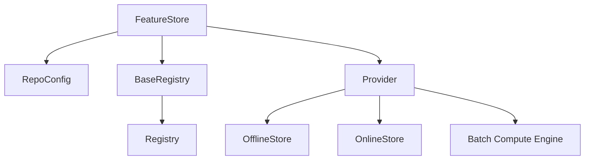
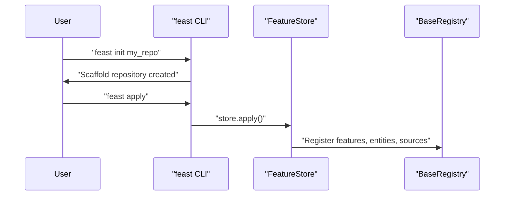
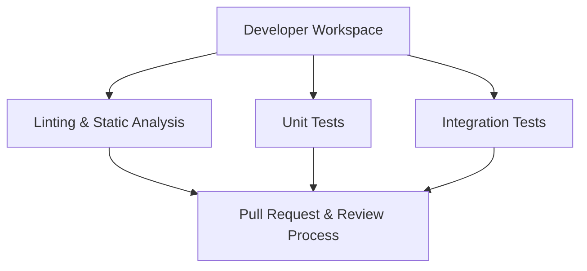

<!-- source: DeepWiki mcp.deepwiki.com · repo feast-dev/feast · page 1 Overview · fetched 2026-10-21 -->

# Overview

Relevant source files

The following files were used as context for generating this wiki page:

- [CONTRIBUTING.md](CONTRIBUTING.md)
- [README.md](README.md)
- [docs/README.md](docs/README.md)
- [docs/SUMMARY.md](docs/SUMMARY.md)
- [docs/adr/ADR-0011-data-quality-monitoring.md](docs/adr/ADR-0011-data-quality-monitoring.md)
- [docs/blog/feast-0-18-adds-snowflake-support-and-data-quality-monitoring.md](docs/blog/feast-0-18-adds-snowflake-support-and-data-quality-monitoring.md)
- [docs/community.md](docs/community.md)
- [docs/getting-started/concepts/dataset.md](docs/getting-started/concepts/dataset.md)
- [docs/getting-started/third-party-integrations.md](docs/getting-started/third-party-integrations.md)
- [docs/reference/codebase-structure.md](docs/reference/codebase-structure.md)
- [docs/reference/data-sources/README.md](docs/reference/data-sources/README.md)
- [docs/reference/dqm.md](docs/reference/dqm.md)
- [docs/reference/offline-stores/README.md](docs/reference/offline-stores/README.md)
- [docs/reference/online-stores/README.md](docs/reference/online-stores/README.md)
- [docs/reference/providers/README.md](docs/reference/providers/README.md)
- [docs/roadmap.md](docs/roadmap.md)
- [infra/templates/README.md.jinja2](infra/templates/README.md.jinja2)
- [infra/website/docs/blog/feast-mlflow-kubeflow.md](infra/website/docs/blog/feast-mlflow-kubeflow.md)
- [sdk/python/feast/errors.py](sdk/python/feast/errors.py)
- [sdk/python/feast/feature_store.py](sdk/python/feast/feature_store.py)
- [sdk/python/feast/infra/online_stores/online_store.py](sdk/python/feast/infra/online_stores/online_store.py)
- [sdk/python/feast/infra/online_stores/sqlite.py](sdk/python/feast/infra/online_stores/sqlite.py)
- [sdk/python/feast/infra/passthrough_provider.py](sdk/python/feast/infra/passthrough_provider.py)
- [sdk/python/feast/infra/provider.py](sdk/python/feast/infra/provider.py)
- [sdk/python/feast/repo_config.py](sdk/python/feast/repo_config.py)
- [sdk/python/feast/repo_operations.py](sdk/python/feast/repo_operations.py)
- [sdk/python/tests/foo_provider.py](sdk/python/tests/foo_provider.py)

## Purpose and Scope

This document provides a high-level introduction to Feast (Fea**t**ure **St**ore), an open-source operational machine learning data system for managing and serving features for machine learning [sdk/python/feast/feature_store.py:164-174](), [README.md:29-38](). Feast acts as a configurable operational data system that bridges the gap between batch data pipelines and real-time online inference infrastructure [docs/README.md:13-14]().

As a parent page, this document summarizes Feast's core purpose, high-level architecture, quickstart workflows, and contribution guidelines. For comprehensive details, please refer to the dedicated child pages:
- For architectural deep dives and data flow patterns, see **[System Architecture](#1.1)**.
- For installation guides, feature repository initialization, and CLI commands, see **[Getting Started and CLI](#1.2)**.
- For developer environment setup, testing frameworks, and governance, see **[Contributing and Development Setup](#1.3)**.

Sources: [sdk/python/feast/feature_store.py:164-174](), [README.md:29-38](), [docs/README.md:13-14](), [docs/SUMMARY.md:3-49]()

## What is Feast?

Feast is designed to solve fundamental operational challenges in production machine learning pipelines. By providing a unified metadata registry and abstraction layer across offline and online storage systems, Feast helps machine learning platform teams achieve consistency, prevent data leakage, and decouple models from underlying data infrastructure [README.md:32-37]().

Concretely, Feast manages:
- An **offline store** for historical feature extraction used in model training and batch scoring [docs/README.md:9-10]().
- An **online store** for low-latency feature serving powering real-time inference [docs/README.md:10-11]().
- A **feature server** and Python SDK for querying and materializing features consistently [docs/README.md:18-20]().

Sources: [README.md:32-37](), [docs/README.md:9-20]()

---

## 1.1. System Architecture

Feast's architecture centers around the `FeatureStore` class [sdk/python/feast/feature_store.py:164-182](), which coordinates metadata stored in registry implementations such as `BaseRegistry` [sdk/python/feast/infra/registry/base_registry.py]() and the `Registry` itself, combined with the execution delegation through the `Provider` interface [sdk/python/feast/infra/provider.py:51-64](). 

The provider implements integration with various offline and online stores, plus batch compute engines and orchestration components configured via the `RepoConfig` object derived from `feature_store.yaml` [sdk/python/feast/repo_config.py:39-112](). This config-driven plugin model enables Feast to support multiple storage and compute backends transparently.

Key architectural components include:
- **Registry(s):** Persist feature metadata and definitions, serving as the source of truth
- **Offline Stores:** Systems such as BigQuery or Snowflake for historical, batch feature retrieval
- **Online Stores:** Low-latency key-value stores like Redis or DynamoDB for serving features in real time
- **Batch Compute Engines:** Orchestrate materialization of features from offline to online stores
- **Feature Server and SDK:** Query features consistently for training and serving workflows

Diagram: High-Level Feast Architecture and Code Entity Mapping

Sources: [sdk/python/feast/feature_store.py:164-182](), [sdk/python/feast/repo_config.py:39-112](), [sdk/python/feast/infra/provider.py:51-64]()

For details on the high-level architecture, registry topologies, store integrations, and data flow patterns governed by `feature_store.yaml`, see **[System Architecture](#1.1)**.

---

## 1.2. Getting Started and CLI

Getting started with Feast involves installing the Python package [README.md:47-50](), initializing a feature repository using the CLI command `feast init` [README.md:52-56](), registering feature definitions into the registry via `feast apply` [README.md:57-60](), and then using the SDK or feature server to retrieve features for training or online serving [README.md:70-156]().

Typical workflow steps include:
1. Installing Feast with `pip install feast`
2. Creating a feature repo scaffold with `feast init my_repo`
3. Defining feature entities, feature views, and sources as Python files
4. Running `feast apply` to register definitions in the metadata registry
5. Materializing features from offline to online stores
6. Reading features during batch training or online inference via SDK or feature server

Diagram: CLI Workflow and Registry Registration

Sources: [README.md:47-60](), [sdk/python/feast/feature_store.py](), [docs/SUMMARY.md:3-49]()

For a step-by-step guide on installation, repository bootstrapping, CLI commands (`feast init`, `feast apply`, `feast serve`), and basic configuration, see **[Getting Started and CLI](#1.2)**.

---

## 1.3. Contributing and Development Setup

Contributing to Feast requires setting up a local development environment, running unit and integration tests, and adhering to repository standards including governance and code ownership [CONTRIBUTING.md:1-3](), [docs/community.md](). Feast provides scripts and templates for streamlined development and testing.

The contribution workflow typically involves:
- Cloning the repository and installing development dependencies
- Running test suites that cover diverse backend configurations
- Using linters and formatters to maintain code quality
- Following contribution guidelines including PR reviews and governance

Diagram: Development and Testing Workflow

Sources: [README.md:10-14](), [CONTRIBUTING.md:1-3](), [docs/community.md]()

For comprehensive instructions on setting up your environment, running tests, understanding PR guidelines, and exploring community resources, see **[Contributing and Development Setup](#1.3)**.

---

