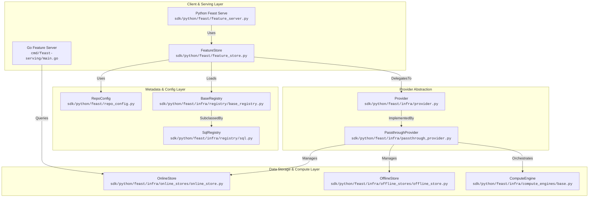

<!-- source: DeepWiki mcp.deepwiki.com · repo feast-dev/feast · page 1.1 System Architecture · fetched 2026-10-21 -->

# System Architecture

<details>
<summary>Relevant source files</summary>

The following files were used as context for generating this wiki page:

- [.gitbook.yaml](.gitbook.yaml)
- [CONTRIBUTING.md](CONTRIBUTING.md)
- [README.md](README.md)
- [docs/README.md](docs/README.md)
- [docs/SUMMARY.md](docs/SUMMARY.md)
- [docs/adr/ADR-0011-data-quality-monitoring.md](docs/adr/ADR-0011-data-quality-monitoring.md)
- [docs/blog/feast-0-18-adds-snowflake-support-and-data-quality-monitoring.md](docs/blog/feast-0-18-adds-snowflake-support-and-data-quality-monitoring.md)
- [docs/community.md](docs/community.md)
- [docs/getting-started/architecture/push-vs-pull-model.md](docs/getting-started/architecture/push-vs-pull-model.md)
- [docs/getting-started/architecture/write-patterns.md](docs/getting-started/architecture/write-patterns.md)
- [docs/getting-started/components/README.md](docs/getting-started/components/README.md)
- [docs/getting-started/components/feature-server.md](docs/getting-started/components/feature-server.md)
- [docs/getting-started/components/online-store.md](docs/getting-started/components/online-store.md)
- [docs/getting-started/components/open-telemetry.md](docs/getting-started/components/open-telemetry.md)
- [docs/getting-started/components/overview.md](docs/getting-started/components/overview.md)
- [docs/getting-started/concepts/data-ingestion.md](docs/getting-started/concepts/data-ingestion.md)
- [docs/getting-started/concepts/dataset.md](docs/getting-started/concepts/dataset.md)
- [docs/getting-started/concepts/label-view.md](docs/getting-started/concepts/label-view.md)
- [docs/getting-started/concepts/point-in-time-joins.md](docs/getting-started/concepts/point-in-time-joins.md)
- [docs/getting-started/third-party-integrations.md](docs/getting-started/third-party-integrations.md)
- [docs/how-to-guides/customizing-feast/README.md](docs/how-to-guides/customizing-feast/README.md)
- [docs/reference/beta-on-demand-feature-view.md](docs/reference/beta-on-demand-feature-view.md)
- [docs/reference/codebase-structure.md](docs/reference/codebase-structure.md)
- [docs/reference/data-sources/README.md](docs/reference/data-sources/README.md)
- [docs/reference/dqm.md](docs/reference/dqm.md)
- [docs/reference/feature-repository.md](docs/reference/feature-repository.md)
- [docs/reference/feature-repository/README.md](docs/reference/feature-repository/README.md)
- [docs/reference/offline-stores/README.md](docs/reference/offline-stores/README.md)
- [docs/reference/online-stores/README.md](docs/reference/online-stores/README.md)
- [docs/reference/providers/README.md](docs/reference/providers/README.md)
- [docs/roadmap.md](docs/roadmap.md)
- [infra/templates/README.md.jinja2](infra/templates/README.md.jinja2)
- [infra/website/docs/blog/feast-mlflow-kubeflow.md](infra/website/docs/blog/feast-mlflow-kubeflow.md)
- [infra/website/docs/blog/feast-openai-compatible-api.md](infra/website/docs/blog/feast-openai-compatible-api.md)
- [infra/website/public/images/blog/feast-openai-compat-flow.png](infra/website/public/images/blog/feast-openai-compat-flow.png)
- [sdk/python/feast/errors.py](sdk/python/feast/errors.py)
- [sdk/python/feast/feature_store.py](sdk/python/feast/feature_store.py)
- [sdk/python/feast/infra/online_stores/online_store.py](sdk/python/feast/infra/online_stores/online_store.py)
- [sdk/python/feast/infra/online_stores/sqlite.py](sdk/python/feast/infra/online_stores/sqlite.py)
- [sdk/python/feast/infra/passthrough_provider.py](sdk/python/feast/infra/passthrough_provider.py)
- [sdk/python/feast/infra/provider.py](sdk/python/feast/infra/provider.py)
- [sdk/python/feast/repo_config.py](sdk/python/feast/repo_config.py)
- [sdk/python/feast/repo_operations.py](sdk/python/feast/repo_operations.py)
- [sdk/python/tests/foo_provider.py](sdk/python/tests/foo_provider.py)
- [sdk/python/tests/unit/test_on_demand_feature_view_input_schema.py](sdk/python/tests/unit/test_on_demand_feature_view_input_schema.py)

</details>


## Purpose and Scope

This document describes the high-level architecture of Feast, an open-source operational machine learning data system designed for managing, storing, and serving machine learning features with strict point-in-time correctness. It details how the core components—the Registry (`BaseRegistry`), Offline Stores (`OfflineStore`), Online Stores (`OnlineStore`), Feature Servers, and Compute Engines—interact via the provider model (`Provider`). Furthermore, it explains how declarations in `feature_store.yaml` are parsed into repository configurations (`RepoConfig`) to dynamically wire these components together at runtime [sdk/python/feast/feature_store.py:164-190](), [sdk/python/feast/repo_config.py:30-122](), [sdk/python/feast/infra/provider.py:51-130]().

Sources:  
[sdk/python/feast/feature_store.py:164-190]()  
[sdk/python/feast/repo_config.py:30-122]()  
[sdk/python/feast/infra/provider.py:51-130]()

---

## Layered Architecture and Component Wiring

Feast adopts a modular, layered architecture that isolates metadata management, storage backends, and compute execution. At the core of the Python SDK is the `FeatureStore` class (`sdk/python/feast/feature_store.py`), which orchestrates feature creation, materialization, and retrieval operations by delegating backend-specific tasks to an implementation of the `Provider` interface (`sdk/python/feast/infra/provider.py`) [sdk/python/feast/feature_store.py:164-190](), [sdk/python/feast/infra/provider.py:51-130]().

### System Architecture to Code Entity Mapping

The following diagram bridges natural language architectural concepts to their concrete Python code entities across the codebase:



Sources:  
[sdk/python/feast/feature_store.py:164-190]()  
[sdk/python/feast/repo_config.py:30-122]()  
[sdk/python/feast/infra/provider.py:51-130]()  
[sdk/python/feast/infra/passthrough_provider.py:58-131]()

---

## Component Responsibilities and Implementation

### 1. Client & Orchestration Layer
- **`FeatureStore` (`sdk/python/feast/feature_store.py`)**: The primary entry point for users interacting with Feast. It coordinates operations such as `feast apply`, `get_historical_features()`, `get_online_features()`, and `materialize()`. Internally, it loads the feature store configuration (`RepoConfig`), initializes the `BaseRegistry` for metadata, and instantiates the `Provider` implementation for backend orchestration [sdk/python/feast/feature_store.py:164-190]().

- **CLI & Repository Operations (`sdk/python/feast/repo_operations.py`)**: Responsible for parsing user-defined Feast objects (e.g., `Entity`, `FeatureView`, `DataSource`) by scanning Python files in the feature repository. Implements `parse_repo()` which collects these objects into a `RepoContents` structure used for schema diffs and updates [sdk/python/feast/repo_operations.py:115-178]().

### 2. Metadata Layer (Registry)
- **`BaseRegistry` (`sdk/python/feast/infra/registry/base_registry.py`)**: Abstract interface for storing and retrieving feature and entity metadata objects. Supports different storage backends.

- **Concrete Registries**:  
  - `Registry` (`sdk/python/feast/infra/registry/registry.py`): Default registry backed by files and optionally object stores like S3 or GCS.  
  - `SqlRegistry` (`sdk/python/feast/infra/registry/sql.py`): Registry backed by SQL relational databases.  
  - `SnowflakeRegistry`, `RemoteRegistry`: Other concrete registry implementations for specific backends.

### 3. Provider & Storage Abstractions
- **`Provider` Interface (`sdk/python/feast/infra/provider.py`)**: Defines contracts for  
  - Updating and tearing down infrastructure (`update_infra()`, `teardown_infra()`),  
  - Online batch writes (`online_write_batch()` and async variant),  
  - Providing access to offline and online stores, and batch compute engines.

- **`PassthroughProvider` (`sdk/python/feast/infra/passthrough_provider.py`)**: The standard provider used by default. Delegates responsibilities directly to instantiated `OfflineStore`, `OnlineStore`, and `ComputeEngine` components based on the repo configuration. Manages initialization of these subcomponents lazily and forwards materialization, reading, and writing operations [sdk/python/feast/infra/passthrough_provider.py:59-188]().

### 4. Offline Store (`OfflineStore`)
- Manages historical feature data for training. Provides point-in-time correct feature retrieval through a `RetrievalJob`.
- Examples include BigQuery, Snowflake, Redshift, Dask, Spark, DuckDB, and file-based stores.

### 5. Online Store (`OnlineStore`)
- Supports low-latency feature retrieval for model inference.
- Defines interfaces for reading and writing batches of entities and features.
- Implementations include Redis, DynamoDB, SQLite, Postgres, Snowflake, and various vector stores.
- Is queried by feature servers like the Go and Python feature servers for serving online features at runtime.

### 6. Feature Servers
- Serve online features via HTTP/gRPC APIs.
- The Python feature server wraps the `FeatureStore` SDK for serving.
- The Go feature server provides a lightweight, standalone serving solution.
- Both serve features from online stores, sometimes caching feature data or orchestrating calls to the underlying storage layers.

Sources:  
[sdk/python/feast/feature_store.py:164-190]()  
[sdk/python/feast/repo_operations.py:115-178]()  
[sdk/python/feast/infra/provider.py:51-130]()  
[sdk/python/feast/infra/passthrough_provider.py:59-188]()  
[sdk/python/feast/infra/online_stores/online_store.py:44-167]()

---

## Data Flow Patterns and Execution Flow

### 1. Feature Registration (Control Plane)
- When a user runs `feast apply`, Feast scans the repository folder using `parse_repo()` to gather all declared Feast objects (`Entity`, `FeatureView`, `FeatureService`, etc.) into a `RepoContents` object [sdk/python/feast/repo_operations.py:115-178]().
- A diff is performed between the current registry state and the desired state, resulting in commands to add, update, or delete entities and feature views.
- The `Provider.update_infra()` method reconciles the cloud or local infrastructure by creating or deleting tables or other resources in the configured online and offline stores [sdk/python/feast/infra/provider.py:70-94]().

### 2. Historical Feature Retrieval (Training Data)
- Training datasets are created via `FeatureStore.get_historical_features()`.
- This delegates to the offline store via the `Provider`, using point-in-time join operations to guarantee no data leakage.
- The offline store returns a `RetrievalJob`, which fetches and processes the necessary data for model training [sdk/python/feast/infra/provider.py:29-30]().

### 3. Online Feature Retrieval (Inference)
- Real-time feature retrieval is done using `FeatureStore.get_online_features()` which queries the online store managed by the provider.
- The online store returns an `OnlineResponse` containing feature values for each entity requested.
- Feature servers (Go/Python) utilize this low-latency retrieval path to serve features in production environments [sdk/python/feast/infra/online_stores/online_store.py:107-167]().

### 4. Materialization

- Materialization loads offline feature data into the online store for low-latency serving.
- Users invoke `FeatureStore.materialize()` initiating a materialization job via the provider’s batch compute engine.
- The compute engine reads relevant historical data slices from the offline store, then writes feature rows in batches to the online store.
- This ensures online store freshness and point-in-time consistency.

### Materialization Data Flow Diagram

```mermaid
sequenceDiagram
    participant Client as "FeatureStore"
    participant Prov as "PassthroughProvider"
    participant Engine as "ComputeEngine"
    participant Off as "OfflineStore"
    participant On as "OnlineStore"

    Client->>Prov: "materialize(start_date, end_date)"
    Prov->>Engine: "run materialization task"
    Engine->>Off: "pull historical feature slice"
    Off-->>Engine: "feature dataframe / batch"
    Engine->>On: "online_write_batch(table, data)"
    On-->>Client: "write complete"
```

Sources:  
[sdk/python/feast/feature_store.py:164-190]()  
[sdk/python/feast/infra/passthrough_provider.py:58-188]()  
[sdk/python/feast/infra/online_stores/online_store.py:54-128]()

---

## Wiring via `feature_store.yaml` and `RepoConfig`

Feast’s architecture is configured declaratively through the `feature_store.yaml` file in a feature repository. This file defines key parameters like the backend provider, registry, offline store, online store, and batch engine configurations.

- The Python `RepoConfig` class parses this YAML file and maps string identifiers to precise Python classes using internal mapping dictionaries, enabling Feast to dynamically instantiate correct backends at runtime [sdk/python/feast/repo_config.py:30-122]().

### Backend Class Mapping Table

| Configuration Field    | YAML Key Example | Mapped Python Class / Module                                                                                       |
|-----------------------|------------------|------------------------------------------------------------------------------------------------------------------|
| `provider`            | `local`          | `feast.infra.passthrough_provider.PassthroughProvider` [sdk/python/feast/infra/provider.py:42-48]()              |
| `registry`            | `sql`            | `feast.infra.registry.sql.SqlRegistry` [sdk/python/feast/repo_config.py:39-44]()                                |
| `online_store.type`   | `redis`          | `feast.infra.online_stores.redis.RedisOnlineStore` [sdk/python/feast/repo_config.py:69-92]()                    |
| `offline_store.type`  | `bigquery`       | `feast.infra.offline_stores.bigquery.BigQueryOfflineStore` [sdk/python/feast/repo_config.py:94-112]()           |

The provider (`Provider`) reads the `RepoConfig` and constructs or delegates to the corresponding offline/online store and batch engine implementations, wiring together the entire Feast stack without users needing to write boilerplate code.

Sources:  
[sdk/python/feast/repo_config.py:30-122]()  
[sdk/python/feast/infra/provider.py:42-48]()

---

This design allows Feast to be highly extensible, with new providers, stores, registries, or compute engines added by simply registering new class mappings and dependencies, all controlled via simple YAML configuration.

# End of Document

---

